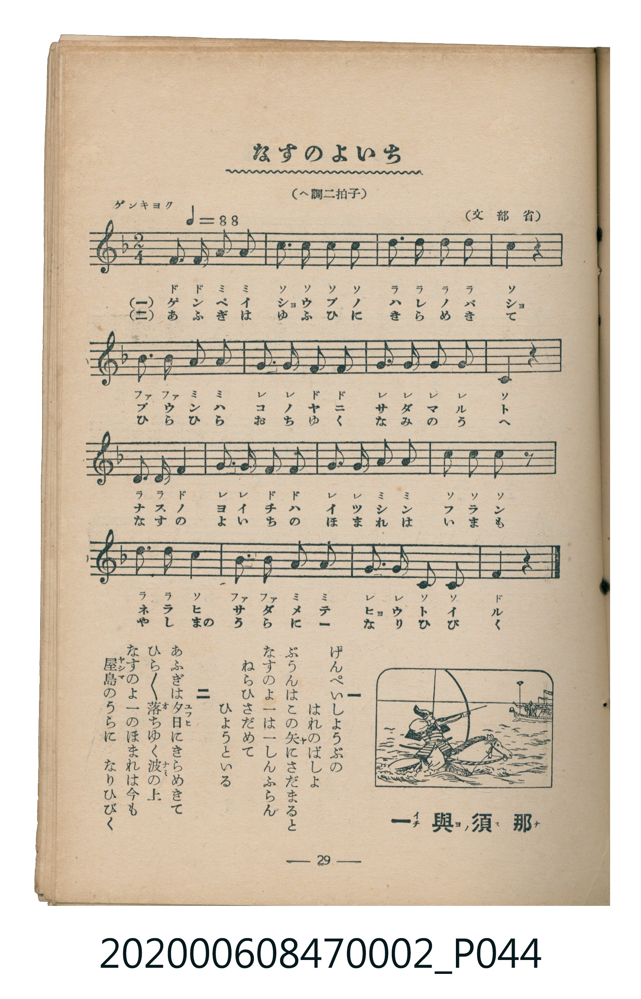

# なすのよいち（那須與一）

> Re:Shōka 使用 AI 協助辨識與重建樂譜，可能會有錯誤。歡迎回報。

- **NEUTRINO 歌聲合成版**：<br><audio controls src="nasu_no_yoichi_neutrino.mp3"></audio>
- **鋼琴伴奏版**：<br><audio controls src="nasu_no_yoichi.mp3"></audio>


- 文部省
- 臺灣教育會公認《新定兒童唱歌》尋常科第二學年用（2020.006.0847.0002）

## 說明

曲目說明
中文解釋：描寫源平故事中的武將那須與一，在海上射中扇子的英勇事蹟。

原書資訊與歌詞全文（對應 P044.jpg，書頁 p. 29，第三學期第 2 首）：
調性與拍號：ヘ調二拍子（F 大調 2/4 拍），「ゲンキヨク（♩＝88）」


## 歌詞

```text
一
げんぺいしようぶの　はれのばしよ
ぶうんはこの矢にさだまると
なすのよ一は一しんふらん
ねらひさだめて　ひようといる

二
あふぎは夕日にきらめきて
ひら／＼落ちゆく波の上
なすのよ一のほまれは今も
屋島のうらに　なりひびく
```

## ABC

```abc
X:1
T:なすのよいち（那須與一）
M:2/4
L:1/16
Q:1/4=88
K:F
V:V1 name="Piano" snm="Pia"
[V:V1]
F3 F A2 A2 | c3 c c2 c2 | d3 d d2 d2 | c4 z4 |
w: 1.~げ ん ぺ い | しよ う ぶ の | は れ の ば | しよ
w: 2.~あ ふ ぎ は | ゆ ふ ひ に | き ら め き | て
B3 B A2 A2 | G3 G F2 F2 | G3 G G2 G2 | C4 z4 |
w: 1.~ぶ う ん は | こ の や に | さ だ ま る | と
w: 2.~ひ ら ひ ら | お ち ゆ く | な み の う | へ
D3 D F2 F2 | G3 G F2 F2 | G3 G A2 A2 | c3 c c2 z2 |
w: 1.~な す の _ | よ い ち は | い つ し ん | ふ ら ん
w: 2.~な す の _ | よ い ち の | ほ ま れ は | い ま も
d3 d c2 B2 | B3 B A2 A2 | G3 G C2 C2 | F4 z4 |
w: 1.~ね ら ひ さ | だ め て _ | ひよ う と い | る
w: 2.~や し まの う | ら に _ _ | な り ひ び | く
```

## TMD 檔案連結

- [主旋律 TMD 檔案](nasu_no_yoichi.tmd) [[在 TMD Studio 編輯](https://tmdlang.github.io/Tmd-TS/#tmd=s7IKdvYPcrWy4qpTUCpJTLdSSM7PyUlNLsnMz7MqzsjMK0nNjM_KTMmPL87Iz05Ugisry88pzU21Si9KTEmNN4o3MjAyiDcwMIs3sDAxBzIMjBBKi_NLi5JTrYqTM_Lzc-JLUitKkvLzsxHyBUX5Zal5iXlANQVFIBtTwIoQClLLMlNSQdKpKZkl-UWZiTlI7kgtKga7FWxJfElRYl5xclFmAcgDCFUlGalAx6bl52Tn5BelootnZBYDja1ECAPtSM_Ms8rNz0sqBfpbiUtLS-Fx46rHjTMfN6573NTxuLHlcePC93s6XjYtfrmg40VH-5MdDe_3dCpoaXEp2ipYWHDZ2yq4cdkY6ZvYgQx9Nq39ZfOK53MawVa8aN_1vHHxs6kzXzRtejan-Wnrmhereh83dD2btuHpullPWyc9X7306ZSNz9b2PG7ofrqh--mOHc-XT3y-Zs2TXT1P1-54unPL8ykrgJaDwlwPGOZ6oDAHMgyMgE5Q4tLXUng2e9Pz2eterFr1bEYfl4KCwpMda4FOeLF88cv27vd7Zj3r73-6fvWzXROe7tz8bGrrk13dQAXPZ7U8W7vs6YZ2VD_1PJ2z4tnW7U92dD3d0AIyp7P96doJQMUvujc-7W4H6n2xc_7jhiYuLX0ukNW21AIgdz_tm_9s9o4Xm9tfrOgCOggYIi9WznvaugLoGaD_n27ofdbeqRBgYGKil1WQDnQrUPHLBY0KBXoKRpZALijIdnQCg-zZnPlAtoKRwstl04BhBAwCkOkvVu1_1rAcZG5374uZ84Gij5tnAAWBwQwUAfoSaIebwtMly4FiCsCoVACKgnUD46XncdOmx82bHzetfdy84nHTeqDSRzNXvt8z18ICqORxQy8XJNwbQNTjxkmPmyY_btwFTjfTwQmo7XHjNlBiamh43Lj-cVMPiN24ASIL0QOUbgNrW_-4EUiuez5_0ePG1Y8bpz5uXPC4cd_jpu7HjSsgShEpE2gjUAOYBJoE1Lb1cVMnkAFRtxbEadwENaOp8XHjMrADNsGctALkwqZuiON39UB0NYFMaewDmvt0ydRn05eCXdELNhdoQi_QEIg6oCnAwOl_v2fPiwl7gfnjcRPQxP5nm4HOXgdMP1idCvT0brBngAGw_snursdNTeCI39j9dDM4fEBhAHTzarA7Vz1u6gK7fzPQYJA6ypMZFCiAkq9fYnGpX35kfmZyRqZVQGZiXr5DjUFNNcgiBRtDMy07MKtGwVBBFwgNFYyBJAjXKJiCRUzBNAjXKJiBRczANAjD1OgqGEDpGrBpPoY1oPQBFgHGE5C9C8RqbAHrgaQHiGRjGyhRgFnroJLrodp6oGLAFISuTVchHtU-I5B0E9TIrUDcB2aBjALKNLUhyWwCs1ZDjeyFWtYJxI1gGZAISGYZVptqFEzAPBOkcDICixiBQxCEESIgGoSB4QQzBltAgfwPDQtgYCE5vBHEg4TN4yZQ4CEcPhUqswCI94G90A2VWYEniECeh3oXEhBAFkRXF9S8hdDgAqZFqMwqqMx-eHyA5EEyO3AEkRlEAEhhBgmmCPYEBwon5DCCuWIm1BVg-4BuhaWjFrDbkcMOFF4g_hJQygH7FRSaIJmtiFAAi4GcixxKxNsFS7O7oTL7wOkWmytAMqAEirALkZ1A_gUlK3yJC5yAwAQsq2JPS2sRfoMmdVBKAcksgMo0IiVucJpAzYyg5APPqeBEhSMxgRMkSO10kPfQ0gY4XcHSK8IuaMg2dcFdtxkqA0ptqBbVcnHp2ikgF18KQL4yFwA)]
- [鋼琴伴奏 TMD 檔案](nasu_no_yoichi_piano.tmd) [[在 TMD Studio 編輯](https://tmdlang.github.io/Tmd-TS/#tmd=s7IKdvYPcrWy4tLSUnjcuOpx48zHjeseN3U8bmx53Ljw_Z6Ol917nk_Y8mTPlqdL-593drzf06mgpcWlaKtgYcFlb6vgxmVjpG9ix1WnoPRsWvvL5hXP5zQqgXgv2nc9b1z8bOrMF02bns1pftq65sWq3scNXc-mbXi6btbT1knPVy99OmXjs7U9jxu6n27ofrpjx_PlE5-vWfNkV8_TtTue7tzyfMoKoP1GBkYGegYGZnoGFibmQIaBEdAJSlxcfonFpX75kfmZyRmZVgGZiXn5QR4ONQY11VwKQGBjaKZlB2bVKBgq6AKhoYIxkAThGgVTsIgpmAbhGgUzsIgZmAZhmBpdBQMoXQM2zcewBhhMk8Aij5smA9m7QKzGFrCex43TgUEHkWxsA-JtYNY6qOR6qLYeqNjjxg3o2nQV4lHtMwJJN0GN3ArEfWAWyCigTFMbkswmMGs11MheqGWdQNwIlgGJgGSWYbWpRsEEzDNBCicjsIgROARBGCECokEYGE4wY7AFFMj_0LAABhaSwxtBPEjYPG4CBR7C4VOhMguAeB_YC91QmRV4ggjkeah3IQEBZEF0dUHNWwgNrseN_VCZVVCZ_fD4AMmDZHbgCCIziACQwgwSTBHsCQ4UTshhBHPFTKgrwPYB3QpLRy1gtyOHHSi8QPwloJQD9isoNEEyWxGhABYDORc5lIi3C5Zmd0Nl9oHTLTZXgGRACRRhFyI7gfwLSlb4Ehc4AYEJWFbFnpbWIvwGTeqglAKSWQCVaURK3OA0gZoZQckHnlPBiQpHYgInSJDa6SDvoaUNcLqCpVeEXdCQbeqCu24zVAaU2lAtqsVWevkgl14miMIrXiHaMBaZYQJkmEBFDBCZFyZtGo_CMo2HMZHV4lAMswjVWLBlqOZDTIWqBHpH104B2UfRPkClGGJGYDFlLgA)]

## 分析

```text
================================================================================
📊 TMD Song Profile: [ なすのよいち（那須與一） ]
================================================================================
⏱  Duration:       0:21 (21.8s), 16 measures total
🎼 Key & Tempo:    首調基準 F, != 88.0 BPM, <2/4>
   - 分析範圍：      由實際發聲的音符與和弦推測調性；播放脈絡另行呈現
🎤 人聲音域:    C4 (MIDI 60) – D5 (MIDI 74) [跨度: 14 個半音 / 1.2 個八度, 難度: moderate]
   - 最低音:  C4 in [NasuNoYoichi #1 @ m.8, 0:09]
   - 最高音: D5 in [NasuNoYoichi #1 @ m.3, 0:02]
   - 適合: soprano, mezzo-soprano, contralto, tenor, baritone, bass
🏛  結構:      NasuNoYoichi (21.8s)
⚡ 編曲密度:        Peak 1 軌道同時演奏
🗝  調性診斷：       F 調性不明確（純淨自然大調，未偵測到可信轉調）
   - 風格氣質:    純淨自然大調（陽光明朗、易唱易記，無明顯調外色彩）
   - 轉調歷程:    全曲維持單一推測調性（未偵測到可信轉調）
   - 核心骨幹音:  C, G, F, D, A
   - 調性數值:    F 調性不明確 [相關度: 0.82, 穩定度: Ambiguous, 自然音純度: 100.0%]
   - 候選調性 (K-S): F 大調 (0.82), C 大調 (0.79), G 小調 (0.56)
   - 五度圈歷程:   -1
   - 各段落調性細節:
     • [NasuNoYoichi #1]: F 調性不明確 (r: 0.82, 自然音純度: 100.0%)

  [ 五度圈游移軌跡 ]
               C  
        [F ]*          G  
      Bb               D  
      Eb               A  
         Ab           E  
            Db       B  
               F# 
     (* = active key center)

  [ 十二半音累積音高分佈 ]
     C  : ████████████████████████  24.6%
     C# :                            0.0%
     D  : ██████████████            14.0%
     D# :                            0.0%
     E  :                            0.0%
     F  : █████████████████         17.5%
     F# :                            0.0%
     G  : █████████████████████     21.1%
     G# :                            0.0%
     A  : ██████████████            14.0%
     A# : █████████                  8.8%
     B  :                            0.0%
--------------------------------------------------------------------------------
Assignment 軌道音域：
  - Piano         : C4 – D5 (14 個半音 / 1.2 個八度, 54 個音符)
================================================================================
```


## 原書掃描頁




