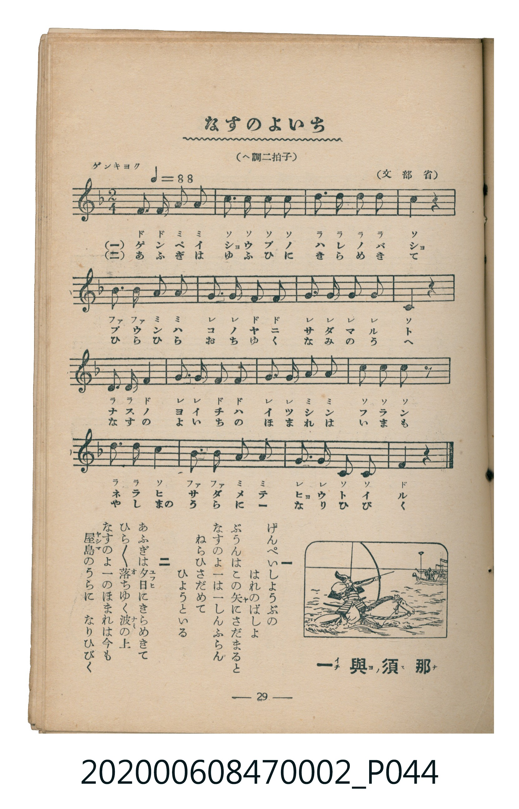

# なすのよいち

<audio controls src="nasu_no_yoichi.mp3"></audio>

- 文部省
- 臺灣教育會公認《新定兒童唱歌》尋常科第二學年用（2020.006.0847.0002）

## 說明

原書資訊與歌詞全文（對應 P044.jpg，書頁 p. 29，第三學期第 2 首）：
調性與拍號：ヘ調二拍子（F 大調 2/4 拍），「ゲンキヨク（♩＝88）」

## 歌詞

```text
一
げんぺいしようぶの　はれのばしよ
ぶうんはこの矢にさだまると
なすのよ一は一しんふらん
ねらひさだめて　ひようといる

二
あふぎは夕日にきらめきて
ひら／＼落ちゆく波の上
なすのよ一のほまれは今も
屋島のうらに　なりひびく
```

## 原書掃描頁



## 分析

```text
================================================================================
📊 TMD Song Profile: [ なすのよいち ]
================================================================================
⏱  Duration:       0:21 (21.8s), 16 measures total
🎼 Key & Tempo:    首調基準 F, != 88.0 BPM, <2/4>
   - 分析範圍：      由實際發聲的音符與和弦推測調性；播放脈絡另行呈現
🎤 人聲音域:    C4 (MIDI 60) – D5 (MIDI 74) [跨度: 14 個半音 / 1.2 個八度, 難度: moderate]
   - 最低音:  C4 in [NasuNoYoichi #1 @ m.8, 0:09]
   - 最高音: D5 in [NasuNoYoichi #1 @ m.3, 0:02]
   - 適合: soprano, mezzo-soprano, contralto, tenor, baritone, bass
🏛  結構:      NasuNoYoichi (21.8s)
⚡ 編曲密度:        Peak 1 軌道同時演奏
🗝  調性診斷：       F 調性不明確（純淨自然大調，未偵測到可信轉調）
   - 風格氣質:    純淨自然大調（陽光明朗、易唱易記，無明顯調外色彩）
   - 轉調歷程:    全曲維持單一推測調性（未偵測到可信轉調）
   - 核心骨幹音:  C, G, F, D, A
   - 調性數值:    F 調性不明確 [相關度: 0.82, 穩定度: Ambiguous, 自然音純度: 100.0%]
   - 候選調性 (K-S): F 大調 (0.82), C 大調 (0.79), G 小調 (0.56)
   - 五度圈歷程:   -1
   - 各段落調性細節:
     • [NasuNoYoichi #1]: F 調性不明確 (r: 0.82, 自然音純度: 100.0%)

  [ 五度圈游移軌跡 ]
               C  
        [F ]*          G  
      Bb               D  
      Eb               A  
         Ab           E  
            Db       B  
               F# 
     (* = active key center)

  [ 十二半音累積音高分佈 ]
     C  : ████████████████████████  24.6%
     C# :                            0.0%
     D  : ██████████████            14.0%
     D# :                            0.0%
     E  :                            0.0%
     F  : █████████████████         17.5%
     F# :                            0.0%
     G  : █████████████████████     21.1%
     G# :                            0.0%
     A  : ██████████████            14.0%
     A# : █████████                  8.8%
     B  :                            0.0%
--------------------------------------------------------------------------------
Assignment 軌道音域：
  - Piano         : C4 – D5 (14 個半音 / 1.2 個八度, 54 個音符)
================================================================================
```

## ABC

```abc
X:1
T:なすのよいち
C:TMD (Chen, Chih-Han / aguai)
M:2/4
L:1/16
Q:1/4=88
K:F
V:V1 name="Piano" snm="Pia"
[V:V1]
f3 f a2 a2 | c3 c c2 c2 | d3 d d2 d2 | c4 z4 |
b3 b a2 a2 | g3 g f2 f2 | g3 g g2 g2 | c4 z4 |
d3 d f2 f2 | g3 g f2 f2 | g3 g a2 a2 | c3 c c2 z2 |
d3 d c2 b2 | b3 b a2 a2 | g3 g c2 c2 | f4 z4 |
```

- [主旋律 TMD 檔案](nasu_no_yoichi.tmd)
- [鋼琴伴奏 TMD 檔案](nasu_no_yoichi_piano.tmd)
