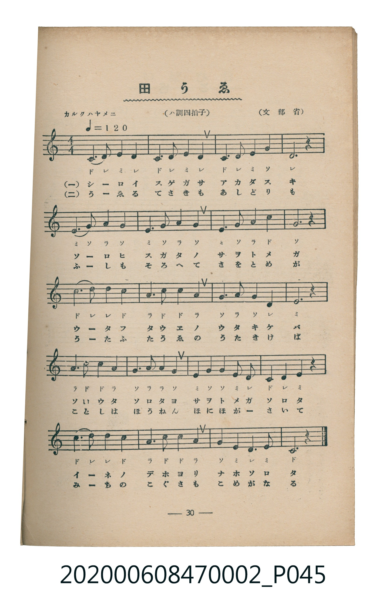

# 田うゑ

<audio controls src="taue.mp3"></audio>

- 文部省
- 臺灣教育會公認《新定兒童唱歌》尋常科第二學年用（2020.006.0847.0002）

- note

原書資訊與歌詞全文（對應 P045.jpg，書頁 p. 30，第三學期第 3 首）：
調性與拍號：ハ調四拍子（C 大調 4/4 拍），「カルク ハヤメニ（♩＝120）」

## 歌詞

```text
一
しろいすげがさ　あかだすき
そろひすがたの　さをとめが
うたふ田うゑの　うたきけば
そろたそろたよ　さをとめが
そろたいねの　でほよりも

二
うゑるてさきも　あしどりも
ふしもそろへて　さをとめが
うたふ田うゑの　うたきけば
ことしはほうねん　ほにほがさいて
みちのこぐさも　こめがなる
```

## 原書掃描頁



## 調性分析

```text
================================================================================
📊 TMD Song Profile: [ 田うゑ ]
================================================================================
⏱  Duration:       0:40 (40.0s), 20 measures total
🎼 Key & Tempo:    首調基準 C, != 120.0 BPM, <4/4>
   - 分析範圍：      由實際發聲的音符與和弦推測調性；播放脈絡另行呈現
🎤 人聲音域:    C4 (MIDI 60) – D5 (MIDI 74) [跨度: 14 個半音 / 1.2 個八度, 難度: moderate]
   - 最低音:  C4 in [Taue #1 @ m.1, 0:00]
   - 最高音: D5 in [Taue #1 @ m.9, 0:16]
   - 適合: soprano, mezzo-soprano, contralto, tenor, baritone, bass
🏛  結構:      Taue (40.0s)
⚡ 編曲密度:        Peak 1 軌道同時演奏
🗝  調性診斷：       C 大調（純淨自然大調，未偵測到可信轉調）
   - 風格氣質:    純淨自然大調（陽光明朗、易唱易記，無明顯調外色彩）
   - 轉調歷程:    全曲維持單一推測調性（未偵測到可信轉調）
   - 核心骨幹音:  C, G, D, E, A
   - 調性數值:    C 大調 [相關度: 0.83, 穩定度: Moderate, 自然音純度: 100.0%]
   - 候選調性 (K-S): C 大調 (0.83), G 大調 (0.74), A 小調 (0.66)
   - 五度圈歷程:   +0
   - 各段落調性細節:
     • [Taue #1]: C 大調 (r: 0.83, 自然音純度: 100.0%)

  [ 五度圈游移軌跡 ]
              [C ]*
         F            G  
      Bb               D  
      Eb               A  
         Ab           E  
            Db       B  
               F# 
     (* = active key center)

  [ 十二半音累積音高分佈 ]
     C  : ████████████████████████  24.7%
     C# :                            0.0%
     D  : ███████████████████       19.3%
     D# :                            0.0%
     E  : ██████████████████        18.0%
     F  :                            0.0%
     F# :                            0.0%
     G  : █████████████████████     21.3%
     G# :                            0.0%
     A  : ████████████████          16.7%
     A# :                            0.0%
     B  :                            0.0%
--------------------------------------------------------------------------------
Assignment 軌道音域：
  - Piano         : C4 – D5 (14 個半音 / 1.2 個八度, 68 個音符)
================================================================================
```

## ABC

```abc
X:1
T:田うゑ
C:TMD (Chen, Chih-Han / aguai)
M:4/4
L:1/16
Q:1/4=120
K:C

V:V1 name="Piano" snm="Pia"

[V:V1]
c6 d2 e4 d4 | c4 d4 e4 d4 | c4 d4 e4 g4 | d12 z4 |
e6 g2 a4 g4 | e4 g4 a4 g4 | e4 g4 a4 c4 | g12 z4 |
c6 d2 d4 c4 | a4 c4 c4 a4 | g4 a4 g4 d4 | e12 z4 |
a6 c2 c4 a4 | g6 a2 a4 g4 | e4 g4 g4 e2 d2 | c4 d4 e4 z4 |
c6 d2 d4 c4 | a6 c2 c4 a4 | g4 e4 d6 e2 | c12 z4 |
```

- [主旋律 TMD 檔案](taue.tmd)
- [鋼琴伴奏 TMD 檔案](taue_piano.tmd)
