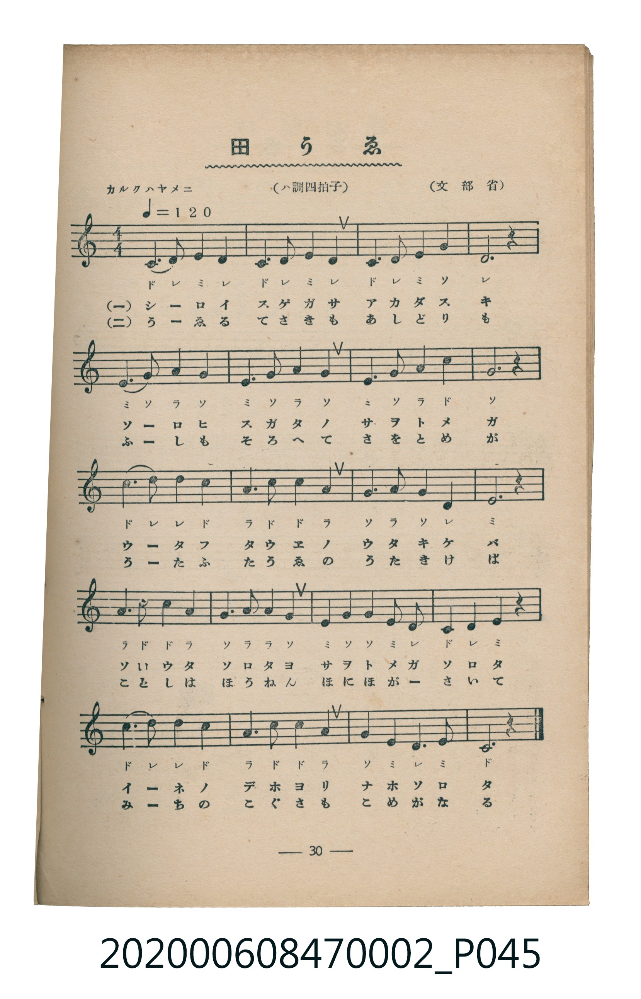

# 田うゑ

> Re:Shōka 使用 AI 協助辨識與重建樂譜，可能會有錯誤。歡迎[回報](https://github.com/TMDLang/reshoka/issues)。

- **鋼琴伴奏版**：<br><audio controls src="taue.mp3"></audio>
- **NEUTRINO 歌聲合成版**：<br><audio controls src="taue_neutrino.mp3"></audio>

- 文部省
- 臺灣教育會公認《新定兒童唱歌》尋常科第二學年用（2020.006.0847.0002）

## 說明

原書資訊與歌詞全文（對應 P045.jpg，書頁 p. 30，第三學期第 3 首）：
調性與拍號：ハ調四拍子（C 大調 4/4 拍），「カルク ハヤメニ（♩＝120）」


## 歌詞

```text
一
しろいすげがさ　あかだすき
そろひすがたの　さをとめが
うたふ田うゑの　うたきけば
そろたそろたよ　さをとめが
そろたいねの　でほよりも

二
うゑるてさきも　あしどりも
ふしもそろへて　さをとめが
うたふ田うゑの　うたきけば
ことしはほうねん　ほにほがさいて
みちのこぐさも　こめがなる
```

## ABC

<div class="abc-score" data-abc-src="taue.abc" aria-label="五線譜載入中"></div>

[下載 ABC 原始檔](taue.abc)

## TMD 檔案連結

- [主旋律 TMD 檔案](taue.tmd) [[在 TMD Studio 編輯](https://tmdlang.github.io/Tmd-TS/#tmd=s7IKdvYPcrWy4qpTUCpJTLdSSM7PyUlNLsnMz7MqzsjMK0nNjM_KTMmPL87Iz05Ugisry88pzU21Si9KTEmNN4o3MjAyiDcwMIs3sDAxBzIMjBBKi_NLi5JTrYqTM_Lzc-JLUitKkvLzsxHyBUX5Zal5iXlANQVFIBtTwIoQClLLMlNSQdKpKZkl-UWZiTlI7kgtKga7FWxJfElRYl5xclFmAcgDCFUlGalAx5bnFyFZCzQoPTPPKjc_L6kU6DlkiZKMfKDHCjIqrTIyi0E2JifmxGcn5iH5H2pfQWJ6qlWAgYmpEpeWlsLzKRseN7Y9bpqooKXFpWirYGhkwGVvq-DMZWOib2IH0vtsWvvL5hXP5zSCTXrRvut54-JnU2e-aNr0bE7z09Y1L1b1Pm7oejZtw9N1s562Tnq-eunTKRufre153ND9dEP30x07ni-f-HzNmie7ep6u3fF055bnU1a839MBCn09YOjrgUIfyDAwer-nU4mLS19LwZZagEtBQeFp3_xns3e82Nz-YkXXi452oLterJz3tHUF0FdAVzzd0PusvVMBFBp6WQXp7_f0ABW_XNCoUKCnYGwA5IIcvqMT6PBnc-YD2QrGCi-XTQO69P2eWSDTX6za_6xhOcjc7t4XM-cDRR839wMFn86eDRR5unYC0A5nhadLlgPFFIABqgAUBesGhk7P46bVj5tXP25arwDU9Lh5yePmhY-bu4E6Hs1c-X7PXGBMAJU-bujlAtn0ZEcDiHrcOP1xU-_jxpbHjTMfN0563NjzuHHq44aGx41Njxu7HzcuAIv3QpTOBSvdBBYCqpv_uHEdWOnUx01AnSseNzUCxSFK28DSW-GpAaYUIg40BSiyAdlUoCiM0dSBy1S4UqBz18KMXP64cTdIT1PX46YmiN92wV0BtLkJ6I1lIOOA1jY1wfw2_XHjSqgWsNKt4JAASkDs2AHSQ7nfJoO0guxaD3IkSMXax02TwaqB3NVgEhziIB8tg-jZ_7hxIchIkOYJYAdAHD0Z4obHjauAXgIppTxBQ4GClj4XV0hiKTAbZybm5TvUGNRUgyxQsLHQsgMzahQMFXSB0AiYYEGkLlQExMIuYgoWAfFg0AAkAjbNx7AGlPCg4sDwBpGNLWAdwMQF5k0Ckz1gcipUpgnM6waTC8AkSC1IBmQCDMYj7DECybXB7ZkIJkH6QeLL4GZD9APDGcUekPuAiQQs0wWRAavAtKcG7GOQn83gPoeFAXYRwziwEIiLK3jmogXPJpTggQTMfDC5DioD9koTJOBWgNmNUBmQalzBsxVmD8TD8EAA2Q-zeweYBAUYOfYAEwbIu8C0EQdCcN_DAwJMgHiQEIEFGSRRQYIWexjBoxYaEiC_gMQhPJAsNNLhYQQWg8pD_AaSB8lswBNGtLcHEhrgoEALDRAbMxGBsDEwhFAzHaE0BHIPQhwkCnVjUwdUBlvcguIVPUWAdKGH0mRoGK2AZ571UFN3Q2XagHgt2BSQWpgMsCAEkxA2KA3BXQIuFCApj7j0hC0EYQUUiAUryLCnJ5BtEJeCXQmPzeVQ0d3QkEItEIAlMpL754LDCJY6cKWo_XCbFqLYBAvDCfC4gOVHkAwkp8HyGchekBtABRqqPbVcXLp2CqASXQFIK3MBAA)]
- [鋼琴伴奏 TMD 檔案](taue_piano.tmd) [[在 TMD Studio 編輯](https://tmdlang.github.io/Tmd-TS/#tmd=s7IKdvYPcrWy4qpTUCpJTLdSyC8qychPL0osyKi0ysgsLskvykxOzInPTsxLVIIrKs4vLUpOjS9ITE-1CjAwMVXi0tJSeD5lw-PGtsdNE9_v6XjZvef5hC1P9mx5urT_eWfH-z2dClpaXIq2CoZGBlz2tgrOXDYm-iZ2IAOfTWt_2bzi-ZxGsPEv2nc9b1z8bOrMF02bns1pftq65sWq3scNXc-mbXi6btbT1knPVy99OmXjs7U9jxu6n27ofrpjx_PlE5-vWfNkV8_TtTue7tzyfMoKoAOMDIwM9AwMzPQMLEzMgQwDI6AblLi4QhJLgU7OTMzLD_JwqDGoqeZSAAIbCy07MKNGwVBBFwiNFIzBpC5UBMTCLmIKFgHxYNAAJAI2zcewRuFx43So-OOmXhDZ2ALW8bhxJpg3CUz2gMmpUJkmMK8bTC4AkyC1IBmQCTAYj7DHCCTXBrOnsQNsG0g_SHwZ3GyI_sdNIPMR9oDc97hxJVimCyIDVoFpTw3YxyA_m8F9DgsD7CKGcWAhEBdX8MxFC55NKMEDCZj5YHIdVAbslSZIwK0AsxuhMiDVuIJnKzx4wB6GBwLIfpjdO8AkKMDIsQeYMEDeBaaNOBCC-x4eEGACxIOECCzIIIkKErTYwwgRtZCQAPkFJA7hgWShkQ4PI4gYRB7it4lQmQ14woj29kBCAxwUaKEBYmMmIhA2BoYQaqYjlIZA7kGIg0ShbmwCuR5X3ILiFT1FgHShh9JkaBitgGee9VBTd0Nl2oB4LdgUkFqYzOPG1WASwgalIbhLwIUCJOURl56whSCsgAKxYAUZ9vQEsg3iUrAr4bG5HCq6GxpSqAXC48ZVSO6fCw4jWOrAlaL2w21aiGITLAwnwOMClh9BMpCcBstnIHtBbgAVaKj21CIX6D7IBboJokCPV4g2jAVTpvGxUAEQC7sIUCkwNOOhImDCABEfEAUmMHV4-CZIfBDGMMQUpgmqGkUTkAGkQM7AYQg2TVhcguJHsK9IdgpYHiWokBwDjABdOwVQHET7AIXgbCMwW5kLAA)]

## 分析

```text
================================================================================
📊 TMD Song Profile: [ 田うゑ ]
================================================================================
⏱  Duration:       0:40 (40.0s), 20 measures total
🎼 Key & Tempo:    首調基準 C, != 120.0 BPM, <4/4>
   - 分析範圍：      由實際發聲的音符與和弦推測調性；播放脈絡另行呈現
🎤 人聲音域:    C4 (MIDI 60) – D5 (MIDI 74) [跨度: 14 個半音 / 1.2 個八度, 難度: moderate]
   - 最低音:  C4 in [Taue #1 @ m.1, 0:00]
   - 最高音: D5 in [Taue #1 @ m.9, 0:16]
   - 適合: soprano, mezzo-soprano, contralto, tenor, baritone, bass
🏛  結構:      Taue (40.0s)
⚡ 編曲密度:        Peak 1 軌道同時演奏
🗝  調性診斷：       C 大調（純淨自然大調，未偵測到可信轉調）
   - 風格氣質:    純淨自然大調（陽光明朗、易唱易記，無明顯調外色彩）
   - 轉調歷程:    全曲維持單一推測調性（未偵測到可信轉調）
   - 核心骨幹音:  C, G, D, E, A
   - 調性數值:    C 大調 [相關度: 0.83, 穩定度: Moderate, 自然音純度: 100.0%]
   - 候選調性 (K-S): C 大調 (0.83), G 大調 (0.74), A 小調 (0.66)
   - 五度圈歷程:   +0
   - 各段落調性細節:
     • [Taue #1]: C 大調 (r: 0.83, 自然音純度: 100.0%)

  [ 五度圈游移軌跡 ]
              [C ]*
         F            G  
      Bb               D  
      Eb               A  
         Ab           E  
            Db       B  
               F# 
     (* = active key center)

  [ 十二半音累積音高分佈 ]
     C  : ████████████████████████  24.7%
     C# :                            0.0%
     D  : ███████████████████       19.3%
     D# :                            0.0%
     E  : ██████████████████        18.0%
     F  :                            0.0%
     F# :                            0.0%
     G  : █████████████████████     21.3%
     G# :                            0.0%
     A  : ████████████████          16.7%
     A# :                            0.0%
     B  :                            0.0%
--------------------------------------------------------------------------------
Assignment 軌道音域：
  - Piano         : C4 – D5 (14 個半音 / 1.2 個八度, 68 個音符)
================================================================================
```


## 原書掃描頁




