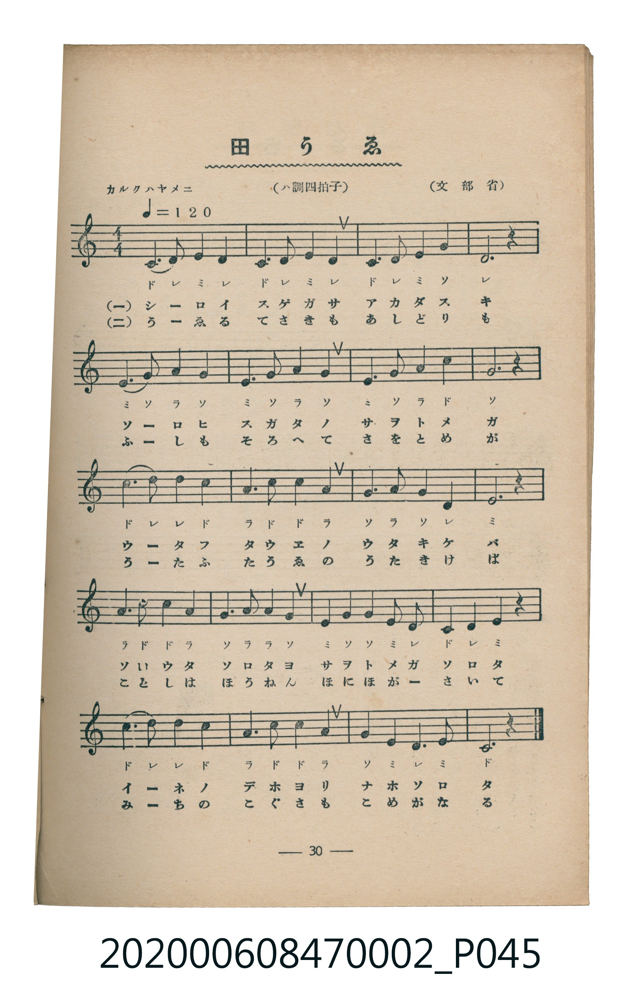

# 田うゑ

> Re:Shōka 使用 AI 協助辨識與重建樂譜，可能會有錯誤。歡迎回報。

- **NEUTRINO 歌聲合成版**：<br><audio controls src="taue_neutrino.mp3"></audio>
- **鋼琴伴奏版**：<br><audio controls src="taue.mp3"></audio>


- 文部省
- 臺灣教育會公認《新定兒童唱歌》尋常科第二學年用（2020.006.0847.0002）

## 說明

原書資訊與歌詞全文（對應 P045.jpg，書頁 p. 30，第三學期第 3 首）：
調性與拍號：ハ調四拍子（C 大調 4/4 拍），「カルク ハヤメニ（♩＝120）」


## 跨冊／重複收錄參照

> 同曲＋同名異曲（《公學校唱歌》第三學年、《公學校唱歌集》與《新定兒童唱歌》第二學年為同曲；《共益商社唱歌教科書》卷二〈田植〉為同名異曲）

- **[同名異曲]** 《共益商社唱歌教科書》卷二・教師用（明治33年／1900）：[**〈田植〉**](../../../kyoeki_shoka/kan_2_854863/4_taue/index.md)（`G` / `4/4` — [原始 TMD](../../../kyoeki_shoka/kan_2_854863/4_taue/taue.tmd)）
- 總表：[跨冊重複與同名歌曲總索引](../../../duplicate_songs.md)

## 歌詞

```text
一
しろいすげがさ　あかだすき
そろひすがたの　さをとめが
うたふ田うゑの　うたきけば
そろたそろたよ　さをとめが
そろたいねの　でほよりも

二
うゑるてさきも　あしどりも
ふしもそろへて　さをとめが
うたふ田うゑの　うたきけば
ことしはほうねん　ほにほがさいて
みちのこぐさも　こめがなる
```

## ABC

```abc
X:1
T:田うゑ
M:4/4
L:1/16
Q:1/4=120
K:C
V:V1 name="Piano" snm="Pia"
[V:V1]
C6 D2 E4 D4 | C4 D4 E4 D4 | C4 D4 E4 G4 | D12 z4 |
w: 1.~し _ ろ い | す げ が さ | あ か だ す | き
w: 2.~う _ ゑ る | て さ き も | あ し ど り | も
E6 G2 A4 G4 | E4 G4 A4 G4 | E4 G4 A4 c4 | G12 z4 |
w: 1.~そ _ ろ ひ | す が た の | さ を と め | が
w: 2.~ふ _ し も | そ ろ へ て | さ を と め | が
c6 d2 d4 c4 | A4 c4 c4 A4 | G4 A4 G4 D4 | E12 z4 |
w: 1.~う _ た ふ | た う ゑ の | う た き け | ば
w: 2.~う _ た ふ | た う ゑ の | う た き け | ば
A6 c2 c4 A4 | G6 A2 A4 G4 | E4 G4 G4 E2 D2 | C4 D4 E4 z4 |
w: 1.~そ _ ろ た | そ ろ た よ | さ を と め が | そ ろ た
w: 2.~こ と し は | ほ う ね ん | ほ に ほ が _ | さ い て
c6 d2 d4 c4 | A6 c2 c4 A4 | G4 E4 D6 E2 | C12 z4 |
w: 1.~い _ ね の | で ほ よ り | も な ほ ろ | た
w: 2.~み _ ち の | こ ぐ さ も | こ め が な | る
```

## TMD 檔案連結

- [主旋律 TMD 檔案](taue.tmd) [[在 TMD Studio 編輯](https://tmdlang.github.io/Tmd-TS/#tmd=s7IKdvYPcrWy4qpTUCpJTLdSSM7PyUlNLsnMz7MqzsjMK0nNjM_KTMmPL87Iz05Ugisry88pzU21Si9KTEmNN4o3MjAyiDcwMIs3sDAxBzIMjBBKi_NLi5JTrYqTM_Lzc-JLUitKkvLzsxHyBUX5Zal5iXlANQVFIBtTwIoQClLLMlNSQdKpKZkl-UWZiTlI7kgtKga7FWxJfElRYl5xclFmAcgDCFUlGalAx5bnFwGt1dJSeD5lw-PGtsdNExW0tLgUbRUMjQy47G0VnLlsTPRN7EC6nk1rf9m84vmcRrAZL9p3PW9c_GzqzBdNm57NaX7auubFqt7HDV3Ppm14um7W09ZJz1cvfTpl47O1PY8bup9u6H66Y8fz5ROfr1nzZFfP07U7nu7c8nzKivd7OkChpAcMJT1QKAEZBkbv93QqcXHpaynYUgtwKSgoPO2b_2z2jheb21-s6HrR0Q5014uV8562rgD6CuiKpxt6n7V3KgQYmJjqZRWkv9_TA1T8ckGjQoGegrEBkAty-I5OoMOfzZkPZCsYK7xcNg3o0vd7ZoFMf7Fq_7OG5SBzu3tfzJwPFH3c3A8UfDp7NlDk6doJQDucFZ4uWQ4UUwAGqAJQFKwbGDo9j5tWP25e_bhpvQJQ0-PmJY-bFz5u7gbqeDRz5fs9c4ExAVT6uKGXC2TTkx0NIOpx4_THTb2PG1seN8583DjpcWPP48apjxsaHjc2PW7sfty4ACzeC1E6F6x0E1gIqG7-48Z1YKVTHzcBda543NQIFIcobQNLb4WnBphSiDjQFKDIBmRTgaIwRlMHLlPhSoHOXQszcvnjxt0gPU1dj5uaIH7bBXcF0OYmoDeWgYwDWtvUBPPb9MeNK6FawEq3gkMCKAGxYwdID-V-mwzSCrJrPciRIBVrHzdNBqsGcleDSXCIg3y0DKJn_-PGhSAjQZongB0AcfRkiBseN64CegmklPIEDQUKWvpcXCGJpalWAZmJefkONQY11SALFGwstOzAjBoFQwVdIDQCJlgQqQsVAbGwi5iCRUA8GDQAiYBN8zGsASU8qDgwvEFkYwtYBzBxgXmTwGQPmJwKlWkC87rB5AIwCVILkgGZAIPxCHuMQHJtcHsmgkmQfpD4MrjZEP3AcEaxB-Q-YCIBy3RBZMAqMO2pAfsY5GczuM9hYYBdxDAOLATi4gqeuWjBswkleCABMx9MroPKgL3SBAm4FWB2I1QGpBpX8GyF2QPxMDwQQPbD7N4BJkEBRo49wIQB8i4wbcSBENz38IAAEyAeJERgQQZJVJCgxR5G8KiFhgTILyBxCA8kC410eBiBxaDyEL-B5EEyG_CEEe3tgYQGOCjQQgPExkxEIGwMDCHUTEcoDYHcgxAHiULd2NQBlcEWt6B4RU8RIF3ooTQZGkYr4JlnPdTU3VCZNiBeCzYFpBYmAywIwSSEDUpDcJeACwVIyiMuPWELQVgBBWLBCjLs6QlkG8SlYFfCY3M5VHQ3NKRQCwRgiYzk_rngMIKlDlwpaj_cpoUoNsHCcAI8LmD5ESQDyWmwfAayF-QGUIGGak8tF5eunQKoRFcA0spcAA)]
- [鋼琴伴奏 TMD 檔案](taue_piano.tmd) [[在 TMD Studio 編輯](https://tmdlang.github.io/Tmd-TS/#tmd=s7IKdvYPcrWy4tLSUng-ZcPjxrbHTRPf7-l42b3n-YQtT_Zsebq0_3lnx_s9nQpaWlyKtgqGRgZc9rYKzlw2Jvomdlx1CkrPprW_bF7xfE6jEoj3on3X88bFz6bOfNG06dmc5qeta16s6n3c0PVs2oan62Y9bZ30fPXSp1M2Plvb87ih--mG7qc7djxfPvH5mjVPdvU8Xbvj6c4tz6esADrAyMDIQM_AwEzPwMLEHMgwMAK6QYmLKySxNNUqIDMxLz_Iw6HGoKaaSwEIbCy07MCMGgVDBV0gNFIwBpO6UBEQC7uIKVgExINBA5AI2DQfwxqFx43ToeKPm3pBZGMLWMfjxplg3iQw2QMmp0JlmsC8bjC5AEyC1IJkQCbAYDzCHiOQXBvcnolgEqQfJL4MbjZE_-MmkPkIe0Due9y4EizTBZEBq8C0pwbsY5CfzeA-h4UBdhHDOLAQiIsreOaiBc8mlOCBBMx8MLkOKgP2ShMk4FaA2Y1QGZBqXMGzFWYPxMPwQADZD7N7B5gEBRg59gATBsi7wLQRB0Jw38MDAkyAeJAQgQUZJFFBghZ7GMGjFhoSIL-AxCE8kCw00uFhBBaDykP8BpIHyWzAE0a0twcSGuCgQAsNEBszEYGwMTCEUDMdoTQEcg9CHCQKdWNTB1QGW9yC4hU9RYB0oYfSZGgYrYBnnvVQU3dDZdqAeC3YFJBamMzjxtVgEsIGpSG4S8CFAiTlEZeesIUgrIACsWAFGfb0BLIN4lKwK-GxuRwquhsaUqgFwuPGVUjunwsOI1jqwJWi9sNtWohiEywMJ8DjApYfQTKQnAbLZyB7QW4AFWio9tQiF-g-yAW6CaJAj1eINowFU6bxsVABEAu7CFApMDTjoSJgwgARHxAFJjB1ePgmSHwQxjDEFKYJqhpFE5ABpEDOwGEINk1YXILiR7CvSHYKWB4lqJAcA4wAXTsFUBxE-wCF4GwjMFuZCwA)]

## 分析

```text
================================================================================
📊 TMD Song Profile: [ 田うゑ ]
================================================================================
⏱  Duration:       0:40 (40.0s), 20 measures total
🎼 Key & Tempo:    首調基準 C, != 120.0 BPM, <4/4>
   - 分析範圍：      由實際發聲的音符與和弦推測調性；播放脈絡另行呈現
🎤 人聲音域:    C4 (MIDI 60) – D5 (MIDI 74) [跨度: 14 個半音 / 1.2 個八度, 難度: moderate]
   - 最低音:  C4 in [Taue #1 @ m.1, 0:00]
   - 最高音: D5 in [Taue #1 @ m.9, 0:16]
   - 適合: soprano, mezzo-soprano, contralto, tenor, baritone, bass
🏛  結構:      Taue (40.0s)
⚡ 編曲密度:        Peak 1 軌道同時演奏
🗝  調性診斷：       C 大調（純淨自然大調，未偵測到可信轉調）
   - 風格氣質:    純淨自然大調（陽光明朗、易唱易記，無明顯調外色彩）
   - 轉調歷程:    全曲維持單一推測調性（未偵測到可信轉調）
   - 核心骨幹音:  C, G, D, E, A
   - 調性數值:    C 大調 [相關度: 0.83, 穩定度: Moderate, 自然音純度: 100.0%]
   - 候選調性 (K-S): C 大調 (0.83), G 大調 (0.74), A 小調 (0.66)
   - 五度圈歷程:   +0
   - 各段落調性細節:
     • [Taue #1]: C 大調 (r: 0.83, 自然音純度: 100.0%)

  [ 五度圈游移軌跡 ]
              [C ]*
         F            G  
      Bb               D  
      Eb               A  
         Ab           E  
            Db       B  
               F# 
     (* = active key center)

  [ 十二半音累積音高分佈 ]
     C  : ████████████████████████  24.7%
     C# :                            0.0%
     D  : ███████████████████       19.3%
     D# :                            0.0%
     E  : ██████████████████        18.0%
     F  :                            0.0%
     F# :                            0.0%
     G  : █████████████████████     21.3%
     G# :                            0.0%
     A  : ████████████████          16.7%
     A# :                            0.0%
     B  :                            0.0%
--------------------------------------------------------------------------------
Assignment 軌道音域：
  - Piano         : C4 – D5 (14 個半音 / 1.2 個八度, 68 個音符)
================================================================================
```


## 原書掃描頁




