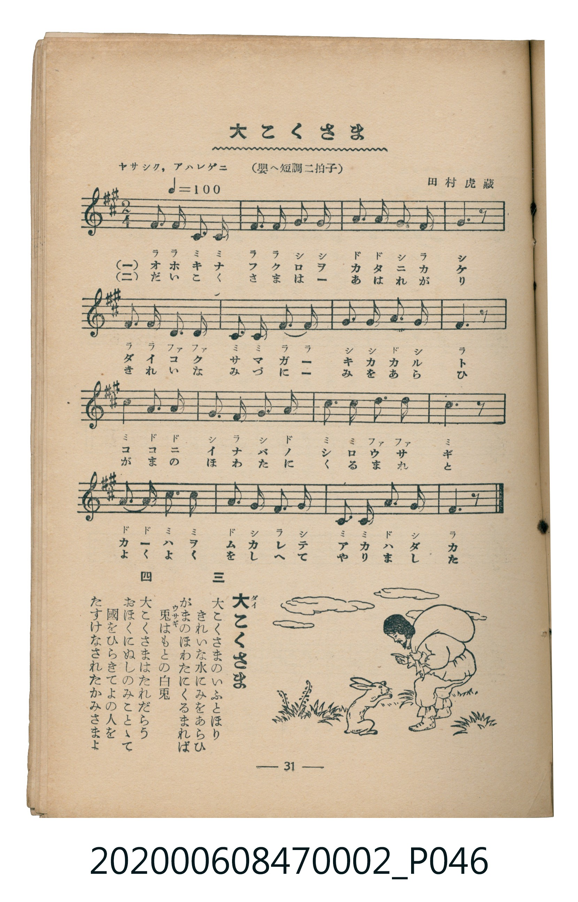

# 大こくさま

<audio controls src="daikoku_sama.mp3"></audio>

- 曲：田村虎藏
- 臺灣教育會公認《新定兒童唱歌》尋常科第二學年用（2020.006.0847.0002）

## 說明

原書資訊與歌詞全文（對應 P046.jpg，書頁 p. 31，第三學期第 4 首）：
調性與拍號：嬰ヘ短調二拍子（F# 小調 / 關係調 A 大調 2/4 拍），「ヤサシク，アハレゲニ（♩＝100）」

## 歌詞

```text
一
おほきなふくろをかたにかけ
だいこくさまがきかかれば
ここにいなばのしらうさぎ
かはをむかれしあかはだか

二
だいこくさまはあはれがり
きれいなみづにみをあらひ
がまのほわたにくるまれと
よくよくをしへてやりました

三
大こくさまのいふとほり
きれいな水にみをあらひ
がまのほわたにくるまれば
兎はもとの白兎

四
大こくさまはたれだらう
おほくにぬしのみことゝて
國をひらきてよの人を
たすけなされたかみさまよ
```

## ABC

```abc
X:1
T:大こくさま
C:曲：田村虎藏
M:2/4
L:1/16
Q:1/4=100
K:A
V:V1 name="Piano" snm="Pia"
[V:V1]
F2 F2 C2 C2 | F2 F2 G2 G2 | A2 A2 G2 F2 | G6 z2 |
F2 F2 D2 D2 | C2 C2 F2 F2 | G2 G2 A2 G2 | F6 z2 |
c4 A2 A2 | G2 F2 G2 A2 | c2 c2 d2 d2 | c6 z2 |
A2 A2 c2 c2 | A2 G2 F2 G2 | C2 C2 A2 G2 | F6 z2 |
```

## TMD 檔案連結

- [主旋律 TMD 檔案](daikoku_sama.tmd) [[在 TMD Studio 編輯](https://tmdlang.github.io/Tmd-TS/#tmd=s7IKdvYPcrWy4tLSUni6ZPnjxsmPG_sfN0593LhPQUuLS9FWwdDAgMveVsGRy8ZI38SOq05B6dnsTe_3zHo-ZcOzuRNfzOx7Mb1fCST8on3X88bFz6bOfNG06dmc5qeta16s6n3c0PVs2oan62Y9bZ30fPXSp1M2Plvb87ih--mG7qc7djxfPvH5mjVPdvU8Xbvj6c4tz6eseL-nw8jAyEDPwMBMz8DCxBzIMDB6v6dTiYtLX0vBllqAS0FB4Wnf_Gezd7zY3P5iRdeLjnagu16snPe0dcWzae1AVzzd0PusvVMhwMDETC-rIP39nh6g4pcLGhUK9BSMDYFckMN3dAId_mzOfCBbwUTh5bJpQJcCgwZk-otV-581LAeZ2937YuZ8oOjTNRseN894Pn8tUAroZaD407UTgDa5KSs83dAPFFTQV3g5fc6T_U0gtiMoOkAMYKgrANWCTQaGXM_j5iWPm7Y-btr-uGk9SKRp0ePm_sfNax43bXrc3A0079HMle_3zAVGG1DL44ZeLpBrnuxoAFGPG7seN-5-3Nj7uHHV48atoKhu6n3cNOlxY_fjxvmPG1eDGRMhShc8bmxBTg-PG3vAOoEquh83AdkbIOqAKoAIqBWoGmjqhseN6x43Tn_c1Pm4sQ2ssw-iDqhvPciupgaYAdMfNzZBxUG2dUOcuqsHl_1AZUD1QEOAeoEe74KoA3oAyIdYvv9x41KwW_aDfdUEdsUmiDqgIqAZQLftftwENBLiXWAAAO3fBzZiBVhdUwdYFEICzQA6csfjxmWPm1qANoKNAIrMh4ZqJzghoeYbsB1A5wCDdwXYMgx3PtuwhWxHggP9aWsfOByAoQG0Yt3zmXuBImAnPZ09G6uTgEE3H6x_ASRikFMDUBHQkjVgjwFtBoYhUOeKx01zgd4GGzYHGF1Ah24CawWmAGBgAINn3ZNdu4DiEJOADp0JTDngSJgKtggoAnQ00DCwA5o6QOooz7hQoKClz8XlkpiZnZ9dGpyYm2gVkJmYl-9QY1CjUA2ySMHG0EzLDsyqUTCLV9CFEMZwAlnUHE7UKBgCSRAGc8GyNRA2DBqAhDAMNoETNUiWIOShhoAJuPFQA7CZbAwVgzkHqh_hXIggSBkIm0AxQiO6gTCDYDogImiGIrsdvytrubh07RSQIkAByFXm4gIA)]
- [鋼琴伴奏 TMD 檔案](daikoku_sama_piano.tmd) [[在 TMD Studio 編輯](https://tmdlang.github.io/Tmd-TS/#tmd=s7IKdvYPcrWy4tLSUni6ZPnjxsmPG_sfN0593Ljv_Z6Ol917nk_Y8mTPlqdL-593drzf06mgpcWlaKtgaGDAZW-r4MhlY6RvYsdVp6D0bPam93tmPZ-y4dnciS9m9r2Y3q8EEn7Rvut54-JnU2e-aNr0bE7z09Y1L1b1Pm7oejZtw9N1s562Tnq-eunTKRufre153ND9dEP30x07ni-f-HzNmie7ep6u3fF055bnU1YAXWJkYGSgZ2BgpmdgYWIOZBgYAR2jxMXlkpiZnZ9dGpyYm2gVkJmYlx_k4VBjUKNQzaUABDaGZlp2YFaNglm8gi6EMIYTyKLmcKJGwRBIgjCYC5atgbBh0AAkhGGwCZyoQbIEIQ81BEzAjYcagM1kY6gYzDlQ_QjnQgRBykDYBIoRGtENhBkE0wERQTMU2e34XVmLJfx9UMLfBCn44xWizeJjYUxjBBMiagxkGiAFKlDCCC6BpAZJJ5pyJDVIFiEMwaocyTFYTAf6UNdOAcmTCkCuMhcXAA)]

## 分析

```text
================================================================================
📊 TMD Song Profile: [ 大こくさま ]
================================================================================
⏱  Duration:       0:19 (19.2s), 16 measures total
🎼 Key & Tempo:    首調基準 A, != 100.0 BPM, <2/4>
   - 分析範圍：      由實際發聲的音符與和弦推測調性；播放脈絡另行呈現
🎤 人聲音域:    C#4 (MIDI 61) – D5 (MIDI 74) [跨度: 13 個半音 / 1.1 個八度, 難度: moderate]
   - 最低音:  C#4 in [DaikokuSama #1 @ m.1, 0:00]
   - 最高音: D5 in [DaikokuSama #1 @ m.11, 0:12]
   - 適合: soprano, mezzo-soprano, contralto, tenor, baritone, bass
🏛  結構:      DaikokuSama (19.2s)
⚡ 編曲密度:        Peak 1 軌道同時演奏
🗝  調性診斷：       F# 小調（純淨自然小調，未偵測到可信轉調）
   - 風格氣質:    純淨自然小調（陰鬱抒情、旋律集中，無明顯調外色彩）
   - 轉調歷程:    全曲維持單一推測調性（未偵測到可信轉調）
   - 核心骨幹音:  F#, C#, G#, A, D
   - 調性數值:    F# 小調 [相關度: 0.82, 穩定度: High, 自然音純度: 100.0%]
   - 候選調性 (K-S): F# 小調 (0.82), C# 大調 (0.61), F# 大調 (0.58)
   - 五度圈歷程:   +6
   - 各段落調性細節:
     • [DaikokuSama #1]: F# 小調 (r: 0.82, 自然音純度: 100.0%)

  [ 五度圈游移軌跡 ]
               C  
         F            G  
      Bb               D  
      Eb               A  
         Ab           E  
            Db       B  
              [F#]*
     (* = active key center)

  [ 十二半音累積音高分佈 ]
     C  :                            0.0%
     C# : █████████████████████     25.0%
     D  : ██████                     6.7%
     D# :                            0.0%
     E  :                            0.0%
     F  :                            0.0%
     F# : ████████████████████████  28.3%
     G  :                            0.0%
     G# : ████████████████████      23.3%
     A  : ██████████████            16.7%
     A# :                            0.0%
     B  :                            0.0%
--------------------------------------------------------------------------------
Assignment 軌道音域：
  - Piano         : C#4 – D5 (13 個半音 / 1.1 個八度, 51 個音符)
================================================================================
```


## 原書掃描頁




