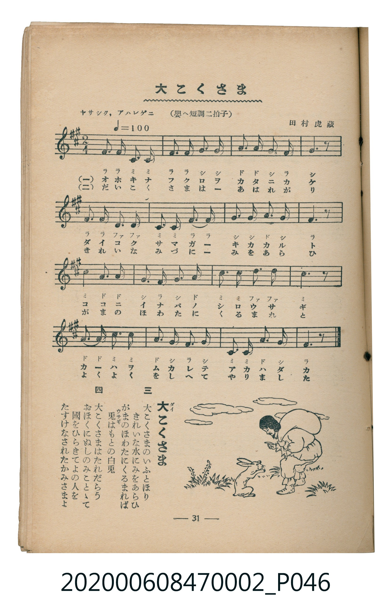

# 大こくさま

> Re:Shōka 使用 AI 協助辨識與重建樂譜，可能會有錯誤。歡迎[回報](https://github.com/TMDLang/reshoka/issues)。

- **鋼琴伴奏版**：<br><audio controls src="daikoku_sama.mp3"></audio>
- **NEUTRINO 歌聲合成版**：<br><audio controls src="daikoku_sama_neutrino.mp3"></audio>

- 曲：田村虎藏
- 臺灣教育會公認《新定兒童唱歌》尋常科第二學年用（2020.006.0847.0002）

## 說明

原書資訊與歌詞全文（對應 P046.jpg，書頁 p. 31，第三學期第 4 首）：
調性與拍號：嬰ヘ短調二拍子（F# 小調 / 關係調 A 大調 2/4 拍），「ヤサシク，アハレゲニ（♩＝100）」


## 歌詞

```text
一
おほきなふくろをかたにかけ
だいこくさまがきかかれば
ここにいなばのしらうさぎ
かはをむかれしあかはだか

二
だいこくさまはあはれがり
きれいなみづにみをあらひ
がまのほわたにくるまれと
よくよくをしへてやりました

三
大こくさまのいふとほり
きれいな水にみをあらひ
がまのほわたにくるまれば
兎はもとの白兎

四
大こくさまはたれだらう
おほくにぬしのみことゝて
國をひらきてよの人を
たすけなされたかみさまよ
```

## ABC

<div class="abc-score" data-abc-src="daikoku_sama.abc" aria-label="五線譜載入中"></div>

[下載 ABC 原始檔](daikoku_sama.abc)

## TMD 檔案連結

- [主旋律 TMD 檔案](daikoku_sama.tmd) [[在 TMD Studio 編輯](https://tmdlang.github.io/Tmd-TS/#tmd=s7IKdvYPcrWy4qpTUCpJTLdSSM7PyUlNLsnMz7MqzsjMK0nNjM_KTMmPL87Iz05Ugisry88pzU21Si9KTEmNN4o3MjAyiDcwMIs3sDAxBzIMjBBKi_NLi5JTrYqTM_Lzc-JLUitKkvLzsxHyBUX5Zal5iXlANQVFIBtTwIoQClLLMlNSQdKpKZkl-UWZiTlI7kgtKga7FWxJfElRYl5xclFmAcgDCFUlGalAx6bl52Tn5BeloosXpeZkpqOoB1qSnplnlZuamZWJxcX5RSUZ-UCvF2RUWmVkFoPclJyYE5-dmIcUQlAXFSSmp1oFGJiYKXFpaSk8XbL8cePkx439jxunPm7cp6ClxaVoq2BoYMBlb6vgyGVjpG9iBzLh2exN7_fMej5lw7O5E1_M7HsxvR9s8Iv2Xc8bFz-bOvNF06Znc5qftq55sar3cUPXs2kbnq6b9bR10vPVS59O2fhsbc_jhu6nG7qf7tjxfPnE52vWPNnV83Ttjqc7tzyfsuL9ng5QdOkBo0sPFF1AhoHR-z2dSlxc-loKttQCXAoKCk_75j-bvePF5vYXK7pedLQD3fVi5bynrSueTWsHuuLpht5n7Z0KoMDRyypIf7-nB6j45YJGhQI9BWNDIBfk8B2dQIc_mzMfyFYwUXi5bBrQpcCgAZn-YtX-Zw3LQeZ2976YOR8o-nTNhsfNM57PXwuUAnoZKP507QSgTW7KCk839AMFFfQVXk6f82R_E4jtCIoOEAMY6gpAtWCTgSHX87h5yeOmrY-btj9uWg8SaVr0uLn_cfOax02bHjd3A817NHPl-z1zgdEG1PK4oZcL5JonOxpA1OPGrseNux839j5uXPW4cSsoqpt6HzdNetzY_bhx_uPG1WDGRIjSBY8bW5DTw-PGHrBOoIrux01A9gaIOqAKIAJqBaoGmrrhceO6x43THzd1Pm5sA-vsg6gD6lsPsqupAWbA9MeNTVBxkG3dEKfu6sFlP1AZUD3QEKBeoMe7IOqAHgDyIZbvf9y4FOyW_WBfNYFdsQmiDqgIaAbQbbsfNwGNhHgXGABA-_eBjVgBVtfUARaFkEAzgI7c8bhx2eOmFqCNYCOAIvOhodoJTkio-QZsB9A5wOBdAbYMw53PNmwh25HgQH_a2gcOB2BoAK1Y93zmXqAI2ElPZ8_G6iRg0M0H618AiRjk1ABUBLRkDdhjQJuBYQjUueJx01ygt8GGzQFGF9Chm8BagSkAGBjA4Fn3ZNcuoDjEJKBDZwJTDjgSpoItAooAHQ00DOyApg6QOsozLhQoaOlzcbkkZmbnZ5cGJ-YmWgVkJublO9QY1FSD7FGwsdCyAzNqFMziQcgYjGA8czCqUTAEQiADKFIDonWB0EChBqzRx7AGFEBAvBsUd0C8CqgIGKtA3A9MJUCRpklgkW6Q94F4NZgNEpkINgloKMQkI5DYAiBuAeUWsH6QyFQg3gfE64FqQfwmMBsYdqBkABJp6kI1xxi_Oeug5oBkQa5cAXY7FnNMiHMP0E9gtwBVNnWCRdpQzIEFpgkY1UCDGCIGDk4gAgcvWCFm2OJ2QQ_UBaBQB4UuEANdAhLZgCVkQTEBcifILEgc7QfipeAYgZgD5APjChzCUJ9swhKyVDAHHLKwNANMJUCdIJE1QDwdKYZA5oJ8DYqhFWCRZWghawzkgRInOBwhCRbEMQZCEyCEKEAP0MlAEYjBEGshHgEFGshqkAjQEUCHgyISFNggkT4sAQoKfliSAvGBnmkCeQaSyEEioAwAihigGmjErMASoOSYgxbB4ADtB5sDzF7QDLcJ6gtQ8lgGTuAdYDvAMpAABapEDVBQYIJCD8SCBykszeJLpSDngXIlMN6bGmD5HZxOpiPlW6gqYJqGqMAIVLATQd6F0BAnQlLFDrg3gBEGzKuQIJsOzYOYwQqJPFDUgewE6QO5AJSWYOmLYDSDgxUUDTOBeCI4mUDzH9hnIFthfgelVUi-hPgCZk4tF5eunQJSEawA5CpzAQA)]
- [鋼琴伴奏 TMD 檔案](daikoku_sama_piano.tmd) [[在 TMD Studio 編輯](https://tmdlang.github.io/Tmd-TS/#tmd=s7IKdvYPcrWy4qpTUCpJTLdSyC8qychPL0osyKi0ysgsLskvykxOzInPTsxLVIIrKs4vLUpOjS9ITE-1CjAwMVPi0tJSeLpk-ePGyY8b-x83Tn3cuO_9no6X3XueT9jyZM-Wp0v7n3d2vN_TqaClxaVoq2BoYMBlb6vgyGVjpG9iBzL22exN7_fMej5lw7O5E1_M7HsxvR9s24v2Xc8bFz-bOvNF06Znc5qftq55sar3cUPXs2kbnq6b9bR10vPVS59O2fhsbc_jhu6nG7qf7tjxfPnE52vWPNnV83Ttjqc7tzyfsgLoEiMDIwM9AwMzPQMLE3Mgw8AI6BglLi6XxMzs_OzS4MTcRKuAzMS8_CAPhxqDmmouBSCwsdCyAzNqFMziQcgYjGA8czCqUTAEQiADKFIDonWB0EChBqzRx7BG4XFjFxDvBuJeIF4FVPS4cSsQ9ys8bgKKNE0Ci3QD8XwgXg1mg0Qmgk0CGgoxyQgktgCIW4B4Mlg_SGQqEO8D4vVAtSB-E5j9uKkHSPeARJq6UM0xxm_OOqg5IFmQK1eA3Y7FHBPi3AP0E9gtQJVNnWCRNhRzYIFpAkY10CCGiIGDE4jAwQtWiBm2uF3QA3UBKNRBoQvEQJeARDZgCVlQTIDcCTILEkf7gXgWOEYg5gD5wLgChzDUJ5uwhCwVzAGHLCzNAFMJUCdIZA0QT0eKIZC5IF-DYmgFWGQZWsgaA3mgxAkOR0iCBXGMgdAECCEK0AN0MlAEYjDEWohHQIEGshokAnQE0OGgiAQFNkikD0uAgoIflqRAfKBnmkCegSRykAgoA4AiBqgGGjErsAQoOeagRTA4QPvB5gCzFzTDbYL6ApQ8loETeAfYDrAMJECBKlEDFBSYoNADseBBCkuz-FIpyHmgXAmM96YGWH4Hp5PpSPkWqgqYpiEqMAIV7ESQdyE0xImQVLED7g1ghAHzKiTIpkPzIGawQiIPFHUgO0H6QC4ApSVY-iIYzeBgBUXDTCCeCE4m0PwH9hnIVpjfQWkVki8hvoCZU4ulBPZBLoFNkErgeIVos_hYGNMYwYSIGgOZsFCHShjBJZDUIOlEU46kBskihCFYlSM5BovpQA_q2ikg-THaxzBWAV3ICFPIGFPIBCykzAUA)]

## 分析

```text
================================================================================
📊 TMD Song Profile: [ 大こくさま ]
================================================================================
⏱  Duration:       0:19 (19.2s), 16 measures total
🎼 Key & Tempo:    首調基準 A, != 100.0 BPM, <2/4>
   - 分析範圍：      由實際發聲的音符與和弦推測調性；播放脈絡另行呈現
🎤 人聲音域:    C#4 (MIDI 61) – D5 (MIDI 74) [跨度: 13 個半音 / 1.1 個八度, 難度: moderate]
   - 最低音:  C#4 in [DaikokuSama #1 @ m.1, 0:00]
   - 最高音: D5 in [DaikokuSama #1 @ m.11, 0:12]
   - 適合: soprano, mezzo-soprano, contralto, tenor, baritone, bass
🏛  結構:      DaikokuSama (19.2s)
⚡ 編曲密度:        Peak 1 軌道同時演奏
🗝  調性診斷：       F# 小調（純淨自然小調，未偵測到可信轉調）
   - 風格氣質:    純淨自然小調（陰鬱抒情、旋律集中，無明顯調外色彩）
   - 轉調歷程:    全曲維持單一推測調性（未偵測到可信轉調）
   - 核心骨幹音:  F#, C#, G#, A, D
   - 調性數值:    F# 小調 [相關度: 0.82, 穩定度: High, 自然音純度: 100.0%]
   - 候選調性 (K-S): F# 小調 (0.82), C# 大調 (0.61), F# 大調 (0.58)
   - 五度圈歷程:   +6
   - 各段落調性細節:
     • [DaikokuSama #1]: F# 小調 (r: 0.82, 自然音純度: 100.0%)

  [ 五度圈游移軌跡 ]
               C  
         F            G  
      Bb               D  
      Eb               A  
         Ab           E  
            Db       B  
              [F#]*
     (* = active key center)

  [ 十二半音累積音高分佈 ]
     C  :                            0.0%
     C# : █████████████████████     25.0%
     D  : ██████                     6.7%
     D# :                            0.0%
     E  :                            0.0%
     F  :                            0.0%
     F# : ████████████████████████  28.3%
     G  :                            0.0%
     G# : ████████████████████      23.3%
     A  : ██████████████            16.7%
     A# :                            0.0%
     B  :                            0.0%
--------------------------------------------------------------------------------
Assignment 軌道音域：
  - Piano         : C#4 – D5 (13 個半音 / 1.1 個八度, 51 個音符)
================================================================================
```


## 原書掃描頁




