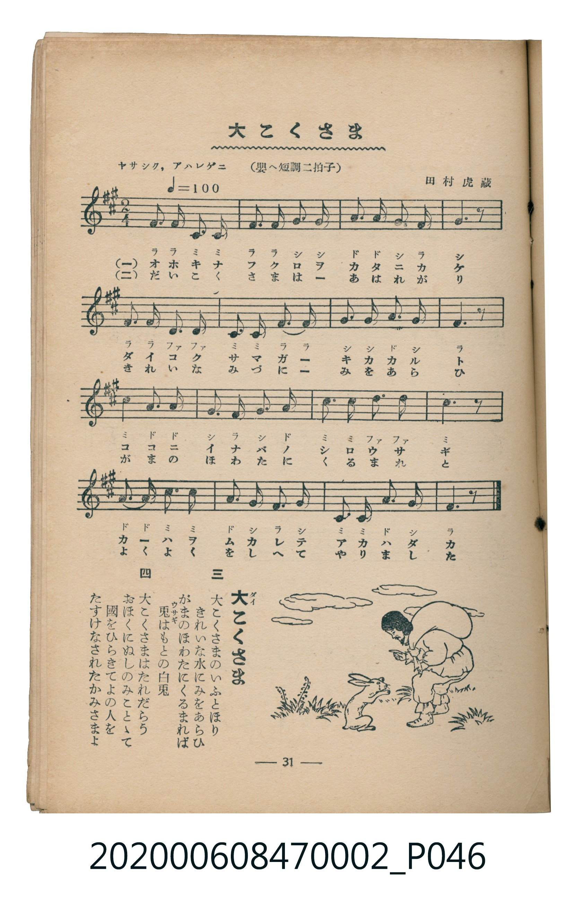

# 大こくさま

> Re:Shōka 使用 AI 協助辨識與重建樂譜，可能會有錯誤。歡迎回報。

- **NEUTRINO 歌聲合成版**：<br><audio controls src="daikoku_sama_neutrino.mp3"></audio>
- **鋼琴伴奏版**：<br><audio controls src="daikoku_sama.mp3"></audio>


- 曲：田村虎藏
- 臺灣教育會公認《新定兒童唱歌》尋常科第二學年用（2020.006.0847.0002）

## 說明

原書資訊與歌詞全文（對應 P046.jpg，書頁 p. 31，第三學期第 4 首）：
調性與拍號：嬰ヘ短調二拍子（F# 小調 / 關係調 A 大調 2/4 拍），「ヤサシク，アハレゲニ（♩＝100）」


## 歌詞

```text
一
おほきなふくろをかたにかけ
だいこくさまがきかかれば
ここにいなばのしらうさぎ
かはをむかれしあかはだか

二
だいこくさまはあはれがり
きれいなみづにみをあらひ
がまのほわたにくるまれと
よくよくをしへてやりました

三
大こくさまのいふとほり
きれいな水にみをあらひ
がまのほわたにくるまれば
兎はもとの白兎

四
大こくさまはたれだらう
おほくにぬしのみことゝて
國をひらきてよの人を
たすけなされたかみさまよ
```

## ABC

```abc
X:1
T:大こくさま
C:曲：田村虎藏
M:2/4
L:1/16
Q:1/4=100
K:A
V:V1 name="Piano" snm="Pia"
[V:V1]
F2 F2 C2 C2 | F2 F2 G2 G2 | A2 A2 G2 F2 | G6 z2 |
w: 1.~お ほ き な | ふ く ろ を | か た に か | け
w: 2.~だ い こ く | さ ま は _ | あ は れ が | り
w: 3.~だ い こ く | さ ま の _ | い ふ と ほ | り
w: 4.~だ い こ く | さ ま は _ | た れ だ ら | う
F2 F2 D2 D2 | C2 C2 F2 F2 | G2 G2 A2 G2 | F6 z2 |
w: 1.~だ い こ く | さ ま が _ | き か か れ | ば
w: 2.~き れ い な | み づ に _ | み を あ ら | ひ
w: 3.~き れ い な | み づ に _ | み を あ ら | ひ
w: 4.~お ほ く に | ぬ し の _ | み こ と と | て
c4 A2 A2 | G2 F2 G2 A2 | c2 c2 d2 d2 | c6 z2 |
w: 1.~こ こ に | い な ば の | し ら う さ | ぎ
w: 2.~が ま の | ほ わ た に | く る ま れ | と
w: 3.~が ま の | ほ わ た に | く る ま れ | ば
w: 4.~く に を | ひ ら き て | よ の ひ と | を
A2 A2 c2 c2 | A2 G2 F2 G2 | C2 C2 A2 G2 | F6 z2 |
w: 1.~か は を む | か れ し _ | あ か は だ | か
w: 2.~よ く よ く | を し へ て | や り ま し | た
w: 3.~う さ ぎ は | も と の _ | し ら う さ | ぎ
w: 4.~た す け な | さ れ た _ | か み さ ま | よ
```

## TMD 檔案連結

- [主旋律 TMD 檔案](daikoku_sama.tmd) [[在 TMD Studio 編輯](https://tmdlang.github.io/Tmd-TS/#tmd=s7IKdvYPcrWy4qpTUCpJTLdSSM7PyUlNLsnMz7MqzsjMK0nNjM_KTMmPL87Iz05Ugisry88pzU21Si9KTEmNN4o3MjAyiDcwMIs3sDAxBzIMjBBKi_NLi5JTrYqTM_Lzc-JLUitKkvLzsxHyBUX5Zal5iXlANQVFIBtTwIoQClLLMlNSQdKpKZkl-UWZiTlI7kgtKga7FWxJfElRYl5xclFmAcgDCFUlGalAx6bl52Tn5BeloosXpeZkpoPVa2kpPF2y_HHj5MeN_Y8bpz5u3KegpcWlaKtgaGDAZW-r4MhlY6RvYgfS_2z2pvd7Zj2fsuHZ3IkvZva9mN4PNvZF-67njYufTZ35omnTsznNT1vXvFjV-7ih69m0DU_XzXraOun56qVPp2x8trbncUP30w3dT3fseL584vM1a57s6nm6dsfTnVueT1nxfk8HKED1gAGqBwpQIMPA6P2eTiUuLn0tBVtqAS4FBYWnffOfzd7xYnP7ixVdLzrage56sXLe09YVz6a1A13xdEPvs_ZOhQADEzO9rIL093t6gIpfLmhUKNBTMDYEckEO39EJdPizOfOBbAUThZfLpgFdCgwakOkvVu1_1rAcZG5374uZ84GiT9dseNw84_n8tUApoJeB4k_XTgDa5Kas8HRDP1BQQV_h5fQ5T_Y3gdiOoOgAMYChrgBUCzYZGHI9j5uXPG7a-rhp--Om9SCRpkWPm_sfN6953LTpcXM30LxHM1e-3zMXGG1ALY8berlArnmyowFEPW7sety4-3Fj7-PGVY8bt4Kiuqn3cdOkx43djxvnP25cDWZMhChd8LixBTk9PG7sAesEquh-3ARkb4CoA6oAIqBWoGqgqRseN6573Dj9cVPn48Y2sM4-iDqgvvUgu5oaYAZMf9zYBBUH2dYNcequHlz2A5UB1QMNAeoFerwLog7oASAfYvn-x41LwW7ZD_ZVE9gVmyDqgIqAZgDdtvtxE9BIiHeBAQC0fx_YiBVgdU0dYFEICTQD6MgdjxuXPW5qAdoINgIoMh8aqp3ghISab8B2AJ0DDN4VYMsw3PlswxayHQkO9KetfeBwAIYG0Ip1z2fuBYqAnfR09mysTgIG3Xyw_gWQiEFODUBFQEvWgD0GtBkYhkCdKx43zQV6G2zYHGB0AR26CawVmAKAgQEMnnVPdu0CikNMAjp0JjDlgCNhKtgioAjQ0UDDwA5o6gCpozzjQoGClj4Xl0tiZnZ-dmlwYm6iVUBmYl6-Q41BTTXIHgUbQzMtOzCrRsEsXkEXQhjDCWRRczhRo2AIJEEYzAXL1kDYMGgAEgIb7GNYAwpBIB8YiGCyF0yuAmsCRj-Y1w8im8AyTZOgMt1gmflgcjWYBImAZCYi2QS2HGKTEUhuAVhlC5icDDcbJDMVzNsHJtdDdYPEm-AiwAgBs0EkUKYJ5Gos9hgTb886JHsgaiH-XQEPDzz2mJDnH3CIQX0C1t3UCZVpw2oPciSbwIkapGSAkIdGM5iAJwCoAbjinjgfgNwL8wEkhUDiH0yCfQOS2YA9pMAxD0k9EH9DbIOlsf1g3lIwCUpJMHvA4uD0Bk0F8JDahN0ecMzTwR5wzCPnGXD-AJsJklkD5k0Hk8gpDGI_JIwhKQxEgmSWYbUHGMdQMViGhsYvIsNDBEHKQNgEihEasUU4yAEgCHMKzNmIwIJEJMTxIBmwV8CBAkmkkKQBkunDHkDgCIclGeTMBhIHB1kTJMgQxQdIBlLMQBIWWA88YYECCleEU9MeHAkYHOEgXRB7wMUdvCAEJRJY6ECyBig6QQVHB9w9UFWwCAfrxRbhsIiGxShEBC3SkfM-sbkc4llIKQpO6U0NUOcjcjAkomGpFVLuIukDlxQwHTgiHeplSAAj2DAvw3LFDpRgAic8cCkLi0KQKlhZiSvaEQkRkgwhrgSZB3E5JIch5z-SkzE42iFJZyaYBNVsiPIEbDc05GAuRYQ1JLcjylBY6KDaU8vFpWungNQGUABylbkA)]
- [鋼琴伴奏 TMD 檔案](daikoku_sama_piano.tmd) [[在 TMD Studio 編輯](https://tmdlang.github.io/Tmd-TS/#tmd=s7IKdvYPcrWy4tLSUni6ZPnjxsmPG_sfN0593Ljv_Z6Ol917nk_Y8mTPlqdL-593drzf06mgpcWlaKtgaGDAZW-r4MhlY6RvYsdVp6D0bPam93tmPZ-y4dnciS9m9r2Y3q8EEn7Rvut54-JnU2e-aNr0bE7z09Y1L1b1Pm7oejZtw9N1s562Tnq-eunTKRufre153ND9dEP30x07ni-f-HzNmie7ep6u3fF055bnU1YAXWJkYGSgZ2BgpmdgYWIOZBgYAR2jxMXlkpiZnZ9dGpyYm2gVkJmYlx_k4VBjUFPNpQAENoZmWnZgVo2CWbyCLoQwhhPIouZwokbBEEiCMJgLlq2BsGHQACQENtjHsEbhcWMXkP-4cTeY7AWTq8CaHjduBfP6QWQTWKZpElSmGywzH0yuBpMgEZDMRCSbwJZDbDICyS0Aq2wBk5PhZoNkpoJ5-8DkeqhukHgTXORxUw-YDSKBMk0gV2Oxx5h4e9Yh2QNRC_HvCnh44LHHhDz_gEMM6hOw7qZOqEwbVnuQI9kETtQgJQOEPDSawQQ8AUANwBX3xPkA5F6YDyApBBL_YBLsG5DMBuwhBY55SOqB-BtiGyyN7QfzloJJUEqC2QMWB6c3aCqAh9Qm7PaAY54O9oBjHjnPgPMH2EyQzBowbzqYRE5hEPshYQxJYSASJLMMqz3AOIaKwTI0NH4RGR4iCFIGwiZQjNCILcJBDgBBmFNgzkYEFiQiIY4HyYC9Ag4USCKFJA2QTB_2AAJHOCzJIGc2kDg4yJogQYYoPkAykGIGkrDAeuAJCxRQuCKcmvbgSMDgCAfpgtgDLu7gBSEokcBCB5I1QNEJKjg64O6BqoJFOFgvtgiHRTQsRiEiaJGOnPeJzeUQz0JKUXBKb2qAOh-RgyERDUutkHIXSR-4pIDpwBHpUC9DAhjBhnkZlit2oAQTOOGBS1lYFIJUwcpKXNGOSIiQZAhxJcg8iMshOQw5_5GcjMHRDkk6M8EkqGZDlCdgu6EhB3MpIqwhuR1RhsJCB9WeWixNAB_kJoAJUgsgXiHaLD4WxjRGMCGixkCmAVKtAZQwgksgqUHSiaYcSQ2SRQhDsCpHcgwW04Ee1LVTQPJjtI9hrAK6kBGmkDGmkAlYSJkLAA)]

## 分析

```text
================================================================================
📊 TMD Song Profile: [ 大こくさま ]
================================================================================
⏱  Duration:       0:19 (19.2s), 16 measures total
🎼 Key & Tempo:    首調基準 A, != 100.0 BPM, <2/4>
   - 分析範圍：      由實際發聲的音符與和弦推測調性；播放脈絡另行呈現
🎤 人聲音域:    C#4 (MIDI 61) – D5 (MIDI 74) [跨度: 13 個半音 / 1.1 個八度, 難度: moderate]
   - 最低音:  C#4 in [DaikokuSama #1 @ m.1, 0:00]
   - 最高音: D5 in [DaikokuSama #1 @ m.11, 0:12]
   - 適合: soprano, mezzo-soprano, contralto, tenor, baritone, bass
🏛  結構:      DaikokuSama (19.2s)
⚡ 編曲密度:        Peak 1 軌道同時演奏
🗝  調性診斷：       F# 小調（純淨自然小調，未偵測到可信轉調）
   - 風格氣質:    純淨自然小調（陰鬱抒情、旋律集中，無明顯調外色彩）
   - 轉調歷程:    全曲維持單一推測調性（未偵測到可信轉調）
   - 核心骨幹音:  F#, C#, G#, A, D
   - 調性數值:    F# 小調 [相關度: 0.82, 穩定度: High, 自然音純度: 100.0%]
   - 候選調性 (K-S): F# 小調 (0.82), C# 大調 (0.61), F# 大調 (0.58)
   - 五度圈歷程:   +6
   - 各段落調性細節:
     • [DaikokuSama #1]: F# 小調 (r: 0.82, 自然音純度: 100.0%)

  [ 五度圈游移軌跡 ]
               C  
         F            G  
      Bb               D  
      Eb               A  
         Ab           E  
            Db       B  
              [F#]*
     (* = active key center)

  [ 十二半音累積音高分佈 ]
     C  :                            0.0%
     C# : █████████████████████     25.0%
     D  : ██████                     6.7%
     D# :                            0.0%
     E  :                            0.0%
     F  :                            0.0%
     F# : ████████████████████████  28.3%
     G  :                            0.0%
     G# : ████████████████████      23.3%
     A  : ██████████████            16.7%
     A# :                            0.0%
     B  :                            0.0%
--------------------------------------------------------------------------------
Assignment 軌道音域：
  - Piano         : C#4 – D5 (13 個半音 / 1.1 個八度, 51 個音符)
================================================================================
```


## 原書掃描頁




