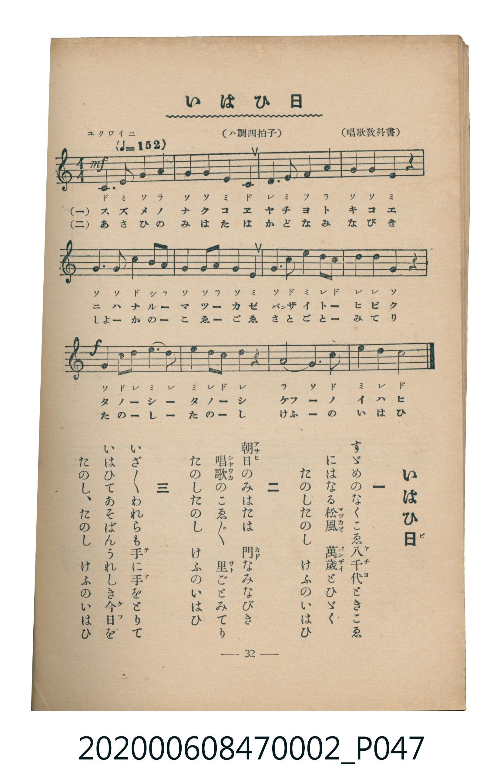

# いはひ日

<audio controls src="iwaibi.mp3"></audio>

- 唱歌教科書
- 臺灣教育會公認《新定兒童唱歌》尋常科第二學年用（2020.006.0847.0002）

## 說明

原書資訊與歌詞全文（對應 P047.jpg，書頁 p. 32，第三學期第 5 首）：
調性與拍號：ハ調四拍子（C 大調 4/4 拍），「ユクワイニ（♩＝152）」

## 歌詞

```text
一
すゞめのなくこゑ八千代ときこゑ
にはなる松風　萬歲とひゞく
たのし、たのし　けふのいはひ日

二
朝日のみはたは　門なみなびき
唱歌のこゑ／＼　里ごとみてり
たのし、たのし　けふのいはひ日

三
いざ／＼われらも手に手にとりて
いはひてあそばんうれしき今日を
たのし、たのし　けふのいはひ日
```

## 原書掃描頁



## 分析

```text
================================================================================
📊 TMD Song Profile: [ いはひ日 ]
================================================================================
⏱  Duration:       0:18 (18.9s), 12 measures total
🎼 Key & Tempo:    首調基準 C, != 152.0 BPM, <4/4>
   - 分析範圍：      由實際發聲的音符與和弦推測調性；播放脈絡另行呈現
🎤 人聲音域:    C4 (MIDI 60) – C5 (MIDI 72) [跨度: 12 個半音 / 1.0 個八度, 難度: easy]
   - 最低音:  C4 in [Iwaibi #1 @ m.1, 0:00]
   - 最高音: C5 in [Iwaibi #1 @ m.5, 0:07]
   - 適合: soprano, mezzo-soprano, contralto, tenor, baritone, bass
🏛  結構:      Iwaibi (18.9s)
⚡ 編曲密度:        Peak 1 軌道同時演奏
🗝  調性診斷：       G 大調（純淨自然大調，未偵測到可信轉調）
   - 風格氣質:    純淨自然大調（陽光明朗、易唱易記，無明顯調外色彩）
   - 轉調歷程:    全曲維持單一推測調性（未偵測到可信轉調）
   - 核心骨幹音:  G, E, C, D, A
   - 調性數值:    G 大調 [相關度: 0.84, 穩定度: Moderate, 自然音純度: 97.7%]
   - 候選調性 (K-S): G 大調 (0.84), C 大調 (0.79), E 小調 (0.71)
   - 五度圈歷程:   +1
   - 各段落調性細節:
     • [Iwaibi #1]: G 大調 (r: 0.84, 自然音純度: 97.7%, 調外音: F)

  [ 五度圈游移軌跡 ]
               C  
         F           [G ]*
      Bb               D  
      Eb               A  
         Ab           E  
            Db       B  
               F# 
     (* = active key center)

  [ 十二半音累積音高分佈 ]
     C  : █████████████             17.0%
     C# :                            0.0%
     D  : █████████████             17.0%
     D# :                            0.0%
     E  : ████████████████          20.5%
     F  : ██                         2.3%
     F# :                            0.0%
     G  : ████████████████████████  30.7%
     G# :                            0.0%
     A  : █████████                 11.4%
     A# :                            0.0%
     B  : █                          1.1%
--------------------------------------------------------------------------------
Assignment 軌道音域：
  - Piano         : C4 – C5 (12 個半音 / 1.0 個八度, 48 個音符)
================================================================================
```

## ABC

```abc
X:1
T:いはひ日
C:TMD (Chen, Chih-Han / aguai)
M:4/4
L:1/16
Q:1/4=152
K:C
V:V1 name="Piano" snm="Pia"
[V:V1]
c4 e4 g4 a4 | g4 g4 e4 c4 | d4 e4 f4 a4 | g4 g4 e4 z4 |
g6 g2 c4 b2 a2 | g4 g2 a2 g4 e4 | g4 c4 e4 d2 c2 | d4 d4 g4 z4 |
g4 c2 d2 e4 d4 | e4 d2 c2 d4 z4 | a8 g4 c4 | e4 d4 c4 z4 |
```

- [主旋律 TMD 檔案](iwaibi.tmd)
- [鋼琴伴奏 TMD 檔案](iwaibi_piano.tmd)
