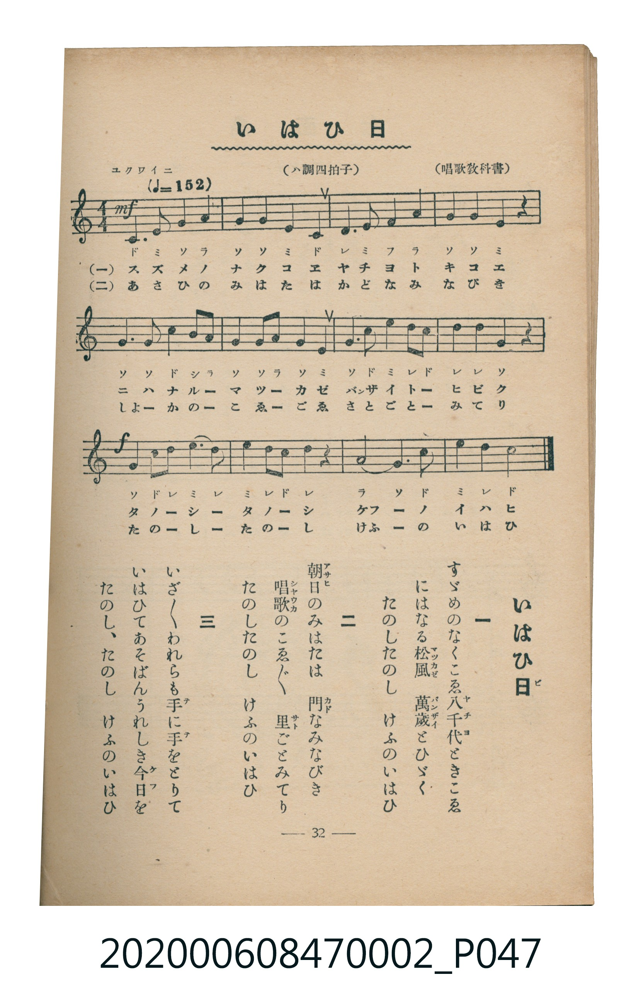

# いはひ日

> Re:Shōka 使用 AI 協助辨識與重建樂譜，可能會有錯誤。歡迎[回報](https://github.com/TMDLang/reshoka/issues)。

- **鋼琴伴奏版**：<br><audio controls src="iwaibi.mp3"></audio>
- **NEUTRINO 歌聲合成版**：<br><audio controls src="iwaibi_neutrino.mp3"></audio>

- 唱歌教科書
- 臺灣教育會公認《新定兒童唱歌》尋常科第二學年用（2020.006.0847.0002）

## 說明

原書資訊與歌詞全文（對應 P047.jpg，書頁 p. 32，第三學期第 5 首）：
調性與拍號：ハ調四拍子（C 大調 4/4 拍），「ユクワイニ（♩＝152）」


## 歌詞

```text
一
すゞめのなくこゑ八千代ときこゑ
にはなる松風　萬歲とひゞく
たのし、たのし　けふのいはひ日

二
朝日のみはたは　門なみなびき
唱歌のこゑ／＼　里ごとみてり
たのし、たのし　けふのいはひ日

三
いざ／＼われらも手に手にとりて
いはひてあそばんうれしき今日を
たのし、たのし　けふのいはひ日
```

## ABC

<div class="abc-score" data-abc-src="iwaibi.abc" aria-label="五線譜載入中"></div>

[下載 ABC 原始檔](iwaibi.abc)

## TMD 檔案連結

- [主旋律 TMD 檔案](iwaibi.tmd) [[在 TMD Studio 編輯](https://tmdlang.github.io/Tmd-TS/#tmd=s7IKdvYPcrWy4qpTUCpJTLdSSM7PyUlNLsnMz7MqzsjMK0nNjM_KTMmPL87Iz05Ugisry88pzU21Si9KTEmNN4o3MjAyiDcwMIs3sDAxBzIMjBBKi_NLi5JTrYqTM_Lzc-JLUitKkvLzsxHyBUX5Zal5iXlANQVFIBtTwIoQClLLMlNSQdKpKZkl-UWZiTlI7kgtKga7FWxJfElRYl5xclFmAcgDCFUlGalAx6alFpdkliHrBhqWnplnlZuamZWJxWX5RSUZ-UAvFmRUWmVkFoPsTk7Mic9OzEMKCajNBYnpqVYBBibmSlxaWgqPG1seN65_3Ljp2fSlClpaXIq2CoamRlz2tgrOXDYm-iZ2IO1Pp2x8trbn2dSZz5dPfDZ7B9jIF-27njcuBoq9aNr0bE7z09Y1L1b1Pm7oejZtw9N1s562Tnq-eilE3-OG7qcbup_u2AHU_XzNmie7ep6u3fF055bnU1a839MBihA9YITogSIEyDAwer-nU4mLS19LwZZagEtBQeFp33yg019sbn-xoutFRzvQXS9WznvauuLZtHagK55u6H3W3qkACha9rIL093t6gIpfLmhUKNBTMAa6qAfk8B2dQIc_mzMfyFYwVXi5bBrQpe_3zAKZ_mLV_mcNy0Hmdve-mDkfKPq4uR8o-HT2bKDI07UTgHY4KzxdshwopgAMVgWgKFg3MHR6Hjcve9y0_nHz-sdNSx43dwOVPpq58v2eucCIAKp53NDLBbLiyY4GEPW4cebjpnmPmxofN6573LjqcWP_48bJj5smPm1d_bS3-cnuxY8bVzxu7IUIQjSsBsfwqsdN3c_m7nu5aMXjhoYXE9Y8W7sJrHQTyLjGfojS-WBTpz9uABoPZzc8bpz4uHErmItILRBH7eoBUc_mzAWKgBXsBysA6l0P1PhyGlAv0I1AQSC5GegucFRAkgVINciR7_f0v9-zB6S6HSg4BewooAZgmHSR6agdnRCNQHFgHIFNb-p_3NTzuKnzcVPTs85uYJhASJBlTV1Ay-AaQAaBLG9setw493HjhsdNkx83toE0A21t7H2yuwvk06ZJpDsNqIHypAwFClr6XFye5YmZSZlWAZmJefkONQY11SArFGwstOzAjBoFQwVdBWMgNgViMyCuAbNAGCQKkq1RMILyTLCqMQCJgE3zMawBpT0g_3HjLBDZ1AhmrwPrAcYvmNcPJieD5SdCZJpawGILwWIdYPYKqJ5eNNXxCNuMQPJNYPmpYHITim37wbz1YHI-nA2S6QbzVoJJiJtAahEu3AwmQTYj2WYMkoe4cxqYRLBBPgD7qqkHTHaCSZDLQHqWgdWtBpNgdtMkqAzIj8CkBZdB2AYJYVAYG8YBKXNgsMMC3Qwe8BARsAJjEGEUB-IAowvKgUQRevSAHAIJDKh3m0DBAZLZBxZfAiYhQTQHKgNK4Rg-h8UQJNQhYQYKBfQYmg6MXmD2gFrbDY0hEATJImIWmK_hbJAMJE7BYQSRgdsIiVlIWIJCD1sswbwIcR1ILSK1zAWTG8D6QfaDZEDug8Zf43QwCYp_kAzEbVvB8qCYQ48lYJgDAxsWAyA9SLEBFgFHATjnQOIUGmkIhVAB9KiCpFpQaEHcBAszdHGwi6Auhfgc7Fp4ToDEFyQnIGILOY7oYhM4bmhtUy0Xl66dAqTYUwCylLkA)]
- [鋼琴伴奏 TMD 檔案](iwaibi_piano.tmd) [[在 TMD Studio 編輯](https://tmdlang.github.io/Tmd-TS/#tmd=s7IKdvYPcrWy4qpTUCpJTLdSyC8qychPL0osyKi0ysgsLskvykxOzInPTsxLVIIrKs4vLUpOjS9ITE-1CjAwMVfi0tJSeNzY8rhx_ePGTc-mL32_p-Nl957nE7Y82bPl6dL-550d7_d0KmhpcSnaKhiaGnHZ2yo4c9mY6JvYgcx8OmXjs7U9z6bOfL584rPZO8D2vGjf9bxxMVDsRdOmZ3Oan7auebGq93FD17NpG56um_W0ddLz1Ush-h43dD_d0P10xw6g7udr1jzZ1fN07Y6nO7c8n7IC6AwjAyMDPQMDMz0DCxNzIMPACOgSJS4uz_LEzKRMq4DMxLz8IA-HGoOaai4FILCx0LIDM2oUDBV0FYyB2BSIzYC4BswCYZAoSLZGwQjKM8GqxgAkAjbNx7AGGEAzgfzHjbNAZFMjmL0OrOdx4yowrx9MTgaTHRCZphYwbyFYD0jsceMKqJ5eNNXxCNuMQPJNYJmpYHITim37wbz1YHI-nA2S6QbzVoJJiJtAahEu3AwmQTYj2WYMkoe4cxqYRLBBPgD7qqkHTHaCSZDLQHqWgdWtBpNgdtMkqAzIj4-buuAyCNsgIQwKY8M4IGUODHZYoJvBAx4iAlZgDCKM4kAcYHRBOZAoQo8ekEMggQH1bhMoOEAy-8DiS8AkJIjmQGU2PG6CxACyz2ExBAl1SJiBQgE9hqY_bmp_3NgGtbYbGkMgCJJFxOzjxilwNkgGEqfgMILKwGyExCwkLEGhhy2WYF6EuA6kFpFa5oLJDWD9IPtBMiD3QeOvcTqYBMU_OAUC3Q8WgCgBRR56RAGDHRjesEgAaUOKELAIOBbAmQcSrdB4QyiECqDHFiThggIM4ixYsKGLg12EcCzE_2AHw_MDJNYg-QERZ8gxRS_LwJFEB8tqUUtAH-QS0ARRAsYrRBvGgimTWFQ-kAJGcDyQZRofq2CCpgKEDeDpACqIrghuDE5jwQSGOSAKJIGwDaoMZgMWg6DuAXpb104B4vNoH6AgEs8IhWcM5ilzAQA)]

## 分析

```text
================================================================================
📊 TMD Song Profile: [ いはひ日 ]
================================================================================
⏱  Duration:       0:18 (18.9s), 12 measures total
🎼 Key & Tempo:    首調基準 C, != 152.0 BPM, <4/4>
   - 分析範圍：      由實際發聲的音符與和弦推測調性；播放脈絡另行呈現
🎤 人聲音域:    C4 (MIDI 60) – E5 (MIDI 76) [跨度: 16 個半音 / 1.3 個八度, 難度: moderate]
   - 最低音:  C4 in [Iwaibi #1 @ m.1, 0:00]
   - 最高音: E5 in [Iwaibi #1 @ m.7, 0:10]
   - 適合: soprano, mezzo-soprano, contralto, tenor, baritone, bass
🏛  結構:      Iwaibi (18.9s)
⚡ 編曲密度:        Peak 1 軌道同時演奏
🗝  調性診斷：       G 大調（純淨自然大調，未偵測到可信轉調）
   - 風格氣質:    純淨自然大調（陽光明朗、易唱易記，無明顯調外色彩）
   - 轉調歷程:    全曲維持單一推測調性（未偵測到可信轉調）
   - 核心骨幹音:  G, E, C, D, A
   - 調性數值:    G 大調 [相關度: 0.84, 穩定度: Moderate, 自然音純度: 97.7%]
   - 候選調性 (K-S): G 大調 (0.84), C 大調 (0.79), E 小調 (0.71)
   - 五度圈歷程:   +1
   - 各段落調性細節:
     • [Iwaibi #1]: G 大調 (r: 0.84, 自然音純度: 97.7%, 調外音: F)

  [ 五度圈游移軌跡 ]
               C  
         F           [G ]*
      Bb               D  
      Eb               A  
         Ab           E  
            Db       B  
               F# 
     (* = active key center)

  [ 十二半音累積音高分佈 ]
     C  : █████████████             17.0%
     C# :                            0.0%
     D  : █████████████             17.0%
     D# :                            0.0%
     E  : ████████████████          20.5%
     F  : ██                         2.3%
     F# :                            0.0%
     G  : ████████████████████████  30.7%
     G# :                            0.0%
     A  : █████████                 11.4%
     A# :                            0.0%
     B  : █                          1.1%
--------------------------------------------------------------------------------
Assignment 軌道音域：
  - Piano         : C4 – E5 (16 個半音 / 1.3 個八度, 48 個音符)
================================================================================
```


## 原書掃描頁




