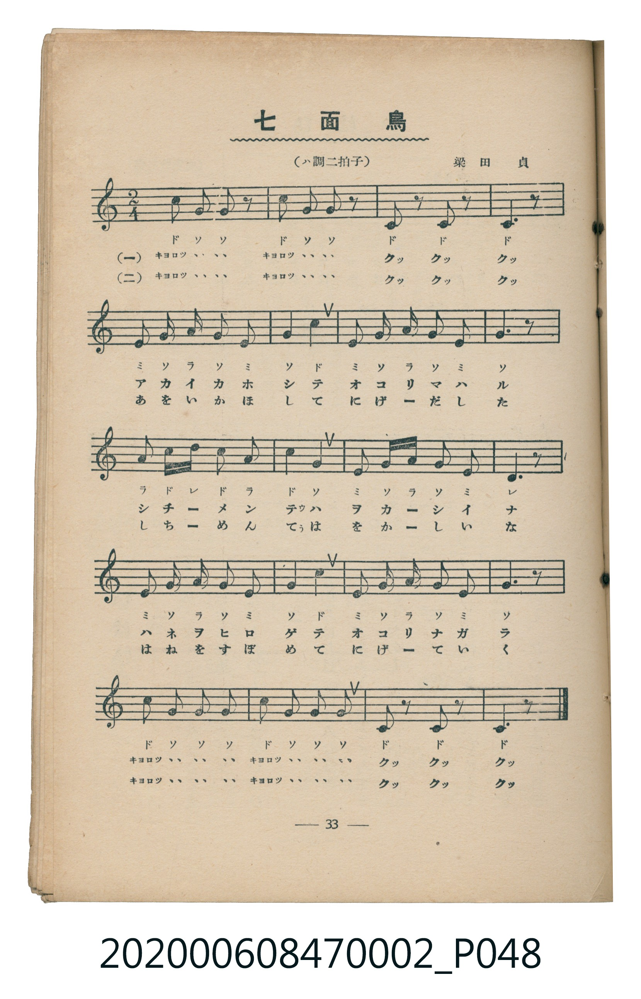
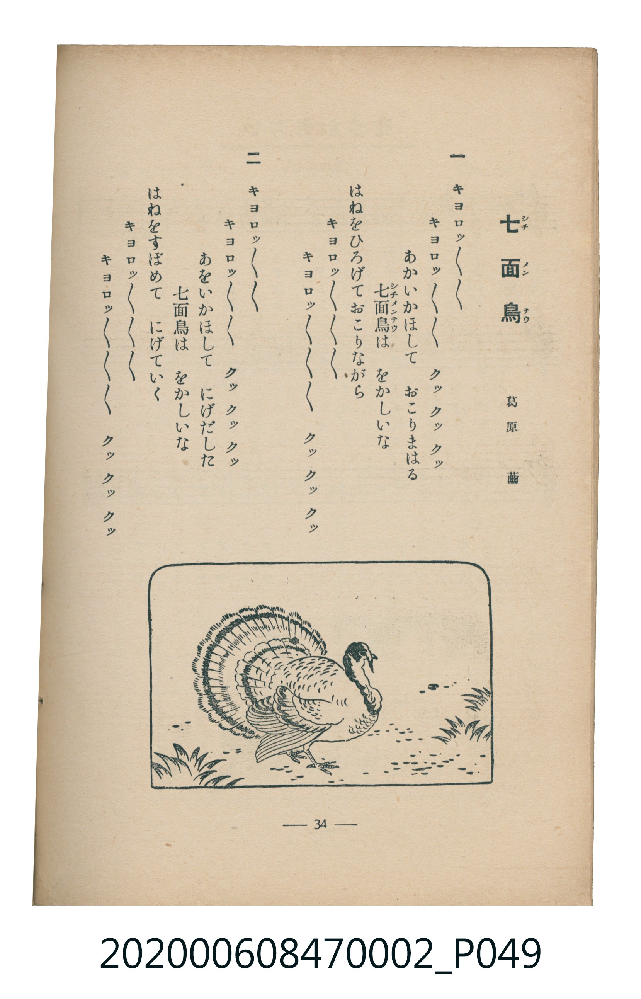

# 七面鳥

<audio controls src="shichimencho.mp3"></audio>

- 詞：葛原齒
- 曲：梁田貞
- 臺灣教育會公認《新定兒童唱歌》尋常科第二學年用（2020.006.0847.0002）

## 說明

原書資訊與歌詞全文（對應 P048.jpg – P049.jpg，書頁 pp. 33–34，第三學期第 6 首）：
調性與拍號：ハ調二拍子（C 大調 2/4 拍）

## 歌詞

```text
一
キヨロツ～～　キヨロツ～～　クツ　クツ　クツ
あかいかほして　おこりまはる
七面鳥は　をかしいな
はねをひろげておこりながら
キヨロツ～～　キヨロツ～～　クツ　クツ　クツ

二
キヨロツ～～　キヨロツ～～　クツ　クツ　クツ
あをいかほして　にげだした
七面鳥は　をかしいな
はねをすばめて　にげていく
キヨロツ～～　キヨロツ～～　クツ　クツ　クツ
```

## ABC

```abc
X:1
T:七面鳥
C:曲：梁田貞
M:2/4
L:1/16
Q:1/4=100
K:C
V:V1 name="Piano" snm="Pia"
[V:V1]
c2 g2 g2 z2 | c2 g2 g2 z2 | c2 z2 c2 z2 | c6 z2 |
e2 g2 a2 g2 | e2 g2 c4 | e2 g2 a2 g2 | e2 g4 z2 |
a2 c d c2 a2 | c2 g6 | e2 g a g2 e2 | d6 z2 |
e2 g2 a2 g2 | e2 g2 c4 | e2 g2 a2 g2 | e2 g4 z2 |
c2 g2 g2 g2 | c2 g2 g2 g2 | c2 z2 c2 z2 | c6 z2 |
```

## TMD 檔案連結

- [主旋律 TMD 檔案](shichimencho.tmd)
- [鋼琴伴奏 TMD 檔案](shichimencho_piano.tmd)

## 分析

```text
================================================================================
📊 TMD Song Profile: [ 七面鳥 ]
================================================================================
⏱  Duration:       0:24 (24.0s), 20 measures total
🎼 Key & Tempo:    首調基準 C, != 100.0 BPM, <2/4>
   - 分析範圍：      由實際發聲的音符與和弦推測調性；播放脈絡另行呈現
🎤 人聲音域:    C4 (MIDI 60) – D5 (MIDI 74) [跨度: 14 個半音 / 1.2 個八度, 難度: moderate]
   - 最低音:  C4 in [Shichimencho #1 @ m.3, 0:02]
   - 最高音: D5 in [Shichimencho #1 @ m.9, 0:10]
   - 適合: soprano, mezzo-soprano, contralto, tenor, baritone, bass
🏛  結構:      Shichimencho (24.0s)
⚡ 編曲密度:        Peak 1 軌道同時演奏
🗝  調性診斷：       C 大調（純淨自然大調，未偵測到可信轉調）
   - 風格氣質:    純淨自然大調（陽光明朗、易唱易記，無明顯調外色彩）
   - 轉調歷程:    全曲維持單一推測調性（未偵測到可信轉調）
   - 核心骨幹音:  G, C, E, A, D
   - 調性數值:    C 大調 [相關度: 0.85, 穩定度: Moderate, 自然音純度: 100.0%]
   - 候選調性 (K-S): C 大調 (0.85), G 大調 (0.74), E 小調 (0.61)
   - 五度圈歷程:   +0
   - 各段落調性細節:
     • [Shichimencho #1]: C 大調 (r: 0.85, 自然音純度: 100.0%)

  [ 五度圈游移軌跡 ]
              [C ]*
         F            G  
      Bb               D  
      Eb               A  
         Ab           E  
            Db       B  
               F# 
     (* = active key center)

  [ 十二半音累積音高分佈 ]
     C  : █████████████████         29.7%
     C# :                            0.0%
     D  : ███                        5.1%
     D# :                            0.0%
     E  : ████████                  14.5%
     F  :                            0.0%
     F# :                            0.0%
     G  : ████████████████████████  41.3%
     G# :                            0.0%
     A  : █████                      9.4%
     A# :                            0.0%
     B  :                            0.0%
--------------------------------------------------------------------------------
Assignment 軌道音域：
  - Piano         : C4 – D5 (14 個半音 / 1.2 個八度, 59 個音符)
================================================================================
```


## 原書掃描頁






