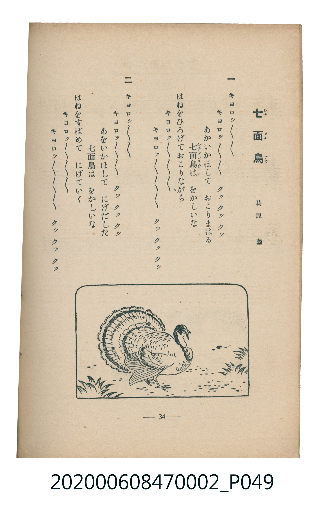

# 七面鳥

> Re:Shōka 使用 AI 協助辨識與重建樂譜，可能會有錯誤。歡迎回報。

- **鋼琴伴奏版**：<br><audio controls src="shichimencho.mp3"></audio>
- **NEUTRINO 歌聲合成版**：<br><audio controls src="shichimencho_neutrino.mp3"></audio>

- 詞：葛原齒
- 曲：梁田貞
- 臺灣教育會公認《新定兒童唱歌》尋常科第二學年用（2020.006.0847.0002）

## 說明

原書資訊與歌詞全文（對應 P048.jpg – P049.jpg，書頁 pp. 33–34，第三學期第 6 首）：
調性與拍號：ハ調二拍子（C 大調 2/4 拍）


## 歌詞

```text
一
キヨロツ～～　キヨロツ～～　クツ　クツ　クツ
あかいかほして　おこりまはる
七面鳥は　をかしいな
はねをひろげておこりながら
キヨロツ～～　キヨロツ～～　クツ　クツ　クツ

二
キヨロツ～～　キヨロツ～～　クツ　クツ　クツ
あをいかほして　にげだした
七面鳥は　をかしいな
はねをすばめて　にげていく
キヨロツ～～　キヨロツ～～　クツ　クツ　クツ
```

## ABC

<div class="abc-score" data-abc-src="shichimencho.abc" aria-label="五線譜載入中"></div>

[下載 ABC 原始檔](shichimencho.abc)

## TMD 檔案連結

- [主旋律 TMD 檔案](shichimencho.tmd) [[在 TMD Studio 編輯](https://tmdlang.github.io/Tmd-TS/#tmd=s7IKdvYPcrWy4qpTUCpJTLdSSM7PyUlNLsnMz7MqzsjMK0nNjM_KTMmPL87Iz05Ugisry88pzU21Si9KTEmNN4o3MjAyiDcwMIs3sDAxBzIMjBBKi_NLi5JTrYqTM_Lzc-JLUitKkvLzsxHyBUX5Zal5iXlANQVFIBtTwIoQClLLMlNSQdKpKZkl-UWZiTlI7kgtKga7FWxJfElRYl5xclFmAcgDCFUlGalAxybmZeYi6wUalZ6ZZ1WSmAn0HMiD5YnxuYmZeTmJeSnIqkoy8oH-LMiotMrILAY5IDkxJz47MQ8pOKDWFySmp1oFGJhY6AIJSyUuLS2FJzuaX85d9HLzUgUtLS5FWwVDAwMue1sFZy4bI30TO5ABL1bOe79n1ouJs5_2zX-5dxLY0GezNwHFni1qfD5lw4tN88BiL9p3PW9c_GzqzBdNm57NaX7auubFqt7HDV3Ppm14um7W09ZJz1cvfTpl47O1PY8bup9u6H66Y8fz5ROfr1nzZFfP07U7nu7c8nzKivd7OkBxpQeMKz1QXAEZBkbv93QqcXHpaynYUgtwKSgoAL3zbPaOF5vbX6zoetHRDnQX0KdPW1c8m9YOdMXTDb3P2jsVQIGll1WQrvCoYTKIYwnivN_TA9T5ckGjQkGBnoKxMVDO2AQoCPLLjk6gX57NmQ9kK5gpvFw2Deh4YFCBLHyxav-zhuUgq7p7X8ycDxR93NwPFAT6HyjydO0EoLXOCk-XLAeKKQBDXwEoCtTNBdL7ZEcDiHrctPZx84rHzUCy5f3eeUD0uKEBh-B6IBeTATalselxY_fjxhYwuftx4_THjctAKhq7HjdOftwEJPc9blz_uKkbYjU0hYCEQMZMAmsD6gHqXwUxb_3jxrVgiU2Pm3ofNwIZy5AMW_W4sedxUyeVPAB2064e6gYHyO2YwbEa7JUFYJH5JIfFzMeNGx43NaIaBgwXoNJ-6rme8swABQpa-lxcwRmZyRmZucDiLCPfKiAzMS_focagphpkkYKNoZmWHZhVo2AYp6CrYArFBkCMXQjKgtEQERgEi4DN8zGsAQZc7-OmDnDyWYKkKB6sjYBkP0QYxEXhIMmhaIFYajQAltYoGENDyAxKI0TAAQiCMCEzsDCIXQNm4Qq4JrATusFkC5wNktkN5k0Hk8vgpgOzJlhkMjAJdgHpfWDeeohcE0gvrtAC29Q0iQSbVoNFIDoWwNWAZObjCCBQwACDwigOEiAgLlLigkFsYWSEJ4wgLlsIdn8jmJwMdQcwR7bBAwBhPMybkGCFaAd5GaRlFZ4gooNFJCUibIqwBRDIUcCSC-xiiIM2QZ3XC-ZBxLAlIpAOCBvkXJBMD1isE0cIYdo0E6pvAyLUcCQiEITIgcQhSbAfSwChFEYQz2MTgoYDBeUTzIl4JaldPtHG0louLl07BeQaQAHIV-YCAA)]
- [鋼琴伴奏 TMD 檔案](shichimencho_piano.tmd) [[在 TMD Studio 編輯](https://tmdlang.github.io/Tmd-TS/#tmd=s7IKdvYPcrWy4qpTUCpJTLdSyC8qychPL0osyKi0ysgsLskvykxOzInPTsxLVIIrKs4vLUpOjS9ITE-1CjAwsdAFEpZKXFpaCk92NL-cu-jl5qXv93S87N7zfMKWJ3u2PF3a_7yz4_2eTgUtLS5FWwVDAwMue1sFZy4bI30TO5CpL1bOe79n1ouJs5_2zX-5dxLYpmezNwHFni1qfD5lw4tN88BiL9p3PW9c_GzqzBdNm57NaX7auubFqt7HDV3Ppm14um7W09ZJz1cvfTpl47O1PY8bup9u6H66Y8fz5ROfr1nzZFfP07U7nu7c8nzKCqDTjAyMDPQMDMz0DCxMzIEMAyOg65S4uIIzMpMzMnNT85Iz8q0CMhPz8oM8HGoMaqq5FIDAxtBMyw7MqlEwjFPQVTCFYgMgxi4EZcFoiAgMgkXA5vkY1ig8bux93NTxuKn3ceMSJEXxYG0EJPshwiAuCgdJDkULxFKjAbC0RsEYGkJmUBohAg5AEIQJmYGFQewaMAtXwDWBndANJlvgbJDMbjBvOphcBjf9cWMXWGSywuOmLiC9D8xbD5FrAunFFVpgm5omkWDTarAIRMcCuBqQzHwcAQQKGGBQGMVBAgTERUpcMIgtjIzwhBHEZQvB7m8Ek5Oh7lj2uLENHgAI42HehAQrRDvIyyAtq_AEER0sIikRYVOELYBAjnrcuBbsYoiDNkGd1wvmQcSwJSKQDggb5FyQTA9YrBNHCGHaNBOqbwMi1HAkIhCEyIHEIUmwH0sAoRRGEM9jE4KGAwXlE8yJeCWpXT7RxtJabBWAD3IFYIIo_-MVog1j0RhABKYNENEAlDVBVwYXQagzwaoOzDCNJ8dAgu4DelbXTgHZv9E-QHUYYkZgMWUuAA)]

## 分析

```text
================================================================================
📊 TMD Song Profile: [ 七面鳥 ]
================================================================================
⏱  Duration:       0:24 (24.0s), 20 measures total
🎼 Key & Tempo:    首調基準 C, != 100.0 BPM, <2/4>
   - 分析範圍：      由實際發聲的音符與和弦推測調性；播放脈絡另行呈現
🎤 人聲音域:    C4 (MIDI 60) – D5 (MIDI 74) [跨度: 14 個半音 / 1.2 個八度, 難度: moderate]
   - 最低音:  C4 in [Shichimencho #1 @ m.3, 0:02]
   - 最高音: D5 in [Shichimencho #1 @ m.9, 0:10]
   - 適合: soprano, mezzo-soprano, contralto, tenor, baritone, bass
🏛  結構:      Shichimencho (24.0s)
⚡ 編曲密度:        Peak 1 軌道同時演奏
🗝  調性診斷：       C 大調（純淨自然大調，未偵測到可信轉調）
   - 風格氣質:    純淨自然大調（陽光明朗、易唱易記，無明顯調外色彩）
   - 轉調歷程:    全曲維持單一推測調性（未偵測到可信轉調）
   - 核心骨幹音:  G, C, E, A, D
   - 調性數值:    C 大調 [相關度: 0.85, 穩定度: Moderate, 自然音純度: 100.0%]
   - 候選調性 (K-S): C 大調 (0.85), G 大調 (0.74), E 小調 (0.61)
   - 五度圈歷程:   +0
   - 各段落調性細節:
     • [Shichimencho #1]: C 大調 (r: 0.85, 自然音純度: 100.0%)

  [ 五度圈游移軌跡 ]
              [C ]*
         F            G  
      Bb               D  
      Eb               A  
         Ab           E  
            Db       B  
               F# 
     (* = active key center)

  [ 十二半音累積音高分佈 ]
     C  : █████████████████         29.7%
     C# :                            0.0%
     D  : ███                        5.1%
     D# :                            0.0%
     E  : ████████                  14.5%
     F  :                            0.0%
     F# :                            0.0%
     G  : ████████████████████████  42.0%
     G# :                            0.0%
     A  : █████                      8.7%
     A# :                            0.0%
     B  :                            0.0%
--------------------------------------------------------------------------------
Assignment 軌道音域：
  - Piano         : C4 – D5 (14 個半音 / 1.2 個八度, 59 個音符)
================================================================================
```


## 原書掃描頁





