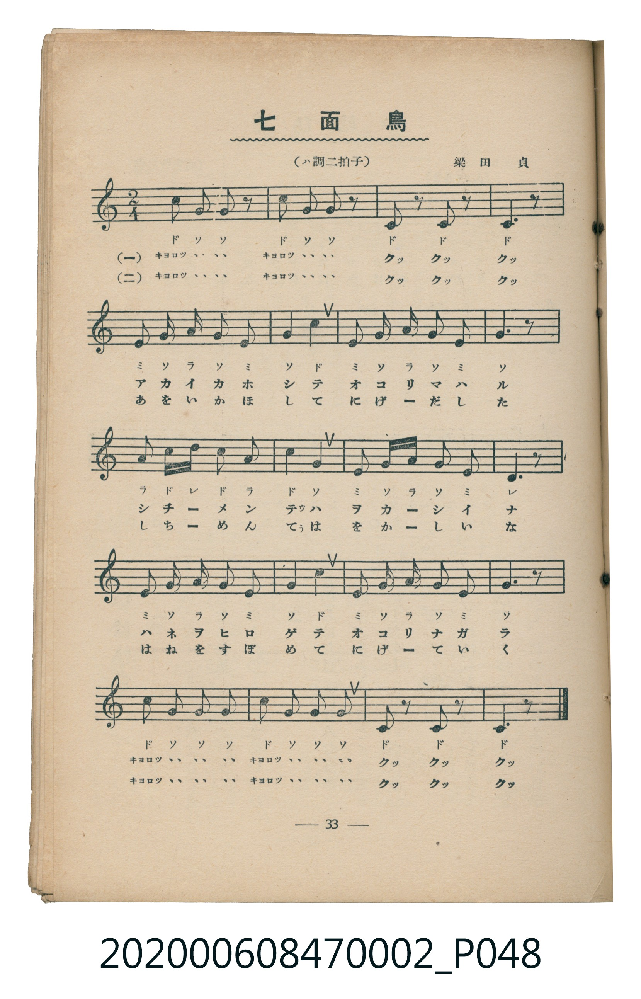
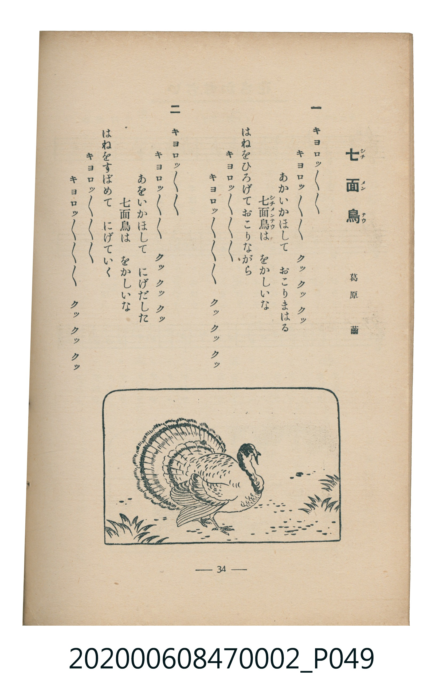

# 七面鳥

> Re:Shōka 使用 AI 協助辨識與重建樂譜，可能會有錯誤。歡迎回報。

- **NEUTRINO 歌聲合成版**：<br><audio controls src="shichimencho_neutrino.mp3"></audio>
- **鋼琴伴奏版**：<br><audio controls src="shichimencho.mp3"></audio>


- 詞：葛原齒
- 曲：梁田貞
- 臺灣教育會公認《新定兒童唱歌》尋常科第二學年用（2020.006.0847.0002）

## 說明

原書資訊與歌詞全文（對應 P048.jpg – P049.jpg，書頁 pp. 33–34，第三學期第 6 首）：
調性與拍號：ハ調二拍子（C 大調 2/4 拍）


## 跨冊／重複收錄參照

> 同曲（《公學校唱歌》、《新定兒童唱歌》共同收錄教材）

- **[同曲]** 《公學校唱歌》第二學年用（昭和11年／1936）：[**〈しちめんてう（七面鳥）〉**](../../../kogakko_shoka/grade_2/13_shichimencho/index.md)（`C` / `2/4` — [原始 TMD](../../../kogakko_shoka/grade_2/13_shichimencho/shichimencho.tmd)）
- 總表：[跨冊重複與同名歌曲總索引](../../../duplicate_songs.md)

## 歌詞

```text
一
キヨロツ～～　キヨロツ～～　クツ　クツ　クツ
あかいかほして　おこりまはる
七面鳥は　をかしいな
はねをひろげておこりながら
キヨロツ～～　キヨロツ～～　クツ　クツ　クツ

二
キヨロツ～～　キヨロツ～～　クツ　クツ　クツ
あをいかほして　にげだした
七面鳥は　をかしいな
はねをすばめて　にげていく
キヨロツ～～　キヨロツ～～　クツ　クツ　クツ
```

## ABC

```abc
X:1
T:七面鳥
C:曲：梁田貞
M:2/4
L:1/16
Q:1/4=100
K:C
V:V1 name="Piano" snm="Pia"
[V:V1]
c2 G2 G2 z2 | c2 G2 G2 z2 | C2 z2 C2 z2 | C6 z2 |
w: 1.~きよろつ _ _ | きよろつ _ _ | くつ くつ | くつ
w: 2.~きよろつ _ _ | きよろつ _ _ | くつ くつ | くつ
E2 G2 A2 G2 | E2 G2 c4 | E2 G A G2 E2 | G6 z2 |
w: 1.~あ か い か | ほ し て | お こ り ま は | る
w: 2.~あ を い か | ほ し て | に げ _ だ し | た
A2 c d c2 A2 | c2 G6 | E2 G A G2 E2 | D6 z2 |
w: 1.~し ち _ め ん | てう は | を か _ し い | な
w: 2.~し ち _ め ん | てう は | を か _ し い | な
E2 G2 A2 G2 | E2 G2 c4 | E2 G2 A2 G2 | E2 G4 z2 |
w: 1.~は ね を ひ | ろ げ て | お こ り な | が ら
w: 2.~は ね を す | ば め て | に げ _ て | い く
c2 G2 G2 G2 | c2 G2 G2 G2 | C2 z2 C2 z2 | C6 z2 |
w: 1.~きよろつ _ _ _ | きよろつ _ _ _ | くつ くつ | くつ
w: 2.~きよろつ _ _ _ | きよろつ _ _ _ | くつ くつ | くつ
```

## TMD 檔案連結

- [主旋律 TMD 檔案](shichimencho.tmd) [[在 TMD Studio 編輯](https://tmdlang.github.io/Tmd-TS/#tmd=s7IKdvYPcrWy4qpTUCpJTLdSSM7PyUlNLsnMz7MqzsjMK0nNjM_KTMmPL87Iz05Ugisry88pzU21Si9KTEmNN4o3MjAyiDcwMIs3sDAxBzIMjBBKi_NLi5JTrYqTM_Lzc-JLUitKkvLzsxHyBUX5Zal5iXlANQVFIBtTwIoQClLLMlNSQdKpKZkl-UWZiTlI7kgtKga7FWxJfElRYl5xclFmAcgDCFUlGalAxybmZeaC9GppKTzZ0fxy7qKXm5cqaGlxKdoqGBoYcNnbKjhz2Rjpm9iB9L1YOe_9nlkvJs5-2jf_5d5JYLOezd4EFHu2qPH5lA0vNs0Di71o3_W8cfGzqTNfNG16Nqf5aeuaF6t6Hzd0PZu24em6WU9bJz1fvfTplI3P1vY8buh-uqH76Y4dz5dPfL5mzZNdPU_X7ni6c8vzKSve7-kAhaAeMAT1QCEIZBgYvd_TqcTFpa-lYEstwKWgoAD0zrPZO15sbn-xoutFRzvQXUCfPm1d8WxaO9AVTzf0PmvvVAgwMLHQyypIV3jUMBnEsQRx3u_pAep8uaBRoaBAT8HYGChnbAIUBPllRyfQL8_mzAeyFcwUXi6bBnQ8MKhAFr5Ytf9Zw3KQVd29L2bOB4o-bu4HCgL9DxR5unYC0FpnhadLlgPFFIChrwAUBermAul9sqMBRD1uWvu4ecXjZiDZ8n7vPCB63NCAQ3A9kIvJAJvS2PS4sftxYwuY3P24cfrjxmUgFY1djxsnP24CkvseN65_3NQNsRqaQkBCIGMmgbUB9QD1r4KYt_5x41qwxKbHTb2PG4GMZUiGrXrc2PO4qZNKHgC7aVcPdYMD5HbM4FgN9soCsMh8ksNi5uPGDY-bGlENA4YLUGk_9VxPeWaAAgUtfS6u4IzM5IzMXGAhk5FvFZCZmJfvUGNQUw2ySMHG0EzLDsyqUTCMU9BVMIViAyDGLgRlwWiICAyCRcDm-RjWAAOu93FTBzj5LEFSFA_WRkCyHyIM4qJwkORQtEAsNRoAS2sUjKEhZAalESLgAARBmJAZWBjErgGzcAVcE9gJ3WCyBc4GyewG86aDyWVw04FZEywyGZgEu4D0PjBvPUSuCaQXV2iBbWqaRIJNq8EiEB0L4GpAMvNxBBAoYIBBYRQHCRAQFylxwSC2MDLCE0YQly0Eu78RTE6GugOYI9vgAYAwHuZNSLBCtIO8DNKyCk8Q0cEikhIRNkXYAgjkKGDJBXYxxEGboM7rBfMgYtgSEUgHhA1yLkimByzWiSOEMG2aCdW3ARFqOBIRCELkQOKQJNiPJYBQCiOI57EJQcOBgvIJ5kS8ktQun2hjaS0Xl66dAnINoADkK3MBAA)]
- [鋼琴伴奏 TMD 檔案](shichimencho_piano.tmd) [[在 TMD Studio 編輯](https://tmdlang.github.io/Tmd-TS/#tmd=s7IKdvYPcrWy4tLSUniyo_nl3EUvNy99v6fjZfee5xO2PNmz5enS_uedHe_3dCpoaXEp2ioYGhhw2dsqOHPZGOmb2HHVKSi9WDnv_Z5ZLybOfto3_-XeSUogsWezNwHFni1qfD5lw4tN88BiL9p3PW9c_GzqzBdNm57NaX7auubFqt7HDV3Ppm14um7W09ZJz1cvfTpl47O1PY8bup9u6H66Y8fz5ROfr1nzZFfP07U7nu7c8nzKCqDTjAyMDPQMDMz0DCxMzIEMAyOg65S4uIIzMpMzMnNT85Iz8q0CMhPz8oM8HGoMaqq5FIDAxtBMyw7MqlEwjFPQVTCFYgMgxi4EZcFoiAgMgkXA5vkY1ig8bux93NTxuKn3ceMSJEXxYG0EJPshwiAuCgdJDkULxFKjAbC0RsEYGkJmUBohAg5AEIQJmYGFQewaMAtXwDWBndANJlvgbJDMbjBvOphcBjf9cWMXWGSywuOmLiC9D8xbD5FrAunFFVpgm5omkWDTarAIRMcCuBqQzHwcAQQKGGBQGMVBAgTERUpcMIgtjIzwhBHEZQvB7m8Ek5Oh7lj2uLENHgAI42HehAQrRDvIyyAtq_AEER0sIikRYVOELYBAjnrcuBbsYoiDNkGd1wvmQcSwJSKQDggb5FyQTA9YrBNHCGHaNBOqbwMi1HAkIhCEyIHEIUmwH0sAoRRGEM9jE4KGAwXlE8yJeCWpXT7RxtJabBWAD3IFYIIo_-MVog1j0RhABKYNENEAlDVBVwYXQagzwaoOzDCNJ8dAgu4DelbXTgHZv9E-QHUYYkZgMWUuAA)]

## 分析

```text
================================================================================
📊 TMD Song Profile: [ 七面鳥 ]
================================================================================
⏱  Duration:       0:24 (24.0s), 20 measures total
🎼 Key & Tempo:    首調基準 C, != 100.0 BPM, <2/4>
   - 分析範圍：      由實際發聲的音符與和弦推測調性；播放脈絡另行呈現
🎤 人聲音域:    C4 (MIDI 60) – D5 (MIDI 74) [跨度: 14 個半音 / 1.2 個八度, 難度: moderate]
   - 最低音:  C4 in [Shichimencho #1 @ m.3, 0:02]
   - 最高音: D5 in [Shichimencho #1 @ m.9, 0:10]
   - 適合: soprano, mezzo-soprano, contralto, tenor, baritone, bass
🏛  結構:      Shichimencho (24.0s)
⚡ 編曲密度:        Peak 1 軌道同時演奏
🗝  調性診斷：       C 大調（純淨自然大調，未偵測到可信轉調）
   - 風格氣質:    純淨自然大調（陽光明朗、易唱易記，無明顯調外色彩）
   - 轉調歷程:    全曲維持單一推測調性（未偵測到可信轉調）
   - 核心骨幹音:  G, C, E, A, D
   - 調性數值:    C 大調 [相關度: 0.85, 穩定度: Moderate, 自然音純度: 100.0%]
   - 候選調性 (K-S): C 大調 (0.85), G 大調 (0.74), E 小調 (0.61)
   - 五度圈歷程:   +0
   - 各段落調性細節:
     • [Shichimencho #1]: C 大調 (r: 0.85, 自然音純度: 100.0%)

  [ 五度圈游移軌跡 ]
              [C ]*
         F            G  
      Bb               D  
      Eb               A  
         Ab           E  
            Db       B  
               F# 
     (* = active key center)

  [ 十二半音累積音高分佈 ]
     C  : █████████████████         29.7%
     C# :                            0.0%
     D  : ███                        5.1%
     D# :                            0.0%
     E  : ████████                  14.5%
     F  :                            0.0%
     F# :                            0.0%
     G  : ████████████████████████  42.0%
     G# :                            0.0%
     A  : █████                      8.7%
     A# :                            0.0%
     B  :                            0.0%
--------------------------------------------------------------------------------
Assignment 軌道音域：
  - Piano         : C4 – D5 (14 個半音 / 1.2 個八度, 59 個音符)
================================================================================
```


## 原書掃描頁






