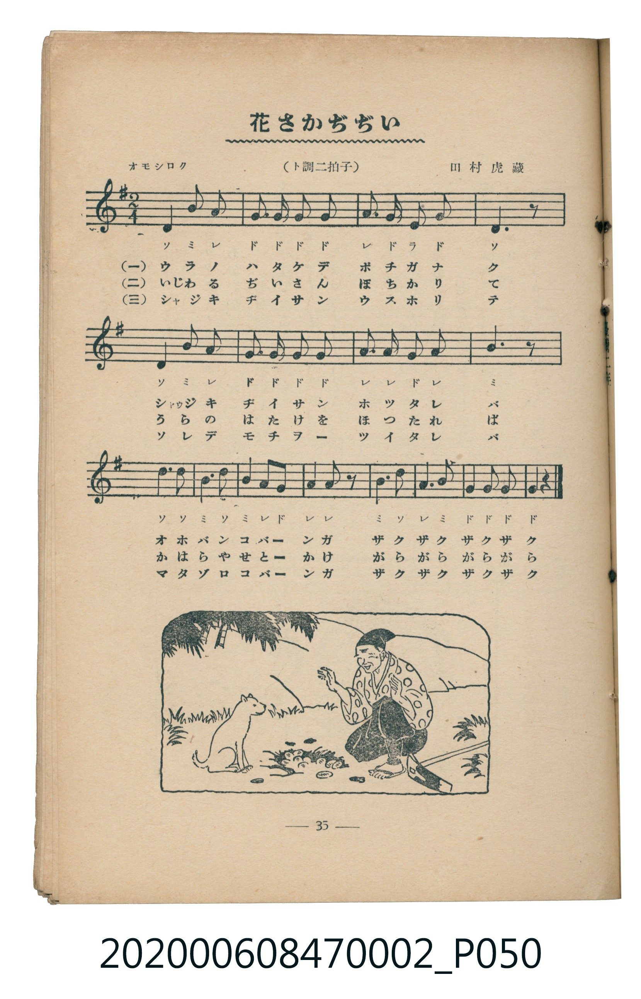
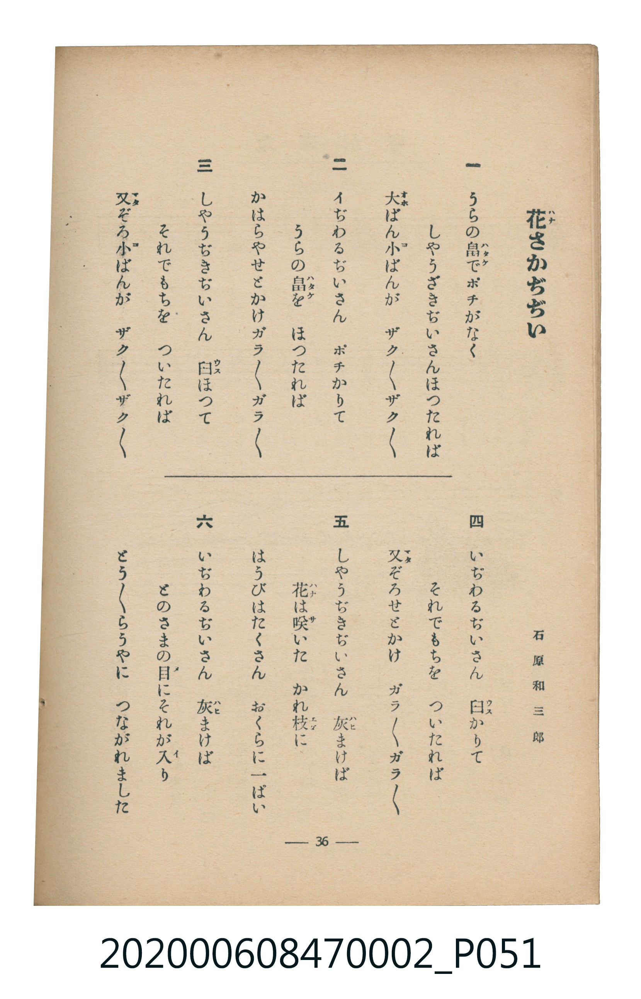

# 花さかぢぢい

<audio controls src="hanasaka_jijii.mp3"></audio>

- 詞：石原和三郎
- 曲：田村虎藏
- 臺灣教育會公認《新定兒童唱歌》尋常科第二學年用（2020.006.0847.0002）

## 說明

原書資訊與歌詞全文（對應 P050.jpg – P051.jpg，書頁 pp. 35–36，第三學期第 7 首）：
調性與拍號：ト調二拍子（G 大調 2/4 拍），「オモシロク」

## 歌詞

```text
一
うらの畠でポチがなく
しやうぢきぢいさんほつたれば
大ばん小ばんが　ザク／＼ザク／＼

二
いぢわるぢいさん　ポチかりて
うらの畠を　ほつたれば
かはらやせとかけガラ／＼ガラ／＼

三
しやうぢきぢいさん　臼ほつて
それでもちを　ついたれば
又ぞろ小ばんが　ザク／＼ザク／＼

四
いぢわるぢいさん　臼かりて
それでもちを　ついたれば
又ぞろせとかけ　ガラ／＼ガラ／＼

五
しやうぢきぢいさん　灰まけば
花は咲いた　かれ枝に
はうびはたくさん　おくらに一ぱい

六
いぢわるぢいさん　灰まけば
とのさまの目にそれが入り
とう／＼らうやに　つながれました
```

## ABC

```abc
X:1
T:花さかぢぢい
C:曲：田村虎藏
M:2/4
L:1/16
Q:1/4=104
K:G
V:V1 name="Piano" snm="Pia"
[V:V1]
D2 B2 A4 | G2 G2 G2 G2 | A2 G2 E2 G2 | D6 z2 |
D2 B2 A4 | G2 G2 G2 G2 | A2 A2 G2 A2 | B6 z2 |
d3 d B3 d | B2 A G A A z2 | B3 d A3 B | G2 G2 G2 G2 |
```

## TMD 檔案連結

- [主旋律 TMD 檔案](hanasaka_jijii.tmd) [[在 TMD Studio 編輯](https://tmdlang.github.io/Tmd-TS/#tmd=s7IKdvYPcrWy4qpTUCpJTLdSSM7PyUlNLsnMz7MqzsjMK0nNjM_KTMmPL87Iz05Ugisry88pzU21Si9KTEmNN4o3MjAyiDcwMIs3sDAxBzIMjBBKi_NLi5JTrYqTM_Lzc-JLUitKkvLzsxHyBUX5Zal5iXlANQVFIBtTwIoQClLLMlNSQdKpKZkl-UWZiTlI7kgtKga7FWxJfElRYl5xclFmAcgDCFUlGalAx6bl52Tn5BelKnFpaSm86Nr4uHHq48bux42LwKhFQUuLS9FWwdDAhMveVsGdy8ZI38QOZMSLlfPe75n1fP7mp33zn07qebKj82VzH9jwZ7M3gWSmbHg2d-KLmX0vpveDhV-073reuPjZ1JkvmjY9m9P8tHXNi1W9jxu6nk3b8HTdrKetk56vXvp0ysZna3seN3Q_3dD9dMeO58snPl-z5smunqdrdzzdueX5lBXv93SAQlUPGKp6oFAFMgyM3u_pVOLi0tdSsKUW4FJQUAD669nsHS82t79Y0fWiox3oLqCXn7aueDatHeiKpxt6n7V3KgQYmBroZRWkKzxqmAziGII47_f0AHW-XNCoUFCgp2BsCpQzNgMKgvyyoxPol2dz5gPZCuYKL5dNAzoeGFogC1-s2v-sYTnIqu7eFzPnA0UfN3cABYH-B4o8XTsBaK27wtMly4FiCsBoUACKgnUDA6zncdOqx82LHjdtf9y89nHT-scNvVwgM5_saABRjxvbHjd1Pm5c93zqgseNyx83z33c3Pi4sedx46rHjf0QFdMfN7WA1IGivRcS-aC00DT5cePux41LHjfOf9wE1LABHDZLlgNZQLmnG_ohDJBhDQ2Pm7YBLX-_p__9nj3IbIhbdvVAbAKaC3Rp_-MmSDKDWQPUDnVX9-OmrseNyzBc3jQJpAjTOeAEux6kDuSF2Y8bV4BFJj5uWvO4eSXMOQg2NGg6CXm8oeFF-x6YfVDnzAVbu_xxU9PjxoUwFwGlgXqQA6i_43HjvMdNvaQE0NPZswkEENg5KKFDonNQQgfkHHwBtGsK4QB6DvRc4z6QaRCbwCXI-qeTNkGdAHIO0ME9z-bNfdy4GmLeerBhm8GM-cD0h4j_RqDHgN4GxvdqYMp93Ag0qwUSNK1rCQQNukPA3lwHLs2AouuezwayV8PCq-dp61JgKMLVtcGCAGgzML0BTV0NC0hgBgFmLqAeoCnTge4F6aG8gIECBS19Li6PxLzE4sTsRK_MrMxMq4DMxLx8hxqDGoVqkFUKNoZmWnZgVo2CabyCroIxEBsBMQjWKBgCSWRcA5YDscxAiiFCYH0waAASItVAmKEgugasA6txYBFTqLwpVKURUKcREIJVwuUgNhpjs5GrlotL104BJVwUgALKXFwA)]
- [鋼琴伴奏 TMD 檔案](hanasaka_jijii_piano.tmd) [[在 TMD Studio 編輯](https://tmdlang.github.io/Tmd-TS/#tmd=s7IKdvYPcrWy4tLSUnjRtfFx49THjd2PGxeBUcv7PR0vu_c8n7DlyZ4tT5f2P-_seL-nU0FLi0vRVsHQwITL3lbBncvGSN_EjqtOQenFynnv98x6Pn_z0775Tyf1PNnR-bK5Twkk82z2JpDMlA3P5k58MbPvxfR-sPCL9l3PGxc_mzrzRdOmZ3Oan7auebGq93FD17NpG56um_W0ddLz1UufTtn4bG3P44bupxu6n-7Y8Xz5xOdr1jzZ1fN07Y6nO7c8n7IC6EYjAyMDPQMDMz0DCxNzIMPACOhMJS4uj8S8xOLE7ESvzKzMTKuAzMS8_CAPhxqDGoVqLgUgsDE007IDs2oUTOMVdBWMgdgIiEGwRsEQSCLjGrAciGUGUgwRAuuDQQOQEKkGwgwF0TVgHViNA4uYQuVNoSqNgDqNgBCsEi4HsdEYm41ctViDxQclWEzgoWIYrxBtGh8LZRmCGKbxQJYJWAzENIC7EJdauBiqUrACIAOkBpUBlgI5VNdOAcWtCkABZS4uAA)]

## 分析

```text
================================================================================
📊 TMD Song Profile: [ 花さかぢぢい ]
================================================================================
⏱  Duration:       0:13 (13.8s), 12 measures total
🎼 Key & Tempo:    首調基準 G, != 104.0 BPM, <2/4>
   - 分析範圍：      由實際發聲的音符與和弦推測調性；播放脈絡另行呈現
🎤 人聲音域:    D4 (MIDI 62) – D5 (MIDI 74) [跨度: 12 個半音 / 1.0 個八度, 難度: easy]
   - 最低音:  D4 in [HanasakaJijii #1 @ m.1, 0:00]
   - 最高音: D5 in [HanasakaJijii #1 @ m.9, 0:09]
   - 適合: soprano, mezzo-soprano, contralto, tenor, baritone, bass
🏛  結構:      HanasakaJijii (13.8s)
⚡ 編曲密度:        Peak 1 軌道同時演奏
🗝  調性診斷：       G 大調（純淨自然大調，未偵測到可信轉調）
   - 風格氣質:    純淨自然大調（陽光明朗、易唱易記，無明顯調外色彩）
   - 轉調歷程:    全曲維持單一推測調性（未偵測到可信轉調）
   - 核心骨幹音:  G, A, B, D, E
   - 調性數值:    G 大調 [相關度: 0.82, 穩定度: High, 自然音純度: 100.0%]
   - 候選調性 (K-S): G 大調 (0.82), D 大調 (0.65), B 小調 (0.51)
   - 五度圈歷程:   +1
   - 各段落調性細節:
     • [HanasakaJijii #1]: G 大調 (r: 0.82, 自然音純度: 100.0%)

  [ 五度圈游移軌跡 ]
               C  
         F           [G ]*
      Bb               D  
      Eb               A  
         Ab           E  
            Db       B  
               F# 
     (* = active key center)

  [ 十二半音累積音高分佈 ]
     C  :                            0.0%
     C# :                            0.0%
     D  : ████████████              17.8%
     D# :                            0.0%
     E  : ██                         2.2%
     F  :                            0.0%
     F# :                            0.0%
     G  : ████████████████████████  34.4%
     G# :                            0.0%
     A  : █████████████████         24.4%
     A# :                            0.0%
     B  : ███████████████           21.1%
--------------------------------------------------------------------------------
Assignment 軌道音域：
  - Piano         : D4 – D5 (12 個半音 / 1.0 個八度, 41 個音符)
================================================================================
```


## 原書掃描頁






