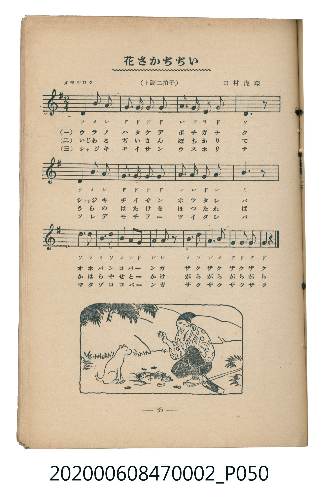
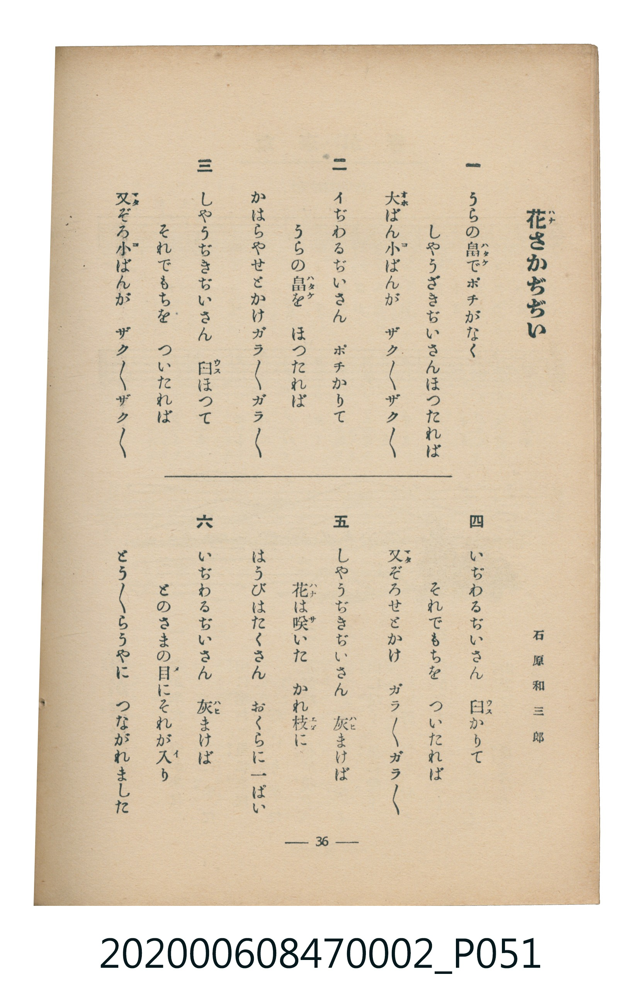

# 花さかぢぢい

> Re:Shōka 使用 AI 協助辨識與重建樂譜，可能會有錯誤。歡迎回報。

- **鋼琴伴奏版**：<br><audio controls src="hanasaka_jijii.mp3"></audio>
- **NEUTRINO 歌聲合成版**：<br><audio controls src="hanasaka_jijii_neutrino.mp3"></audio>

- 詞：石原和三郎
- 曲：田村虎藏
- 臺灣教育會公認《新定兒童唱歌》尋常科第二學年用（2020.006.0847.0002）

## 說明

原書資訊與歌詞全文（對應 P050.jpg – P051.jpg，書頁 pp. 35–36，第三學期第 7 首）：
調性與拍號：ト調二拍子（G 大調 2/4 拍），「オモシロク」


## 歌詞

```text
一
うらの畠でポチがなく
しやうぢきぢいさんほつたれば
大ばん小ばんが　ザク／＼ザク／＼

二
いぢわるぢいさん　ポチかりて
うらの畠を　ほつたれば
かはらやせとかけガラ／＼ガラ／＼

三
しやうぢきぢいさん　臼ほつて
それでもちを　ついたれば
又ぞろ小ばんが　ザク／＼ザク／＼

四
いぢわるぢいさん　臼かりて
それでもちを　ついたれば
又ぞろせとかけ　ガラ／＼ガラ／＼

五
しやうぢきぢいさん　灰まけば
花は咲いた　かれ枝に
はうびはたくさん　おくらに一ぱい

六
いぢわるぢいさん　灰まけば
とのさまの目にそれが入り
とう／＼らうやに　つながれました
```

## ABC

<div class="abc-score" data-abc-src="hanasaka_jijii.abc" aria-label="五線譜載入中"></div>

[下載 ABC 原始檔](hanasaka_jijii.abc)

## TMD 檔案連結

- [主旋律 TMD 檔案](hanasaka_jijii.tmd) [[在 TMD Studio 編輯](https://tmdlang.github.io/Tmd-TS/#tmd=s7IKdvYPcrWy4qpTUCpJTLdSSM7PyUlNLsnMz7MqzsjMK0nNjM_KTMmPL87Iz05Ugisry88pzU21Si9KTEmNN4o3MjAyiDcwMIs3sDAxBzIMjBBKi_NLi5JTrYqTM_Lzc-JLUitKkvLzsxHyBUX5Zal5iXlANQVFIBtTwIoQClLLMlNSQdKpKZkl-UWZiTlI7kgtKga7FWxJfElRYl5xclFmAcgDCFUlGalAx6bl52Tn5BelIsSBhqVn5lnlpmZmZWJxWX5RSUY-0IsFGZVWGZnFILuTE3PisxPzkEICanNBYnqqVYCBqYEukDBU4tLSUnjRtfFx49THjd2PGxeBUYuClhaXoq2CoYEJl72tgjuXjZG-iR3IpBcr573fM-v5_M1P--Y_ndTzZEfny-Y-sB3PZm8CyUzZ8GzuxBcz-15M7wcLv2jf9bxx8bOpM180bXo2p_lp65oXq3ofN3Q9m7bh6bpZT1snPV-99OmUjc_W9jxu6H66ofvpjh3Pl098vmbNk109T9fueLpzy_MpK97v6QBFnB4w4vRAEQdkGBi939OpxMWlr6VgSy3ApaCgAPTXs9k7Xmxuf7Gi60VHO9BdQC8_bV3xbFo70BVPN_Q-a-9UAAWfXlZBusKjhskgjiGI835PD1DnywWNCgUFegrGpkA5YzOgIMgvOzqBfnk2Zz6QrWCu8HLZNKDjgaEFsvDFqv3PGpaDrOrufTFzPlD0cXMHUBDof6DI07UTgNa6KzxdshwopgCMBgWgKFg3MMB6Hjetety86HHT9sfNax83rX_c0MsFMvPJjgYQ9bix7XFT5-PGdc-nLnjcuPxx89zHzY2PG3seN6563NgPUTH9cVMLSB0o2nshkQ9KC02THzfufty45HHj_MdNQA0bwGGzZDmQBZR7uqEfwgAZ1tDwuGkb0PL3e_rf79mDzIa4ZVcPxCaguUCX9j9ugiQzmDVA7VB3dT9u6nrcuAzD5U2TQIownQNOsOtB6kBemP24cQVYZOLjpjWPm1fCnINgQ4Omk5DHGxpetO-B2Qd1zlywtcsfNzU9blwIcxFQGqgHOYD6Ox43znvc1EtKAD2dPZtAAIGdgxI6JDoHJXRAzsEXQLumEA6g50DPNe4DmQaxCVyCrH86aRPUCSDnAB3c82ze3MeNqyHmrQcbthnMmA9Mf4j4bwR6DOhtYHyvBqbcx41As1ogQdO6lkDQoDsE7M114NIMKLru-WwgezUsvHqeti4FhiJcXRssCIA2A9Mb0NTVsIAEZhBg5gLqAZoyHehekB7KCxgoUNDS5-LyABbOxYnZiV7AIj3TKiAzMS_focagphpkk4KNoZmWHZhVo2Aar6ALhsZAbATENQqGQBIZ14DFQWwzkGKIEFwfCBqAhMAG-hjWgLIXVBzodxDZuA6sBRg3YN58MDkRTC6HyuyFqG9cCMQ9YNYqqEw_kj0gO6H2GIHkWmD2NC4C2wZSCxRv6kaIgdUAYwwqMxmqfi_YLhALpBYk04XdHmOQPdDEimpbYy_Uhej2QGxBhMPjxplAvBvMWgKVWYbdNhPKfNUGtosIX5lS4itQLIJENwHxPjALFJcgmQ3YbTOjzFfrwXaBWCDbQGaB7MO0h6TEbATmQdSAVONKyuQGEii6IREOTfBNoGSNJ5DACZrojNM0iVx7wAl6LtweSGaDZsOmJjAPnDHANoAgSD0o2UJ8SqQt4IRMc1vAyRiSHGFFBoQPEgfHBzRuQKbBbAElOIjZjxs7wLILoDKrsdsCTr4r4LaA4gSeSKEZACzW1Ahmg0xB-B5iD8T_ILfgzpTA5IskDmKjpkxUEVDKRU7PEBH01ItsEyStoIcmIsVCshtIHUwekQlBoiA_oKdXSFjCVEBDHpx2EeZDfd04G64OFpbIJkDSNXo6BYUuwnxQLIJE56GY30ue-8EplBTzSXQ_StqEqADlbpDoZhRRWHqFpVFIlYdeDELMxpUqUc3HKgqPFYgIIl5gqR7VfGxpD5bSQBAkCyldQRBRusJEQCkRHEZIqXEairugFQABUVhogPggcVhzAFbSI6dGUAwj4g3kX8KisJIWWtLAQwnNfHBqpKH7wamRhu4Hp0bU0gBWAaPkVnjphaiuQaUysNWMJo5mPjg1QspvmD5YAw7V_bASHZbzgDUszCSkPIAwvZaLS9dOAaU5qwAUUOYCAA)]
- [鋼琴伴奏 TMD 檔案](hanasaka_jijii_piano.tmd) [[在 TMD Studio 編輯](https://tmdlang.github.io/Tmd-TS/#tmd=s7IKdvYPcrWy4qpTUCpJTLdSyC8qychPL0osyKi0ysgsLskvykxOzInPTsxLVIIrKs4vLUpOjS9ITE-1CjAwNdAFEoZKXFpaCi-6Nj5unPq4sftx4yIwanm_p-Nl957nE7Y82bPl6dL-550d7_d0KmhpcSnaKhgamHDZ2yq4c9kY6ZvYgYx_sXLe-z2zns_f_LRv_tNJPU92dL5s7gNb_Gz2JpDMlA3P5k58MbPvxfR-sPCL9l3PGxc_mzrzRdOmZ3Oan7auebGq93FD17NpG56um_W0ddLz1UufTtn4bG3P44bupxu6n-7Y8Xz5xOdr1jzZ1fN07Y6nO7c8n7IC6EYjAyMDPQMDMz0DCxNzIMPACOhMJS4uD6DHixOzE70yszIzrQIyE_PygzwcagxqqrkUgMDG0EzLDsyqUTCNV9AFQ2MgNgLiGgVDIImMa8DiILYZSDFECK4PBA1AQmADfQxrFB43tkHFHzd1gsjGdWAtjxvXg3nzweREMLkcKrMXor5xIRD3gFmroDL9SPaA7ITaYwSSa4HZ0zgDbBtILVC8qRshBlYDjF2ozGSo-r1gu0AskFqQTBd2e4xB9kx_3NSC5Cuoyb1QF6LbA7EFEQ6PG2cC8W4wawlUZhl220wo81Ub2C4ifGVKia9AsQgS3QTE-8AsUFyCZDZgt82MMl-tB9sFYoFsA5kFsg_THpISsxGYB1EDUo0rKZMbSKDohkQ4NME3gZI1nkACJ2iiM07TJHLtASfouXB7IJkNmg2bmsA8cMYA2wCCIPWgZAvxKZG2gBMyzW0BJ2NIcoQVGRA-SBwcH9C4AZkGswWU4CBmP27sAMsugMqsxm4LOPmugNsCihN4IoVmALBYUyOYDTIF4XuIPRD_g9yCO1MCky-SOIiNmjJRRUApFzk9Q0TQUy-yTZC0gh6aiBQLyW4gdTB5RCYEiYL8gJ5eIWEJUwENeXDaRZgP9XXjbLg6WFgimwBJ1-jpFBS6CPNBsQgSnYdifi957genUFLMJ9H9KGkTogKUu0Gim1FEYekVlkYhVR56MQgxG1eqRDUfqyg8ViAiiHiBpXpU87GlPVhKA0GQLKR0BUFE6QoTAaVEcBghpcZpKO6CVgAERGGhAeKDxGHNAVhJj5waQTGMiDeQfwmLwkpaaEkDDyU088GpkYbuB6dGGrofnBpRSwNYBYySW-GlF6K6BpXKjxs3oomjmQ9OjZDyG6YP1oBDdT-sRIflPGANCzMJKQ8gTK_F2pr1QW7NmsAbs4bxCtGGscgMExjDND4emCZhaRtTIUg-2jQeKoZPJYoWLApRTUI1E-gbXTsFFA9F-wB1YQoaYRM0xiZogk3QFJugGVhQmQsA)]

## 分析

```text
================================================================================
📊 TMD Song Profile: [ 花さかぢぢい ]
================================================================================
⏱  Duration:       0:18 (18.5s), 16 measures total
🎼 Key & Tempo:    首調基準 G, != 104.0 BPM, <2/4>
   - 分析範圍：      由實際發聲的音符與和弦推測調性；播放脈絡另行呈現
🎤 人聲音域:    D4 (MIDI 62) – D5 (MIDI 74) [跨度: 12 個半音 / 1.0 個八度, 難度: easy]
   - 最低音:  D4 in [HanasakaJijii #1 @ m.1, 0:00]
   - 最高音: D5 in [HanasakaJijii #1 @ m.9, 0:09]
   - 適合: soprano, mezzo-soprano, contralto, tenor, baritone, bass
🏛  結構:      HanasakaJijii (18.5s)
⚡ 編曲密度:        Peak 1 軌道同時演奏
🗝  調性診斷：       G 大調（純淨自然大調，未偵測到可信轉調）
   - 風格氣質:    純淨自然大調（陽光明朗、易唱易記，無明顯調外色彩）
   - 轉調歷程:    全曲維持單一推測調性（未偵測到可信轉調）
   - 核心骨幹音:  G, B, A, D, E
   - 調性數值:    G 大調 [相關度: 0.82, 穩定度: Moderate, 自然音純度: 100.0%]
   - 候選調性 (K-S): G 大調 (0.82), D 大調 (0.71), B 小調 (0.61)
   - 五度圈歷程:   +1
   - 各段落調性細節:
     • [HanasakaJijii #1]: G 大調 (r: 0.82, 自然音純度: 100.0%)

  [ 五度圈游移軌跡 ]
               C  
         F           [G ]*
      Bb               D  
      Eb               A  
         Ab           E  
            Db       B  
               F# 
     (* = active key center)

  [ 十二半音累積音高分佈 ]
     C  :                            0.0%
     C# :                            0.0%
     D  : ██████████████████        22.0%
     D# :                            0.0%
     E  : █                          1.7%
     F  :                            0.0%
     F# :                            0.0%
     G  : ████████████████████████  29.7%
     G# :                            0.0%
     A  : ███████████████████       22.9%
     A# :                            0.0%
     B  : ███████████████████       23.7%
--------------------------------------------------------------------------------
Assignment 軌道音域：
  - Piano         : D4 – D5 (12 個半音 / 1.0 個八度, 41 個音符)
================================================================================
```


## 原書掃描頁






