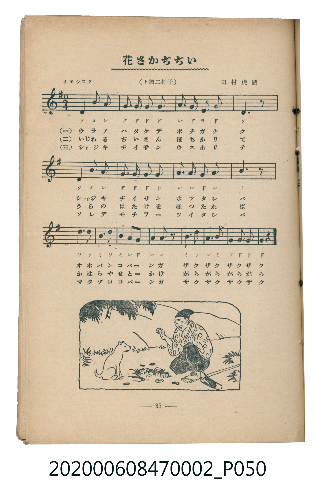
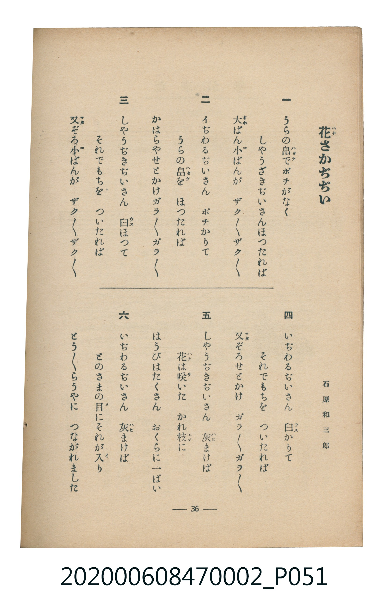

# 花さかぢぢい

> Re:Shōka 使用 AI 協助辨識與重建樂譜，可能會有錯誤。歡迎回報。

- **NEUTRINO 歌聲合成版**：<br><audio controls src="hanasaka_jijii_neutrino.mp3"></audio>
- **鋼琴伴奏版**：<br><audio controls src="hanasaka_jijii.mp3"></audio>


- 詞：石原和三郎
- 曲：田村虎藏
- 臺灣教育會公認《新定兒童唱歌》尋常科第二學年用（2020.006.0847.0002）

## 說明

原書資訊與歌詞全文（對應 P050.jpg – P051.jpg，書頁 pp. 35–36，第三學期第 7 首）：
調性與拍號：ト調二拍子（G 大調 2/4 拍），「オモシロク」


## 跨冊／重複收錄參照

> 同名異曲（各冊收錄之不同詞曲版本）

- **[同名異曲]** 《公學校唱歌集》（大正4年／1915，國臺圖 0725 26）：[**〈花咲爺〉**](../../../kogakko_shokashu_1915/3_07_hanasaka_jijii/index.md)（`D` / `2/4` — [原始 TMD](../../../kogakko_shokashu_1915/3_07_hanasaka_jijii/hanasaka_jijii.tmd)）
- 總表：[跨冊重複與同名歌曲總索引](../../../duplicate_songs.md)

## 歌詞

```text
一
うらの畠でポチがなく
しやうぢきぢいさんほつたれば
大ばん小ばんが　ザク／＼ザク／＼

二
いぢわるぢいさん　ポチかりて
うらの畠を　ほつたれば
かはらやせとかけガラ／＼ガラ／＼

三
しやうぢきぢいさん　臼ほつて
それでもちを　ついたれば
又ぞろ小ばんが　ザク／＼ザク／＼

四
いぢわるぢいさん　臼かりて
それでもちを　ついたれば
又ぞろせとかけ　ガラ／＼ガラ／＼

五
しやうぢきぢいさん　灰まけば
花は咲いた　かれ枝に
はうびはたくさん　おくらに一ぱい

六
いぢわるぢいさん　灰まけば
とのさまの目にそれが入り
とう／＼らうやに　つながれました
```

## ABC

```abc
X:1
T:花さかぢぢい
C:曲：田村虎藏
M:2/4
L:1/16
Q:1/4=104
K:G
V:V1 name="Piano" snm="Pia"
[V:V1]
D4 B2 A2 | G2 G2 G2 G2 | A3 G E2 G2 | D6 z2 |
w: 1.~う ら の | は た け で | ぽ ち が な | く
w: 2.~い ぢ わ | る ぢ い さ | ん ぽ ち か | り
w: 3.~しやう ぢ き | ぢ い さ ん | う す ほ つ | て
w: 4.~い ぢ わ | る ぢ い さ | ん う す か | り
w: 5.~しやう ぢ き | ぢ い さ ん | は ひ ま け | ば
w: 6.~い ぢ わ | る ぢ い さ | ん は ひ ま | け
D4 B2 A2 | G2 G2 G2 G2 | A3 A G2 A2 | B6 z2 |
w: 1.~しやう ぢ き | ぢ い さ ん | ほ つ た れ | ば
w: 2.~う ら の | は た け を | ほ つ た れ | ば
w: 3.~そ れ で | も ち を _ | つ い た れ | ば
w: 4.~そ れ で | も ち を _ | つ い た れ | ば
w: 5.~は な は | さ い た _ | か れ え だ | に
w: 6.~と の さ | ま の め に | そ れ が い | り
d6 d2 | B6 d2 | B4 A2 G2 | A4 A2 z2 |
w: 1.~お ほ | ば ん | こ ば _ | ん が
w: 2.~か は | ら や | せ と _ | か け
w: 3.~ま た | ぞ ろ | こ ば _ | ん が
w: 4.~ま た | ぞ ろ | せ と _ | か け
w: 5.~は う | び は | た く さ | ん _
w: 6.~と う | と う | ら う や | に _
B6 d2 | A6 B2 | G4 G2 G2 | G4 z4 |
w: 1.~ざ く | ざ く | ざ く ざ | く
w: 2.~が ら | が ら | が ら が | ら
w: 3.~ざ く | ざ く | ざ く ざ | く
w: 4.~が ら | が ら | が ら が | ら
w: 5.~お く | ら に | い つ ぱ | い
w: 6.~つ な | が れ | ま し _ | た
```

## TMD 檔案連結

- [主旋律 TMD 檔案](hanasaka_jijii.tmd) [[在 TMD Studio 編輯](https://tmdlang.github.io/Tmd-TS/#tmd=s7IKdvYPcrWy4qpTUCpJTLdSSM7PyUlNLsnMz7MqzsjMK0nNjM_KTMmPL87Iz05Ugisry88pzU21Si9KTEmNN4o3MjAyiDcwMIs3sDAxBzIMjBBKi_NLi5JTrYqTM_Lzc-JLUitKkvLzsxHyBUX5Zal5iXlANQVFIBtTwIoQClLLMlNSQdKpKZkl-UWZiTlI7kgtKga7FWxJfElRYl5xclFmAcgDCFUlGalAx6bl52Tn5BelKnFpaSm86Nr4uHHq48bux42LwKhFQUuLS9FWwdDAhMveVsGdy8ZI38QOZMSLlfPe75n1fP7mp33zn07qebKj82VzH9jwZ7M3gWSmbHg2d-KLmX0vpveDhV-073reuPjZ1JkvmjY9m9P8tHXNi1W9jxu6nk3b8HTdrKetk56vXvp0ysZna3seN3Q_3dD9dMeO58snPl-z5smunqdrdzzdueX5lBXv93SAQlUPGKp6oFAFMgyM3u_pVOLi0tdSsKUW4FJQUAD669nsHS82t79Y0fWiox3oLqCXn7aueDatHeiKpxt6n7V3KgQYmBroZRWkKzxqmAziGII47_f0AHW-XNCoUFCgp2BsCpQzNgMKgvyyoxPol2dz5gPZCuYKL5dNAzoeGFogC1-s2v-sYTnIqu7eFzPnA0UfN3cABYH-B4o8XTsBaK27wtMly4FiCsBoUACKgnUDA6zncdOqx82LHjdtf9y89nHT-scNvVwgM5_saABRjxvbHjd1Pm5c93zqgseNyx83z33c3Pi4sedx46rHjf0QFdMfN7WA1IGivRcS-aC00DT5cePux41LHjfOf9wE1LABHDZLlgNZQLmnG_ohDJBhDQ2Pm7YBLX-_p__9nj3IbIhbdvVAbAKaC3Rp_-MmSDKDWQPUDnVX9-OmrseNyzBc3jQJpAjTOeAEux6kDuSF2Y8bV4BFJj5uWvO4eSXMOQg2NGg6CXm8oeFF-x6YfVDnzAVbu_xxU9PjxoUwFwGlgXqQA6i_43HjvMdNvaQE0NPZswkEENg5KKFDonNQQgfkHHwBtGsK4QB6DvRc4z6QaRCbwCXI-qeTNkGdAHIO0ME9z-bNfdy4GmLeerBhm8GM-cD0h4j_RqDHgN4GxvdqYMp93Ag0qwUSNK1rCQQNukPA3lwHLs2AouuezwayV8PCq-dp61JgKMLVtcGCAGgzML0BTV0NC0hgBgFmLqAeoCnTge4F6aG8gIECBS19Li6PxLzE4sTsRK_MrMxMq4DMxLx8hxqDmmqQTQo2hmZadmBWjYJpvIIuGBoDsREQ1ygYAklkXAMWB7HNQIohQnB9IGgAEgIb6GNYA8peUHGg30Fk4zqwFmDcgHnzweREMLkcKrMXor5xIRD3gFmroDL9SPaA7ITaYwSSa4HZ07gIbBtILVC8qRshBlYDjDGozGSo-r1gu0AskFqQTBd2e4xB9kATK6ptjb1QF6LbA7EFEQ6PG2cC8W4wawlUZhl220wo81Ub2C4ifGVKia9AsQgS3QTE-8AsUFyCZDZgt82MMl-tB9sFYoFsA5kFsg_THpISsxGYB1EDUo0rKZMbSKDohkQ4NME3gZI1nkACJ2iiM07TJHLtASfouXB7IJkNmg2bmsA8cMYA2wCCIPWgZAvxKZG2gBMyzW0BJ2NIcoQVGRA-SBwcH9C4AZkGswWU4CBmP27sAMsugMqsxm4LOPmugNsCihN4IoVmALBYUyOYDTIF4XuIPRD_g9yCO1MCky-SOIiNmjJRRUApFzk9Q0TQUy-yTZC0gh6aiBQLyW4gdTB5RCYEiYL8gJ5eIWEJUwENeXDaRZgP9XXjbLg6WFgimwBJ1-jpFBS6CPNBsQgSnYdifi957genUFLMJ9H9KGkTogKUu0Gim1FEYekVlkYhVR56MQgxG1eqRDUfqyg8ViAiiHiBpXpU87GlPVhKA0GQLKR0BUFE6QoTAaVEcBghpcZpKO6CVgAERGGhAeKDxGHNAVhJj5waQTGMiDeQfwmLwkpaaEkDDyU088GpkYbuB6dGGrofnBpRSwNYBYySW-GlF6K6BpXKwFYzmjia-eDUCCm_YfpgDThU98NKdFjOA9awMJOQ8gDC9FouLl07BZTmrAJQQJkLAA)]
- [鋼琴伴奏 TMD 檔案](hanasaka_jijii_piano.tmd) [[在 TMD Studio 編輯](https://tmdlang.github.io/Tmd-TS/#tmd=s7IKdvYPcrWy4tLSUnjRtfFx49THjd2PGxeBUcv7PR0vu_c8n7DlyZ4tT5f2P-_seL-nU0FLi0vRVsHQwITL3lbBncvGSN_EjqtOQenFynnv98x6Pn_z0775Tyf1PNnR-bK5Twkk82z2JpDMlA3P5k58MbPvxfR-sPCL9l3PGxc_mzrzRdOmZ3Oan7auebGq93FD17NpG56um_W0ddLz1UufTtn4bG3P44bupxu6n-7Y8Xz5xOdr1jzZ1fN07Y6nO7c8n7IC6EYjAyMDPQMDMz0DCxNzIMPACOhMJS4uj8S8xOLE7ESvzKzMTKuAzMS8_CAPhxqDmmouBSCwMTTTsgOzahRM4xV0wdAYiI2AuEbBEEgi4xqwOIhtBlIMEYLrA0EDkBDYQB_DGoXHjW1Q8cdNnSCycR1Yy-PG9WDefDA5EUwuh8rshahvXAjEPWDWKqhMP5I9IDuh9hiB5Fpg9jQuAtsGUgsUb-pGiIHVAGMXKjMZqn4v2C4QC6QWJNOF3R5jkD3THze1IPkKanIv1IXo9kBsQYTD48aZQLwbzFoClVmG3TYTynzVBraLCF-ZUuIrUCyCRDcB8T4wCxSXIJkN2G0zo8xX68F2gVgg20BmgezDtIekxGwE5kHUgFTjSsrkBhIouiERDk3wTaBkjSeQwAma6IzTNIlce8AJei7cHkhmg2bDpiYwD5wxwDaAIEg9KNlCfEqkLeCETHNbwMkYkhxhRQaEDxIHxwc0bkCmwWwBJTiI2Y8bO8CyC6Ayq7HbAk6-K-C2gOIEnkihGQAs1tQIZoNMQfgeYg_E_yC34M6UwOSLJA5io6ZMVBFQykVOzxAR9NSLbBMkraCHJiLFQrIbSB1MHpEJQaIgP6CnV0hYwlRAQx6cdhHmQ33dOBuuDhaWyCZA0jV6OgWFLsJ8UCyCROehmN9LnvvBKZQU80l0P0rahKgA5W6Q6GYUUVh6haVRSJWHXgxCzMaVKlHNxyoKjxWICCJeYKke1XxsaQ-W0kAQJAspXUEQUbrCREApERxGSKlxGoq7oBUAAVFYaID4IHFYcwBW0iOnRlAMI-IN5F_CorCSFlrSwEMJzXxwaqSh-8GpkYbuB6dG1NIAVgGj5FZ46YWorkGl8uPGjWjiaOaDUyOk_IbpgzXgUN0PK9FhOQ9Yw8JMQsoDCNNrsbZmfZBbsybwxqxhvEK0YSwywwTGMI2PB6ZJWNrGVAiSjzaNh4rhU4miBYtCVJNQzQT6RtdOAcVD0T5AXZiCRtgEjbEJmmATNMUmaAYWVOYCAA)]

## 分析

```text
================================================================================
📊 TMD Song Profile: [ 花さかぢぢい ]
================================================================================
⏱  Duration:       0:18 (18.5s), 16 measures total
🎼 Key & Tempo:    首調基準 G, != 104.0 BPM, <2/4>
   - 分析範圍：      由實際發聲的音符與和弦推測調性；播放脈絡另行呈現
🎤 人聲音域:    D4 (MIDI 62) – D5 (MIDI 74) [跨度: 12 個半音 / 1.0 個八度, 難度: easy]
   - 最低音:  D4 in [HanasakaJijii #1 @ m.1, 0:00]
   - 最高音: D5 in [HanasakaJijii #1 @ m.9, 0:09]
   - 適合: soprano, mezzo-soprano, contralto, tenor, baritone, bass
🏛  結構:      HanasakaJijii (18.5s)
⚡ 編曲密度:        Peak 1 軌道同時演奏
🗝  調性診斷：       G 大調（純淨自然大調，未偵測到可信轉調）
   - 風格氣質:    純淨自然大調（陽光明朗、易唱易記，無明顯調外色彩）
   - 轉調歷程:    全曲維持單一推測調性（未偵測到可信轉調）
   - 核心骨幹音:  G, B, A, D, E
   - 調性數值:    G 大調 [相關度: 0.82, 穩定度: Moderate, 自然音純度: 100.0%]
   - 候選調性 (K-S): G 大調 (0.82), D 大調 (0.71), B 小調 (0.61)
   - 五度圈歷程:   +1
   - 各段落調性細節:
     • [HanasakaJijii #1]: G 大調 (r: 0.82, 自然音純度: 100.0%)

  [ 五度圈游移軌跡 ]
               C  
         F           [G ]*
      Bb               D  
      Eb               A  
         Ab           E  
            Db       B  
               F# 
     (* = active key center)

  [ 十二半音累積音高分佈 ]
     C  :                            0.0%
     C# :                            0.0%
     D  : ██████████████████        22.0%
     D# :                            0.0%
     E  : █                          1.7%
     F  :                            0.0%
     F# :                            0.0%
     G  : ████████████████████████  29.7%
     G# :                            0.0%
     A  : ███████████████████       22.9%
     A# :                            0.0%
     B  : ███████████████████       23.7%
--------------------------------------------------------------------------------
Assignment 軌道音域：
  - Piano         : D4 – D5 (12 個半音 / 1.0 個八度, 41 個音符)
================================================================================
```


## 原書掃描頁






