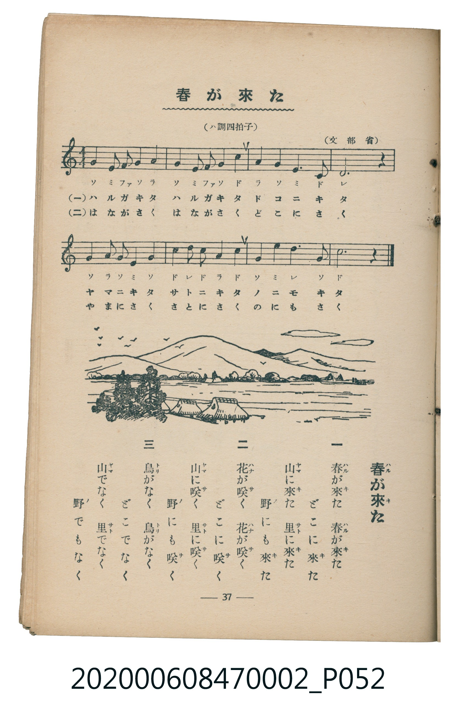

# 春が來た

> Re:Shoka 使用 AI 協助辨識與重建樂譜，可能會有錯誤。歡迎回報。

<audio controls src="haru_ga_kita.mp3"></audio>

- 文部省
- 臺灣教育會公認《新定兒童唱歌》尋常科第二學年用（2020.006.0847.0002）

## 說明

原書資訊與歌詞全文（對應 P052.jpg，書頁 p. 37，第三學期第 8 首）：
調性與拍號：ハ調四拍子（C 大調 4/4 拍）

## 歌詞

```text
一
春が來た　春が來た　どこに來た
山に來た　里に來た　野にも來た

二
花が咲く　花が咲く　どこに咲く
山に咲く　里に咲く　野にも咲く

三
鳥がなく　鳥がなく　どこでなく
山でなく　里でなく　野でもなく
```

## ABC

```abc
X:1
T:春が來た
M:4/4
L:1/16
Q:1/4=100
K:C
V:V1 name="Piano" snm="Pia"
[V:V1]
G4 E2 F2 G4 A4 | G4 E2 F2 G4 c4 | A4 G4 E4 C4 | D12 z4 |
G4 A2 G2 E4 G4 | c4 d2 c2 A4 c4 | G4 E4 D6 G2 | c12 z4 |
```

## TMD 檔案連結

- [主旋律 TMD 檔案](haru_ga_kita.tmd) [[在 TMD Studio 編輯](https://tmdlang.github.io/Tmd-TS/#tmd=s7IKdvYPcrWy4qpTUCpJTLdSSM7PyUlNLsnMz7MqzsjMK0nNjM_KTMmPL87Iz05Ugisry88pzU21Si9KTEmNN4o3MjAyiDcwMIs3sDAxBzIMjBBKi_NLi5JTrYqTM_Lzc-JLUitKkvLzsxHyBUX5Zal5iXlANQVFIBtTwIoQClLLMlNSQdKpKZkl-UWZiTlI7kgtKga7FWxJfElRYl5xclFmAcgDCFUlGalAxxanJhbn5xXjFNbSUng2Y-njxp4n-9oeN85X0NLiUrRVMDQw4LK3VXDmsjHRN7ED6X02rf1l84rncxrBJr1o3_W8cfGzqTNfNG16Nqf5aeuaF6t6Hzd0PZu24em6WU9bJz1fvfTplI3P1vY8buh-uqH76Y4dz5dPfL5mzZNdPU_X7ni6c8vzKSve7-kABaEeMAj1QEEIZBgYvd_TqcTFpa-lYEstwKWgoPC0b_6z2TtebG5_saLrRUc70F0vVs572roC6CugK55u6H3W3qkQYGBqpJdVkP5-Tw9Q8csFjQoFegrG5kAuyOE7OoEOfzZnPpCtYKHwctk0oEvf75kFMv3Fqv3PGpaDzO3ufTFzPlD0cXM_UPDp7NlAkadrJwDtcFZ4umQ5UEwBGKAKQFGgbi6Q3ic7GkAUchw8bmhA4z5uXPm4cfLjxtUQEbCPNm6E84EqXrb3oHL7gNzHTU1QDWCbdvWAHdsF1NjzdNKmx439QJVoXLhNEBGETXAVEJuQuFCboBogfuoEUS83gzzxuHEVVCUqF2bTcogI3CYoH2YTMhdo03KgTQgNlCcOKFDQ0ufi8kgsKnVP9M4sSbQKyEzMy3eoMahRqAbZo2BjoWUHZtQomCroKhgrmIBpMyBGFTGMAwuBJCDCQCGwiBGQhEEDkAiScWZAEqQSxK6BGGEUB6JBxkBNhJkGMccUpg7VyFouLl07BYQ_FIA8ZS4uAA)]
- [鋼琴伴奏 TMD 檔案](haru_ga_kita_piano.tmd) [[在 TMD Studio 編輯](https://tmdlang.github.io/Tmd-TS/#tmd=s7IKdvYPcrWy4tLSUng2Y-njxp4n-9oeN85_v6fjZfee5xO2PNmz5enS_uedHe_3dCpoaXEp2ioYGhhw2dsqOHPZmOib2HHVKSg9m9b-snnF8zmNSiDei_ZdzxsXP5s680XTpmdzmp-2rnmxqvdxQ9ezaRuerpv1tHXS89VLn07Z-Gxtz-OG7qcbup_u2PF8-cTna9Y82dXzdO2Opzu3PJ-yAugAIwMjAz0DAzM9AwsTcyDDwAjoBiUuLo_EolL3RO_MkkSrgMzEvPwgD4cagxqFai4FILCx0LIDM2oUTBV0FYwVTMC0GRCjihjGgYVAEhBhoBBYxAhIwqABSATJODMgCVIJYtdAjDCKA9EgY6AmwkyDmGMKU4dqZC2mN3xQvGEC94ZhvEK0YSyYMolF5QOpGgUTNL5pPJBlGh8LIQzg7semD2gglILLw7XDRUAYZAzQzbp2CghnKwB5ylxcAA)]

## 分析

```text
================================================================================
📊 TMD Song Profile: [ 春が來た ]
================================================================================
⏱  Duration:       0:19 (19.2s), 8 measures total
🎼 Key & Tempo:    首調基準 C, != 100.0 BPM, <4/4>
   - 分析範圍：      由實際發聲的音符與和弦推測調性；播放脈絡另行呈現
🎤 人聲音域:    C4 (MIDI 60) – D5 (MIDI 74) [跨度: 14 個半音 / 1.2 個八度, 難度: moderate]
   - 最低音:  C4 in [HaruGaKita #1 @ m.3, 0:06]
   - 最高音: D5 in [HaruGaKita #1 @ m.6, 0:12]
   - 適合: soprano, mezzo-soprano, contralto, tenor, baritone, bass
🏛  結構:      HaruGaKita (19.2s)
⚡ 編曲密度:        Peak 1 軌道同時演奏
🗝  調性診斷：       C 大調（純淨自然大調，未偵測到可信轉調）
   - 風格氣質:    純淨自然大調（陽光明朗、易唱易記，無明顯調外色彩）
   - 轉調歷程:    全曲維持單一推測調性（未偵測到可信轉調）
   - 核心骨幹音:  G, C, D, E, A
   - 調性數值:    C 大調 [相關度: 0.88, 穩定度: Moderate, 自然音純度: 100.0%]
   - 候選調性 (K-S): C 大調 (0.88), G 大調 (0.81), E 小調 (0.56)
   - 五度圈歷程:   +0
   - 各段落調性細節:
     • [HaruGaKita #1]: C 大調 (r: 0.88, 自然音純度: 100.0%)

  [ 五度圈游移軌跡 ]
              [C ]*
         F            G  
      Bb               D  
      Eb               A  
         Ab           E  
            Db       B  
               F# 
     (* = active key center)

  [ 十二半音累積音高分佈 ]
     C  : ████████████████████      25.0%
     C# :                            0.0%
     D  : █████████████             16.7%
     D# :                            0.0%
     E  : ███████████               13.3%
     F  : ███                        3.3%
     F# :                            0.0%
     G  : ████████████████████████  30.0%
     G# :                            0.0%
     A  : █████████                 11.7%
     A# :                            0.0%
     B  :                            0.0%
--------------------------------------------------------------------------------
Assignment 軌道音域：
  - Piano         : C4 – D5 (14 個半音 / 1.2 個八度, 30 個音符)
================================================================================
```


## 原書掃描頁




