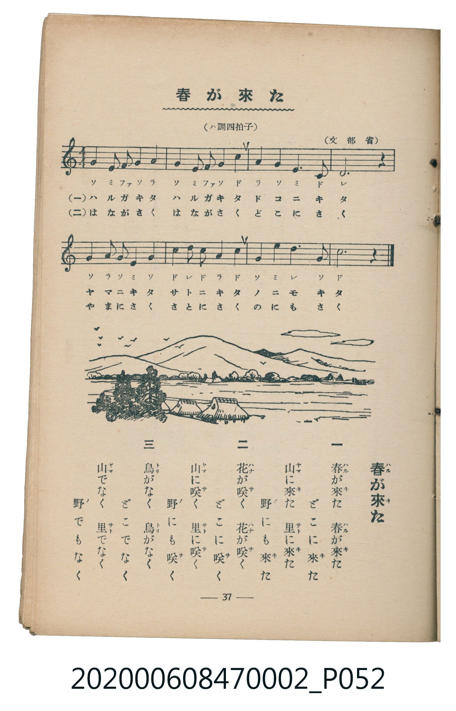

# 春が來た

> Re:Shōka 使用 AI 協助辨識與重建樂譜，可能會有錯誤。歡迎回報。

- **鋼琴伴奏版**：<br><audio controls src="haru_ga_kita.mp3"></audio>
- **NEUTRINO 歌聲合成版**：<br><audio controls src="haru_ga_kita_neutrino.mp3"></audio>

- 文部省
- 臺灣教育會公認《新定兒童唱歌》尋常科第二學年用（2020.006.0847.0002）

## 說明

原書資訊與歌詞全文（對應 P052.jpg，書頁 p. 37，第三學期第 8 首）：
調性與拍號：ハ調四拍子（C 大調 4/4 拍）


## 歌詞

```text
一
春が來た　春が來た　どこに來た
山に來た　里に來た　野にも來た

二
花が咲く　花が咲く　どこに咲く
山に咲く　里に咲く　野にも咲く

三
鳥がなく　鳥がなく　どこでなく
山でなく　里でなく　野でもなく
```

## ABC

<div class="abc-score" data-abc-src="haru_ga_kita.abc" aria-label="五線譜載入中"></div>

[下載 ABC 原始檔](haru_ga_kita.abc)

## TMD 檔案連結

- [主旋律 TMD 檔案](haru_ga_kita.tmd) [[在 TMD Studio 編輯](https://tmdlang.github.io/Tmd-TS/#tmd=s7IKdvYPcrWy4qpTUCpJTLdSSM7PyUlNLsnMz7MqzsjMK0nNjM_KTMmPL87Iz05Ugisry88pzU21Si9KTEmNN4o3MjAyiDcwMIs3sDAxBzIMjBBKi_NLi5JTrYqTM_Lzc-JLUitKkvLzsxHyBUX5Zal5iXlANQVFIBtTwIoQClLLMlNSQdKpKZkl-UWZiTlI7kgtKga7FWxJfElRYl5xclFmAcgDCFUlGalAxxanJhbn5xUTFAZakZ6ZZ5Wbn5dUCvQ2pkRqZlYmkke0tBSezVj6uLHnyb62x43zFbS0uBRtFQwNDLjsbRWcuWxM9E3sQGY8m9b-snnF8zmNYBNftO963rj42dSZL5o2PZvT_LR1zYtVvY8bup5N2_B03aynrZOer176dMrGZ2t7Hjd0P93Q_XTHjufLJz5fs-bJrp6na3c83bnl-ZQV7_d0gIJeDxj0eqCgBzIMjN7v6VTi4tLXUrClFuBSUFB42jf_2ewdLza3v1jR9aKjHeiuFyvnPW1dAfQV0BVPN_Q-a-9UCDAwNdLLKkh_v6cHqPjlgkaFAj0FY3MgF-TwHZ1Ahz-bMx_IVrBQeLlsGtCl7_fMApn-YtX-Zw3LQeZ2976YOR8o-ri5Hyj4dPZsoMjTtROAdjgrPF2yHCimAAxQBaAoUDcXSO-THQ0gCjkOHjc0oHEfN6583Dj5ceNqiAjYRxs3wvlAFS_be1C5fUDu46YmqAawTbt6wI7tAmrseTpp0-PGfqBKNC7cJogIwia4CohNSFyoTVANED91gqiXm0GeeNy4CqoSlQuzaTlEBG4TlA-zCZkLtGk50CaEBsoTBxQoaOlzcXkkFpW6J3pnliRaBWQm5uU71BjUVIOsUbCx0LIDM2oUTBV0FYwVTMC0GRCjihjGgYVAEhBhoBBYxAhIwqABSARsnI9hjcLjxvVA_uOmbiCrB4h7QTxgRgTpwi-3EsybDCZXg0mQPEgGpAIG4xG2GcFNbFwFNXEqmNePbBsOOUzbQPIgGZAKLLYZg-RWgN3fBTVxFYqJ-OSQbVsOdRU-2yDRYAYkQWEOYtdAIsMoDkSDIgQaN-B4gcqAzDCFqcQRPU0tYOv3gb2NHgWQIFqBVW4dIqiamsAmg1QQiB4021CjANU2VDlstk0lFD1Iti3HiAKEbZhyENvAEQO3bRUO22q5uHTtFBCZSwHIU-YCAA)]
- [鋼琴伴奏 TMD 檔案](haru_ga_kita_piano.tmd) [[在 TMD Studio 編輯](https://tmdlang.github.io/Tmd-TS/#tmd=s7IKdvYPcrWy4tLSUng2Y-njxp4n-9oeN85_v6fjZfee5xO2PNmz5enS_uedHe_3dCpoaXEp2ioYGhhw2dsqOHPZmOib2HHVKSg9m9b-snnF8zmNSiDei_ZdzxsXP5s680XTpmdzmp-2rnmxqvdxQ9ezaRuerpv1tHXS89VLn07Z-Gxtz-OG7qcbup_u2PF8-cTna9Y82dXzdO2Opzu3PJ-yAugAIwMjAz0DAzM9AwsTcyDDwAjoBiUuLo_EolL3RO_MkkSrgMzEvPwgD4cag5pqLgUgsLHQsgMzahRMFXQVjBVMwLQZEKOKGMaBhUASEGGgEFjECEjCoAFIBGycj2GNwuPG9UD-46ZuIKsHiHtBvMb5YF345VaCeZPB5GowCZIHyYBUwGA8wjYjuImNq6AmTgXz-pFtwyGHaRtIHiQDUoHFNmOQ3Aqw-7ugJq5CMRGfHLJty6GuwmcbJBrMgCQozEHsGkhkGMWBaFCEQOMGHC9QGZAZpjCVOKKnqQVs_T6wt9GjABJEK7DKrUMEVVMT2GSQCgLRg2YbahSg2oYqh822qYSiB8m25RhRgLANUw5iGzhi4LatwmFbLWbe8kHOWybwvGUYrxBtGAumTGJR-UCqRsEEjW8aD2SZxsdCCAN4UsCmD2gglILLw7XDRUAYZAzQybp2CghXR_sAJdBEjDBEjMEiylwA)]

## 分析

```text
================================================================================
📊 TMD Song Profile: [ 春が來た ]
================================================================================
⏱  Duration:       0:19 (19.2s), 8 measures total
🎼 Key & Tempo:    首調基準 C, != 100.0 BPM, <4/4>
   - 分析範圍：      由實際發聲的音符與和弦推測調性；播放脈絡另行呈現
🎤 人聲音域:    C4 (MIDI 60) – E5 (MIDI 76) [跨度: 16 個半音 / 1.3 個八度, 難度: moderate]
   - 最低音:  C4 in [HaruGaKita #1 @ m.3, 0:06]
   - 最高音: E5 in [HaruGaKita #1 @ m.7, 0:15]
   - 適合: soprano, mezzo-soprano, contralto, tenor, baritone, bass
🏛  結構:      HaruGaKita (19.2s)
⚡ 編曲密度:        Peak 1 軌道同時演奏
🗝  調性診斷：       C 大調（純淨自然大調，未偵測到可信轉調）
   - 風格氣質:    純淨自然大調（陽光明朗、易唱易記，無明顯調外色彩）
   - 轉調歷程:    全曲維持單一推測調性（未偵測到可信轉調）
   - 核心骨幹音:  G, C, D, E, A
   - 調性數值:    C 大調 [相關度: 0.88, 穩定度: Moderate, 自然音純度: 100.0%]
   - 候選調性 (K-S): C 大調 (0.88), G 大調 (0.81), E 小調 (0.56)
   - 五度圈歷程:   +0
   - 各段落調性細節:
     • [HaruGaKita #1]: C 大調 (r: 0.88, 自然音純度: 100.0%)

  [ 五度圈游移軌跡 ]
              [C ]*
         F            G  
      Bb               D  
      Eb               A  
         Ab           E  
            Db       B  
               F# 
     (* = active key center)

  [ 十二半音累積音高分佈 ]
     C  : ████████████████████      25.0%
     C# :                            0.0%
     D  : █████████████             16.7%
     D# :                            0.0%
     E  : ███████████               13.3%
     F  : ███                        3.3%
     F# :                            0.0%
     G  : ████████████████████████  30.0%
     G# :                            0.0%
     A  : █████████                 11.7%
     A# :                            0.0%
     B  :                            0.0%
--------------------------------------------------------------------------------
Assignment 軌道音域：
  - Piano         : C4 – E5 (16 個半音 / 1.3 個八度, 30 個音符)
================================================================================
```


## 原書掃描頁




