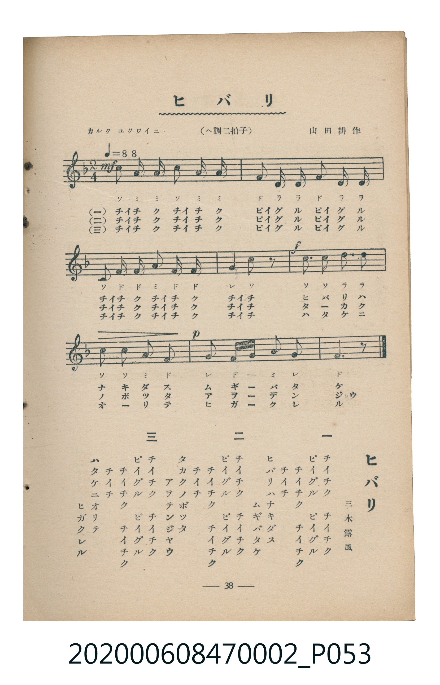

# ヒバリ（雲雀）

> Re:Shōka 使用 AI 協助辨識與重建樂譜，可能會有錯誤。歡迎回報。

- **鋼琴伴奏版**：<br><audio controls src="hibari.mp3"></audio>
- **NEUTRINO 歌聲合成版**：<br><audio controls src="hibari_neutrino.mp3"></audio>

- 詞：三木露風
- 曲：山田耕作
- 臺灣教育會公認《新定兒童唱歌》尋常科第二學年用（2020.006.0847.0002）

## 說明

曲目說明
中文解釋：描寫雲雀飛上天空、在春日田野歌唱。

原書資訊與歌詞全文（對應 P053.jpg，書頁 p. 38，參考教材第 1 首）：
調性與拍號：ヘ調二拍子（F 大調 2/4 拍），「カルク ユクワイニ（♩＝88）」


## 歌詞

```text
一
チイチク　チイチク
ピイグル　ピイグル
チイチク　チイチク　チイチ
ヒバリハナキダス　ムギバタケ

二
チイチク　チイチク
ピイグル　ピイグル
チイチク　チイチク　チイチ
タカクノボツタ　アヲテンジヤウ

三
チイチク　チイチク
ピイグル　ピイグル
チイチク　チイチク　チイチ
ハタケニオリテ　ヒガクレル
```

## ABC

```abc
X:1
T:ヒバリ（雲雀）
C:曲：山田耕作
M:2/4
L:1/16
Q:1/4=88
K:F
V:V1 name="Piano" snm="Pia"
[V:V1]
!mf! c2 A A c2 A A | F2 D D F2 D D | C2 F F A2 F F | G4 c2 z2 |
w: 1.~チイ チ ク チイ チ ク | ピイ グ ル ピイ グ ル | チイ チ ク チイ チ ク | チイ チ
w: 2.~チイ チ ク チイ チ ク | ピイ グ ル ピイ グ ル | チイ チ ク チイ チ ク | チイ チ
w: 3.~チイ チ ク チイ チ ク | ピイ グ ル ピイ グ ル | チイ チ ク チイ チ ク | チイ チ
!f! c3 c d3 d | c2 c2 A2 F2 | !p! G2 F F A2 G2 | F6 z2 |
w: 1.~ヒ バ リ ハ | ナ キ ダ ス | ム ギ _ バ タ | ケ
w: 2.~タ カ ク ノ | ボ ツ タ _ | ア ヲ _ テ ン | ジヤウ
w: 3.~ハ タ ケ ニ | オ リ テ _ | ヒ ガ _ ク レ | ル
```

## TMD 檔案連結

- [主旋律 TMD 檔案](hibari.tmd) [[在 TMD Studio 編輯](https://tmdlang.github.io/Tmd-TS/#tmd=s7IKdvYPcrWy4qpTUCpJTLdSSM7PyUlNLsnMz7MqzsjMK0nNjM_KTMmPL87Iz05Ugisry88pzU21Si9KTEmNN4o3MjAyiDcwMIs3sDAxBzIMjBBKi_NLi5JTrYqTM_Lzc-JLUitKkvLzsxHyBUX5Zal5iXlANQVFIBtTwIoQClLLMlNSQdKpKZkl-UWZiTlI7kgtKga7FWxJfElRYl5xclFmAcgDCFUlGalAxybmZeYi6wUalZ6ZZ1WSmAn0HMiD5YnxuYmZeTmJeSlKXFpaCo-bJz1unvC4edX7PR0vZ296Obvh_Z5OBS0tLkVbBQsLLntbBTcuGyN9EzuQkS9Wznu_Z9aTHZ3P5qx4OWfTy0UrwDY9m70JKPx048bnUza8aJj6ZO8csPCL9l3PGxc_mzrzRdOmZ3Oan7auebGq93FD17NpG56um_W0ddLz1UufTtn4bG3P44bupxu6n-7Y8Xz5xOdr1jzZ1fN07Y6nO7c8n7IC6CxQwOsBA14PFPBAhoER0IlKXPpaCkCLn89e92LVqmcz-rgUFBSe7Fj7bFr7i-WLX7Z3A130rL__6frVEF-9XDz7yY6up0tWPl-563FD49M5K57NWPps-lKgk1-29wHdAHTJ44YmLi19LpDJttQCIGc97Zv_bPaOF5vbX6zoetHRDrQMGJBPW1cA3Qr03tMNvc_aOxUCDEyN9bIK0t_v6QEqfrmgUaFAT8HYAsh92t_8oqEZGI7P5k4Aho6CocLLZdOAQQD0Icj0F6v2P2tYDjK3u_fFzPlA0cfNM4CCwFAEijxdOwFoh5vC0yXLgWIKwJhUAIqCdQODvedx0-rHzasfN60HJoRlQOpx8_rHTUseNwODr-PRzJXv98y1ADqh83FDLxckgBtA1OPmRrAqILn-cUMDMhciPQXEb9oAMhokjeAS0I3MhSiFps7Hzf2Pm7seN6193NzwuGknWN2Cx03rQLJN-x83bYQ4b1cPfZ0HshoUeo-b-x43z3nc3AISASpqWvS4edPj5rbHzZsfN-143Aw0fhk0ADvpHID9kPABRunjJmAwAlEbWNGkx01rwC5fAzWV8rQOBQqgPOSRmZRYlGkVkJmYl-9QY1BTDbJCwcbQTMsOzKpRqM5Nq1UwVdBVMAZCGF0DTN26CmbxIIRg1YC1-BjWQL0OlAAygMEPSrZoAiA1oOACCTVtAHJWYwpAzTOisnnG1DWvRsE0HihoCITGULpGwQjIAkFQgBkAMTAcocEIEjMD02YkBxhUCARBwroKIItBEpOgYhOAeBWU3U9y-OEyvmk_RKwJGAZApRD5PpKDE6fr-6HG7wfijVD5bkToQoMRErjgoCyoBQcwLMhBbEiKhEFwkCMFbhfY_LVgkxvA7J1QuxeAeeugoQdxBcTTEJdAINilSKE5B6y-Ba4eBEF6FoHFN4HJNjC5GSoDLV2wmwkKwiZQvEFiD6IXaiY4boGFAJgEBT6wKIDKrMYwrZaLS9dOAZKpFYAsZS4A)]
- [鋼琴伴奏 TMD 檔案](hibari_piano.tmd) [[在 TMD Studio 編輯](https://tmdlang.github.io/Tmd-TS/#tmd=s7IKdvYPcrWy4tLSUnjcPOlx84THzave7-l42b3n-YQtT_Zsebq0_3lnx_s9nQpaWlyKtgoWFlz2tgpuXDZG-iZ2XHUKSi9Wznu_Z9aTHZ3P5qx4OWfTy0UrlEDCz2ZvAgo_3bjx-ZQNLxqmPtk7Byz8on3X88bFz6bOfNG06dmc5qeta16s6n3c0PVs2oan62Y9bZ30fPXSp1M2Plvb87ih--mG7qc7djxfPvH5mjVPdvU8Xbvj6c4tz6esALrPyMDIQM_AwEzPwMLEHMgwMAI6UYmLyyMzKbEo0yogMzEvP8jDocagpppLAQhsDM207MCsGoXq3LRaBVMFXQVjIITRNQqGQJZZPAghWDVgLT6GNcDAaXzctAQoAWQoPG5ajykAUjMFKtS0AchZjSkANc-IyuYZU9e8GgXTeKCgIRAaQ-kaBSMgCwRBAWYAxKQGDVQIBEHCugogK0gND3yGEB0IeAwBJg5o2gB51AxMm4HCA-pxSHCgen4S1KQJQLwKyu4HW9QFDtm1YJEGMHsnqp-b9kPUNwGjAug4iN4-sN45YHYLWBaiCtWj_VCd-4F4I1RnN0hnE8gNEJc8bm5D0Qn0XUEtOCJhUQtiQ1I-DKJH7QKwLeugPoS5BmQPxFYIRIvLpkVg9ZvgbnjcvBmqa8fj5iWPm5Zh1wv2GSg8HzetAZOgMHncDGKDZFZj6KpFzfE-yDneBJ7hDeMVog1jgQwTKANd3DQeyDKNR5UxAcnAlMDzBUwhSMYA4gJdOwWII6J9gEqReEYoPGMwT5kLAA)]

## 分析

```text
================================================================================
📊 TMD Song Profile: [ ヒバリ（雲雀） ]
================================================================================
⏱  Duration:       0:10 (10.9s), 8 measures total
🎼 Key & Tempo:    首調基準 F, != 88.0 BPM, <2/4>
   - 分析範圍：      由實際發聲的音符與和弦推測調性；播放脈絡另行呈現
🎤 人聲音域:    C4 (MIDI 60) – D5 (MIDI 74) [跨度: 14 個半音 / 1.2 個八度, 難度: moderate]
   - 最低音:  C4 in [Hibari #1 @ m.3, 0:02]
   - 最高音: D5 in [Hibari #1 @ m.5, 0:06]
   - 適合: soprano, mezzo-soprano, contralto, tenor, baritone, bass
🏛  結構:      Hibari (10.9s)
⚡ 編曲密度:        Peak 1 軌道同時演奏
🗝  調性診斷：       F 大調（純淨自然大調，未偵測到可信轉調）
   - 風格氣質:    純淨自然大調（陽光明朗、易唱易記，無明顯調外色彩）
   - 轉調歷程:    全曲維持單一推測調性（未偵測到可信轉調）
   - 核心骨幹音:  F, C, A, D, G
   - 調性數值:    F 大調 [相關度: 0.91, 穩定度: High, 自然音純度: 100.0%]
   - 候選調性 (K-S): F 大調 (0.91), C 大調 (0.73), D 小調 (0.60)
   - 五度圈歷程:   -1
   - 各段落調性細節:
     • [Hibari #1]: F 大調 (r: 0.91, 自然音純度: 100.0%)

  [ 五度圈游移軌跡 ]
               C  
        [F ]*          G  
      Bb               D  
      Eb               A  
         Ab           E  
            Db       B  
               F# 
     (* = active key center)

  [ 十二半音累積音高分佈 ]
     C  : █████████████████████     26.7%
     C# :                            0.0%
     D  : ███████████               13.3%
     D# :                            0.0%
     E  :                            0.0%
     F  : ████████████████████████  30.0%
     F# :                            0.0%
     G  : ███████████               13.3%
     G# :                            0.0%
     A  : █████████████             16.7%
     A# :                            0.0%
     B  :                            0.0%
--------------------------------------------------------------------------------
Assignment 軌道音域：
  - Piano         : C4 – D5 (14 個半音 / 1.2 個八度, 34 個音符)
================================================================================
```


## 原書掃描頁




