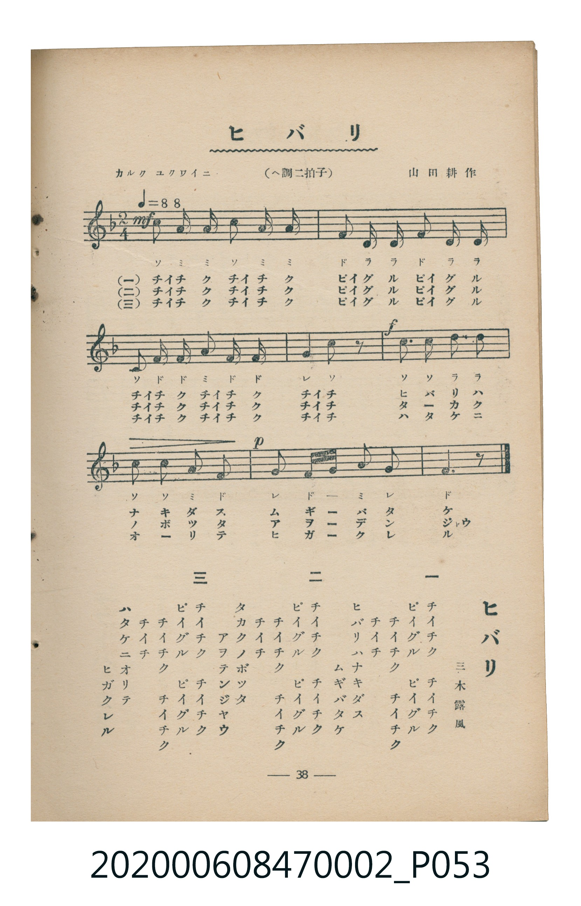

# ヒバリ（雲雀）

> Re:Shōka 使用 AI 協助辨識與重建樂譜，可能會有錯誤。歡迎[回報](https://github.com/TMDLang/reshoka/issues)。

- **鋼琴伴奏版**：<br><audio controls src="hibari.mp3"></audio>
- **NEUTRINO 歌聲合成版**：<br><audio controls src="hibari_neutrino.mp3"></audio>

- 詞：三木露風
- 曲：山田耕筰
- 臺灣教育會公認《新定兒童唱歌》尋常科第二學年用（2020.006.0847.0002）

## 說明

曲目說明
中文解釋：描寫雲雀飛上天空、在春日田野歌唱。

原書資訊與歌詞全文（對應 P053.jpg，書頁 p. 38，參考教材第 1 首）：
調性與拍號：ヘ調二拍子（F 大調 2/4 拍），「カルク ユクワイニ（♩＝88）」


## 歌詞

```text
一
チイチク　チイチク
ピイグル　ピイグル
チイチク　チイチク　チイチ
ヒバリハナキダス　ムギバタケ

二
チイチク　チイチク
ピイグル　ピイグル
チイチク　チイチク　チイチ
タカクノボツタ　アヲテンジヤウ

三
チイチク　チイチク
ピイグル　ピイグル
チイチク　チイチク　チイチ
ハタケニオリテ　ヒガクレル
```

## ABC

<div class="abc-score" data-abc-src="hibari.abc" aria-label="五線譜載入中"></div>

[下載 ABC 原始檔](hibari.abc)

## TMD 檔案連結

- [主旋律 TMD 檔案](hibari.tmd) [[在 TMD Studio 編輯](https://tmdlang.github.io/Tmd-TS/#tmd=s7IKdvYPcrWy4qpTUCpJTLdSSM7PyUlNLsnMz7MqzsjMK0nNjM_KTMmPL87Iz05Ugisry88pzU21Si9KTEmNN4o3MjAyiDcwMIs3sDAxBzIMjBBKi_NLi5JTrYqTM_Lzc-JLUitKkvLzsxHyBUX5Zal5iXlANQVFIBtTwIoQClLLMlNSQdKpKZkl-UWZiTlI7kgtKga7FWxJfElRYl5xclFmAcgDCFUlGalAxybmZeYi6wUalZ6ZZ1WSmAn0HMiD5YnxuYmZeTmJeSnIqkoy8oH-LMiotMrILAY5IDkxJz47MQ8pOKDWFySmp1oFGJgaK3FpaSk8bp70uHnC4-ZV7_d0vJy96eXshvd7OhW0tLgUbRUsLLjsbRXcuGyM9E3sQMa8WDnv_Z5ZT3Z0Ppuz4uWcTS8XrQCb_mz2JqDw040bn0_Z8KJh6pO9c8DCL9p3PW9c_GzqzBdNm57NaX7auubFqt7HDV3Ppm14um7W09ZJz1cvfTpl47O1PY8bup9u6H66Y8fz5ROfr1nzZFfP07U7nu7c8nzKCqCzQPGmB4w3PVC8ARkGRkAnKnHpaykALX4-e92LVauezejjUlBQeLJj7bNp7S-WL37Z3g100bP-_qfrV0N89XLx7Cc7up4uWfl85a7HDY1P56x4NmPps-lLgU5-2d4HdAPQJY8bmri09LlAJttSC4Cc9bRv_rPZO15sbn-xoutFRzvQMmBAPm1dAXQr0HtPN_Q-a-9UAMWIXlZB-vs9PUDFLxc0KhToKRhbALlP-5tfNDQDw_HZ3AnA0FEwVHi5bBowCIA-BJn-YtX-Zw3LQeZ2976YOR8o-rh5BlAQGIpAkadrJwDtcFN4umQ5UEwBGJMKQFGwbmCw9zxuWv24efXjpvXAhLAMSD1uXv-4acnjZmDwdTyaufL9nrkWQCd0Pm7o5YIEcAOIetzcCFYFJNc_bmhA5kKkp4D4TRtARoOkEVwCupG5EKXQ1Pm4uf9xc9fjprWPmxseN-0Eq1vwuGkdSLZp_-OmjRDn7eqhr_NAVoNC73Fz3-PmOY-bW0AiQEVNix43b3rc3Pa4efPjph2Pm4HGL4MGYCedA7AfEj7AKH3cBAxGIGoDK5r0uGkN2OVroKZSntahQAGUhzwykxKLMq0CMhPz8h1qDGqqQVYo2BiaadmBWTUK1blptQqmCroKxkAIo2uAqVtXwSwehBCsGrAWH8MaqNeBEkAGMPhByRZNAKQGFFwgoaYNQM5qTAGoeUZUNs-YuubVKJjGAwUNgdAYStcoGAFZIAgKMAMgBoYjNBhBYmZg2ozkAIMKgSBIWFcBZDFIYhJUbAIQr4Ky-0kOP1zGN-2HiDUBwwCoFCLfR3Jw4nR9P9T4_UC8ESrfjQhdaDBCAhcclAW14ACGBTmIDUmRMAgOcqTA7QKbvxZscgOYvRNq9wIwbx009CCugHga4hIIBLsUKTTngNW3wNWDIEjPIrD4JjDZBiY3Q2WgpQt2M0FB2ASKN0jsQfRCzQTHLbAQAJOgwAcWBVCZ1Rim1XJx6dopQDK1ApClzAUA)]
- [鋼琴伴奏 TMD 檔案](hibari_piano.tmd) [[在 TMD Studio 編輯](https://tmdlang.github.io/Tmd-TS/#tmd=s7IKdvYPcrWy4qpTUCpJTLdSyC8qychPL0osyKi0ysgsLskvykxOzInPTsxLVIIrKs4vLUpOjS9ITE-1CjAwNVbi0tJSeNw86XHzhMfNq97v6XjZvef5hC1P9mx5urT_eWfH-z2dClpaXIq2ChYWXPa2Cm5cNkb6JnYg816snPd-z6wnOzqfzVnxcs6ml4tWgK15NnsTUPjpxo3Pp2x40TD1yd45YOEX7bueNy5-NnXmi6ZNz-Y0P21d82JV7-OGrmfTNjxdN-tp66Tnq5c-nbLx2dqexw3dTzd0P92x4_nyic_XrHmyq-fp2h1Pd255PmUF0H1GBkYGegYGZnoGFibmQIaBEdCJSlxcHplJiUWZVgGZiXn5QR4ONQY11VwKQGBjaKZlB2bVKFTnptUqmCroKhgDIYyuUTAEssziQQjBqgFr8TGsAQZO4-OmJUAJIEPhcdN6TAGQmilQoaYNQM5qTAGoeUZUNs-YuubVKJjGAwUNgdAYStcoGAFZIAgKMAMgJjVooEIgCBLWVQBZQWp44DOE6EDAYwgwcUDTBsijZmDaDBQeUI9DggPV85OgJk0A4lVQdj_Yoi5wyK4FizSA2TtR_dy0H6K-CRgVQMdB9PaB9c4Bs1vAshBVqB7th-rcD8QboTq7QTqbQG6AuORxcxuKTqDvCmrBEQmLWhAbkvJhED1qF4BtWQf1Icw1IHsgtkIgWlw2LQKr3wR3w-PmzVBdOx43L3_ctAy7XrDPQOH5uGkNmASFyeNmEBsksxpDVy1qjvdBzvEm8AxvGK8QbRgLZJhAGejipvFAlmk8qowJSAamBJ4vYApBMgYQF-jaKUAcEe0DVIrEM0LhGYN5ylwA)]

## 分析

```text
================================================================================
📊 TMD Song Profile: [ ヒバリ（雲雀） ]
================================================================================
⏱  Duration:       0:10 (10.9s), 8 measures total
🎼 Key & Tempo:    首調基準 F, != 88.0 BPM, <2/4>
   - 分析範圍：      由實際發聲的音符與和弦推測調性；播放脈絡另行呈現
🎤 人聲音域:    C4 (MIDI 60) – D5 (MIDI 74) [跨度: 14 個半音 / 1.2 個八度, 難度: moderate]
   - 最低音:  C4 in [Hibari #1 @ m.3, 0:02]
   - 最高音: D5 in [Hibari #1 @ m.5, 0:06]
   - 適合: soprano, mezzo-soprano, contralto, tenor, baritone, bass
🏛  結構:      Hibari (10.9s)
⚡ 編曲密度:        Peak 1 軌道同時演奏
🗝  調性診斷：       F 大調（純淨自然大調，未偵測到可信轉調）
   - 風格氣質:    純淨自然大調（陽光明朗、易唱易記，無明顯調外色彩）
   - 轉調歷程:    全曲維持單一推測調性（未偵測到可信轉調）
   - 核心骨幹音:  F, C, A, D, G
   - 調性數值:    F 大調 [相關度: 0.91, 穩定度: High, 自然音純度: 100.0%]
   - 候選調性 (K-S): F 大調 (0.91), C 大調 (0.73), D 小調 (0.60)
   - 五度圈歷程:   -1
   - 各段落調性細節:
     • [Hibari #1]: F 大調 (r: 0.91, 自然音純度: 100.0%)

  [ 五度圈游移軌跡 ]
               C  
        [F ]*          G  
      Bb               D  
      Eb               A  
         Ab           E  
            Db       B  
               F# 
     (* = active key center)

  [ 十二半音累積音高分佈 ]
     C  : █████████████████████     26.7%
     C# :                            0.0%
     D  : ███████████               13.3%
     D# :                            0.0%
     E  :                            0.0%
     F  : ████████████████████████  30.0%
     F# :                            0.0%
     G  : ███████████               13.3%
     G# :                            0.0%
     A  : █████████████             16.7%
     A# :                            0.0%
     B  :                            0.0%
--------------------------------------------------------------------------------
Assignment 軌道音域：
  - Piano         : C4 – D5 (14 個半音 / 1.2 個八度, 34 個音符)
================================================================================
```


## 原書掃描頁




