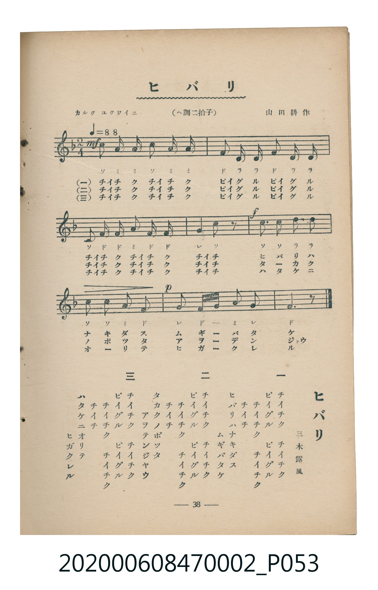

# ヒバリ

<audio controls src="hibari.mp3"></audio>

- 詞：三木露風
- 曲：山田耕作
- 臺灣教育會公認《新定兒童唱歌》尋常科第二學年用（2020.006.0847.0002）

## 說明

原書資訊與歌詞全文（對應 P053.jpg，書頁 p. 38，參考教材第 1 首）：
調性與拍號：ヘ調二拍子（F 大調 2/4 拍），「カルク ユクワイニ（♩＝88）」

## 歌詞

```text
一
チイチク　チイチク
ピイグル　ピイグル
チイチク　チイチク　チイチ
ヒバリハナキダス　ムギバタケ

二
チイチク　チイチク
ピイグル　ピイグル
チイチク　チイチク　チイチ
タカクノボツタ　アヲテンジヤウ

三
チイチク　チイチク
ピイグル　ピイグル
チイチク　チイチク　チイチ
ハタケニオリテ　ヒガクレル
```

## 原書掃描頁



## 分析

```text
================================================================================
📊 TMD Song Profile: [ ヒバリ ]
================================================================================
⏱  Duration:       0:16 (16.4s), 12 measures total
🎼 Key & Tempo:    首調基準 F, != 88.0 BPM, <2/4>
   - 分析範圍：      由實際發聲的音符與和弦推測調性；播放脈絡另行呈現
🎤 人聲音域:    C4 (MIDI 60) – D5 (MIDI 74) [跨度: 14 個半音 / 1.2 個八度, 難度: moderate]
   - 最低音:  C4 in [Hibari #1 @ m.5, 0:05]
   - 最高音: D5 in [Hibari #1 @ m.8, 0:10]
   - 適合: soprano, mezzo-soprano, contralto, tenor, baritone, bass
🏛  結構:      Hibari (16.4s)
⚡ 編曲密度:        Peak 1 軌道同時演奏
🗝  調性診斷：       F 大調（純淨自然大調，未偵測到可信轉調）
   - 風格氣質:    純淨自然大調（陽光明朗、易唱易記，無明顯調外色彩）
   - 轉調歷程:    全曲維持單一推測調性（未偵測到可信轉調）
   - 核心骨幹音:  F, C, A, D, G
   - 調性數值:    F 大調 [相關度: 0.89, 穩定度: High, 自然音純度: 100.0%]
   - 候選調性 (K-S): F 大調 (0.89), D 小調 (0.70), C 大調 (0.65)
   - 五度圈歷程:   -1
   - 各段落調性細節:
     • [Hibari #1]: F 大調 (r: 0.89, 自然音純度: 100.0%)

  [ 五度圈游移軌跡 ]
               C  
        [F ]*          G  
      Bb               D  
      Eb               A  
         Ab           E  
            Db       B  
               F# 
     (* = active key center)

  [ 十二半音累積音高分佈 ]
     C  : ████████████████          20.7%
     C# :                            0.0%
     D  : ████████████              15.2%
     D# :                            0.0%
     E  :                            0.0%
     F  : ████████████████████████  30.4%
     F# :                            0.0%
     G  : ██████████                13.0%
     G# :                            0.0%
     A  : ████████████████          20.7%
     A# :                            0.0%
     B  :                            0.0%
--------------------------------------------------------------------------------
Assignment 軌道音域：
  - Piano         : C4 – D5 (14 個半音 / 1.2 個八度, 34 個音符)
================================================================================
```

## ABC

```abc
X:1
T:ヒバリ
C:曲：山田耕作
M:2/4
L:1/16
Q:1/4=88
K:F

V:V1 name="Piano" snm="Pia"

[V:V1]
c3 a a4 | c3 a a4 | f3 d d4 | f3 d d4 |
c3 f f4 | a3 f f4 | g4 c2 z2 | c2 c2 d2 d2 |
c2 c2 a2 f2 | g4 f2 f2 | a4 g4 | f6 z2 |
```

- [主旋律 TMD 檔案](hibari.tmd)
- [鋼琴伴奏 TMD 檔案](hibari_piano.tmd)
