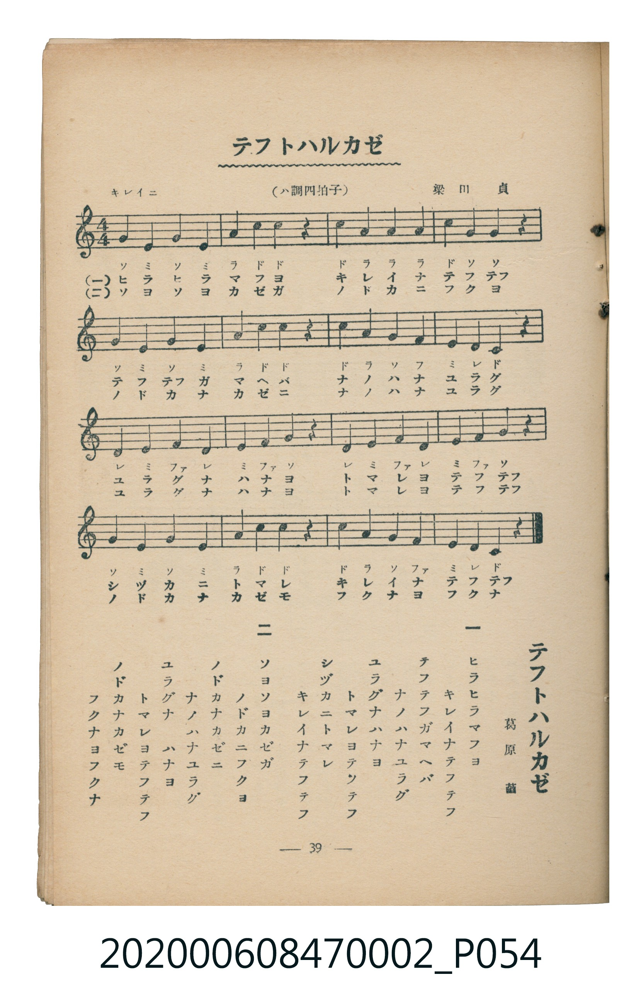

# テフトハルカゼ（蝴蝶與春風）

> Re:Shōka 使用 AI 協助辨識與重建樂譜，可能會有錯誤。歡迎回報。

- **鋼琴伴奏版**：<br><audio controls src="cho_to_harukaze.mp3"></audio>
- **NEUTRINO 歌聲合成版**：<br><audio controls src="cho_to_harukaze_neutrino.mp3"></audio>

- 詞：葛原𦱳
- 曲：梁田貞
- 臺灣教育會公認《新定兒童唱歌》尋常科第二學年用（2020.006.0847.0002）

## 說明

曲目說明
中文解釋：描寫蝴蝶隨著春風飛舞，呈現春日的輕快景色。

原書資訊與歌詞全文（對應 P054.jpg，書頁 p. 39，參考教材第 2 首）：
調性與拍號：ハ調四拍子（C 大調 4/4 拍），「キレイニ」


## 歌詞

```text
一
ヒラヒラマフヨ　キレイナテフテフ
テフテフガマヘバ　ナノハナユラグ
ユラグナハナヨ　トマレヨテフテフ
シヅカニトマレ　キレイナテフテフ

二
ソヨソヨカゼガ　ノドカニフクヨ
ノドカナカゼニ　ナノハナユラグ
ユラグナハナヨ　トマレヨテフテフ
ノドカナカゼモ　フクナヨフクナ
```

## ABC

<div class="abc-score" data-abc-src="cho_to_harukaze.abc" aria-label="五線譜載入中"></div>

[下載 ABC 原始檔](cho_to_harukaze.abc)

## TMD 檔案連結

- [主旋律 TMD 檔案](cho_to_harukaze.tmd) [[在 TMD Studio 編輯](https://tmdlang.github.io/Tmd-TS/#tmd=s7IKdvYPcrWy4qpTUCpJTLdSSM7PyUlNLsnMz7MqzsjMK0nNjM_KTMmPL87Iz05Ugisry88pzU21Si9KTEmNN4o3MjAyiDcwMIs3sDAxBzIMjBBKi_NLi5JTrYqTM_Lzc-JLUitKkvLzsxHyBUX5Zal5iXlANQVFIBtTwIoQClLLMlNSQdKpKZkl-UWZiTlI7kgtKga7FWxJfElRYl5xclFmAcgDCFUlGalAxybmZeYi6wUalZ6ZZ1WSmAn0HMiD5YnxuYmZeTmJeSnIqkoy8oH-LMiotMrILAY5IDkxJz47MQ8pOKDWFySmp1oFGJiaKHFpaSk8bm573Dz1cXPH4-b-x82rHzcB0Z73ezpezN3yYu62Fx3tz2Ysfbloxfs9nQpaWlyKtgqGBgZc9rYKzlw2JvomdiDDX6yc937PrBcTZz_tm_9h2cbNYBufzd4EFHy2qPH5lA0vNs0Di71o3_W8cfGzqTNfNG16Nqf5aeuaF6t6Hzd0PZu24em6WU9bJz1fvfTplI3P1vY8buh-uqH76Y4dz5dPfL5mzZNdPU_X7ni6c8vzKUCXdIAiUg8YkXqgiAQyDIyAzlPi0tdSANr6fPa6F6tWPZvRx6WgoPBkx9pn09pfLF_8sr0b5Jz-_qfrV0O89nLWihcTp0N893Lx7BcdQE_0PJ3Y8bx_H1Dw2fSlz2e1vNgz9en-1c9mrn_RuelxQxOXlj4XyBZbagGQE4GB9mz2jheb21-s6AIF99oeYHg-bV0BdDfQq0839D5r71QARZdeVkE60IlAxS8XNCoU6CkYW4Jc3N_8oqEZGKbP5k4AhpSCkcLLZdOAwQH0Lcj0F6v2P2tYDjK3u_fFzPlAUWA8AwWfzp4NFHm6dgLQDmeFp0uWA8UUgBGqABQF6wZGQc_jprWPm9c8blryuLn7cUMvFyREG0DU4-ZJj5tXwsh54CS04nFDA5KWLljSApEQPQj-46Y1YG0zHjdPAGkDqe4DJ0EgYxnI0KYNED1QDlgCIg22B5RggfqBpqzAsKdp--PmVlBKBjobrg6P28D-2tUD0bsXZCKUBOUFkEtB9gFd1wkzE-j89UAFEAfCJbqgGkCBRWUfYbFkEVgPxCVgI2BskAbKkyYUKICSvHNGfki-R2JRaXZiFbDoyEzMy3eoMaipBtmkYGOiZQdm1CiYKhiDcY2CmYJhHAgZANlAygwMwUxTIASKgnX4GNaAEhIQr4TTIJF5QDwViFcoxIP4TWuB7DVAegmQ7gKrAAUMiAIrBCqCGGcEUrwXrBFGg0RWA_EeIF4DMa65D4g7IeLN3WARoFlN62EWEvaMqYIJkGkMzGuGaH6BOAjmPqCNMO_MAOIJUPu7oG7oh3tnGSQImjag-gXFpWCVML8A3U28WTVAhxoDnWwEdrQJJAKwiSF5BGEKzFyIDfBIae6A-gwYMZBwRvU8qkeoZhx58dK0HWhOK0qUI-zDmcZwewd3vCyCegeWoiBeRBUBmVXLxaVrp4CSsRSAAspcAA)]
- [鋼琴伴奏 TMD 檔案](cho_to_harukaze_piano.tmd) [[在 TMD Studio 編輯](https://tmdlang.github.io/Tmd-TS/#tmd=s7IKdvYPcrWy4qpTUCpJTLdSyC8qychPL0osyKi0ysgsLskvykxOzInPTsxLVIIrKs4vLUpOjS9ITE-1CjAwNVHi0tJSeNzc9rh56uPmjsfN_Y-bVz9uAqI97_d0vOze83zClid7tjxd2v-8s-P9nk4FLS0uRVsFQwMDLntbBWcuGxN9EzuQ4S9Wznu_Z9aLibOf9s3_sGzjZrCNz2ZvAgo-W9T4fMqGF5vmgcVetO963rj42dSZL5o2PZvT_LR1zYtVvY8bup5N2_B03aynrZOer176dMrGZ2t7Hjd0P93Q_XTHjufLJz5fs-bJrp6na3c83bnl-ZQVQLcZGRgZ6BkYmOkZWJiYAxkGRkDnKXFxOWfkh-R7JBaVZidWAb2YmZiXH-ThUGNQU82lAAQ2Jlp2YEaNgqmCMRjXKJgpGMaBkAGQDaTMwBDMNAVCoChYh49hDTCkJgHxSjgNEpkHxFOBeIVCPIjftBbIXgOklwDpLrAKUOiCKLBCoCKIcUYgxXvBGmE0SGQ1EO8B4jUQ45r7gLgTIt7cDRYBmtW0HmYhYc-YKpgAmcYKRgqGaH6BOAjmPqCNMO_MAOIJUPu7oG7oh3tnGSQImjag-gXFpWCVML8A3U28WTVAhxoDnWwEdrQJJAKwiSF5BGEKzFyIDfBIae6A-gwYMZBwRvU8qkeoZhx58dK0HWhOK0qUI-zDmcZwewd3vCyCegeWoiBeRBUBmVWLNV_5YM9XhvEK0YaxMKpGwQTIMIkFY5DfoVwoBVcOwrBQINYMkDTYDNN4IMs0Ht0UuDCcATEZZBJEIRFKCLgIpIUoJwHDUNdOASUYo32AcpiCRmBBZS4A)]

## 分析

```text
================================================================================
📊 TMD Song Profile: [ テフトハルカゼ（蝴蝶與春風） ]
================================================================================
⏱  Duration:       0:38 (38.4s), 16 measures total
🎼 Key & Tempo:    首調基準 C, != 100.0 BPM, <4/4>
   - 分析範圍：      由實際發聲的音符與和弦推測調性；播放脈絡另行呈現
🎤 人聲音域:    C4 (MIDI 60) – C5 (MIDI 72) [跨度: 12 個半音 / 1.0 個八度, 難度: easy]
   - 最低音:  C4 in [ChoToHarukaze #1 @ m.8, 0:18]
   - 最高音: C5 in [ChoToHarukaze #1 @ m.2, 0:03]
   - 適合: soprano, mezzo-soprano, contralto, tenor, baritone, bass
🏛  結構:      ChoToHarukaze (38.4s)
⚡ 編曲密度:        Peak 1 軌道同時演奏
🗝  調性診斷：       C 大調（純淨自然大調，未偵測到可信轉調）
   - 風格氣質:    純淨自然大調（陽光明朗、易唱易記，無明顯調外色彩）
   - 轉調歷程:    全曲維持單一推測調性（未偵測到可信轉調）
   - 核心骨幹音:  C, E, G, A, D
   - 調性數值:    C 大調 [相關度: 0.92, 穩定度: High, 自然音純度: 100.0%]
   - 候選調性 (K-S): C 大調 (0.92), A 小調 (0.71), E 小調 (0.64)
   - 五度圈歷程:   +0
   - 各段落調性細節:
     • [ChoToHarukaze #1]: C 大調 (r: 0.92, 自然音純度: 100.0%)

  [ 五度圈游移軌跡 ]
              [C ]*
         F            G  
      Bb               D  
      Eb               A  
         Ab           E  
            Db       B  
               F# 
     (* = active key center)

  [ 十二半音累積音高分佈 ]
     C  : ████████████████████████  21.4%
     C# :                            0.0%
     D  : ████████████              10.7%
     D# :                            0.0%
     E  : ████████████████████████  21.4%
     F  : ████████████              10.7%
     F# :                            0.0%
     G  : ████████████████████████  21.4%
     G# :                            0.0%
     A  : ████████████████          14.3%
     A# :                            0.0%
     B  :                            0.0%
--------------------------------------------------------------------------------
Assignment 軌道音域：
  - Piano         : C4 – C5 (12 個半音 / 1.0 個八度, 56 個音符)
================================================================================
```


## 原書掃描頁




