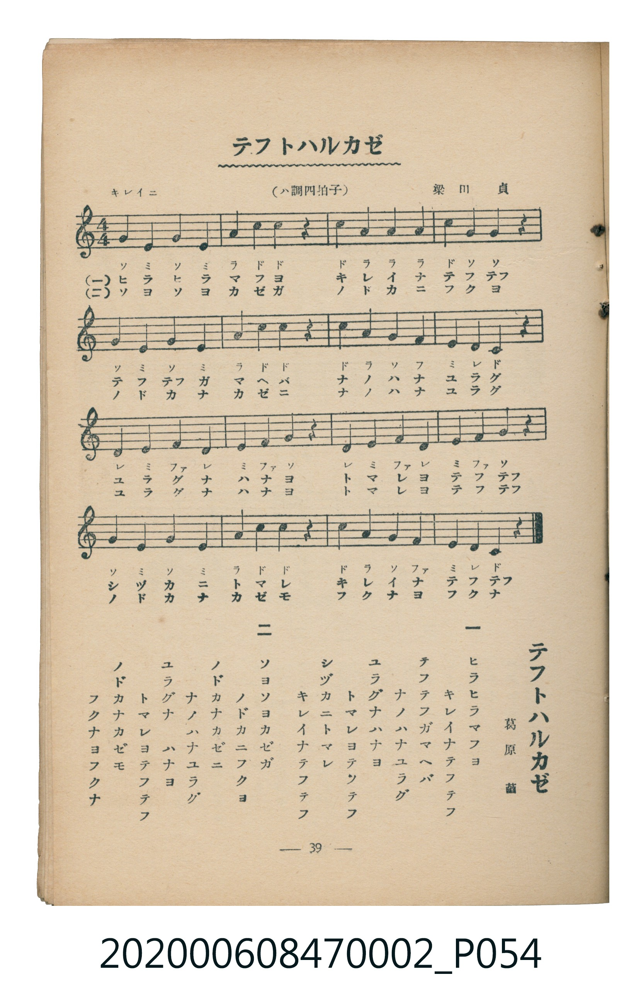

# テフトハルカゼ

<audio controls src="cho_to_harukaze.mp3"></audio>

- 詞：葛原齒
- 曲：梁田貞
- 臺灣教育會公認《新定兒童唱歌》尋常科第二學年用（2020.006.0847.0002）

## 說明

原書資訊與歌詞全文（對應 P054.jpg，書頁 p. 39，參考教材第 2 首）：
調性與拍號：ハ調四拍子（C 大調 4/4 拍），「キレイニ」

## 歌詞

```text
一
ヒラヒラマフヨ　キレイナテフテフ
テフテフガマヘバ　ナノハナユラグ
ユラグナハナヨ　トマレヨテフテフ
シヅカニトマレ　キレイナテフテフ

二
ソヨソヨカゼガ　ノドカニフクヨ
ノドカナカゼニ　ナノハナユラグ
ユラグナハナヨ　トマレヨテフテフ
ノドカナカゼモ　フクナヨフクナ
```

## ABC

```abc
X:1
T:テフトハルカゼ
C:曲：梁田貞
M:4/4
L:1/16
Q:1/4=100
K:C
V:V1 name="Piano" snm="Pia"
[V:V1]
G4 E4 G4 E4 | A4 c4 c4 z4 | c4 A4 A4 A4 | c4 G4 G4 z4 |
G4 E4 G4 E4 | A4 c4 c4 z4 | c4 A4 G4 F4 | E4 D4 C4 z4 |
D4 E4 F4 D4 | E4 F4 G4 z4 | D4 E4 F4 D4 | E4 F4 G4 z4 |
G4 E4 G4 E4 | A4 c4 d4 z4 | c4 A4 G4 F4 | E4 D4 C4 z4 |
```

## TMD 檔案連結

- [主旋律 TMD 檔案](cho_to_harukaze.tmd) [[在 TMD Studio 編輯](https://tmdlang.github.io/Tmd-TS/#tmd=s7IKdvYPcrWy4tLSUnjc3Pa4eerj5o7Hzf2Pm1c_bgKiPQpaWlyKtgqGBgZc9rYKzlw2Jvomdlx1CkovVs57v2fWi4mzn_bNf7l3khJI7NnsTUCxZ4san0_Z8GLTPLDYi_ZdzxsXP5s680XTpmdzmp-2rnmxqvdxQ9ezaRuerpv1tHXS89VLn07Z-Gxtz-OG7qcbup_u2PF8-cTna9Y82dXzdO2Opzu3PJ-y4v2eDiMDIwM9AwMzPQMLE3Mgw8Do_Z5OJS4ufS0FW2oBLgUFBaB3ns3e8WJz-4sVXS862oHuAvr0aeuKZ9Paga54uqH3WXunQoCBqYleVkH6-z09QMUvFzQqFOgpGFsCuU_7m180NAO9-2zuBKAnFIwUXi6bBnQpMFxApr9Ytf9Zw3KQud29L2bOB4oCAxso-HT2bKDI07UTgHY4KzxdshwopgAMagWgKFg3MHR6Hjetfdy85nHTksfN3Y8berlABj7Z0QCiHjdPety8EkbOA8fjiscNDUhaumDxCyIhehD8x01rwNpmPG6eANIGUt0HTgdAxjKQoU0bIHqgHLAERBpsDyjVAPUDTVmBYU_T9sfNraDkBHQ2XB0et4H9tasHoncvyEQoCUqQIJeC7AO6rhNmJtD564EKIA6ES3RBNYACi8o-wmLJIrAeiEvARsDYIA2UJ00oUNDS5-JyzsgPyfdILCrNTqxKtQrITMzLd6gxqFGoBlmlYGOhZQdm1CiYKugqGAMxjK5RMAOShnEwwgAsBmaCJGAYKgTSBcJgVeSZCFJmAhYCKTYCqUIzECQGkgOpArEhKkE8uNXEqCHsPCMSnVfLxaVrp4AS1ApAAWUuLgA)]
- [鋼琴伴奏 TMD 檔案](cho_to_harukaze_piano.tmd) [[在 TMD Studio 編輯](https://tmdlang.github.io/Tmd-TS/#tmd=s7IKdvYPcrWy4tLSUnjc3Pa4eerj5o7Hzf2Pm1c_bgKiPe_3dLzs3vN8wpYne7Y8Xdr_vLPj_Z5OBS0tLkVbBUMDAy57WwVnLhsTfRM7rjoFpRcr573fM-vFxNlP--a_3DtJCST2bPYmoNizRY3Pp2x4sWkeWOxF-67njYufTZ35omnTsznNT1vXvFjV-7ih69m0DU_XzXraOun56qVPp2x8trbncUP30w3dT3fseL584vM1a57s6nm6dsfTnVueT1kBdJqRgZGBnoGBmZ6BhYk5kGFgBHSdEheXc0Z-SL5HYlFpdmJVqlVAZmJefpCHQ41BjUI1lwIQ2Fho2YEZNQqmCroKxkAMo2sUzICkYRyMMACLgZkgCRiGCoF0gTBYFXkmgpSZgIVAio1AqtAMBImB5ECqQGyIShAPbjUxagg7z4hE59ViDWkflJA2gYe0YbxCtGEsjKpRMAEyTGLB2ADBhVJw5SAMlCbJDJA02AzTeCDLNB7dFLgwnAExGWQSRCERSgi4CKSFKCcBA1HXTgElHBWAAspcXAA)]

## 分析

```text
================================================================================
📊 TMD Song Profile: [ テフトハルカゼ ]
================================================================================
⏱  Duration:       0:38 (38.4s), 16 measures total
🎼 Key & Tempo:    首調基準 C, != 100.0 BPM, <4/4>
   - 分析範圍：      由實際發聲的音符與和弦推測調性；播放脈絡另行呈現
🎤 人聲音域:    C4 (MIDI 60) – D5 (MIDI 74) [跨度: 14 個半音 / 1.2 個八度, 難度: moderate]
   - 最低音:  C4 in [ChoToHarukaze #1 @ m.8, 0:18]
   - 最高音: D5 in [ChoToHarukaze #1 @ m.14, 0:32]
   - 適合: soprano, mezzo-soprano, contralto, tenor, baritone, bass
🏛  結構:      ChoToHarukaze (38.4s)
⚡ 編曲密度:        Peak 1 軌道同時演奏
🗝  調性診斷：       C 大調（純淨自然大調，未偵測到可信轉調）
   - 風格氣質:    純淨自然大調（陽光明朗、易唱易記，無明顯調外色彩）
   - 轉調歷程:    全曲維持單一推測調性（未偵測到可信轉調）
   - 核心骨幹音:  E, G, C, A, D
   - 調性數值:    C 大調 [相關度: 0.90, 穩定度: High, 自然音純度: 100.0%]
   - 候選調性 (K-S): C 大調 (0.90), A 小調 (0.69), E 小調 (0.64)
   - 五度圈歷程:   +0
   - 各段落調性細節:
     • [ChoToHarukaze #1]: C 大調 (r: 0.90, 自然音純度: 100.0%)

  [ 五度圈游移軌跡 ]
              [C ]*
         F            G  
      Bb               D  
      Eb               A  
         Ab           E  
            Db       B  
               F# 
     (* = active key center)

  [ 十二半音累積音高分佈 ]
     C  : ██████████████████████    19.6%
     C# :                            0.0%
     D  : ██████████████            12.5%
     D# :                            0.0%
     E  : ████████████████████████  21.4%
     F  : ████████████              10.7%
     F# :                            0.0%
     G  : ████████████████████████  21.4%
     G# :                            0.0%
     A  : ████████████████          14.3%
     A# :                            0.0%
     B  :                            0.0%
--------------------------------------------------------------------------------
Assignment 軌道音域：
  - Piano         : C4 – D5 (14 個半音 / 1.2 個八度, 56 個音符)
================================================================================
```


## 原書掃描頁




