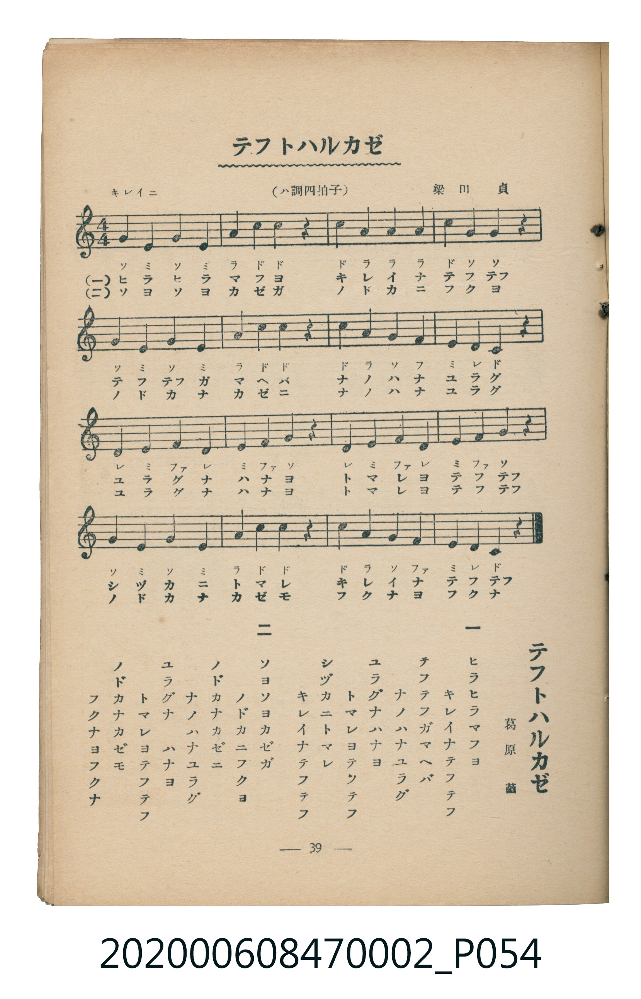

# テフトハルカゼ（蝴蝶與春風）

> Re:Shōka 使用 AI 協助辨識與重建樂譜，可能會有錯誤。歡迎回報。

- **鋼琴伴奏版**：<br><audio controls src="cho_to_harukaze.mp3"></audio>
- **NEUTRINO 歌聲合成版**：<br><audio controls src="cho_to_harukaze_neutrino.mp3"></audio>

- 詞：葛原齒
- 曲：梁田貞
- 臺灣教育會公認《新定兒童唱歌》尋常科第二學年用（2020.006.0847.0002）

## 說明

曲目說明
中文解釋：描寫蝴蝶隨著春風飛舞，呈現春日的輕快景色。

原書資訊與歌詞全文（對應 P054.jpg，書頁 p. 39，參考教材第 2 首）：
調性與拍號：ハ調四拍子（C 大調 4/4 拍），「キレイニ」


## 歌詞

```text
一
ヒラヒラマフヨ　キレイナテフテフ
テフテフガマヘバ　ナノハナユラグ
ユラグナハナヨ　トマレヨテフテフ
シヅカニトマレ　キレイナテフテフ

二
ソヨソヨカゼガ　ノドカニフクヨ
ノドカナカゼニ　ナノハナユラグ
ユラグナハナヨ　トマレヨテフテフ
ノドカナカゼモ　フクナヨフクナ
```

## ABC

<div class="abc-score" data-abc-src="cho_to_harukaze.abc" aria-label="五線譜載入中"></div>

[下載 ABC 原始檔](cho_to_harukaze.abc)

## TMD 檔案連結

- [主旋律 TMD 檔案](cho_to_harukaze.tmd) [[在 TMD Studio 編輯](https://tmdlang.github.io/Tmd-TS/#tmd=s7IKdvYPcrWy4qpTUCpJTLdSSM7PyUlNLsnMz7MqzsjMK0nNjM_KTMmPL87Iz05Ugisry88pzU21Si9KTEmNN4o3MjAyiDcwMIs3sDAxBzIMjBBKi_NLi5JTrYqTM_Lzc-JLUitKkvLzsxHyBUX5Zal5iXlANQVFIBtTwIoQClLLMlNSQdKpKZkl-UWZiTlI7kgtKga7FWxJfElRYl5xclFmAcgDCFUlGalAxybmZeYi6wUalZ6ZZ1WSmAn0HMiD5YnxuYmZeTmJeSlKXFpaCo-b2x43T33c3PG4uf9x8-rHTUC05_2ejhdzt7yYu-1FR_uzGUtfLlrxfk-ngpYWl6KtgqGBAZe9rYIzl42JvokdyKIXK-e93zPrxcTZT_vmv9w7CWz5s9mbgGLPFjU-n7LhxaZ5YLEX7bueNy5-NnXmi6ZNz-Y0P21d82JV7-OGrmfTNjxdN-tp66Tnq5c-nbLx2dqexw3dTzd0P92x4_nyic_XrHmyq-fp2h1Pd255PgXokA5QROgBI0IPFBFAhoER0HVKXPpaCkBbn89e92LVqmcz-rgUFBSe7Fj7bFr7i-WLX7Z3g5zT3_90_WqIz17OWvFi4nSI514unv2iA-iHnqcTO5737wMKPpu-9Pmslhd7pj7dv_rZzPUvOjc9bmji0tLnAtliSy0AciIwzJ7N3vFic_uLFV2g0F7bAwzOp60rgO4GevXpht5n7Z0KAQamJnpZBelAJwIVv1zQqFCgp2BsCXJxf_OLhmZgmD6bOwEYUgpGCi-XTQMGB9C3INNfrNr_rGE5yNzu3hcz5wNFgdEMFHw6ezZQ5OnaCUA7nBWeLlkOFFMAxqcCUBSsGxgFPY-b1j5uXvO4acnj5u7HDb1ckBBtAFGPmyc9bl4JI-eBU9CKxw0NSFq6YCkLREL0IPiPm9aAtc143DwBpA2kug-cAoGMZSBDmzZA9EA5YAmINNgeUHoF6geasgLDnqbtj5tbQQkZ6Gy4OjxuA_trVw9E716QiVASlBVALgXZB3RdJ8xMoPPXAxVAHAiX6IJqAAUWlX2ExZJFYD0Ql4CNgLFBGihPmlCgAEryzhn5IfkeiUWl2YlVqVYBmYl5-Q41BjXVIJsUbEy07MCMGgVTBWMwrlEwUzCMAyEDIBtImYEhmGkKhEBRsA4fwxpQQgLilXAaJDIPiKcC8QqFeBC_aS2QvQZILwHSXWAVoIABUWCFQEUQ44xAiveCNcJokMhqIN4DxGsgxjX3AXEnRLy5GywCNKtpPcxCwp4xVTABMo2Bec0QzS8QB8HcB7QR5p0ZQDwBan8X1A39cO8sgwRB0wZUv6C4FKwS5hegu4k3qwboUGOgk43AjjaBRAA2MSSPIEyBmQuxAR4pzR1QnwEjBhLOqJ5H9QjVjCMvXpq2A81pRYlyhH040xhu7-COl0VQ78BSFMSLqCIgs2q5uHTtFFAylgJQQJkLAA)]
- [鋼琴伴奏 TMD 檔案](cho_to_harukaze_piano.tmd) [[在 TMD Studio 編輯](https://tmdlang.github.io/Tmd-TS/#tmd=s7IKdvYPcrWy4tLSUnjc3Pa4eerj5o7Hzf2Pm1c_bgKiPe_3dLzs3vN8wpYne7Y8Xdr_vLPj_Z5OBS0tLkVbBUMDAy57WwVnLhsTfRM7rjoFpRcr573fM-vFxNlP--a_3DtJCST2bPYmoNizRY3Pp2x4sWkeWOxF-67njYufTZ35omnTsznNT1vXvFjV-7ih69m0DU_XzXraOun56qVPp2x8trbncUP30w3dT3fseL584vM1a57s6nm6dsfTnVueT1kBdJqRgZGBnoGBmZ6BhYk5kGFgBHSdEheXc0Z-SL5HYlFpdmJVqlVAZmJefpCHQ41BTTWXAhDYmGjZgRk1CqYKxmBco2CmYBgHQgZANpAyA0Mw0xQIgaJgHT6GNcCAmgTEK-E0SGQeEE8F4hUK8SB-01ogew2QXgKku8AqQIELosAKgYogxhmBFO8Fa4TRIJHVQLwHiNdAjGvuA-JOiHhzN1gEaFbTepiFhD1jqmACZBorGCkYovkF4iCY-4A2wrwzA4gnQO3vgrqhH-6dZZAgaNqA6hcUl4JVwvwCdDfxZtUAHWoMdLIR2NEmkAjAJobkEYQpMHMhNsAjpbkD6jNgxEDCGdXzqB6hmnHkxUvTdqA5rShRjrAPZxrD7R3c8bII6h1YioJ4EVUEZFYt1nzlgz1fGcYrRBvGwqgaBRMgwyQWjEF-h3KhFFw5CMNCgVgzQNJgM0zjgSzTeHRT4MJwBsRkkEkQhUQoIeAikBainAQMQ107BZRgjPYBymEKGoEFlbkA)]

## 分析

```text
================================================================================
📊 TMD Song Profile: [ テフトハルカゼ（蝴蝶與春風） ]
================================================================================
⏱  Duration:       0:38 (38.4s), 16 measures total
🎼 Key & Tempo:    首調基準 C, != 100.0 BPM, <4/4>
   - 分析範圍：      由實際發聲的音符與和弦推測調性；播放脈絡另行呈現
🎤 人聲音域:    C4 (MIDI 60) – C5 (MIDI 72) [跨度: 12 個半音 / 1.0 個八度, 難度: easy]
   - 最低音:  C4 in [ChoToHarukaze #1 @ m.8, 0:18]
   - 最高音: C5 in [ChoToHarukaze #1 @ m.2, 0:03]
   - 適合: soprano, mezzo-soprano, contralto, tenor, baritone, bass
🏛  結構:      ChoToHarukaze (38.4s)
⚡ 編曲密度:        Peak 1 軌道同時演奏
🗝  調性診斷：       C 大調（純淨自然大調，未偵測到可信轉調）
   - 風格氣質:    純淨自然大調（陽光明朗、易唱易記，無明顯調外色彩）
   - 轉調歷程:    全曲維持單一推測調性（未偵測到可信轉調）
   - 核心骨幹音:  C, E, G, A, D
   - 調性數值:    C 大調 [相關度: 0.92, 穩定度: High, 自然音純度: 100.0%]
   - 候選調性 (K-S): C 大調 (0.92), A 小調 (0.71), E 小調 (0.64)
   - 五度圈歷程:   +0
   - 各段落調性細節:
     • [ChoToHarukaze #1]: C 大調 (r: 0.92, 自然音純度: 100.0%)

  [ 五度圈游移軌跡 ]
              [C ]*
         F            G  
      Bb               D  
      Eb               A  
         Ab           E  
            Db       B  
               F# 
     (* = active key center)

  [ 十二半音累積音高分佈 ]
     C  : ████████████████████████  21.4%
     C# :                            0.0%
     D  : ████████████              10.7%
     D# :                            0.0%
     E  : ████████████████████████  21.4%
     F  : ████████████              10.7%
     F# :                            0.0%
     G  : ████████████████████████  21.4%
     G# :                            0.0%
     A  : ████████████████          14.3%
     A# :                            0.0%
     B  :                            0.0%
--------------------------------------------------------------------------------
Assignment 軌道音域：
  - Piano         : C4 – C5 (12 個半音 / 1.0 個八度, 56 個音符)
================================================================================
```


## 原書掃描頁




