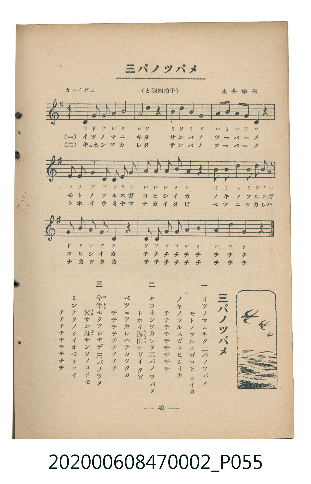

# 三バノツバメ（三隻燕子）

> Re:Shōka 使用 AI 協助辨識與重建樂譜，可能會有錯誤。歡迎回報。

- **鋼琴伴奏版**：<br><audio controls src="sanba_no_tsubame.mp3"></audio>
- **NEUTRINO 歌聲合成版**：<br><audio controls src="sanba_no_tsubame_neutrino.mp3"></audio>

- 曲：永井幸次
- 臺灣教育會公認《新定兒童唱歌》尋常科第二學年用（2020.006.0847.0002）

## 說明

曲目說明
中文解釋：描寫燕子飛翔、築巢與春天歸來的情景。

原書資訊與歌詞全文（對應 P055.jpg，書頁 p. 40，參考教材第 3 首）：
調性與拍號：ト調四拍子（G 大調 4/4 拍），「カハイゲニ」


## 歌詞

```text
一
イツノマニキタ三バノツバメ
モトノフルスガコヒシイカ
ノキノフルスガコヒシイカ
チチチチチチチチチ

二
キヨネンワカレタ三バノツバメ
トホイ海山ナガイタビ
ベツニツカレハナカツタカ
チチチチチチチチチ

三
今年モタツシヤデ三バノツバメ
父サン母サンソノコドモ
ミンナタノシイオモシロイ
チチチチチチチチチ
```

## ABC

<div class="abc-score" data-abc-src="sanba_no_tsubame.abc" aria-label="五線譜載入中"></div>

[下載 ABC 原始檔](sanba_no_tsubame.abc)

## TMD 檔案連結

- [主旋律 TMD 檔案](sanba_no_tsubame.tmd) [[在 TMD Studio 編輯](https://tmdlang.github.io/Tmd-TS/#tmd=s7IKdvYPcrWy4qpTUCpJTLdSSM7PyUlNLsnMz7MqzsjMK0nNjM_KTMmPL87Iz05Ugisry88pzU21Si9KTEmNN4o3MjAyiDcwMIs3sDAxBzIMjBBKi_NLi5JTrYqTM_Lzc-JLUitKkvLzsxHyBUX5Zal5iXlANQVFIBtTwIoQClLLMlNSQdKpKZkl-UWZiTlI7kgtKga7FWxJfElRYl5xclFmAcgDCFUlGalAxybmZeYi6wUalZ6ZZ1WSmAn0HMiD5YnxuYmZeTmJeSnIqkoy8oH-LMiotMrILAY5IDkxJz47MQ8pOKDWFySmp1oFGJiaKnFpaSk82dH5uHnC4-a-x80tYMbC93s6gIIvZ-1-3j716doJ7_d0KmhpcSnaKhgaWHDZ2yq4c9mY6JvYgYx9NnvT-z2znm3Y8WTX1Kc7dzxbsxBs24v2Xc8bFz-bOvNF06Znc5qftq55sar3cUPXs2kbnq6b9bR10vPVS59O2fhsbc_jhu6nG7qf7tjxfPnE52vWPNnV83Ttjqc7tzyfsgLoDFCE6QEjTA8UYUCGgRHQMUpc-loKQIufz173YtWqZzP6uBQUgL5Y-2xa-4vli1-2d4Nc1N__dP1qiPtfLp79fP-Uxw2Nz9d3Pt2-6EVH-7MZS58uWfls7Y4n-9qez2p51tz6bOb6xw1NXFr6XCDDbakFQC572jf_2ewdLza3v1jRBbJ7bc-LlfOetq4AOhfow6cbep-1dyqAYkMvqyD9_Z4eoOKXCxoVCvQUTAyA3Kf9zS8amoFB-WzuBGAAKRgrvFw2DRgKQE-CTH-xav-zhuUgc7t7X8ycDxR93NwBFHw6ezZQBBx7He4KT5csB4opAGNNASgK1g0M-Z7HTasfN_c_blryuGnT4-buxw29XJCwbABRIHFQkgAmjHkg2aa1j5v2Y6YWsNLmRUBrwaJTHzevfty083HTmsdNmx83T3rctB1swWqIuj6QMUSoa8SFIC7c1QNxIdCsFY-bex83A41YD_YO0DicjgS6cDbQkmdbtz_duPFxcxfYcqCd-x83T4aomAnW0Q0iIYYBgwekDsgGiuwn1nk7OsHU7i5gSgaFDcgGoP7tj5uBQdqO3XnPO7Y9btoK9Mmz9b0QxuOmveAAA_oNqGERxOb5YL8CnQQ0EigHCbRVYEuAxgOjaAkhFwKlKU_ZUKAAyjHBiXlJiX75IcWlSYnAAiwgMzEv36HGoKYaZJWCjYWWHZhRo2Aar6CrYAiERkDaGIhrwCwQNAViA7AISBzEA9GGUDXGQGwI0Q5WBDbPx7AGlEaBfGA4gpIWEM8D87rB2oCpA2o4MLCAJEg3SBQUtGBlE8BkH1QRUApoDEJ8IUwLxDIjsIHA5AaW7AXizUC8Hmz6aqj2NVS0zxikFaKvA8jaDspjUINB-kCyoOQEs7G5nVIbaxTM4kEIFObAkAYiMAcU_CAIigJEFBlDo8gULI4UHyBHghwMthSYy4F4NdBFO4F4DdhtoFCbBPEQMO4gYQd1NygGgXGGQy8iGsDmz4bFfdMyUK4AYqBpwPgHyXeBdUDM3w_kT0ayYyY0tYDSCJgFdAEo5oA5HTnogWUFyGBYUIJj-XETKAbgIiDf7IW6GuSrTrDvETaB3AQS74KmCIhKiL9hQW6IkbShYY-ZS0ABDoob9AyAL0AbMTDI0yASIgvjQUi01A4ORlDggAIJ6HzqmAxO16ugqRmUqoERDo5ISkyu5eLStVNALYcUgCLKXAA)]
- [鋼琴伴奏 TMD 檔案](sanba_no_tsubame_piano.tmd) [[在 TMD Studio 編輯](https://tmdlang.github.io/Tmd-TS/#tmd=s7IKdvYPcrWy4qpTUCpJTLdSyC8qychPL0osyKi0ysgsLskvykxOzInPTsxLVIIrKs4vLUpOjS9ITE-1CjAwNVXi0tJSeLKj83HzhMfNfY-bW8CMhe_3dLzs3vN8wpYne7Y8Xdr_vLPj_Z5OBS0tLkVbBUMDCy57WwV3LhsTfRM7kMnPZm96v2fWsw07nuya-nTnjmdrFoItfNG-63nj4mdTZ75o2vRsTvPT1jUvVvU-buh6Nm3D03WznrZOer566dMpG5-t7Xnc0P10Q_fTHTueL5_4fM2aJ7t6nq7d8XTnludTVgBdYmRgZKBnYGCmZ2BhYg5kGBgBHaPExRWcmJeU6JcfUlyalJgL9E5mYl5-kIdDjUFNNZcCENhYaNmBGTUKpvEKugqGQGgEpI2BuAbMAkFTIDYAi4DEQTwQbQhVYwzEhhDtYEVg83wMaxQeNy0B8oEBBsR9QDwPzOsGa3vctBZq-OOm_UASpBskuvVx82awsglgsg-qCCgFNAYhvhCmBWKZEdjAx80rwJK9QLwZiNeDTV8N1b6GivYZg7RC9HUAWduB9CKowSB9INntj5tBvgfb2NxOqY01CmbxIAQKc2BIAxGYAwp-EARFASKKjKFRZAoWR4oPkCNBDgZb-rh5KhCvBrpoJxCvAbsNFGqTIB4Cxh0k7KDuBsUgMM5w6EVEA9j82bC4b1oG5M0HYqBpwPgHyXeBdUDM3w_kT0ayYyY0tYDSCJgFdAEo5h439yMHfXMH2GBYUIJj-XETKAbgIiDf7IW6GuSrTrDvETaB3AQS74KmCIhKiL9hQW6IkbShYY-ZS0ABDoob9AyAL0AbMTDI0yASIgvjQUi01A4ORlDggAIJ6HzqmAxO16ugqRmUqoERDo5ISkyuxV4M-SAXQybwYsgwXiHaMBZGgUIcyDKNjwUzDIhQADXHBCSMVR2YQDMJJASPduwWgvWjmQTkgmwE-lDXTgHVk9E-QEksokZYRY3BospcAA)]

## 分析

```text
================================================================================
📊 TMD Song Profile: [ 三バノツバメ（三隻燕子） ]
================================================================================
⏱  Duration:       0:22 (22.2s), 10 measures total
🎼 Key & Tempo:    首調基準 G, != 108.0 BPM, <4/4>
   - 分析範圍：      由實際發聲的音符與和弦推測調性；播放脈絡另行呈現
🎤 人聲音域:    D4 (MIDI 62) – D5 (MIDI 74) [跨度: 12 個半音 / 1.0 個八度, 難度: easy]
   - 最低音:  D4 in [SanbaNoTsubame #1 @ m.1, 0:00]
   - 最高音: D5 in [SanbaNoTsubame #1 @ m.2, 0:03]
   - 適合: soprano, mezzo-soprano, contralto, tenor, baritone, bass
🏛  結構:      SanbaNoTsubame (22.2s)
⚡ 編曲密度:        Peak 1 軌道同時演奏
🗝  調性診斷：       D 大調（純淨自然大調，未偵測到可信轉調）
   - 風格氣質:    純淨自然大調（陽光明朗、易唱易記，無明顯調外色彩）
   - 轉調歷程:    全曲維持單一推測調性（未偵測到可信轉調）
   - 核心骨幹音:  D, A, B, G, E
   - 調性數值:    D 大調 [相關度: 0.82, 穩定度: Moderate, 自然音純度: 100.0%]
   - 候選調性 (K-S): D 大調 (0.82), G 大調 (0.73), B 小調 (0.62)
   - 五度圈歷程:   +2
   - 各段落調性細節:
     • [SanbaNoTsubame #1]: D 大調 (r: 0.82, 自然音純度: 100.0%)

  [ 五度圈游移軌跡 ]
               C  
         F            G  
      Bb              [D ]*
      Eb               A  
         Ab           E  
            Db       B  
               F# 
     (* = active key center)

  [ 十二半音累積音高分佈 ]
     C  :                            0.0%
     C# :                            0.0%
     D  : ████████████████████████  27.1%
     D# :                            0.0%
     E  : ████                       4.3%
     F  :                            0.0%
     F# :                            0.0%
     G  : ██████████████████        20.0%
     G# :                            0.0%
     A  : ████████████████████████  27.1%
     A# :                            0.0%
     B  : ███████████████████       21.4%
--------------------------------------------------------------------------------
Assignment 軌道音域：
  - Piano         : D4 – D5 (12 個半音 / 1.0 個八度, 49 個音符)
================================================================================
```


## 原書掃描頁




