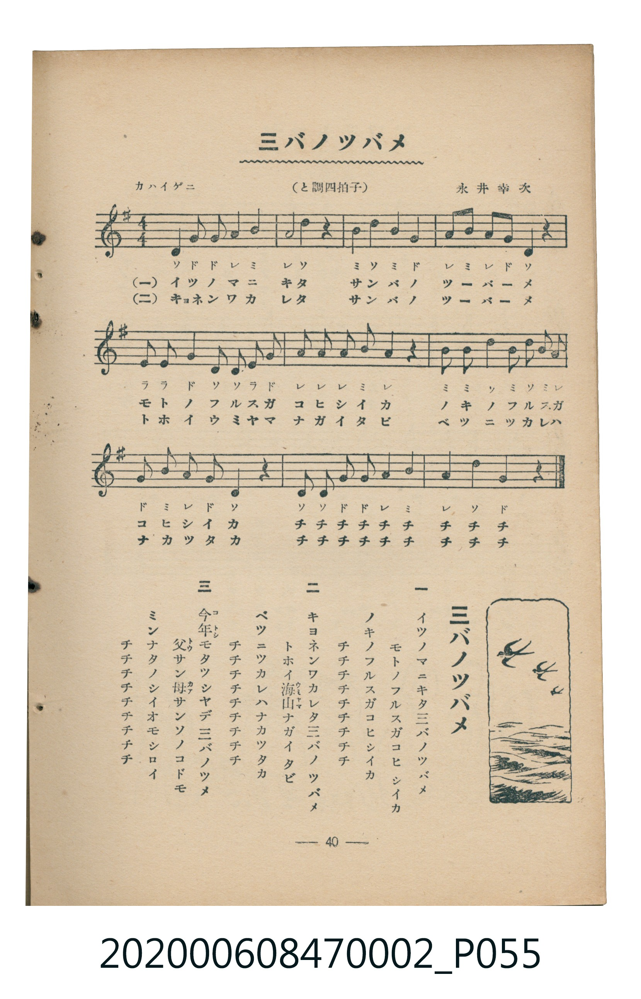

# 三バノツバメ（三隻燕子）

> Re:Shoka 使用 AI 協助辨識與重建樂譜，可能會有錯誤。歡迎回報。

<audio controls src="sanba_no_tsubame.mp3"></audio>

- 曲：永井幸次
- 臺灣教育會公認《新定兒童唱歌》尋常科第二學年用（2020.006.0847.0002）

## 說明

曲目說明
中文解釋：描寫燕子飛翔、築巢與春天歸來的情景。

原書資訊與歌詞全文（對應 P055.jpg，書頁 p. 40，參考教材第 3 首）：
調性與拍號：ト調四拍子（G 大調 4/4 拍），「カハイゲニ」

## 歌詞

```text
一
イツノマニキタ三バノツバメ
モトノフルスガコヒシイカ
ノキノフルスガコヒシイカ
チチチチチチチチチ

二
キヨネンワカレタ三バノツバメ
トホイ海山ナガイタビ
ベツニツカレハナカツタカ
チチチチチチチチチ

三
今年モタツシヤデ三バノツバメ
父サン母サンソノコドモ
ミンナタノシイオモシロイ
チチチチチチチチチ
```

## ABC

```abc
X:1
T:三バノツバメ（三隻燕子）
C:曲：永井幸次
M:4/4
L:1/16
Q:1/4=108
K:G
V:V1 name="Piano" snm="Pia"
[V:V1]
D4 G2 G2 A4 B4 | A8 d4 z4 | B4 d4 B4 G4 | A2 B2 A2 G2 D4 z4 |
E2 E2 G4 D2 D2 E2 G2 | A2 A2 A2 B2 A4 z4 | B2 B2 d4 B2 d2 B2 A2 | G2 B2 A2 G2 D4 z4 |
D2 D2 G2 G2 A4 B4 | A4 d4 G4 z4 |
```

## TMD 檔案連結

- [主旋律 TMD 檔案](sanba_no_tsubame.tmd) [[在 TMD Studio 編輯](https://tmdlang.github.io/Tmd-TS/#tmd=s7IKdvYPcrWy4qpTUCpJTLdSSM7PyUlNLsnMz7MqzsjMK0nNjM_KTMmPL87Iz05Ugisry88pzU21Si9KTEmNN4o3MjAyiDcwMIs3sDAxBzIMjBBKi_NLi5JTrYqTM_Lzc-JLUitKkvLzsxHyBUX5Zal5iXlANQVFIBtTwIoQClLLMlNSQdKpKZkl-UWZiTlI7kgtKga7FWxJfElRYl5xclFmAcgDCFUlGalAxybmZeaC9GppKTzZ0fm4ecLj5r7HzS1gxsL3ezqAgi9n7X7ePvXp2gnv93QqaGlxKdoqGBpYcNnbKrhz2Zjom9iBjHw2e9P7PbOebdjxZNfUpzt3PFuzEGzTi_ZdzxsXP5s680XTpmdzmp-2rnmxqvdxQ9ezaRuerpv1tHXS89VLn07Z-Gxtz-OG7qcbup_u2PF8-cTna9Y82dXzdO2Opzu3PJ-yAugMUFjqAcNSDxSWQIaBEdAxSlz6WgpAi5_PXvdi1apnM_q4FBSAvlj7bFr7i-WLX7Z3g1zU3_90_WqI-18unv18_5THDY3P13c-3b7oRUf7sxlLny5Z-Wztjif72p7PannW3Pps5vrHDU1cWvpcIMNtqQVALnvaN__Z7B0vNre_WNEFsnttz4uV8562rgA6F-jDpxt6n7V3KgQYmJrqZRWkv9_TA1T8ckGjQoGegokBkPu0v_lFQzMwKJ_NnQAMIAVjhZfLpgFDAehJkOkvVu1_1rAcZG5374uZ84Gij5s7gIJPZ88GioBjr8Nd4emS5UAxBWCsKQBFwbqBId_zuGn14-b-x01LHjdtetzc_bihlwsSlg0gCiQOShLAhDEPJNu09nHTfszUAlbavAhoLVh06uPm1Y-bdj5uWvO4afPj5kmPm7aDLVgNUdcHMoYIdY24EMSFu3ogLgSateJxc-_jZqAR68HeARqH05FAF84GWvJs6_anGzc-bu4CWw60c__j5skQFTPBOrpBJMQwYPCA1AHZQJH9xDpvRyeY2t0FTMmgsAHZANS__XEzMEjbsTvvece2x01bgT55tr4XwnjctBccYEC_ATUsgtg8H-xXoJOARgLlIIG2CmwJ0HhgFC0h5EKgNOUpGwoUQDkmODEvKdEvP6S4NCkRWLYEZCbm5TvUGNQoVIPsUrCx0LIDM2oUTOMVdBUMgdAISBsDcQ2YBYKmQGwAFgGJg3gg2hCqxhiIDSHawYqg5pnFgxBIEVAKiMAckHoQBOlBmGkMNdMULA4zwBDDZKhJmI4EaQfZBLG_lotL104B1ecKQBFlLi4A)]
- [鋼琴伴奏 TMD 檔案](sanba_no_tsubame_piano.tmd) [[在 TMD Studio 編輯](https://tmdlang.github.io/Tmd-TS/#tmd=s7IKdvYPcrWy4tLSUniyo_Nx84THzX2Pm1vAjIXv93S87N7zfMKWJ3u2PF3a_7yz4_2eTgUtLS5FWwVDAwsue1sFdy4bE30TO646BaVnsze93zPr2YYdT3ZNfbpzx7M1C5VAwi_adz1vXPxs6swXTZuezWl-2rrmxarexw1dz6ZteLpu1tPWSc9XL306ZeOztT2PG7qfbuh-umPH8-UTn69Z82RXz9O1O57u3PJ8ygqgS4wMjAz0DAzM9AwsTMyBDAMjoGOUuLiCE_OSEv3yQ4pLkxJzU60CMhPz8oM8HGoMahSquRSAwMZCyw7MqFEwjVfQVTAEQiMgbQzENWAWCJoCsQFYBCQO4oFoQ6gaYyA2hGgHK4KaZxYPQiBFQCkgAnNA6kEQpAdhpjHUTFOwOMwAQwyToSZhOhKkHWQTxP5a7B73QfG4CdzjhvEK0YaxMApkCZBlGh8LZhgQoQBqjglIGKs6MIFmEkgI7lPsFoL1o5kE5IJsBHpR104B1ZfYRZS5uAA)]

## 分析

```text
================================================================================
📊 TMD Song Profile: [ 三バノツバメ（三隻燕子） ]
================================================================================
⏱  Duration:       0:22 (22.2s), 10 measures total
🎼 Key & Tempo:    首調基準 G, != 108.0 BPM, <4/4>
   - 分析範圍：      由實際發聲的音符與和弦推測調性；播放脈絡另行呈現
🎤 人聲音域:    D4 (MIDI 62) – D5 (MIDI 74) [跨度: 12 個半音 / 1.0 個八度, 難度: easy]
   - 最低音:  D4 in [SanbaNoTsubame #1 @ m.1, 0:00]
   - 最高音: D5 in [SanbaNoTsubame #1 @ m.2, 0:03]
   - 適合: soprano, mezzo-soprano, contralto, tenor, baritone, bass
🏛  結構:      SanbaNoTsubame (22.2s)
⚡ 編曲密度:        Peak 1 軌道同時演奏
🗝  調性診斷：       D 大調（純淨自然大調，未偵測到可信轉調）
   - 風格氣質:    純淨自然大調（陽光明朗、易唱易記，無明顯調外色彩）
   - 轉調歷程:    全曲維持單一推測調性（未偵測到可信轉調）
   - 核心骨幹音:  D, A, B, G, E
   - 調性數值:    D 大調 [相關度: 0.82, 穩定度: Moderate, 自然音純度: 100.0%]
   - 候選調性 (K-S): D 大調 (0.82), G 大調 (0.73), B 小調 (0.62)
   - 五度圈歷程:   +2
   - 各段落調性細節:
     • [SanbaNoTsubame #1]: D 大調 (r: 0.82, 自然音純度: 100.0%)

  [ 五度圈游移軌跡 ]
               C  
         F            G  
      Bb              [D ]*
      Eb               A  
         Ab           E  
            Db       B  
               F# 
     (* = active key center)

  [ 十二半音累積音高分佈 ]
     C  :                            0.0%
     C# :                            0.0%
     D  : ████████████████████████  27.1%
     D# :                            0.0%
     E  : ████                       4.3%
     F  :                            0.0%
     F# :                            0.0%
     G  : ██████████████████        20.0%
     G# :                            0.0%
     A  : ████████████████████████  27.1%
     A# :                            0.0%
     B  : ███████████████████       21.4%
--------------------------------------------------------------------------------
Assignment 軌道音域：
  - Piano         : D4 – D5 (12 個半音 / 1.0 個八度, 49 個音符)
================================================================================
```


## 原書掃描頁




