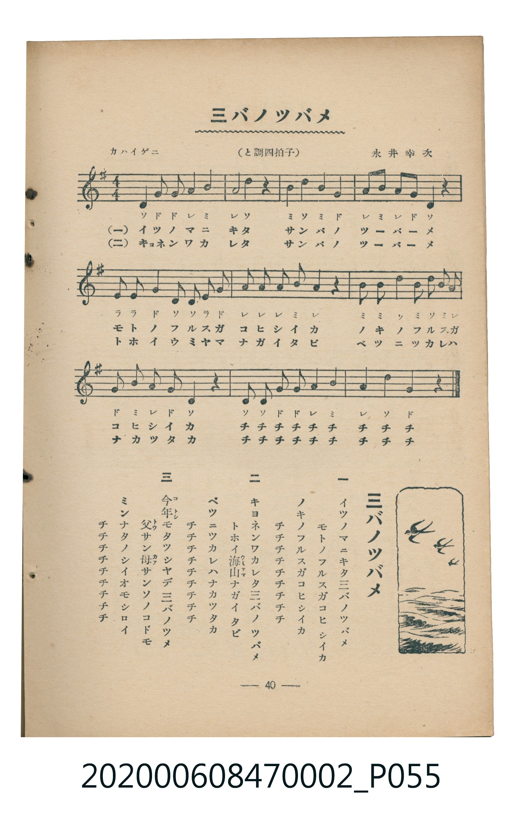

# 三バノツバメ（三隻燕子）

> Re:Shōka 使用 AI 協助辨識與重建樂譜，可能會有錯誤。歡迎回報。

- **鋼琴伴奏版**：<br><audio controls src="sanba_no_tsubame.mp3"></audio>
- **NEUTRINO 歌聲合成版**：<br><audio controls src="sanba_no_tsubame_neutrino.mp3"></audio>

- 曲：永井幸次
- 臺灣教育會公認《新定兒童唱歌》尋常科第二學年用（2020.006.0847.0002）

## 說明

曲目說明
中文解釋：描寫燕子飛翔、築巢與春天歸來的情景。

原書資訊與歌詞全文（對應 P055.jpg，書頁 p. 40，參考教材第 3 首）：
調性與拍號：ト調四拍子（G 大調 4/4 拍），「カハイゲニ」


## 歌詞

```text
一
イツノマニキタ三バノツバメ
モトノフルスガコヒシイカ
ノキノフルスガコヒシイカ
チチチチチチチチチ

二
キヨネンワカレタ三バノツバメ
トホイ海山ナガイタビ
ベツニツカレハナカツタカ
チチチチチチチチチ

三
今年モタツシヤデ三バノツバメ
父サン母サンソノコドモ
ミンナタノシイオモシロイ
チチチチチチチチチ
```

## ABC

<div class="abc-score" data-abc-src="sanba_no_tsubame.abc" aria-label="五線譜載入中"></div>

[下載 ABC 原始檔](sanba_no_tsubame.abc)

## TMD 檔案連結

- [主旋律 TMD 檔案](sanba_no_tsubame.tmd) [[在 TMD Studio 編輯](https://tmdlang.github.io/Tmd-TS/#tmd=s7IKdvYPcrWy4qpTUCpJTLdSSM7PyUlNLsnMz7MqzsjMK0nNjM_KTMmPL87Iz05Ugisry88pzU21Si9KTEmNN4o3MjAyiDcwMIs3sDAxBzIMjBBKi_NLi5JTrYqTM_Lzc-JLUitKkvLzsxHyBUX5Zal5iXlANQVFIBtTwIoQClLLMlNSQdKpKZkl-UWZiTlI7kgtKga7FWxJfElRYl5xclFmAcgDCFUlGalAxybmZeYi6wUalZ6ZZ1WSmAn0HMiD5YnxuYmZeTmJeSlKXFpaCk92dD5unvC4ue9xcwuYsfD9ng6g4MtZu5-3T326dsL7PZ0KWlpcirYKhgYWXPa2Cu5cNib6JnYgK57N3vR-z6xnG3Y82TX16c4dz9YsBNv8on3X88bFz6bOfNG06dmc5qeta16s6n3c0PVs2oan62Y9bZ30fPXSp1M2Plvb87ih--mG7qc7djxfPvH5mjVPdvU8Xbvj6c4tz6esADoDFOJ6wBDXA4U4kGFgBHSMEpe-lgLQ4uez171YterZjD4uBQWgL9Y-m9b-Yvnil-3dIBf19z9dvxri_peLZz_fP-VxQ-Pz9Z1Pty960dH-bMbSp0tWPlu748m-tuezWp41tz6buf5xQxOXlj4XyHBbagGQy572zX82e8eLze0vVnSB7F7b82LlvKetK4DOBfrw6YbeZ-2dCgEGpqZ6WQXp7_f0ABW_XNCoUKCnYGIA5D7tb37R0AwMymdzJwADSMFY4eWyacBQAHoSZPqLVfufNSwHmdvd-2LmfKDo4-YOoODT2bOBIuDY63BXeLpkOVBMARhrCkBRsG5gyPc8blr9uLn_cdOSx02bHjd3P27o5YKEZQOIAomDkgQwYcwDyTatfdy0HzO1gJU2LwJaCxad-rh59eOmnY-b1jxu2vy4edLjpu1gC1ZD1PWBjCFCXSMuBHHhrh6IC4FmrXjc3Pu4GWjEerB3gMbhdCTQhbOBljzbuv3pxo2Pm7vAlgPt3P-4eTJExUywjm4QCTEMGDwgdUA2UGQ_sc7b0QmmdncBUzIobEA2APVvf9wMDNJ27M573rHtcdNWoE-ere-FMB437QUHGNBvQA2LIDbPB_sV6CSgkUA5SKCtAlsCNB4YRUsIuRAoTXnKhgIFUI4JTsxLSvTLDykuTUoElkABmYl5-Q41BjXVIKsUbCy07MCMGgXTeAVdBUMgNALSxkBcA2aBoCkQG4BFQOIgHog2hKoxBmJDiHawIrB5PoY1oDQK5APDEZS0gHgemNcN1gZMHVDDgYEFJEG6QaKgoAUrmwAm-6CKgFJAYxDiC2FaIJYZgQ0EJjewZC8Qbwbi9WDTV0O1r6GifcYgrRB9HUDWdlAegxoM0geSBSUnmI3N7ZTaWKNgFg9CoDAHhjQQgTmg4AdBUBQgosgYGkWmYHGk-AA5EuRgsKXAXA7Eq4Eu2gnEa8BuA4XaJIiHgHEHCTuou0ExCIwzHHoR0QA2fzYs7puWgXIFEANNA8Y_SL4LrANi_n4gfzKSHTOhqQWURsAsoAtAMQfM6chBDywrQAbDghIcy4-bQDEAFwH5Zi_U1SBfdYJ9j7AJ5CaQeBc0RUBUQvwNC3JDjKQNDXvMXAIKcFDcoGcAfAHaiIFBngaREFkYD0KipXZwMIICBxRIQOdTx2Rwul4FTc2gVA2McHBEUmJyLReXrp0CajmkABRR5gIA)]
- [鋼琴伴奏 TMD 檔案](sanba_no_tsubame_piano.tmd) [[在 TMD Studio 編輯](https://tmdlang.github.io/Tmd-TS/#tmd=s7IKdvYPcrWy4tLSUniyo_Nx84THzX2Pm1vAjIXv93S87N7zfMKWJ3u2PF3a_7yz4_2eTgUtLS5FWwVDAwsue1sFdy4bE30TO646BaVnsze93zPr2YYdT3ZNfbpzx7M1C5VAwi_adz1vXPxs6swXTZuezWl-2rrmxarexw1dz6ZteLpu1tPWSc9XL306ZeOztT2PG7qfbuh-umPH8-UTn69Z82RXz9O1O57u3PJ8ygqgS4wMjAz0DAzM9AwsTMyBDAMjoGOUuLiCE_OSEv3yQ4pLkxJzU60CMhPz8oM8HGoMaqq5FIDAxkLLDsyoUTCNV9BVMARCIyBtDMQ1YBYImgKxAVgEJA7igWhDqBpjIDaEaAcrApvnY1ij8LhpCZAPDDAg7gPieWBeN1jb46a1UMMfN-0HkiDdINGtj5s3g5VNAJN9UEVAKaAxCPGFMC0Qy4zABj5uXgGW7AXizUC8Hmz6aqj2NVS0zxikFaKvA8jaDqQXQQ0G6QPJbn_cDPI92MbmdkptrFEwiwchUJgDQxqIwBxQ8IMgKAoQUWQMjSJTsDhSfIAcCXIw2NLHzVOBeDXQRTuBeA3YbaBQmwTxEDDuIGEHdTcoBoFxhkMvIhrA5s-GxX3TMiBvPhADTQPGP0i-C6wDYv5-IH8ykh0zoakFlEbALKALQDH3uLkfOeibO8AGw4ISHMuPm0AxABcB-WYv1NUgX3WCfY-wCeQmkHgXNEVAVEL8DQtyQ4ykDQ17zFwCCnBQ3KBnAHwB2oiBQZ4GkRBZGA9CoqV2cDCCAgcUSEDnU8dkcLpeBU3NoFQNjHBwRFJici32YsgHuRgygRdDhvEK0YaxMAoU4kCWaXwsmGFAhAKoOSYgYazqwASaSSAheLRjtxCsH80kIBdkI9CHunYKqJ6M9gFKYhE1wipqDBZV5gIA)]

## 分析

```text
================================================================================
📊 TMD Song Profile: [ 三バノツバメ（三隻燕子） ]
================================================================================
⏱  Duration:       0:22 (22.2s), 10 measures total
🎼 Key & Tempo:    首調基準 G, != 108.0 BPM, <4/4>
   - 分析範圍：      由實際發聲的音符與和弦推測調性；播放脈絡另行呈現
🎤 人聲音域:    D4 (MIDI 62) – D5 (MIDI 74) [跨度: 12 個半音 / 1.0 個八度, 難度: easy]
   - 最低音:  D4 in [SanbaNoTsubame #1 @ m.1, 0:00]
   - 最高音: D5 in [SanbaNoTsubame #1 @ m.2, 0:03]
   - 適合: soprano, mezzo-soprano, contralto, tenor, baritone, bass
🏛  結構:      SanbaNoTsubame (22.2s)
⚡ 編曲密度:        Peak 1 軌道同時演奏
🗝  調性診斷：       D 大調（純淨自然大調，未偵測到可信轉調）
   - 風格氣質:    純淨自然大調（陽光明朗、易唱易記，無明顯調外色彩）
   - 轉調歷程:    全曲維持單一推測調性（未偵測到可信轉調）
   - 核心骨幹音:  D, A, B, G, E
   - 調性數值:    D 大調 [相關度: 0.82, 穩定度: Moderate, 自然音純度: 100.0%]
   - 候選調性 (K-S): D 大調 (0.82), G 大調 (0.73), B 小調 (0.62)
   - 五度圈歷程:   +2
   - 各段落調性細節:
     • [SanbaNoTsubame #1]: D 大調 (r: 0.82, 自然音純度: 100.0%)

  [ 五度圈游移軌跡 ]
               C  
         F            G  
      Bb              [D ]*
      Eb               A  
         Ab           E  
            Db       B  
               F# 
     (* = active key center)

  [ 十二半音累積音高分佈 ]
     C  :                            0.0%
     C# :                            0.0%
     D  : ████████████████████████  27.1%
     D# :                            0.0%
     E  : ████                       4.3%
     F  :                            0.0%
     F# :                            0.0%
     G  : ██████████████████        20.0%
     G# :                            0.0%
     A  : ████████████████████████  27.1%
     A# :                            0.0%
     B  : ███████████████████       21.4%
--------------------------------------------------------------------------------
Assignment 軌道音域：
  - Piano         : D4 – D5 (12 個半音 / 1.0 個八度, 49 個音符)
================================================================================
```


## 原書掃描頁




