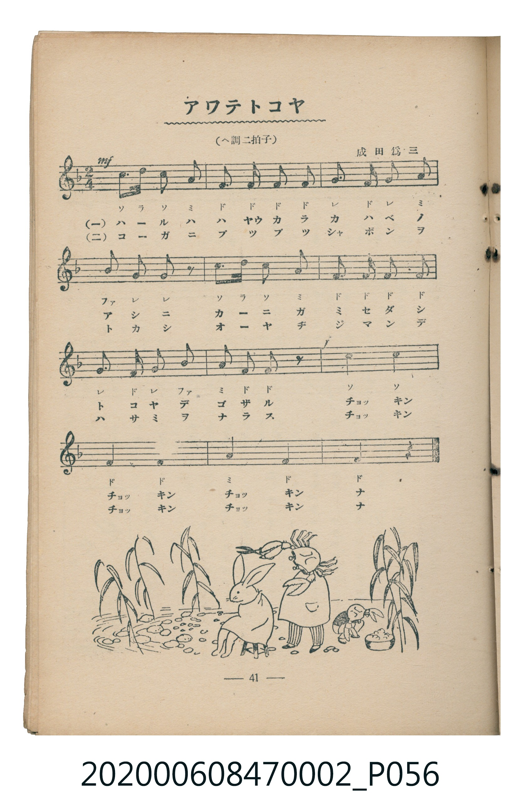
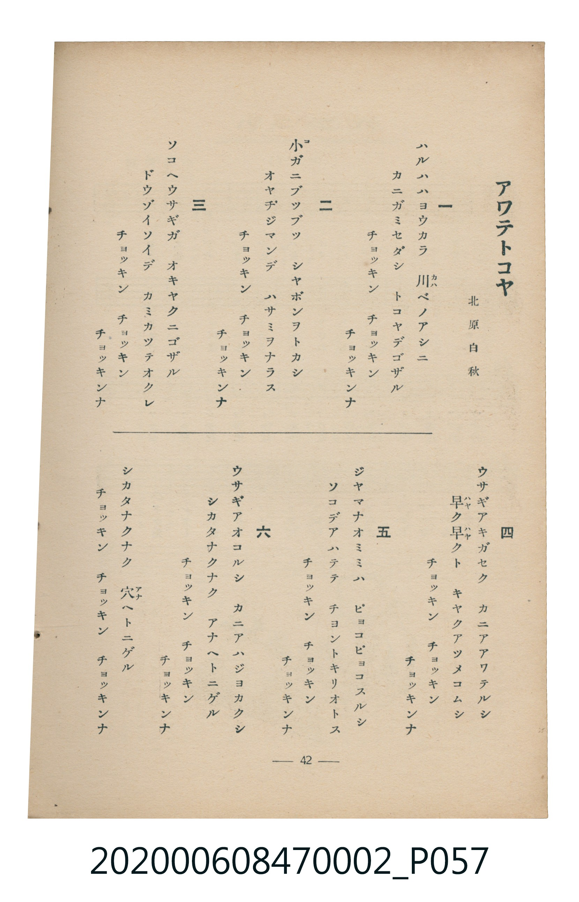

# アワテトコヤ（匆忙理髮店）

> Re:Shōka 使用 AI 協助辨識與重建樂譜，可能會有錯誤。歡迎[回報](https://github.com/TMDLang/reshoka/issues)。

- **鋼琴伴奏版**：<br><audio controls src="awate_tokoya.mp3"></audio>
- **NEUTRINO 歌聲合成版**：<br><audio controls src="awate_tokoya_neutrino.mp3"></audio>

- 詞：北原白秋
- 曲：成田爲三
- 臺灣教育會公認《新定兒童唱歌》尋常科第二學年用（2020.006.0847.0002）

## 說明

曲目說明
中文解釋：以螃蟹與猴子理髮的故事，描寫忙亂又滑稽的場面。

原書資訊與歌詞全文（對應 P056.jpg – P057.jpg，書頁 pp. 41–42，參考教材第 4 首）：
調性與拍號：ヘ調二拍子（F 大調 2/4 拍）


## 歌詞

```text
一
ハルハハヨウカラ　川ベノアシニ
カニガミセダシ　トコヤデゴザル
チヨツキン　チヨツキン　チヨツキンナ

二
小ガニブツブツ　シヤボンヲトカシ
オヤヂジマンデ　ハサミヲナラス
チヨツキン　チヨツキン　チヨツキンナ

三
ソコヘウサギガ　オキヤクニゴザル
ドウゾイソイデ　カミカツテオクレ
チヨツキン　チヨツキン　チヨツキンナ

四
ウサギアキガセク　カニアアワテルシ
早ク早クト　キヤクアツメコムシ
チヨツキン　チヨツキン　チヨツキンナ

五
ジヤマナオミミハ　ピヨコピヨコスルシ
ソコデアハテテ　チヨントキリオトス
チヨツキン　チヨツキン　チヨツキンナ

六
ウサギアオコルシ　カニアハジヨカクシ
シカタナクナク　穴ヘトニゲル
チヨツキン　チヨツキン　チヨツキンナ
```

## ABC

<div class="abc-score" data-abc-src="awate_tokoya.abc" aria-label="五線譜載入中"></div>

[下載 ABC 原始檔](awate_tokoya.abc)

## TMD 檔案連結

- [主旋律 TMD 檔案](awate_tokoya.tmd) [[在 TMD Studio 編輯](https://tmdlang.github.io/Tmd-TS/#tmd=s7IKdvYPcrWy4qpTUCpJTLdSSM7PyUlNLsnMz7MqzsjMK0nNjM_KTMmPL87Iz05Ugisry88pzU21Si9KTEmNN4o3MjAyiDcwMIs3sDAxBzIMjBBKi_NLi5JTrYqTM_Lzc-JLUitKkvLzsxHyBUX5Zal5iXlANQVFIBtTwIoQClLLMlNSQdKpKZkl-UWZiTlI7kgtKga7FWxJfElRYl5xclFmAcgDCFUlGalAx5bnFyFZCzQoPTPPqiQxE-g1kPfKE-NzEzPzchLzUpBVlWTkA31ZkFFplZFZDLI-OTEnPjsxDykwoJYXJKanWgUYmJrpAglzJS4tLYXHTYseN69_3Nz2uLnjcdPmx81L3u_peNrT9nT_zOcT2l6uXvd01_T3ezoVtLS4FG0VDA0suOxtFdy4bIz0TexAxr9YOe_9nllPe6Y_7Zv_fObe58u7wbY-m70JKPysY8LzKRued2x6sqMTLPyifdfzxsXPps580bTp2Zzmp61rXqzqfdzQ9WzahqfrZj1tnfR89dKnUzY-W9vzuKH76Ybupzt2PF8-8fmaNU929Txdu-Ppzi3Pp6wAOhAUm3rA2NQDxSaQYWAEdKMSl76WAtDi57PXvVi16tmMPi4FBYUnO9Y-m9b-Yvnil-3dQBc92b30xbzmF_N3vuhof96z5enaCRBfPp_V8mxq65NdQDU9z_r7n65fDQyAJ7uanvZ3PNs98fmKvUAFTxdseTl30eOGJi4tfS6QXbbUAiCHAsPv2ewdLza3v1jRBXQcMAiAQfu0dQXQ9aAY2dD7rL1TARR3elkF6QqPGiaDOOYgDsjJs3e8XNCoUFCgp2BiCJQzAYZHz9P-5hcNzcDAfjZ3AjAIFUwUXi6bBgwnYDCALHyxav-zhuUgq7p7X8ycDxR93DwDKAgMaqAIMGSA1ropPF2yHCimAIxuBaAoUDcXJFQbQNTj5v7HzavBJBCteNy07HETkLvycUPD0-1zHzfPfNzcB0pgTdsfN3eDNYCkux83rXncPP9x0-7HzQ0guYYGeOJ73Nz-uGnL46ZtQHMhNjSCDG5uedy09nHzZrBSQiLNXRA37uoBh-uGfrB93Y-bp4HUQEigLpCjgPbNAWvZBHbBaqAgxJmrwHJNj5t2PG6eB1bRDrYJaNZWkNtBGrpAPm3aSakzd3RCrNwLDoEZ4EDc-rhpHcjVIGeuAqtf8rgJmEuBQYcSOJ1g1fseNwGlgfrBwQfSAwxlYPgCSaB_28BGADWvodClT2fPhrgU7kBgzK4FORMYk0ALoBYD3QgUh5cqsDB9Nh0YWOshJCiwQaph_gKpBrp0ITgEFsAigZKonwJxKTD2gGECjMAucJQC4w2I-sEap4ATLFALjNG0E-FYWGwAEyPQacC0DfRIG5J9QClgcgFaCQxZoLlANqXJ4GnrWszABZoOVAByFErgglIh0GdAVwOlgKEHdfJ2MH8_2LPAIAaTDQ3PV24BpSqgG0GagcmWknwF1El5aQcFCqBS1LE8sSQ1JD87vzLRKiAzMS_focagphpkj4KNoZmWHZhVo2CqoAuEZmDaGIhrFAyBJDKuUTCCskA0WA1Yr49hDaiYAuvXBbJWg0kQHyYOKbhAjCaI5EqIJJQHUTITTPYhjDUCqdgMM7ZpDVi-G2rsNDCvBUwi2CAdoDIHLDAHTIIMAJYlCGONQYr2wo2FyM-AaoY4ciuYXAe3FiSzCswDZScwYz3CNRBjTbBrXwTVvhbhh6bdcBMQYQAyCaIaqgdiqilIBSiLwUN3HpjsQnZV83wkEhbuoDyH5EEULtRwM_xOhvgYoh3syKbtuJwMsRWakkyAbFAKAWEDsA4i0hYiJUEDAWQXxI54JFshYQCxGRozEH9DArW5AeFORCJq7gCLIvwAMxHkQ4iJkBTTBBXfgRTSEP-3I0wEp58tYLO2wcMGamJzJ8xEaLjug5oISTSgVAdlI5sISjrNkATVhhna0OyBnOxgcYwsBvIjCCInnJ1opsH8jZ76wW5BiUuYS0AkcmqBhAwoN8HCE5aMwfEFFdsPVgVLoxD3gXgQNsKVqCUKKN3UgNMHLFUgpx5dOI1c6kBiFuILpHDFE0PQAhceAqByF9VgcJIBBwIkW0AzFrgIgXkEXIJBAph4g8EpB5J3IGkWwoYWXJAQh-Y6SJjBUjhho8GlD2rhBI1NmOkLkUJqAZgNS1-ETQclJrAysG6IGZCQBxVrIEmIqyGlEUQGFDTEmQ5OWBDHQsIWVBhDjAEZAMns4CRHWkRCShkQhNGQ1IUqAmOB0hp66sJnBWFpkGdAEORg9ORFE5NB6Ys2JoNLKJqYDE9aVDcZlKyobnItF5eunQJSk0oByFXmAgA)]
- [鋼琴伴奏 TMD 檔案](awate_tokoya_piano.tmd) [[在 TMD Studio 編輯](https://tmdlang.github.io/Tmd-TS/#tmd=s7IKdvYPcrWy4qpTUCpJTLdSyC8qychPL0osyKi0ysgsLskvykxOzInPTsxLVIIrKs4vLUpOjS9ITE-1CjAwNdMFEuZKXFpaCo-bFj1uXv-4ue1xc8fjps2Pm5e839PxsnvP8wlbnuzZ8nRp__POjvd7OhW0tLgUbRUMDSy47G0V3LhsjPRN7EDGv1g57_2eWU97pj_tm_985t7ny7vBtj6bvQko_KxjwvMpG553bHqyoxMs_KJ91_PGxc-mznzRtOnZnOanrWterOp93ND1bNqGp-tmPW2d9Hz10qdTNj5b2_O4ofvphu6nO3Y8Xz7x-Zo1T3b1PF274-nOLc-nrAA60MjAyEDPwMBMz8DCxBzIMDACulGJi8uxPLEkNSQ_O78y0SogMzEvP8jDocagpppLAQhsDM207MCsGgVTBV0gNAPTxkBco2AIJJFxjYIRlAWiwWrAen0MaxQeN_eD9esCWavBJIgPE3_cvOJx0zIQowkiuRIiCeVBlMwEk30IY41AKjbDjG1aA5bvhho7DcxrAZMINkjH9sfNi8ECc8AkyIDHzZsQxhqDFO2FGwuRnwHVDHHkVjC5Dm4tSGYVmLcWanjTeoRrIMaaYNe-CKp9LcIPTbvhJiDCAGQSRDVUD8RUU5CKHRBLIaE7D0x2IbuqeT4SCQv3KY-blyN5EIULNdwMv5MhPoZoBzuyaTsuJ0NshaYkEyAblEJA2ACsg4i0hUhJ0EAA2QWxIx7JVkgYQGyGxgzE35BAbW5AuBORiJo7wKIIP8BMBPkQYuISsNwOqDiIhoU0xP_tCBPB6WcLWP02eNhATWzuhJkIDdd9UBMh5oNSHZSNbCIo6TRDElQbZmhDswfEBIgqWBwji4H8CILICWcnmmkwf6OnfrBbUOIS5hIQiZxaICEDyk2w8IQlY3B8QcX2g1XB0ijEfSAehI1wJWqJAko3NeD0AUsVyKlHF04jlzqQmIX4Ailc8cRQIzAjPG5uhocAMEfDyhjkJAMOBEi2gGYscBEC8wi4BIMEMPEGg1MOJO9A0iyEDS24ICEOzXWQMIOlcMJGg0sf1MIJGpsw0xcihdQCMBuWvgibDkpMYGVg3RAzICEPKtZAkhBXQ0ojiAwoaIgzHZywII6FhC2oMIYYAzIAktnBSY60iISUMiAIoyGpC1UExgKlNfTUhc8KwtIgz4AgyMHoyYsmJoPSF21MBpdQNDEZnrSobjIoWVHd5FosLSof5BaVCbxBZRivEG0Yi8wwjYeyYBUlkA8Sw6IW1igD6TCNh8oYQEXAehC2ABFEHMyAqAM5VNdOAcmt0T5Ac9GFjDCFjDGFTDCFTDGFzMBCylwA)]

## 分析

```text
================================================================================
📊 TMD Song Profile: [ アワテトコヤ（匆忙理髮店） ]
================================================================================
⏱  Duration:       0:13 (13.3s), 12 measures total
🎼 Key & Tempo:    首調基準 F, != 108.0 BPM, <2/4>
   - 分析範圍：      由實際發聲的音符與和弦推測調性；播放脈絡另行呈現
🎤 人聲音域:    F4 (MIDI 65) – D5 (MIDI 74) [跨度: 9 個半音 / 0.8 個八度, 難度: easy]
   - 最低音:  F4 in [AwateTokoya #1 @ m.2, 0:01]
   - 最高音: D5 in [AwateTokoya #1 @ m.1, 0:00]
   - 適合: soprano, mezzo-soprano, contralto, tenor, baritone, bass
🏛  結構:      AwateTokoya (13.3s)
⚡ 編曲密度:        Peak 1 軌道同時演奏
🗝  調性診斷：       F 大調（純淨自然大調，未偵測到可信轉調）
   - 風格氣質:    純淨自然大調（陽光明朗、易唱易記，無明顯調外色彩）
   - 轉調歷程:    全曲維持單一推測調性（未偵測到可信轉調）
   - 核心骨幹音:  F, C, G, A, A#
   - 調性數值:    F 大調 [相關度: 0.91, 穩定度: High, 自然音純度: 100.0%]
   - 候選調性 (K-S): F 大調 (0.91), F 小調 (0.66), C 大調 (0.54)
   - 五度圈歷程:   -1
   - 各段落調性細節:
     • [AwateTokoya #1]: F 大調 (r: 0.91, 自然音純度: 100.0%)

  [ 五度圈游移軌跡 ]
               C  
        [F ]*          G  
      Bb               D  
      Eb               A  
         Ab           E  
            Db       B  
               F# 
     (* = active key center)

  [ 十二半音累積音高分佈 ]
     C  : ███████████               20.5%
     C# :                            0.0%
     D  : █                          2.3%
     D# :                            0.0%
     E  :                            0.0%
     F  : ████████████████████████  45.5%
     F# :                            0.0%
     G  : ███████                   13.6%
     G# :                            0.0%
     A  : ███████                   13.6%
     A# : ██                         4.5%
     B  :                            0.0%
--------------------------------------------------------------------------------
Assignment 軌道音域：
  - Piano         : F4 – D5 (9 個半音 / 0.8 個八度, 37 個音符)
================================================================================
```


## 原書掃描頁






