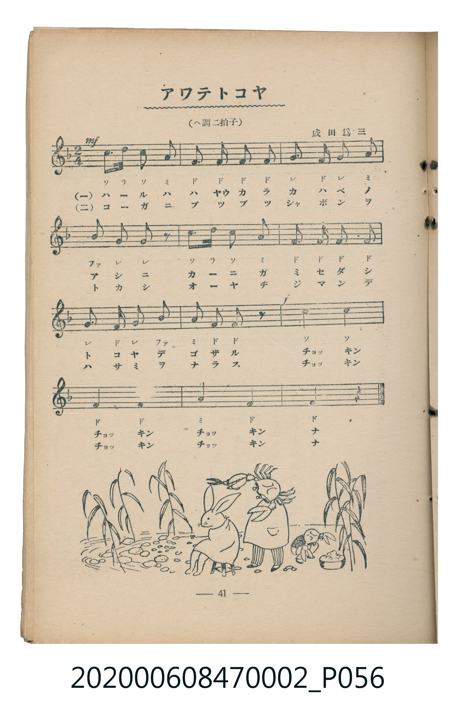
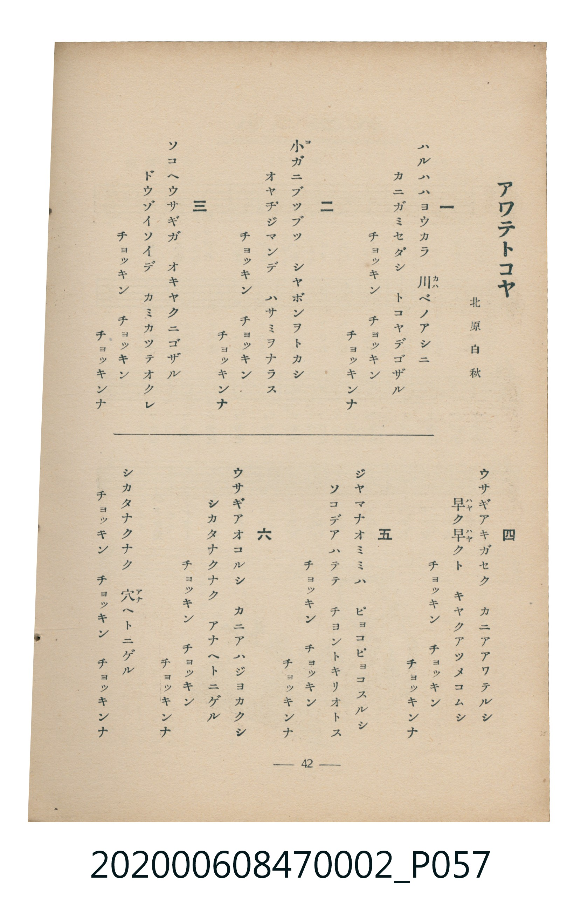

# アワテトコヤ（匆忙理髮店）

<audio controls src="awate_tokoya.mp3"></audio>

- 詞：北原白秋
- 曲：成田爲三
- 臺灣教育會公認《新定兒童唱歌》尋常科第二學年用（2020.006.0847.0002）

## 說明

曲目說明
中文解釋：以螃蟹與猴子理髮的故事，描寫忙亂又滑稽的場面。

原書資訊與歌詞全文（對應 P056.jpg – P057.jpg，書頁 pp. 41–42，參考教材第 4 首）：
調性與拍號：ヘ調二拍子（F 大調 2/4 拍）

## 跨冊／重複收錄參照

> 同詞異曲（北原白秋作詞〈あわて床屋〉；《新定兒童唱歌》二年級為山田耕筰作曲版，《唱歌帖》P164 為佐佐木すぐる作曲版）

- **[同詞異曲]** 楊金土手抄《唱歌帖》第 1 冊（2020.006.0843）：[**〈アハテ床屋〉**](../../../shokacho/vol_01/p164_awate_tokoya/index.md)（`D` / `2/4` — [原始 TMD](../../../shokacho/vol_01/p164_awate_tokoya/awate_tokoya.tmd)）
- 總表：[跨冊重複與同名歌曲總索引](../../../duplicate_songs.md)

## 歌詞

```text
一
ハルハハヨウカラ　川ベノアシニ
カニガミセダシ　トコヤデゴザル
チヨツキン　チヨツキン　チヨツキンナ

二
小ガニブツブツ　シヤボンヲトカシ
オヤヂジマンデ　ハサミヲナラス
チヨツキン　チヨツキン　チヨツキンナ

三
ソコヘウサギガ　オキヤクニゴザル
ドウゾイソイデ　カミカツテオクレ
チヨツキン　チヨツキン　チヨツキンナ

四
ウサギアキガセク　カニアアワテルシ
早ク早クト　キヤクアツメコムシ
チヨツキン　チヨツキン　チヨツキンナ

五
ジヤマナオミミハ　ピヨコピヨコスルシ
ソコデアハテテ　チヨントキリオトス
チヨツキン　チヨツキン　チヨツキンナ

六
ウサギアオコルシ　カニアハジヨカクシ
シカタナクナク　穴ヘトニゲル
チヨツキン　チヨツキン　チヨツキンナ
```

## ABC

```abc
X:1
T:アワテトコヤ（匆忙理髮店）
C:曲：成田爲三
M:2/4
L:1/16
Q:1/4=108
K:F
V:V1 name="Piano" snm="Pia"
[V:V1]
c3 d c2 A2 | F2 F2 F2 F2 | G2 F2 G2 A2 | B2 G2 G2 z2 |
c3 d c2 A2 | F2 F2 F2 F2 | G2 F2 G2 B2 | A2 F2 F2 z2 |
c4 c4 | F4 F4 | A4 F4 | F4 z4 |
```

## TMD 檔案連結

- [主旋律 TMD 檔案](awate_tokoya.tmd) [[在 TMD Studio 編輯](https://tmdlang.github.io/Tmd-TS/#tmd=s7IKdvYPcrWy4qpTUCpJTLdSSM7PyUlNLsnMz7MqzsjMK0nNjM_KTMmPL87Iz05Ugisry88pzU21Si9KTEmNN4o3MjAyiDcwMIs3sDAxBzIMjBBKi_NLi5JTrYqTM_Lzc-JLUitKkvLzsxHyBUX5Zal5iXlANQVFIBtTwIoQClLLMlNSQdKpKZkl-UWZiTlI7kgtKga7FWxJfElRYl5xclFmAcgDCFUlGalAx5bnFwGt1dJSeNy06HHz-sfNbY-bOx43bX7cvOT9no6nPW1P9898PqHt5ep1T3dNf7-nU0FLi0vRVsHQwILL3lbBjcvGSN_EDmTmi5Xz3u-Z9bRn-tO--c9n7n2-vBts1bPZm4DCzzomPJ-y4XnHpic7OsHCL9p3PW9c_GzqzBdNm57NaX7auubFqt7HDV3Ppm14um7W09ZJz1cvfTpl47O1PY8bup9u6H66Y8fz5ROfr1nzZFfP07U7nu7c8nzKCqADQWGsBwxjPVAYAxkGRkA3KnHpaykALX4-e92LVauezejjUlBQeLJj7bNp7S-WL37Z3g100ZPdS1_Ma34xf-eLjvbnPVuerp0A8eXzWS3PprY-2QVU0_Osv__p-tXAAHiyq-lpf8ez3ROfr9gLVPB0wZaXcxc9bmji0tLnAtllSy0Acigw_J7N3vFic_uLFV1AxwGDABi0T1tXAF0PipENvc_aOxUCDEzN9LIK0hUeNUwGccxBHJCTZ-94uaBRoaBAT8HEEChnAgyPnqf9zS8amoGB_WzuBGAQKpgovFw2DRhOwGAAWfhi1f5nDctBVnX3vpg5Hyj6uHkGUBAY1EARYMgArXVTeLpkOVBMARjdCkBRoG4uSKg2gKjHzf2Pm1eDSSBa8bhp2eMmIHfl44aGp9vnPm6e-bi5D5TAmrY_bu4GawBJdz9uWvO4ef7jpt2PmxtAcg0N8MT3uLn9cdOWx03bgOZCbGgEGdzc8rhp7ePmzWClhESauyBu3NUDDtcN_WD7uh83TwOpgZBAXSBHAe2bA9ayCeyC1UBBiDNXgeWaHjfteNw8D6yiHWwT0KytILeDNHSBfNq0k1Jn7uiEWLkXHAIzwIG49XHTOpCrQc5cBVa_5HETMJcCgw4lcDrBqvc9bgJKA_WDgw-kBxjKwPAFkkD_toGNAGpeQ6FLn86eDXEp3IHAmF0LciYwJoEWQC0GuhEoDi9VYGH6bDowsNZDSFBgg1TD_AVSDXTpQnAILIBFAiVRPwXiUmDsAcMEGIFd4CgFxhsQ9YM1TgEnWKAWGKNpJ8KxsNgAJkag04BpG-iRNiT7gFLA5AK0EhiyQHOBbEqTwdPWtZiBCzQdqADkKJTABaVCoM-ArgZKAUMP6uTtYP5-sGeBQQwmGxqer9wCSlVAN4I0A5MtJfkKqJPy0g4KFEClqGN5YklqSH52fmWiVUBmYl6-Q41BjUI1yCIFG0MzLTswq0bBVEEXCM3AtDEQ1ygYAklkXKNgBGWBaLAaqF4TqBgIG4BVEmEaVC-ymSBzasDqYaqQTdOF0zC9IBUgCKMhelFFYCyQSRC9tVxcunYKSOGiAOQqc3EBAA)]
- [鋼琴伴奏 TMD 檔案](awate_tokoya_piano.tmd) [[在 TMD Studio 編輯](https://tmdlang.github.io/Tmd-TS/#tmd=s7IKdvYPcrWy4tLSUnjctOhx8_rHzW2PmzseN21-3Lzk_Z6Ol917nk_Y8mTPlqdL-593drzf06mgpcWlaKtgaGDBZW-r4MZlY6RvYsdVp6D0YuW893tmPe2Z_rRv_vOZe58v71YCCT-bvQko_KxjwvMpG553bHqyoxMs_KJ91_PGxc-mznzRtOnZnOanrWterOp93ND1bNqGp-tmPW2d9Hz10qdTNj5b2_O4ofvphu6nO3Y8Xz7x-Zo1T3b1PF274-nOLc-nrAA60MjAyEDPwMBMz8DCxBzIMDACulGJi8uxPLEkNSQ_O78y0SogMzEvP8jDocagRqGaSwEIbAzNtOzArBoFUwVdIDQD08ZAXKNgCCSRcY2CEZQFosFqoHpNoGIgbABWSYRpUL3IZoLMqQGrh6lCNk0XTsP0glSAIIyG6EUVgbFAJkH01mIJFh-UYDGBh4phvEK0YSwywzQeyoL5HcgHiWFRCwtZkA7TeKiMAVQErAdhCxBBxMEMiDqQS3XtFJAcqwDkKnNxAQA)]

## 分析

```text
================================================================================
📊 TMD Song Profile: [ アワテトコヤ（匆忙理髮店） ]
================================================================================
⏱  Duration:       0:13 (13.3s), 12 measures total
🎼 Key & Tempo:    首調基準 F, != 108.0 BPM, <2/4>
   - 分析範圍：      由實際發聲的音符與和弦推測調性；播放脈絡另行呈現
🎤 人聲音域:    F4 (MIDI 65) – D5 (MIDI 74) [跨度: 9 個半音 / 0.8 個八度, 難度: easy]
   - 最低音:  F4 in [AwateTokoya #1 @ m.2, 0:01]
   - 最高音: D5 in [AwateTokoya #1 @ m.1, 0:00]
   - 適合: soprano, mezzo-soprano, contralto, tenor, baritone, bass
🏛  結構:      AwateTokoya (13.3s)
⚡ 編曲密度:        Peak 1 軌道同時演奏
🗝  調性診斷：       F 大調（純淨自然大調，未偵測到可信轉調）
   - 風格氣質:    純淨自然大調（陽光明朗、易唱易記，無明顯調外色彩）
   - 轉調歷程:    全曲維持單一推測調性（未偵測到可信轉調）
   - 核心骨幹音:  F, C, G, A, A#
   - 調性數值:    F 大調 [相關度: 0.91, 穩定度: High, 自然音純度: 100.0%]
   - 候選調性 (K-S): F 大調 (0.91), F 小調 (0.66), C 大調 (0.54)
   - 五度圈歷程:   -1
   - 各段落調性細節:
     • [AwateTokoya #1]: F 大調 (r: 0.91, 自然音純度: 100.0%)

  [ 五度圈游移軌跡 ]
               C  
        [F ]*          G  
      Bb               D  
      Eb               A  
         Ab           E  
            Db       B  
               F# 
     (* = active key center)

  [ 十二半音累積音高分佈 ]
     C  : ███████████               20.5%
     C# :                            0.0%
     D  : █                          2.3%
     D# :                            0.0%
     E  :                            0.0%
     F  : ████████████████████████  45.5%
     F# :                            0.0%
     G  : ███████                   13.6%
     G# :                            0.0%
     A  : ███████                   13.6%
     A# : ██                         4.5%
     B  :                            0.0%
--------------------------------------------------------------------------------
Assignment 軌道音域：
  - Piano         : F4 – D5 (9 個半音 / 0.8 個八度, 37 個音符)
================================================================================
```


## 原書掃描頁






