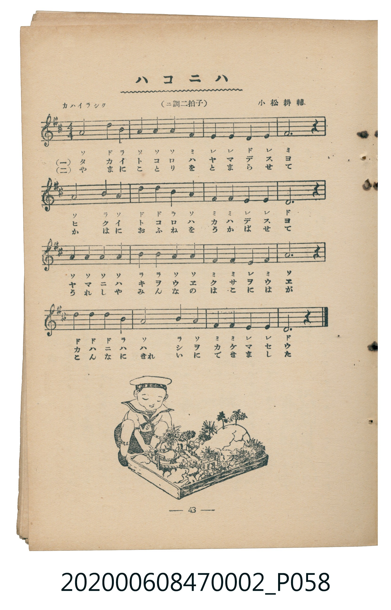

# ハコニハ（箱庭）

> Re:Shōka 使用 AI 協助辨識與重建樂譜，可能會有錯誤。歡迎回報。

- **鋼琴伴奏版**：<br><audio controls src="hakoniwa.mp3"></audio>
- **NEUTRINO 歌聲合成版**：<br><audio controls src="hakoniwa_neutrino.mp3"></audio>

- 曲：小松耕輔
- 臺灣教育會公認《新定兒童唱歌》尋常科第二學年用（2020.006.0847.0002）

## 說明

曲目說明
中文解釋：描寫箱庭中的小型山水與庭園景色，像一個縮小的世界。

原書資訊與歌詞全文（對應 P058.jpg，書頁 p. 43，參考教材第 5 首）：
調性與拍號：ニ調四拍子（標題誤植為二拍子，譜面拍號為 4/4），「カハイラシク」


## 歌詞

```text
一
タカイトコロハ　ヤマデセウ
ヒクイハトコロ　カハデセウ
ヤマニハクサ木　ウヱマセウ
カハニハハシヲ　カケマセウ

二
やまにこみちを　つけませう
かはにおふねを　うかべませう
うまれし里の　みやまには
こはんにきれいに　できました
```

## ABC

<div class="abc-score" data-abc-src="hakoniwa.abc" aria-label="五線譜載入中"></div>

[下載 ABC 原始檔](hakoniwa.abc)

## TMD 檔案連結

- [主旋律 TMD 檔案](hakoniwa.tmd) [[在 TMD Studio 編輯](https://tmdlang.github.io/Tmd-TS/#tmd=s7IKdvYPcrWy4qpTUCpJTLdSSM7PyUlNLsnMz7MqzsjMK0nNjM_KTMmPL87Iz05Ugisry88pzU21Si9KTEmNN4o3MjAyiDcwMIs3sDAxBzIMjBBKi_NLi5JTrYqTM_Lzc-JLUitKkvLzsxHyBUX5Zal5iXlANQVFIBtTwIoQClLLMlNSQdKpKZkl-UWZiTlI7kgtKga7FWxJfElRYl5xclFmAcgDCFUlGalAx-YllpQWpSJEgUalZ-ZZlSRmAj0H8mB5YnxuYmZeTmJeCrKqkox8oD8LMiqtMjKLQQ5ITsyJz07MQwoOqPUFiempVgEGphZKXFpaCo-b-x83bX7c3A1kvN_T8Xzdxqe71r7f06mgpcWlaKtgaGDBZW-r4MJlY6JvYgcy6tnsTe_3zHq6of_Z3H0vGqa-2DMFbMOL9l3PGxc_mzrzRdOmZ3Oan7auebGq93FD17NpG56um_W0ddLz1UufTtn4bG3P44bupxu6n-7Y8Xz5xOdr1jzZ1fN07Y6nO7c8n7IC6ABQJOkBI0kPFElAhoER0DFKXPpaCkCLn89e92LVqmcz-rgUFBSe7Fj7bFr7i-WLX7Z3A130rL__6frVEPcDpZ7PagG68em87qcbNz7bsOVFRztQ_OmcSc9mrn_RCfRBz9Pm_ic7Gp42dD_fsQ6oEqj-yY5pz6cCndfEpaXPBbLRlloA5NynffOfzd7xYnP7ixVdQNcAA-LFynlPW1cA_QD09tMNvc_aOxVA0aKXVZAOdB9Q8csFjQoFegomxiDn9je_aGgGhu-zuROAoaZgqvBy2TRg0AB9DjL9xar9zxqWg8zt7n0xcz5QFBilQMGns2cDRZ6unQC049mKmS8X9rxYteTZkt7nTbuAAQ-T6nmxds7LuYsgeoFSCsDIBpsNDI2ex02rwYlkyePmlY-btj9uWv-4oZcLEgMNIOpx036QGpCCDnBaWgtS39DwuBkoMu9xc_vjpt2Pm5aBlTZPAukHKe1HqAYqhdiBqhSiG5QwwXq2PpuzAqx02ePmjSAphFKobrBSkOrtj5s3QU1tQlIKdvOuHoiWlseN-x43rn7cOPlx4_7HjQsfN00CaWlc8rhxIlhq9uPGNrDSxu7HjevBSrseN2593LgWprQNLLUTTTVQdN_jpp7HjdNftgPJdWClwBCCW7geog5oL9BXQBIo1AvWAFSxGqx6OUgEpHr648b5INWUJ0EoUAAlbY_E7Py8zPJEq4DMxLx8hxqDmmqQJQo2Jlp2YEYNMHnpKhjGKZiBmSBoDGQZAaEhENcAebpAaKBQA1buY1gDSgRAEWCIA_ESoApg7AJZm4H0WlAZAxZZAsTzgLgdKLMbJNK0DGxOPMwcI5BYC8icxn1AvBqkpnEyEO8H4oVAuUlgEaA5jROhamaDRdpQzIE43wxI1oA8AfYHiG0MhCA_AEUx3d88Cez-9bjdD_IbkEXA_Y3dYPcDzYG6vwuItwIx0Byo-9vAqoApB-wHkAgo9WB4AQJrgI4HOR_hAVBUgDyI7gFY8AKNhjoY5Bmg1U0gL2yCOhiYeSDq8HgB5EBg4Db1AOnpYAdOBeIVQLwOqBbEB0YIMKKQo2k9mvshAQ9PQ7D4wBsH8BCGewFIgmJlO9wDoPRF2AOgNAPyPIiGOK8X6h2QoyEiyyGiYC9APDkfblItF5eunQIsnygA2cpcAA)]
- [鋼琴伴奏 TMD 檔案](hakoniwa_piano.tmd) [[在 TMD Studio 編輯](https://tmdlang.github.io/Tmd-TS/#tmd=s7IKdvYPcrWy4qpTUCpJTLdSyC8qychPL0osyKi0ysgsLskvykxOzInPTsxLVIIrKs4vLUpOjS9ITE-1CjAwtVDi0tJSeNzc_7hp8-PmbiDj_Z6Ol917nk_Y8mTPlqdL-593drzf06mgpcWlaKtgaGDBZW-r4MJlY6JvYgcy89nsTe_3zHq6of_Z3H0vGqa-2DMFbNWL9l3PGxc_mzrzRdOmZ3Oan7auebGq93FD17NpG56um_W0ddLz1UufTtn4bG3P44bupxu6n-7Y8Xz5xOdr1jzZ1fN07Y6nO7c8n7IC6BIjAyMDPQMDMz0DCxNzIMPACOgYJS4uj8Ts_LzM8kSrgMzEvPwgD4cag5pqLgUgsDHRsgMzahRMFXQVDOMUzMBMEDQGsoyA0BCIa4A8XSA0UKgBK_cxrFF43LQfKPK4aTUQLwGqeNzcAWRtBtJrQUEEFlkCxPOAuB0osxsk0rQMbE48zBwjkFgLyJzGfUC8GqSmcTIQ7wfihUC5SWARoDmNE6FqZoNF2lDMgTjfDEjWgDwB9geIbQyEID8ARTHd3zwJ7P71uN0P8huQRcD9jd1g9wPNgbq_C4i3AjHQHKj728CqHjfuBPsBJDIbmxcgsAboeJDzER4ARQXIg-gegAUv0Giog0GeAVrdBPLCJqiDHzdvhKjD4wWQA4GB29QDpKeDHTgViFcA8TqgWhAfGCHAiEKOpvVo7ocEPDwNweIDbxzAQxjuBSAJipXtcA-A0hdhD4DSDMjzIBrivF6od0COhogsh4iCvQDx5Hy4SbXo2cQHezYxjFeINoxVMAFSJrEIPpQC-jseyDKNj0Uw4GpAGOZ5FIPAGqEmwvlg_UAWkebAHQA1B86HMmDGIbkQTCAMQnIAss9IcBAwDHXtFGDBGO0DFEbhG4H5ylwA)]

## 分析

```text
================================================================================
📊 TMD Song Profile: [ ハコニハ（箱庭） ]
================================================================================
⏱  Duration:       0:35 (35.6s), 16 measures total
🎼 Key & Tempo:    首調基準 D, != 108.0 BPM, <4/4>
   - 分析範圍：      由實際發聲的音符與和弦推測調性；播放脈絡另行呈現
🎤 人聲音域:    D4 (MIDI 62) – D5 (MIDI 74) [跨度: 12 個半音 / 1.0 個八度, 難度: easy]
   - 最低音:  D4 in [Hakoniwa #1 @ m.3, 0:05]
   - 最高音: D5 in [Hakoniwa #1 @ m.1, 0:01]
   - 適合: soprano, mezzo-soprano, contralto, tenor, baritone, bass
🏛  結構:      Hakoniwa (35.6s)
⚡ 編曲密度:        Peak 1 軌道同時演奏
🗝  調性診斷：       D 調性不明確（純淨自然大調，未偵測到可信轉調）
   - 風格氣質:    純淨自然大調（陽光明朗、易唱易記，無明顯調外色彩）
   - 轉調歷程:    全曲維持單一推測調性（未偵測到可信轉調）
   - 核心骨幹音:  A, D, F#, E, B
   - 調性數值:    D 調性不明確 [相關度: 0.83, 穩定度: Ambiguous, 自然音純度: 100.0%]
   - 候選調性 (K-S): D 大調 (0.83), A 大調 (0.82), F# 小調 (0.68)
   - 五度圈歷程:   +2
   - 各段落調性細節:
     • [Hakoniwa #1]: D 調性不明確 (r: 0.83, 自然音純度: 100.0%)

  [ 五度圈游移軌跡 ]
               C  
         F            G  
      Bb              [D ]*
      Eb               A  
         Ab           E  
            Db       B  
               F# 
     (* = active key center)

  [ 十二半音累積音高分佈 ]
     C  :                            0.0%
     C# :                            0.0%
     D  : ███████████████           21.7%
     D# :                            0.0%
     E  : █████████                 13.3%
     F  :                            0.0%
     F# : █████████████             18.3%
     G  :                            0.0%
     G# :                            0.0%
     A  : ████████████████████████  35.0%
     A# :                            0.0%
     B  : ████████                  11.7%
--------------------------------------------------------------------------------
Assignment 軌道音域：
  - Piano         : D4 – D5 (12 個半音 / 1.0 個八度, 49 個音符)
================================================================================
```


## 原書掃描頁




