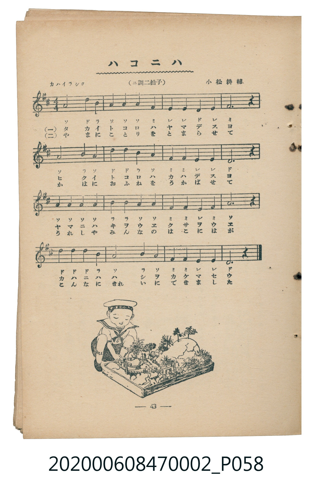

# ハコニハ（箱庭）

> Re:Shōka 使用 AI 協助辨識與重建樂譜，可能會有錯誤。歡迎回報。

- **NEUTRINO 歌聲合成版**：<br><audio controls src="hakoniwa_neutrino.mp3"></audio>
- **鋼琴伴奏版**：<br><audio controls src="hakoniwa.mp3"></audio>


- 曲：小松耕輔
- 臺灣教育會公認《新定兒童唱歌》尋常科第二學年用（2020.006.0847.0002）

## 說明

曲目說明
中文解釋：描寫箱庭中的小型山水與庭園景色，像一個縮小的世界。

原書資訊與歌詞全文（對應 P058.jpg，書頁 p. 43，參考教材第 5 首）：
調性與拍號：ニ調四拍子（標題誤植為二拍子，譜面拍號為 4/4），「カハイラシク」


## 跨冊／重複收錄參照

> 同曲（《新定兒童唱歌》、《新編 小學校・公學校 唱歌教材集》共同收錄教材）

- **[同曲]** 《新編小公學校唱歌教材集》第一、二學年（大正12年／1923，國臺圖 0725-41）：[**〈箱庭〉**](../../../shoka_kyozai_shu_1923/grade_1_2/52_hakoniwa/index.md)（`D` / `4/4` — [原始 TMD](../../../shoka_kyozai_shu_1923/grade_1_2/52_hakoniwa/hakoniwa.tmd)）
- 總表：[跨冊重複與同名歌曲總索引](../../../duplicate_songs.md)

## 歌詞

```text
一
タカイトコロハ　ヤマデセウ
ヒクイハトコロ　カハデセウ
ヤマニハクサ木　ウヱマセウ
カハニハハシヲ　カケマセウ

二
やまにこみちを　つけませう
かはにおふねを　うかべませう
うまれし里の　みやまには
こはんにきれいに　できました
```

## ABC

```abc
X:1
T:ハコニハ（箱庭）
C:曲：小松耕輔
M:4/4
L:1/16
Q:1/4=108
K:D
V:V1 name="Piano" snm="Pia"
[V:V1]
A8 d4 B4 | A4 A4 A4 F4 | E4 E4 D4 E4 | F12 z4 |
w: 1.~タ カ イ | ト コ ロ ハ | ヤ マ デ セ | ウ
w: 2.~や ま に | こ み ち を | つ け ま せ | う
A8 B4 A4 | d4 d4 B4 A4 | F4 F4 E4 E4 | D12 z4 |
w: 1.~ヒ ク イ | ト コ ロ ハ | カ ハ デ セ | ウ
w: 2.~か は に | お ふ ね を | う か べ ま | せう
A4 A4 A4 A4 | B4 B4 A4 A4 | F4 F4 E4 F4 | A12 z4 |
w: 1.~ヤ マ ニ ハ | ク サ キ ヲ | ウ ヱ マ セ | ウ
w: 2.~う ま れ し | さ と の _ | み や ま に | は
d4 d4 d4 B4 | A8 B4 A4 | F4 F4 E4 E4 | D12 z4 |
w: 1.~カ ハ ニ ハ | ハ シ ヲ | カ ケ マ セ | ウ
w: 2.~こ は ん に | き い に | で き ま し | た
```

## TMD 檔案連結

- [主旋律 TMD 檔案](hakoniwa.tmd) [[在 TMD Studio 編輯](https://tmdlang.github.io/Tmd-TS/#tmd=s7IKdvYPcrWy4qpTUCpJTLdSSM7PyUlNLsnMz7MqzsjMK0nNjM_KTMmPL87Iz05Ugisry88pzU21Si9KTEmNN4o3MjAyiDcwMIs3sDAxBzIMjBBKi_NLi5JTrYqTM_Lzc-JLUitKkvLzsxHyBUX5Zal5iXlANQVFIBtTwIoQClLLMlNSQdKpKZkl-UWZiTlI7kgtKga7FWxJfElRYl5xclFmAcgDCFUlGalAx-YllpQWpSpxaWkpPG7uf9y0-XFzN5Dxfk_H83Ubn-5a-35Pp4KWFpeirYKhgQWXva2CC5eNib6JHciYZ7M3vd8z6-mG_mdz971omPpizxSw6S_adz1vXPxs6swXTZuezWl-2rrmxarexw1dz6ZteLpu1tPWSc9XL306ZeOztT2PG7qfbuh-umPH8-UTn69Z82RXz9O1O57u3PJ8ygqgA0DhpwcMPz1Q-AEZBkZAxyhx6WspAC1-Pnvdi1Wrns3o41JQUHiyY-2zae0vli9-2d4NdNGz_v6n61dD3A-Uej6rBejGp_O6n27c-GzDlhcd7UDxp3MmPZu5_kUn0Ac9T5v7n-xoeNrQ_XzHOqBKoPonO6Y9nwp0XhOXlj4XyEZbagGQc5_2zX82e8eLze0vVnQBXQMMiBcr5z1tXQH0A9DbTzf0PmvvVAgwMLXQyypIB7oPqPjlgkaFAj0FE2OQc_ubXzQ0A8P32dwJwFBTMFV4uWwaMGiAPgeZ_mLV_mcNy0Hmdve-mDkfKAqMUqDg09mzgSJP104A2vFsxcyXC3terFrybEnv86ZdwICHSfW8WDvn5dxFEL1AKQVgZIPNBoZGz-Om1eBEsuRx88rHTdsfN61_3NDLBYmBBhD1uGk_SA1IQQc4La0FqW9oeNwMFJn3uLn9cdPux03LwEqbJ4H0g5T2I1QDlULsQFUK0Q1KmGA9W5_NWQFWuuxx80aQFEIpVDdYKUj19sfNm6CmNiEpBbt5Vw9ES8vjxn2PG1c_bpz8uHH_48aFj5smgbQ0LnncOBEsNftxYxtYaWP348b1YKVdjxu3Pm5cC1PaBpbaiaYaKLrvcVPP48bpL9uB5DqwUmAIwS1cD1EHtBfoKyAJFOoFawCqWA1WvRwkAlI9_XHjfJBqypMgFCiAkrZHYnZ-XmZ5olVAZmJevkONQU01yBIFGwstOzCjBpi8dMHQMA5ImAExRAiGjcEiRkAShA2hdA1YHAYNQCJg43wMa0CJBCoOjBUwuQSsA5gKwLzNILJ5LZjsh8qAVABjD0y2g1Xthsg0LUOyJx5hjxFIrgVmT-M-MAmyDSjeOBnMA7kCGNtg0yZBZcD2NE5E0jMbKtOG1R5E8IBCBsSugQQUPLQgYqDQAGFYOAFV4Q6fZpBrIOGznrjwgYQjmEdC-DR2w8MHbA88fLrAvK1gEmwPPHxAoQDRB0zt8FACyYBSPZ4gQsY14ICBBQ5mAEGSFCxgsQUQcnIAOwYeEJAAAzu9CRJEm5ACAlhcIHQSFUQQD4OTQlMPmD0d6uGpYN4KMLkOqhskDk5W4KSHnuxAbsMWPogEg5bHUNMVSWkIJUWgBBGYhqSu7SgBBMmLpAYQJC9Bgh3Chnm3FynQIMEBk1kO5oHloUEEC9T5GDbVcnHp2inAyikFIFuZCwA)]
- [鋼琴伴奏 TMD 檔案](hakoniwa_piano.tmd) [[在 TMD Studio 編輯](https://tmdlang.github.io/Tmd-TS/#tmd=s7IKdvYPcrWy4tLSUnjc3P-4afPj5m4g4_2ejpfde55P2PJkz5anS_ufd3a839OpoKXFpWirYGhgwWVvq-DCZWOib2LHVaeg9Gz2pvd7Zj3d0P9s7r4XDVNf7JmiBBJ-0b7reePiZ1Nnvmja9GxO89PWNS9W9T5u6Ho2bcPTdbOetk56vnrp0ykbn63tedzQ_XRD99MdO54vn_h8zZonu3qert3xdOeW51NWAF1iZGBkoGdgYKZnYGFiDmQYGAEdo8TF5ZGYnZ-XWZ5oFZCZmJcf5OFQY1BTzaUABDYWWnZgRo2CqYIuGBrGAQkzIIYIwbAxWMQISIKwIZSuAYvDoAFIBGycj2GNwuOm_VDxx02rweQSsI7HzR1g3mYQ2bwWTPZDZUAqHjfPA5PtYFW7ITJNy5DsiUfYYwSSa4HZ07gPTIJsA4o3TgbzQK543LgQbNokqAzYnsaJSHpmQ2XasNqDCB5QyIDYNZCAgocWRAwUGiAMCyegKtzh0wxyDSR81hMXPpBwBPNICJ_Gbnj4gO2Bh08XmLcVTILtgYcPKBQg-h437oSHEkhmNv4gQsY14ICBBQ5mAEGSFCxgsQUQcnIAOwYeEJAAAzu9CRJEm5AC4nHzRoROooII4mFwUmjqAbOnQz08FcxbASbXQXWDxMHJCpz00JMdyG3YwgeRYNDyGGq6IikNoaQIlCAC05DUtR0lgCB5kdQAguQlSLBD2DDv9iIFGiQ4YDLLwTywPDSIYIE6H8OmWvRiyge5mDKBF1OG8QrRhrEKJkDKJBbBh1LA8IwHskzjYxEMuBoQNkDEBsIgsEaoiXA-WD-QRaQ5cAdAzYHzoQyYcUguBBMIg5AcgOwzEhwEDENdOwVYMEb7AIVR-EZgvjIXAA)]

## 分析

```text
================================================================================
📊 TMD Song Profile: [ ハコニハ（箱庭） ]
================================================================================
⏱  Duration:       0:35 (35.6s), 16 measures total
🎼 Key & Tempo:    首調基準 D, != 108.0 BPM, <4/4>
   - 分析範圍：      由實際發聲的音符與和弦推測調性；播放脈絡另行呈現
🎤 人聲音域:    D4 (MIDI 62) – D5 (MIDI 74) [跨度: 12 個半音 / 1.0 個八度, 難度: easy]
   - 最低音:  D4 in [Hakoniwa #1 @ m.3, 0:05]
   - 最高音: D5 in [Hakoniwa #1 @ m.1, 0:01]
   - 適合: soprano, mezzo-soprano, contralto, tenor, baritone, bass
🏛  結構:      Hakoniwa (35.6s)
⚡ 編曲密度:        Peak 1 軌道同時演奏
🗝  調性診斷：       D 調性不明確（純淨自然大調，未偵測到可信轉調）
   - 風格氣質:    純淨自然大調（陽光明朗、易唱易記，無明顯調外色彩）
   - 轉調歷程:    全曲維持單一推測調性（未偵測到可信轉調）
   - 核心骨幹音:  A, D, F#, E, B
   - 調性數值:    D 調性不明確 [相關度: 0.83, 穩定度: Ambiguous, 自然音純度: 100.0%]
   - 候選調性 (K-S): D 大調 (0.83), A 大調 (0.82), F# 小調 (0.68)
   - 五度圈歷程:   +2
   - 各段落調性細節:
     • [Hakoniwa #1]: D 調性不明確 (r: 0.83, 自然音純度: 100.0%)

  [ 五度圈游移軌跡 ]
               C  
         F            G  
      Bb              [D ]*
      Eb               A  
         Ab           E  
            Db       B  
               F# 
     (* = active key center)

  [ 十二半音累積音高分佈 ]
     C  :                            0.0%
     C# :                            0.0%
     D  : ███████████████           21.7%
     D# :                            0.0%
     E  : █████████                 13.3%
     F  :                            0.0%
     F# : █████████████             18.3%
     G  :                            0.0%
     G# :                            0.0%
     A  : ████████████████████████  35.0%
     A# :                            0.0%
     B  : ████████                  11.7%
--------------------------------------------------------------------------------
Assignment 軌道音域：
  - Piano         : D4 – D5 (12 個半音 / 1.0 個八度, 49 個音符)
================================================================================
```


## 原書掃描頁




