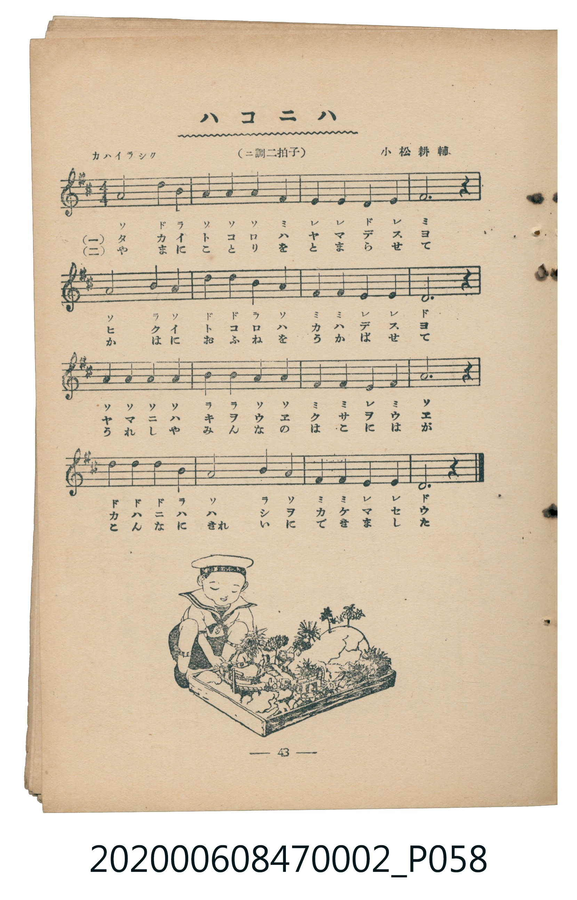

# ハコニハ

<audio controls src="hakoniwa.mp3"></audio>

- 曲：小松耕輔
- 臺灣教育會公認《新定兒童唱歌》尋常科第二學年用（2020.006.0847.0002）

## 說明

原書資訊與歌詞全文（對應 P058.jpg，書頁 p. 43，參考教材第 5 首）：
調性與拍號：ニ調四拍子（標題誤植為二拍子，譜面拍號為 4/4），「カハイラシク」

## 歌詞

```text
一
タカイトコロハ　ヤマデセウ
ヒクイハトコロ　カハデセウ
ヤマニハクサ木　ウヱマセウ
カハニハハシヲ　カケマセウ

二
やまにこみちを　つけませう
かはにおふねを　うかべませう
うまれし里の　みやまには
こはんにきれいに　できました
```

## ABC

```abc
X:1
T:ハコニハ
C:曲：小松耕輔
M:4/4
L:1/16
Q:1/4=108
K:D
V:V1 name="Piano" snm="Pia"
[V:V1]
A8 d4 B4 | A4 A4 A4 F4 | E4 E4 D4 E4 | F12 z4 |
A8 B4 A4 | d4 d4 B4 A4 | F4 F4 E4 E4 | D12 z4 |
A4 A4 A4 A4 | B4 B4 A4 A4 | F4 F4 E4 F4 | A12 z4 |
d4 d4 d4 B4 | A8 B4 A4 | F4 F4 E4 E4 | D12 z4 |
```

## TMD 檔案連結

- [主旋律 TMD 檔案](hakoniwa.tmd) [[在 TMD Studio 編輯](https://tmdlang.github.io/Tmd-TS/#tmd=s7IKdvYPcrWy4tLSUnjc3P-4afPj5m4gQ0FLi0vRVsHQwILL3lbBhcvGRN_EjqtOQenZ7E3v98x6uqH_2dx9LxqmvtgzRQkk_KJ91_PGxc-mznzRtOnZnOanrWterOp93ND1bNqGp-tmPW2d9Hz10qdTNj5b2_O4ofvphu6nO3Y8Xz7x-Zo1T3b1PF274-nOLc-nrHi_p8PIwMhAz8DATM_AwsQcyDAwer-nU4mLS19LwZZagEtBQeFp3_xns3e82Nz-YkXXi452oLterJz3tHXFs2ntQFc83dD7rL1TIcDA1EIvqyD9_Z4eoOKXCxoVCvQUTIyB3Kf9zS8amoHefTZ3AtATCqYKL5dNA7oUGDQg01-s2v-sYTnI3O7eFzPnA0WBoQoUfDp7NlDk6doJQDuerZj5cmHPi1VLni3pfd60CxgOMKmeF2vnvJy7CKIXKKUADHuw2cCw63nctBocT0seN6983LT9cdP6xw29XCBLn-xoAFGPm_aD1IAUdICjcy1IfUPD42agyLzHze2Pm3Y_bloGVto8CaQfpLQfoRqoFGIHqlKIblDaAOvZ-mzOCrDSZY-bN4KkEEqhusFKQaq3P27eBDW1CUkp2M27eiBaWh437nvcuPpx4-THjfsfNy583DQJpKVxyePGiWCp2Y8b28BKG7sfN64HK-163Lj1ceNamNI2sNRONNVA0X2Pm3oeN05_2Q4k14GVAkMIbuF6iDqgvUBfAUmgUC9YA1DFarDq5SARkOrpjxvng1RTngShQEFLn4vLIzE7Py-zPNEqIDMxL9-hxqBGoRpki4KNhZYdmFEDTF-6YGgYByTMgBgiBMPGYBEjIAnChlC6BiwOgwYgETTjQCaB2DUQg-GmQ8RAukEYZi5QFR7zkHEN2BSYSZimQdwLcwW6aQi3oHkX1cnEOK-Wi0vXTgEWwgpAtjIXFwA)]
- [鋼琴伴奏 TMD 檔案](hakoniwa_piano.tmd) [[在 TMD Studio 編輯](https://tmdlang.github.io/Tmd-TS/#tmd=s7IKdvYPcrWy4tLSUnjc3P-4afPj5m4g4_2ejpfde55P2PJkz5anS_ufd3a839OpoKXFpWirYGhgwWVvq-DCZWOib2LHVaeg9Gz2pvd7Zj3d0P9s7r4XDVNf7JmiBBJ-0b7reePiZ1Nnvmja9GxO89PWNS9W9T5u6Ho2bcPTdbOetk56vnrp0ykbn63tedzQ_XRD99MdO54vn_h8zZonu3qert3xdOeW51NWAF1iZGBkoGdgYKZnYGFiDmQYGAEdo8TF5ZGYnZ-XWZ5oFZCZmJcf5OFQY1CjUM2lAAQ2Flp2YEaNgqmCLhgaxgEJMyCGCMGwMVjECEiCsCGUrgGLw6ABSATNOJBJIHYNxGC46RAxkG4QhpkLVIXHPGRcAzYFZhKmaRD3wlyBbhrCLWjeRXUyMc6rRQ9gH5QANoEHsGG8QrRhrIIJkDKJRfChFND6eCDLND4WwYCrAWEDhOMRBoE1Qk2E88H6gSwizYE7AGoOnA9lwIxDciGYQBiE5ABkn5HgIGAg6topwMJRAchW5uICAA)]

## 分析

```text
================================================================================
📊 TMD Song Profile: [ ハコニハ ]
================================================================================
⏱  Duration:       0:35 (35.6s), 16 measures total
🎼 Key & Tempo:    首調基準 D, != 108.0 BPM, <4/4>
   - 分析範圍：      由實際發聲的音符與和弦推測調性；播放脈絡另行呈現
🎤 人聲音域:    D4 (MIDI 62) – D5 (MIDI 74) [跨度: 12 個半音 / 1.0 個八度, 難度: easy]
   - 最低音:  D4 in [Hakoniwa #1 @ m.3, 0:05]
   - 最高音: D5 in [Hakoniwa #1 @ m.1, 0:01]
   - 適合: soprano, mezzo-soprano, contralto, tenor, baritone, bass
🏛  結構:      Hakoniwa (35.6s)
⚡ 編曲密度:        Peak 1 軌道同時演奏
🗝  調性診斷：       D 調性不明確（純淨自然大調，未偵測到可信轉調）
   - 風格氣質:    純淨自然大調（陽光明朗、易唱易記，無明顯調外色彩）
   - 轉調歷程:    全曲維持單一推測調性（未偵測到可信轉調）
   - 核心骨幹音:  A, D, F#, E, B
   - 調性數值:    D 調性不明確 [相關度: 0.83, 穩定度: Ambiguous, 自然音純度: 100.0%]
   - 候選調性 (K-S): D 大調 (0.83), A 大調 (0.82), F# 小調 (0.68)
   - 五度圈歷程:   +2
   - 各段落調性細節:
     • [Hakoniwa #1]: D 調性不明確 (r: 0.83, 自然音純度: 100.0%)

  [ 五度圈游移軌跡 ]
               C  
         F            G  
      Bb              [D ]*
      Eb               A  
         Ab           E  
            Db       B  
               F# 
     (* = active key center)

  [ 十二半音累積音高分佈 ]
     C  :                            0.0%
     C# :                            0.0%
     D  : ███████████████           21.7%
     D# :                            0.0%
     E  : █████████                 13.3%
     F  :                            0.0%
     F# : █████████████             18.3%
     G  :                            0.0%
     G# :                            0.0%
     A  : ████████████████████████  35.0%
     A# :                            0.0%
     B  : ████████                  11.7%
--------------------------------------------------------------------------------
Assignment 軌道音域：
  - Piano         : D4 – D5 (12 個半音 / 1.0 個八度, 49 個音符)
================================================================================
```


## 原書掃描頁




