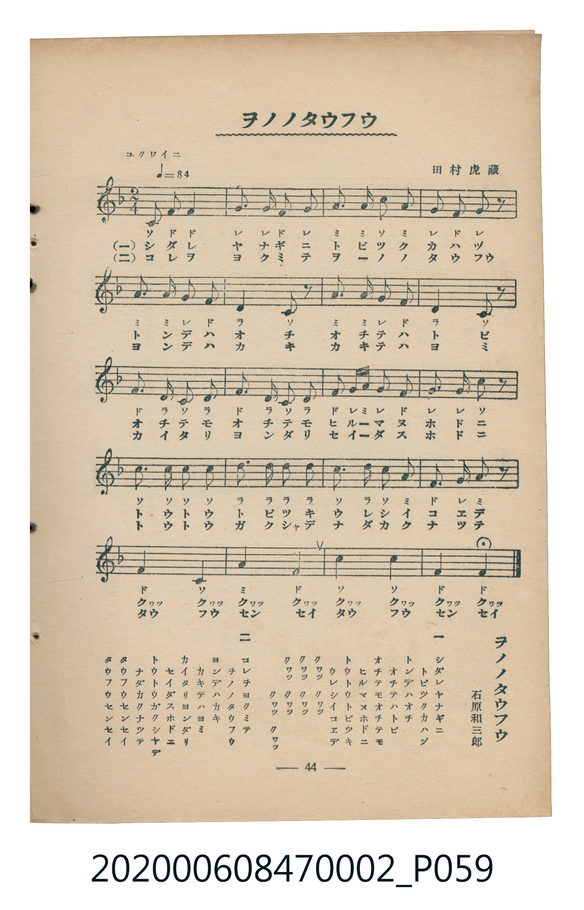

# ヲノノタウフウ（小野道風）

<audio controls src="ono_no_tofu.mp3"></audio>

- 詞：石原和三郎
- 曲：田村虎藏
- 臺灣教育會公認《新定兒童唱歌》尋常科第二學年用（2020.006.0847.0002）

## 說明

曲目說明
中文解釋：描寫書法家小野道風受青蛙啟發、持續努力的故事。

原書資訊與歌詞全文（對應 P059.jpg，書頁 p. 44，參考教材第 6 首）：
調性與拍號：ヘ調二拍子（F 大調 2/4 拍），「ユクワイニ（♩＝84）」

## 歌詞

```text
一
シダレヤナギニ　トビツクカハヅ
トンデハオチ　オチテハトビ
オチテモオチテモ　ヒルマヌホドニ
トウトウトビツキ　ウレシイコエデ
クワツ　クワツ　クワツ　クワツ
クワツ　クワツ　クワツ　クワツ

二
コレヲヨクミテ　ヲノノタウフウ
ヨンデハカキ　カキテハヨミ
カイタリヨンダリ　セイダスホドニ
トウトウガクシヤデ　ナダカクナツテ
タウフウセンセイ　タウフウセンセイ
```

## ABC

```abc
X:1
T:ヲノノタウフウ（小野道風）
C:曲：田村虎藏
M:2/4
L:1/16
Q:1/4=84
K:F
V:V1 name="Piano" snm="Pia"
[V:V1]
C2 F2 F4 | G2 G2 F2 G2 | A2 A2 c2 A2 | G2 F2 G2 z2 |
A2 A2 G2 F2 | D4 C2 z2 | A2 A2 G2 F2 | D4 C2 z2 |
F2 D2 C2 D2 | F2 D2 C2 D2 | F2 G A G2 F2 | G2 G2 c2 z2 |
c3 c c2 c2 | d2 d2 d2 d2 | c2 d2 c2 A2 | F2 G2 A2 z2 |
F4 C4 | A4 F4 | c4 C4 | F4 F4 |
```

## TMD 檔案連結

- [主旋律 TMD 檔案](ono_no_tofu.tmd) [[在 TMD Studio 編輯](https://tmdlang.github.io/Tmd-TS/#tmd=s7IKdvYPcrWy4qpTUCpJTLdSSM7PyUlNLsnMz7MqzsjMK0nNjM_KTMmPL87Iz05Ugisry88pzU21Si9KTEmNN4o3MjAyiDcwMIs3sDAxBzIMjBBKi_NLi5JTrYqTM_Lzc-JLUitKkvLzsxHyBUX5Zal5iXlANQVFIBtTwIoQClLLMlNSQdKpKZkl-UWZiTlI7kgtKga7FWxJfElRYl5xclFmAcgDCFUlGalAx6bl52Tn5BelootnZBYDja1U4tLSUnjcvOlxcx8INe1_3LTscfNUIPl-T8fTDf0v2_teNk5-uWjF-z2dClpaXIq2ChYmXPa2Cm5cNkb6JnYgU1-snPd-z6zn8zc_7Zv_dFLPkx2dL5v7wPY9m70JJDNlw7O5E1_M7HsxvR8s_KJ91_PGxc-mznzRtOnZnOanrWterOp93ND1bNqGp-tmPW2d9Hz10qdTNj5b2_O4ofvphu6nO3Y8Xz7x-Zo1T3b1PF274-nOLc-nAB3UAYoAPWAE6IEiAMgwMAK6UolLX0sBaPHz2eterFr1bEYfl4KCwpMda59Na3-xfPHL9m6gi5719z9dv_rZ7B3PNk99um4bsj-f9k9_OXfSi9kzn06d_3zmnscNjc96Gp8D7e1a9bRr9vNZLc-mtj7Z1f24oYlLS58LZJcttQDIocAgBDrrxeb2Fyu6XnS0A4MAGLpPW1cAXQ-OkN5n7Z0KAQamlnpZBenv9_QAFb9c0KhQoKdgYgLkPu1vftHQDAzZZ3MnAMNLwUzh5bJpwEAB-hlk-otV-581LAeZ2937YuZ8oOjj5hlAQWC4AkWerp0AtMNN4emS5UAxBWD0KgBFwbqBEdHzuHnZ46b1j5vXP25a8rgZGIwdj2aufL9nrgXQ4s7HDb1ckIBuAFGPm7Y_bm543LzmcTNQbdfjpnVAHY8bgCIdj5snP25uAZnUtPpxc__j5lawBpDE5sfN7SChplWPmxtBqiGM5jawOpBOiNlw0UUobJDxkx43A02d97gZ6NzZj5s7gdbCjAclbBgJdcNasCVAkTUgBwO91bT5cdMKoCsg9oA9C1QHUkSATboGcGjt6oFoBPocGFTAXLgCrGA-yEcg72DJlxDvAB0JD63VMI-AGdDQAiqYDzEbKAr02P7HzcCggmgDGrwKrGE3OCqBjJ24Q6sJGDbAuALGJ1BpO9hVXWA9QHOBTgWyW4B2QqxCuBJkNtAqiA0gq7BLgbRRnnGgQAGUIf3z8v3yQ_LTSq0CMhPz8h1qDGoUqkHWKNgYmmnZgVk1CqbxCroKhlAMgjUKRkAShEEiILpGwRhIgrAplIaogckbgESgxsFUwuRrFMxAFoAg2CawWuJUQU0EyYNlwTJgFh5BI6C5CFNhPgG5G9lMEB8kCqJBGGg_yBgkDFEDYiH8DPMviIfuQrjTIUEIUgKCiECFWImiCCYJV8RVy8Wla6cAjzgFIEeZiwsA)]
- [鋼琴伴奏 TMD 檔案](ono_no_tofu_piano.tmd) [[在 TMD Studio 編輯](https://tmdlang.github.io/Tmd-TS/#tmd=s7IKdvYPcrWy4tLSUnjcvOlxcx8INe1_3LTscfNUIPl-T8fL7j3PJ2x5smfL06X9zzs73u_pVNDS4lK0VbAw4bK3VXDjsjHSN7HjqlNQerFy3vs9s57P3_y0b_7TST1PdnS-bO5TAsk8m70JJDNlw7O5E1_M7HsxvR8s_KJ91_PGxc-mznzRtOnZnOanrWterOp93ND1bNqGp-tmPW2d9Hz10qdTNj5b2_O4ofvphu6nO3Y8Xz7x-Zo1T3b1PF274-nOLc-nrAA60cjAyEDPwMBMz8DCxBzIMDACulKJi8s_L98vPyQ_rdQqIDMxLz_Iw6HGoEahmksBCGwMzbTswKwaBdN4BV0FQygGwRoFIyAJwiAREF2jYAwkQdgUSkPUwOQNQCJQ42AqYfI1CmYgC0AQbBNYLXGqoCaC5MGyYBkwC4-gEdBchKkwn4DcjWwmiA8SBdEgDLQfZAwShqgBsRB-hvkXxEN3IdzpkCAEKQFBRKBCrERRBJOEK-KqxYg3H5R4M4FHm2G8QrRhLDj-gCzTeBATRcwA4TyYsAlQGMjBIgJVCeJGm4DNQmISNhaoEkUhkIGiDqQRzADbDuLBRcAaQP7WtVOAe10ByFHm4gIA)]

## 分析

```text
================================================================================
📊 TMD Song Profile: [ ヲノノタウフウ（小野道風） ]
================================================================================
⏱  Duration:       0:28 (28.6s), 20 measures total
🎼 Key & Tempo:    首調基準 F, != 84.0 BPM, <2/4>
   - 分析範圍：      由實際發聲的音符與和弦推測調性；播放脈絡另行呈現
🎤 人聲音域:    C4 (MIDI 60) – D5 (MIDI 74) [跨度: 14 個半音 / 1.2 個八度, 難度: moderate]
   - 最低音:  C4 in [OnoNoTofu #1 @ m.1, 0:00]
   - 最高音: D5 in [OnoNoTofu #1 @ m.14, 0:18]
   - 適合: soprano, mezzo-soprano, contralto, tenor, baritone, bass
🏛  結構:      OnoNoTofu (28.6s)
⚡ 編曲密度:        Peak 1 軌道同時演奏
🗝  調性診斷：       F 大調（純淨自然大調，未偵測到可信轉調）
   - 風格氣質:    純淨自然大調（陽光明朗、易唱易記，無明顯調外色彩）
   - 轉調歷程:    全曲維持單一推測調性（未偵測到可信轉調）
   - 核心骨幹音:  F, C, D, G, A
   - 調性數值:    F 大調 [相關度: 0.87, 穩定度: Moderate, 自然音純度: 100.0%]
   - 候選調性 (K-S): F 大調 (0.87), C 大調 (0.75), D 小調 (0.65)
   - 五度圈歷程:   -1
   - 各段落調性細節:
     • [OnoNoTofu #1]: F 大調 (r: 0.87, 自然音純度: 100.0%)

  [ 五度圈游移軌跡 ]
               C  
        [F ]*          G  
      Bb               D  
      Eb               A  
         Ab           E  
            Db       B  
               F# 
     (* = active key center)

  [ 十二半音累積音高分佈 ]
     C  : ███████████████████████   25.3%
     C# :                            0.0%
     D  : ████████████████          17.3%
     D# :                            0.0%
     E  :                            0.0%
     F  : ████████████████████████  26.7%
     F# :                            0.0%
     G  : ██████████████            15.3%
     G# :                            0.0%
     A  : ██████████████            15.3%
     A# :                            0.0%
     B  :                            0.0%
--------------------------------------------------------------------------------
Assignment 軌道音域：
  - Piano         : C4 – D5 (14 個半音 / 1.2 個八度, 65 個音符)
================================================================================
```


## 原書掃描頁




