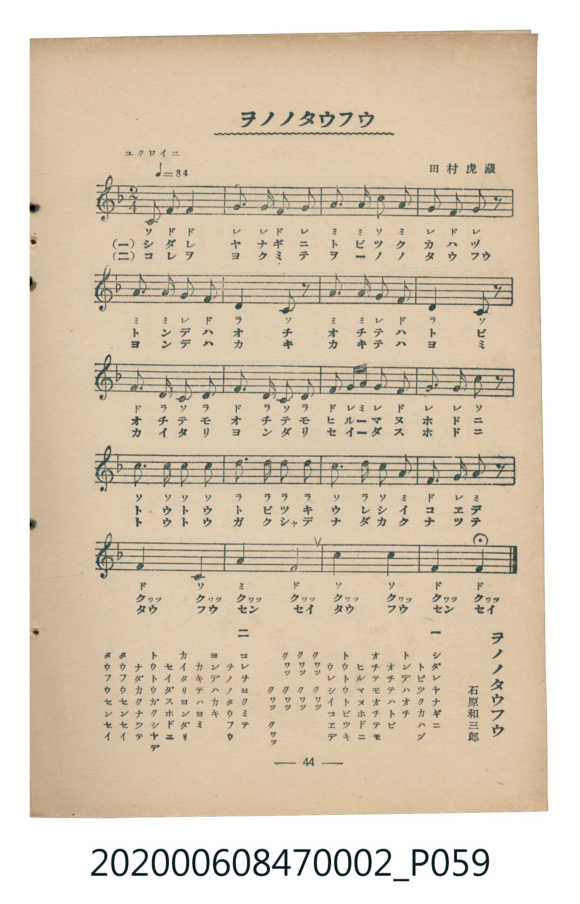

# ヲノノタウフウ（小野道風）

> Re:Shōka 使用 AI 協助辨識與重建樂譜，可能會有錯誤。歡迎回報。

- **鋼琴伴奏版**：<br><audio controls src="ono_no_tofu.mp3"></audio>
- **NEUTRINO 歌聲合成版**：<br><audio controls src="ono_no_tofu_neutrino.mp3"></audio>

- 詞：石原和三郎
- 曲：田村虎藏
- 臺灣教育會公認《新定兒童唱歌》尋常科第二學年用（2020.006.0847.0002）

## 說明

曲目說明
中文解釋：描寫書法家小野道風受青蛙啟發、持續努力的故事。

原書資訊與歌詞全文（對應 P059.jpg，書頁 p. 44，參考教材第 6 首）：
調性與拍號：ヘ調二拍子（F 大調 2/4 拍），「ユクワイニ（♩＝84）」


## 歌詞

```text
一
シダレヤナギニ　トビツクカハヅ
トンデハオチ　オチテハトビ
オチテモオチテモ　ヒルマヌホドニ
トウトウトビツキ　ウレシイコエデ
クワツ　クワツ　クワツ　クワツ
クワツ　クワツ　クワツ　クワツ

二
コレヲヨクミテ　ヲノノタウフウ
ヨンデハカキ　カキテハヨミ
カイタリヨンダリ　セイダスホドニ
トウトウガクシヤデ　ナダカクナツテ
タウフウセンセイ　タウフウセンセイ
```

## ABC

<div class="abc-score" data-abc-src="ono_no_tofu.abc" aria-label="五線譜載入中"></div>

[下載 ABC 原始檔](ono_no_tofu.abc)

## TMD 檔案連結

- [主旋律 TMD 檔案](ono_no_tofu.tmd) [[在 TMD Studio 編輯](https://tmdlang.github.io/Tmd-TS/#tmd=s7IKdvYPcrWy4qpTUCpJTLdSSM7PyUlNLsnMz7MqzsjMK0nNjM_KTMmPL87Iz05Ugisry88pzU21Si9KTEmNN4o3MjAyiDcwMIs3sDAxBzIMjBBKi_NLi5JTrYqTM_Lzc-JLUitKkvLzsxHyBUX5Zal5iXlANQVFIBtTwIoQClLLMlNSQdKpKZkl-UWZiTlI7kgtKga7FWxJfElRYl5xclFmAcgDCFUlGalAx6bl52Tn5BelootnZBYDja1ECAPtSM_Ms8pNzczKxOLg_KKSjHygzwsyKqF6M5MTc-KzE_OQAgjqoILE9FSrAANTSyUuLS2Fx82bHjf3gVDT_sdNyx43TwWS7_d0PN3Q_7K972Xj5JeLVrzf06mgpcWlaKtgYcJlb6vgxmVjpG9iBzL4xcp57_fMej5_89O--U8n9TzZ0fmyuQ9s5bPZm0AyUzY8mzvxxcy-F9P7wcIv2nc9b1z8bOrMF02bns1pftq65sWq3scNXc-mbXi6btbT1knPVy99OmXjs7U9jxu6n27ofrpjx_PlE5-vWfNkV8_TtTue7tzyfArQQR2g6NUDRq8eKHqBDAMjoCuVuPS1FIAWP5-97sWqVc9m9HEpKCg82bH22bT2F8sXv2zvBrroWX__0_Wrn83e8Wzz1KfrtiH782n_9JdzJ72YPfPp1PnPZ-553ND4rKfxOdDerlVPu2Y_n9XybGrrk13djxuauLT0uUB22VILgBwKDEKgs15sbn-xoutFRzswCICh-7R1BdD14AjpfdbeqQCKOL2sgvT3e3qAil8uaFQo0FMwMQFyn_Y3v2hoBobss7kTgOGlYKbwctk0YKAA_Qwy_cWq_c8aloPM7e59MXM-UPRx8wygIDBcgSJP104A2uGm8HTJcqCYAjB6FYCiYN3AiOh53LzscdP6x83rHzctedwMDMaORzNXvt8z1wJocefjhl4uSEA3gKjHTdsfNzc8bl7zuBmotutx0zqgjscNQJGOx82THze3gExqWv24uf9xcytYA0hi8-PmdpBQ06rHzY0g1RBGcxtYHUgnxGy46CIUNsj4SY-bgabOe9wMdO7sx82dQGthxoMSNoyEumEt2BKgyBqQg4Heatr8uGkF0BUQe8CeBaoDKSLAJl0DOLR29UA0An0ODCpgLlwBVjAf5COQd7DkS4h3gI6Eh9ZqmEfADGhoARXMh5gNFAV6bP_jZmBQQbQBDV4F1rAbHJVAxk7codUEDBtgXAHjE6i0HeyqLrAeoLlApwLZLUA7IVYhXAkyG2gVxAaQVdilQNoozzhQoADKkP55-X75IflppVYBmYl5-Q41BjXVIFsUbAzNtOzArBoF03gFXQVDKAbBGgUjIAnCIBEQXaNgDCRB2BRKQ9TA5A1AImDjfAxrQOkdyAcGC5hcAzcVGGhgkS4Q2bQOzO6GynSAeZPBZAtYfj1Epmk1WKwfTLYCSZBroXYZgeQ3w20BphAku1bATQFGPphsg8qAVAHTEZyE6mjaD9axDCwOihsUyxBBAPN4jYIZSBoEwUEIDgTiVCGCCupxiCfa4V4FOWcVVBswT8NcAhWFiEA8BFcPNgmiHhSMaMEECQ6s9oACGKyvaS2SPeBgB4ug2wMyCWIPKFiRQwjkX7BvwT4Fs_AIGgHDCRFKsCQHSmDoyQnTz4twhgZUpnkSmAdJPPPAZA9UZjaY1wkmQckPPUFBfA5OqpAk0QyyBT0MIYkbKtO0G6EHItO0k6BtwJwHDkdTMA3CwLQCCiIkDFEDYiEyHizTgXjYUhMkEUNTFjgVY89goLgFuR2S4MEZCJJxwf6AZ60miK9BaQY9TeG0rQliGjjzgQtLuBEgbeD8Dw0mSGBD8zpUBuw8cHSiJy54LoJkWVAIgCCi4IKEKIoimCRcEVLCglY_UBl0Pp1UICU9UL0AUwYrgmCmgOoJuBGg6gJJjix9XLVcXLp2CvA6QgHIUeYCAA)]
- [鋼琴伴奏 TMD 檔案](ono_no_tofu_piano.tmd) [[在 TMD Studio 編輯](https://tmdlang.github.io/Tmd-TS/#tmd=s7IKdvYPcrWy4qpTUCpJTLdSyC8qychPL0osyKi0ysgsLskvykxOzInPTsxLVIIrKs4vLUpOjS9ITE-1CjAwtVTi0tJSeNy86XFzHwg17X_ctOxx81Qg-X5Px8vuPc8nbHmyZ8vTpf3POzve7-lU0NLiUrRVsDDhsrdVcOOyMdI3sQOZ_WLlvPd7Zj2fv_lp3_ynk3qe7Oh82dwHtvXZ7E0gmSkbns2d-GJm34vp_WDhF-27njcufjZ15oumTc_mND9tXfNiVe_jhq5n0zY8XTfraeuk56uXPp2y8dnanscN3U83dD_dseP58onP16x5sqvn6dodT3dueT5lBdCJRgZGBnoGBmZ6BhYm5kCGgRHQlUpcXP55-X75IflppVYBmYl5-UEeDjUGNdVcCkBgY2imZQdm1SiYxivoKhhCMQjWKBgBSRAGiYDoGgVjIAnCplAaogYmbwASARvnY1ij8LhpO5D_uLkBTK6Bm_q4eQlYpAtENq0Ds7uhMh1g3mQw2QKWXw-RaVoNFusHk61AEuRaqF1GIPnNcFuAUYhk1wq4KY-b54PJNqgMSBUwouEkVEfTfrCOZWBxUOyjWIYIApjHaxTMQNIgCA5CcCAQpwoRVFCPQzzRDvcqyDmroNoeNzfCXAIVhYhAPARXDzYJoh4UjGjBBAkOrPaAAhisr2ktkj3gYAeLoNsDMgliDyhYkUMI5F-wb8E-BbPwCBoBwwkRSrAkB0pg6MkJ08-LcIYGVKZ5EpgHSTzzwGQPVGY2mNcJJkHJDz1BQXwOTqqQJNEMsgU9DCGJGyrTtBuhByLTtJOgbcCcBw5HUzANwsC0AgoiJAxRA2IhMh4s04F42FITJBFDUxY4FWPPYKC4BbkdkuDBGQiSccH-gGetJoivQWkGPU3htK0JYho48zVth-V7kBEgbeD8Dw0mSGBD8zpUBuw8cHSiJy54LoJkWVAIgCCi4IKEKIoimCRcEVLCWv-4GYhA9kE8gsqnkwqkpAeqeWDKYEUQzJTdkJQHMWI3JJLgJRc5-rhqMaoIH-QqwgReQxjGK0QbxoKrCiDLNB7ERBEzQMQSTNgEKAzkYBGBqgRxo03AZiExCRsLVImiEMhAUQfSCGaAbQfx4CJgDSBv69opwH0e7QMURRUwAgsocwEA)]

## 分析

```text
================================================================================
📊 TMD Song Profile: [ ヲノノタウフウ（小野道風） ]
================================================================================
⏱  Duration:       0:28 (28.6s), 20 measures total
🎼 Key & Tempo:    首調基準 F, != 84.0 BPM, <2/4>
   - 分析範圍：      由實際發聲的音符與和弦推測調性；播放脈絡另行呈現
🎤 人聲音域:    C4 (MIDI 60) – D5 (MIDI 74) [跨度: 14 個半音 / 1.2 個八度, 難度: moderate]
   - 最低音:  C4 in [OnoNoTofu #1 @ m.1, 0:00]
   - 最高音: D5 in [OnoNoTofu #1 @ m.14, 0:18]
   - 適合: soprano, mezzo-soprano, contralto, tenor, baritone, bass
🏛  結構:      OnoNoTofu (28.6s)
⚡ 編曲密度:        Peak 1 軌道同時演奏
🗝  調性診斷：       F 大調（純淨自然大調，未偵測到可信轉調）
   - 風格氣質:    純淨自然大調（陽光明朗、易唱易記，無明顯調外色彩）
   - 轉調歷程:    全曲維持單一推測調性（未偵測到可信轉調）
   - 核心骨幹音:  F, C, D, G, A
   - 調性數值:    F 大調 [相關度: 0.87, 穩定度: Moderate, 自然音純度: 100.0%]
   - 候選調性 (K-S): F 大調 (0.87), C 大調 (0.75), D 小調 (0.65)
   - 五度圈歷程:   -1
   - 各段落調性細節:
     • [OnoNoTofu #1]: F 大調 (r: 0.87, 自然音純度: 100.0%)

  [ 五度圈游移軌跡 ]
               C  
        [F ]*          G  
      Bb               D  
      Eb               A  
         Ab           E  
            Db       B  
               F# 
     (* = active key center)

  [ 十二半音累積音高分佈 ]
     C  : ███████████████████████   25.3%
     C# :                            0.0%
     D  : ████████████████          17.3%
     D# :                            0.0%
     E  :                            0.0%
     F  : ████████████████████████  26.7%
     F# :                            0.0%
     G  : ██████████████            15.3%
     G# :                            0.0%
     A  : ██████████████            15.3%
     A# :                            0.0%
     B  :                            0.0%
--------------------------------------------------------------------------------
Assignment 軌道音域：
  - Piano         : C4 – D5 (14 個半音 / 1.2 個八度, 65 個音符)
================================================================================
```


## 原書掃描頁




