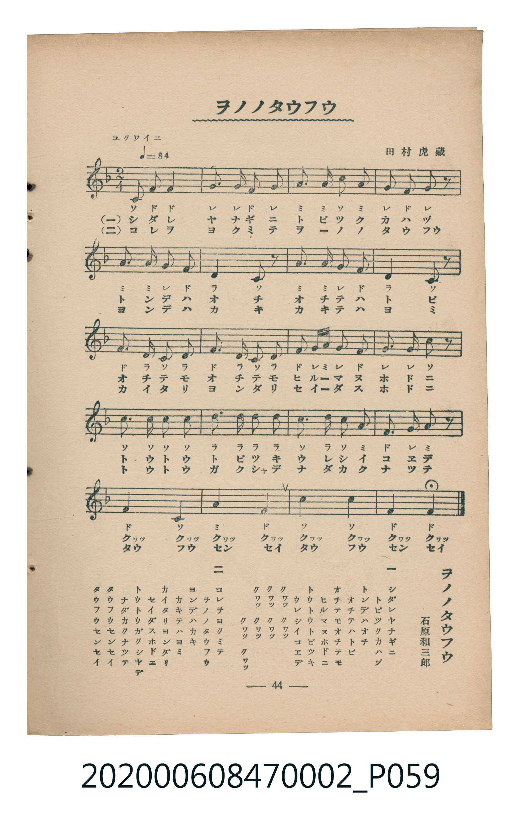

# ヲノノタウフウ（小野道風）

> Re:Shōka 使用 AI 協助辨識與重建樂譜，可能會有錯誤。歡迎回報。

- **鋼琴伴奏版**：<br><audio controls src="ono_no_tofu.mp3"></audio>
- **NEUTRINO 歌聲合成版**：<br><audio controls src="ono_no_tofu_neutrino.mp3"></audio>

- 詞：石原和三郎
- 曲：田村虎藏
- 臺灣教育會公認《新定兒童唱歌》尋常科第二學年用（2020.006.0847.0002）

## 說明

曲目說明
中文解釋：描寫書法家小野道風受青蛙啟發、持續努力的故事。

原書資訊與歌詞全文（對應 P059.jpg，書頁 p. 44，參考教材第 6 首）：
調性與拍號：ヘ調二拍子（F 大調 2/4 拍），「ユクワイニ（♩＝84）」


## 歌詞

```text
一
シダレヤナギニ　トビツクカハヅ
トンデハオチ　オチテハトビ
オチテモオチテモ　ヒルマヌホドニ
トウトウトビツキ　ウレシイコエデ
クワツ　クワツ　クワツ　クワツ
クワツ　クワツ　クワツ　クワツ

二
コレヲヨクミテ　ヲノノタウフウ
ヨンデハカキ　カキテハヨミ
カイタリヨンダリ　セイダスホドニ
トウトウガクシヤデ　ナダカクナツテ
タウフウセンセイ　タウフウセンセイ
```

## ABC

```abc
X:1
T:ヲノノタウフウ（小野道風）
C:曲：田村虎藏
M:2/4
L:1/16
Q:1/4=84
K:F
V:V1 name="Piano" snm="Pia"
[V:V1]
C2 F2 F4 | G2 G2 F2 G2 | A2 A2 c2 A2 | G2 F2 G2 z2 |
w: 1.~シ ダ レ | ヤ ナ ギ ニ | ト ビ ツ ク | カ ハ ヅ
w: 2.~コ レ ヲ | ヨ ク ミ テ | ヲ ノ ノ _ | タ ウ フウ
A2 A2 G2 F2 | D4 C2 z2 | A2 A2 G2 F2 | D4 C2 z2 |
w: 1.~ト ン デ ハ | オ チ | オ チ テ ハ | ト ビ
w: 2.~ヨ ン デ ハ | カ キ | カ キ テ ハ | ヨ ミ
F2 D2 C2 D2 | F2 D2 C2 D2 | F2 G A G2 F2 | G2 G2 c2 z2 |
w: 1.~オ チ テ モ | オ チ テ モ | ヒ ル _ マ ヌ | ホ ド ニ
w: 2.~カ イ タ リ | ヨ ン ダ リ | セ イ _ ダ ス | ホ ド ニ
c3 c c2 c2 | d2 d2 d2 d2 | c2 d2 c2 A2 | F2 G2 A2 z2 |
w: 1.~ト ウ ト ウ | ト ビ ツ キ | ウ レ シ イ | コ エ デ
w: 2.~ト ウ ト ウ | ガ ク シヤ デ | ナ ダ カ ク | ナ ツ テ
F4 C4 | A4 F4 | c4 C4 | F4 F4 |
w: 1.~クワツ クワツ | クワツ クワツ | クワツ クワツ | クワツ クワツ
w: 2.~タウ フウ | セン セイ | タウ フウ | セン セイ
```

## TMD 檔案連結

- [主旋律 TMD 檔案](ono_no_tofu.tmd) [[在 TMD Studio 編輯](https://tmdlang.github.io/Tmd-TS/#tmd=s7IKdvYPcrWy4qpTUCpJTLdSSM7PyUlNLsnMz7MqzsjMK0nNjM_KTMmPL87Iz05Ugisry88pzU21Si9KTEmNN4o3MjAyiDcwMIs3sDAxBzIMjBBKi_NLi5JTrYqTM_Lzc-JLUitKkvLzsxHyBUX5Zal5iXlANQVFIBtTwIoQClLLMlNSQdKpKZkl-UWZiTlI7kgtKga7FWxJfElRYl5xclFmAcgDCFUlGalAx6bl52Tn5BelootnZBYDja1ECAPtSM_Ms8pNzczKRHKwlpbC4-ZNj5v7QKhp_-OmZY-bpwLJ93s6nm7of9ne97Jx8stFK97v6VTQ0uJStFWwMOGyt1Vw47Ix0jexA5n-YuW893tmPZ-_-Wnf_KeTep7s6HzZ3Ae299nsTSCZKRuezZ34Ymbfi-n9YOEX7bueNy5-NnXmi6ZNz-Y0P21d82JV7-OGrmfTNjxdN-tp66Tnq5c-nbLx2dqexw3dTzd0P92x4_nyic_XrHmyq-fp2h1Pd255PgXooA5Q_OgB40cPFD9AhoER0JVKXPpaCkCLn89e92LVqmcz-rgUFBSe7Fj7bFr7i-WLX7Z3A130rL__6frVz2bveLZ56tN125D9-bR_-su5k17Mnvl06vznM_c8bmh81tP4HGhv16qnXbOfz2p5NrX1ya7uxw1NXFr6XCC7bKkFQA4FBiHQWS82t79Y0fWiox0YBMDQfdq6Auh6cIT0PmvvVAgwMLXUyypIf7-nB6j45YJGhQI9BRMTIPdpf_OLhmZgyD6bOwEYXgpmCi-XTQMGCtDPINNfrNr_rGE5yNzu3hcz5wNFHzfPAAoCwxUo8nTtBKAdbgpPlywHiikAo1cBKArWDYyInsfNyx43rX_cvP5x05LHzcBg7Hg0c-X7PXMtgBZ3Pm7o5YIEdAOIety0_XFzw-PmNY-bgWq7HjetA-p43AAU6XjcPPlxcwvIpKbVj5v7Hze3gjWAJDY_bm4HCTWtetzcCFINYTS3gdWBdELMhosuQmGDjJ_0uBlo6rzHzUDnzn7c3Am0FmY8KGHDSKgb1oItAYqsATkY6K2mzY-bVgBdAbEH7FmgOpAiAmzSNYBDa1cPRCPQ58CgAubCFWAF80E-AnkHS76EeAfoSHhorYZ5BMyAhhZQwXyI2UBRoMf2P24GBhVEG9DgVWANu8FRCWTsxB1aTcCwAcYVMD6BStvBruoC6wGaC3QqkN0CtBNiFcKVILOBVkFsAFmFXQqkjfKMAwUKoAzpn5fvlx-Sn1ZqFZCZmJfvUGNQUw2yRcHG0EzLDsyqUTCNV9BVMIRiEKxRMAKSIAwSAdE1CsZAEoRNoTREDUzeACQCNs7HsAaU3oF8YLCAyTVwU4GBBhbpApFN68DsbqhMB5g3GUy2gOXXQ2SaVoPF-sFkK5AEuRZqlxFIfjPcFmAKQbJrBdwUYOSDyTaoDEgVMB3BSaiOpv1gHcvA4qC4QbEMEQQwj9comIGkQRAchOBAIE4VIqigHod4oh3uVZBzVkG1AfM0zCVQUYgIxENw9WCTIOpBwYgWTJDgwGoPKIDB-prWItkDDnawCLo9IJMg9oCCFTmEQP4F-xbsUzALj6ARMJwQoQRLcqAEhp6cMP28CGdoQGWaJ4F5kMQzD0z2QGVmg3mdYBKU_NATFMTn4KQKSRLNIFvQwxCSuKEyTbsReiAyTTsJ2gbMeeBwNAXTIAxMK6AgQsIQNSAWIuPBMh2Ihy01QRIxNGWBUzH2DAaKW5DbIQkenIEgGRfsD3jWaoL4GpRm0NMUTtuaIKaBMx-4sIQbAdIGzv_QYIIENjSvQ2XAzgNHJ3riguciSJYFhQAIIgouSIiiKIJJwhUhJSxo9QOVQefTSQVS0gPVCzBlsCIIZgqonoAbAaoukOTI0sdVy8Wla6cAryMUgBxlLgA)]
- [鋼琴伴奏 TMD 檔案](ono_no_tofu_piano.tmd) [[在 TMD Studio 編輯](https://tmdlang.github.io/Tmd-TS/#tmd=s7IKdvYPcrWy4tLSUnjcvOlxcx8INe1_3LTscfNUIPl-T8fL7j3PJ2x5smfL06X9zzs73u_pVNDS4lK0VbAw4bK3VXDjsjHSN7HjqlNQerFy3vs9s57P3_y0b_7TST1PdnS-bO5TAsk8m70JJDNlw7O5E1_M7HsxvR8s_KJ91_PGxc-mznzRtOnZnOanrWterOp93ND1bNqGp-tmPW2d9Hz10qdTNj5b2_O4ofvphu6nO3Y8Xz7x-Zo1T3b1PF274-nOLc-nrAA60cjAyEDPwMBMz8DCxBzIMDACulKJi8s_L98vPyQ_rdQqIDMxLz_Iw6HGoKaaSwEIbAzNtOzArBoF03gFXQVDKAbBGgUjIAnCIBEQXaNgDCRB2BRKQ9TA5A1AImDjfAxrFB43bQfyHzc3gMk1cFMfNy8Bi3SByKZ1YHY3VKYDzJsMJlvA8ushMk2rwWL9YLIVSIJcC7XLCCS_GW4LMAqR7FoBN-Vx83ww2QaVAakCRjSchOpo2g_WsQwsDop9FMsQQQDzeI2CGUgaBMFBCA4E4lQhggrqcYgn2uFeBTlnFVTb4-ZGmEugohARiIfg6sEmQdSDghEtmCDBgdUeUACD9TWtRbIHHOxgEXR7QCZB7AEFK3IIgfwL9i3Yp2AWHkEjYDghQgmW5EAJDD05Yfp5Ec7QgMo0TwLzIIlnHpjsgcrMBvM6wSQo-aEnKIjPwUkVkiSaQbaghyEkcUNlmnYj9EBkmnYStA2Y88DhaAqmQRiYVkBBhIQhakAsRMaDZToQD1tqgiRiaMoCp2LsGQwUtyC3QxI8OANBMi7YH_Cs1QTxNSjNoKcpnLY1QUwDZ76m7bB8DzICpA2c_6HBBAlsaF6HyoCdB45O9MQFz0WQLAsKARBEFFyQEEVRBJOEK0JKWOsfNwMRyD6IR1D5dFKBlPRANQ9MGawIgpmyG5LyIEbshkQSvOQiRx9XLUYV4YNcRZjAawjDeIVow1hwVQFkmcaDmChiBohYggmbAIWBHCwiUJUgbrQJ2CwkJmFjgSpRFAIZKOpAGsEMsO0gHlwErAHkbV07BbjPo32AoqgCRmABZS4A)]

## 分析

```text
================================================================================
📊 TMD Song Profile: [ ヲノノタウフウ（小野道風） ]
================================================================================
⏱  Duration:       0:28 (28.6s), 20 measures total
🎼 Key & Tempo:    首調基準 F, != 84.0 BPM, <2/4>
   - 分析範圍：      由實際發聲的音符與和弦推測調性；播放脈絡另行呈現
🎤 人聲音域:    C4 (MIDI 60) – D5 (MIDI 74) [跨度: 14 個半音 / 1.2 個八度, 難度: moderate]
   - 最低音:  C4 in [OnoNoTofu #1 @ m.1, 0:00]
   - 最高音: D5 in [OnoNoTofu #1 @ m.14, 0:18]
   - 適合: soprano, mezzo-soprano, contralto, tenor, baritone, bass
🏛  結構:      OnoNoTofu (28.6s)
⚡ 編曲密度:        Peak 1 軌道同時演奏
🗝  調性診斷：       F 大調（純淨自然大調，未偵測到可信轉調）
   - 風格氣質:    純淨自然大調（陽光明朗、易唱易記，無明顯調外色彩）
   - 轉調歷程:    全曲維持單一推測調性（未偵測到可信轉調）
   - 核心骨幹音:  F, C, D, G, A
   - 調性數值:    F 大調 [相關度: 0.87, 穩定度: Moderate, 自然音純度: 100.0%]
   - 候選調性 (K-S): F 大調 (0.87), C 大調 (0.75), D 小調 (0.65)
   - 五度圈歷程:   -1
   - 各段落調性細節:
     • [OnoNoTofu #1]: F 大調 (r: 0.87, 自然音純度: 100.0%)

  [ 五度圈游移軌跡 ]
               C  
        [F ]*          G  
      Bb               D  
      Eb               A  
         Ab           E  
            Db       B  
               F# 
     (* = active key center)

  [ 十二半音累積音高分佈 ]
     C  : ███████████████████████   25.3%
     C# :                            0.0%
     D  : ████████████████          17.3%
     D# :                            0.0%
     E  :                            0.0%
     F  : ████████████████████████  26.7%
     F# :                            0.0%
     G  : ██████████████            15.3%
     G# :                            0.0%
     A  : ██████████████            15.3%
     A# :                            0.0%
     B  :                            0.0%
--------------------------------------------------------------------------------
Assignment 軌道音域：
  - Piano         : C4 – D5 (14 個半音 / 1.2 個八度, 65 個音符)
================================================================================
```


## 原書掃描頁




