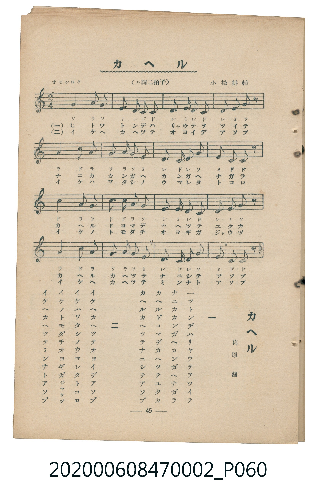

# カヘル（青蛙）

> Re:Shōka 使用 AI 協助辨識與重建樂譜，可能會有錯誤。歡迎[回報](https://github.com/TMDLang/reshoka/issues)。

- **鋼琴伴奏版**：<br><audio controls src="kaeru.mp3"></audio>
- **NEUTRINO 歌聲合成版**：<br><audio controls src="kaeru_neutrino.mp3"></audio>

- 詞：葛原𦱳
- 曲：小松耕輔
- 臺灣教育會公認《新定兒童唱歌》尋常科第二學年用（2020.006.0847.0002）

## 說明

曲目說明
中文解釋：描寫青蛙鳴叫、跳躍與在水邊活動的情景。

原書資訊與歌詞全文（對應 P060.jpg，書頁 p. 45，參考教材第 7 首）：
調性與拍號：ハ調二拍子（C 大調 2/4 拍），「オモシロク」


## 歌詞

```text
一
一ツトンデハリヤウテヲツイテ
ナニカカンガヘカンガヘナガラ
カヘルドコマデカヘツテユクカ
カヘルカヘツテナニシテアソブ

二
イケヘカヘツテオヨイデアソブ
イケハワタシノウマレタトコロ
イケノトモダチオヨギガジヤウヅ
イケヘカヘツテミンナトアソブ
```

## ABC

<div class="abc-score" data-abc-src="kaeru.abc" aria-label="五線譜載入中"></div>

[下載 ABC 原始檔](kaeru.abc)

## TMD 檔案連結

- [主旋律 TMD 檔案](kaeru.tmd) [[在 TMD Studio 編輯](https://tmdlang.github.io/Tmd-TS/#tmd=s7IKdvYPcrWy4qpTUCpJTLdSSM7PyUlNLsnMz7MqzsjMK0nNjM_KTMmPL87Iz05Ugisry88pzU21Si9KTEmNN4o3MjAyiDcwMIs3sDAxBzIMjBBKi_NLi5JTrYqTM_Lzc-JLUitKkvLzsxHyBUX5Zal5iXlANQVFIBtTwIoQClLLMlNSQdKpKZkl-UWZiTlI7kgtKga7FWxJfElRYl5xclFmAcgDCFUlGalAxybmZeYi6wUalZ6ZZ1WSmAn0HMiD5YnxuYmZeTmJeSnIqkoy8oH-LMiotMrILAY5IDkxJz47MQ8pOKDWFySmp1oFGJgZKHFpaSk8blr9uHnG4-bV7_d0vJw76cXsme_3dCpoaXEp2ioYGhhw2dsqOHPZGOmb2IHMebFy3vs9s15MnP20b_6HZRs3gw1_NnsTUPDphv5nc_e9aJj6Ys8UsPCL9l3PGxc_mzrzRdOmZ3Oan7auebGq93FD17NpG56um_W0ddLz1UufTtn4bG3P44bupxu6n-7Y8Xz5xOdr1jzZ1fN07Y6nO7c8n7IC6CpQtOkBo00PFG1AhoER0IVKXPpaCkCLn89e92LVqmcz-rgUFBSe7Fj7bFr7i-WLX7Z3A130rL__6frVEE-93Lzlaf_qxw2NL7ZvfrGr90VH-9M5K55t2PKyqevZlt1Pu6c-n9XyrLn12cz1jxuauLT0uUDm21ILgBwHDLFns3e82Nz-YkUX0Hqgt4GB-bR1BdDFQE8-3dD7rL1TARQtelkF6e_39AAVv1zQqFCgp2BiCuQ-7W9-0dAMDM1ncycAw0jBXOHlsmnAgAD6E2T6i1X7nzUsB5nb3fti5nyg6OPmfqAgMCyBIk_XTgDa4azwdMlyoJgCMDYVgKJg3cDA73nctOpx86LHTdsfN6993AQMgV4uSHA2QKnHzS2PmzseN29-3NwONPdxM1D9ksdNyx43tz1u3gSSbVoCZINUP27uetzcDUpVoIS1-XHTGlDyQmYDFYAYK8GqYanvcXPn4yag8fNANkAFgXYCjV8GclHTalTVKCogFgId3_a4CeiLvY-bp0Hcv6sHogvo1I0wV8B0gby8AuxsoH0wXUiqgZ4EWrsfbG4f2KtAp60BiQADAuTStciq-8DBs-hxMzCoGmFmrwP5s2kHLKhacTumeT44bIEeAZqN5BjKUx4UKIBStHdialGpVUBmYl6-Q41BTTXIBgUbQzMtOzCrRsFUQRcMzYAYxK5RMAaSRkBsCMU1YJ4xkATxQBAmAtFhABIBm-ZjWANMC5OgqoAeA5MtYB0w3mYw2Q4m-6Ey0JQFFmsDk5vgNkH0A4MQLhuPsM8IKA-WAdvXtBGsZgZEX9NqOA9qBlg3SGYVmLcCrBfiFqhdTYvA5uwFy09DsasGHEIgaBgHDS5I4MECDhQckIABBROIRgQnLCjRg6oLHlTdYItBTkY4HRxUTWuweAqLDNgsmNhKIoIJFvjrwWL7weR2sEwf1C5IhMwDk2BzwargUdkEicq1aMEEDh7UFAUWggcbIlhAEJbagKqgLFi6QgoosLchAQWJT2hANXciOQTiUFBsYtMBS4WQ9AX2WhPE62Cz8AQUNDig6RecQpobwGQj1C5QeoLYtQKsbx1UHBJo0MIArqYVKbCon6ZwBRXu7ABJOdAUCEkBsIyCOzuQmfWa54N5kAiD2AsKVtx21XJx6dopgEsxBSBDmQsA)]
- [鋼琴伴奏 TMD 檔案](kaeru_piano.tmd) [[在 TMD Studio 編輯](https://tmdlang.github.io/Tmd-TS/#tmd=s7IKdvYPcrWy4qpTUCpJTLdSyC8qychPL0osyKi0ysgsLskvykxOzInPTsxLVIIrKs4vLUpOjS9ITE-1CjAwM1Di0tJSeNy0-nHzjMfNq9_v6XjZvef5hC1P9mx5urT_eWfH-z2dClpaXIq2CoYGBlz2tgrOXDZG-iZ2IANfrJz3fs-sFxNnP-2b_2HZxs1gW57N3gQUfLqh_9ncfS8apr7YMwUs_KJ91_PGxc-mznzRtOnZnOanrWterOp93ND1bNqGp-tmPW2d9Hz10qdTNj5b2_O4ofvphu6nO3Y8Xz7x-Zo1T3b1PF274-nOLc-nrAA6z8jAyEDPwMBMz8DCxBzIMDACulCJi8s7MbWo1CogMzEvP8jDocagpppLAQhsDM207MCsGgVTBV0wNANiELtGwRhIGgGxIRTXgHnGQBLEA0GYCESHAUgEbJqPYY3C4-ZJUFWPmzvAZAtYB4y3GUy2g8l-qMyqx83LHzctA4u1gclNcJsg-h83LYHLxiPsMwLKg2XA9jVtBKuZAdHXtBrOg5oB1g2SWQXmrQDrhbgFalfTIrA5e8Hy01DsqgGHEAgaxkGDCxJ4sIADBQckYEDBBKIRwQkLSvSg6oIHVTfYYpCTEU4HB1XTGiyewiIDNgsmtpKIYIIF_nqw2H4wuR0s0we1CxIh88Ak2FywKnhUNkGici1aMIGDBzVFgYXgwYYIFhCEpTagKigLlq6QAgrsbUhAQeITGlDNnUgOgTgUFJvYdMBSISR9gb3WBPE62Cw8AQUNDmj6BaeQ5gYw2Qi1C5SeIHatAOtbBxWHBNoOeOqGmLoLKbCon6ZwBRXu7ABJOdAUCEkBsIyCOzuQmfWa54N5kAiD2AsKVtx21aIUYj7IhZgJvAwzjFeINomFMgxBDNN4ZJYBPLxNsKs0jYeKIVRimgliwBWChUgwFOgPXTsFsFeifYBqEBwjMEeZCwA)]

## 分析

```text
================================================================================
📊 TMD Song Profile: [ カヘル（青蛙） ]
================================================================================
⏱  Duration:       0:19 (19.2s), 16 measures total
🎼 Key & Tempo:    首調基準 C, != 100.0 BPM, <2/4>
   - 分析範圍：      由實際發聲的音符與和弦推測調性；播放脈絡另行呈現
🎤 人聲音域:    C4 (MIDI 60) – C5 (MIDI 72) [跨度: 12 個半音 / 1.0 個八度, 難度: easy]
   - 最低音:  C4 in [Kaeru #1 @ m.2, 0:01]
   - 最高音: C5 in [Kaeru #1 @ m.5, 0:05]
   - 適合: soprano, mezzo-soprano, contralto, tenor, baritone, bass
🏛  結構:      Kaeru (19.2s)
⚡ 編曲密度:        Peak 1 軌道同時演奏
🗝  調性診斷：       C 大調（純淨自然大調，未偵測到可信轉調）
   - 風格氣質:    純淨自然大調（陽光明朗、易唱易記，無明顯調外色彩）
   - 轉調歷程:    全曲維持單一推測調性（未偵測到可信轉調）
   - 核心骨幹音:  C, G, A, E, D
   - 調性數值:    C 大調 [相關度: 0.87, 穩定度: High, 自然音純度: 100.0%]
   - 候選調性 (K-S): C 大調 (0.87), A 小調 (0.71), G 大調 (0.69)
   - 五度圈歷程:   +0
   - 各段落調性細節:
     • [Kaeru #1]: C 大調 (r: 0.87, 自然音純度: 100.0%)

  [ 五度圈游移軌跡 ]
              [C ]*
         F            G  
      Bb               D  
      Eb               A  
         Ab           E  
            Db       B  
               F# 
     (* = active key center)

  [ 十二半音累積音高分佈 ]
     C  : ████████████████████████  27.9%
     C# :                            0.0%
     D  : █████████████             15.6%
     D# :                            0.0%
     E  : ███████████████           17.2%
     F  :                            0.0%
     F# :                            0.0%
     G  : ██████████████████        21.3%
     G# :                            0.0%
     A  : ████████████████          18.0%
     A# :                            0.0%
     B  :                            0.0%
--------------------------------------------------------------------------------
Assignment 軌道音域：
  - Piano         : C4 – C5 (12 個半音 / 1.0 個八度, 56 個音符)
================================================================================
```


## 原書掃描頁




