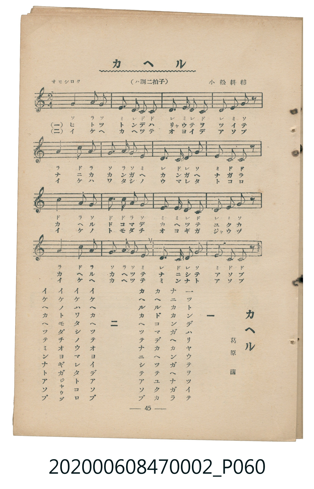

# カヘル

<audio controls src="kaeru.mp3"></audio>

- 詞：葛原齒
- 曲：小松耕輔
- 臺灣教育會公認《新定兒童唱歌》尋常科第二學年用（2020.006.0847.0002）

## 說明

原書資訊與歌詞全文（對應 P060.jpg，書頁 p. 45，參考教材第 7 首）：
調性與拍號：ハ調二拍子（C 大調 2/4 拍），「オモシロク」

## 歌詞

```text
一
一ツトンデハリヤウテヲツイテ
ナニカカンガヘカンガヘナガラ
カヘルドコマデカヘツテユクカ
カヘルカヘツテナニシテアソブ

二
イケヘカヘツテオヨイデアソブ
イケハワタシノウマレタトコロ
イケノトモダチオヨギガジヤウヅ
イケヘカヘツテミンナトアソブ
```

## 原書掃描頁



## 分析

```text
================================================================================
📊 TMD Song Profile: [ カヘル ]
================================================================================
⏱  Duration:       0:19 (19.2s), 16 measures total
🎼 Key & Tempo:    首調基準 C, != 100.0 BPM, <2/4>
   - 分析範圍：      由實際發聲的音符與和弦推測調性；播放脈絡另行呈現
🎤 人聲音域:    C4 (MIDI 60) – C5 (MIDI 72) [跨度: 12 個半音 / 1.0 個八度, 難度: easy]
   - 最低音:  C4 in [Kaeru #1 @ m.2, 0:01]
   - 最高音: C5 in [Kaeru #1 @ m.5, 0:05]
   - 適合: soprano, mezzo-soprano, contralto, tenor, baritone, bass
🏛  結構:      Kaeru (19.2s)
⚡ 編曲密度:        Peak 1 軌道同時演奏
🗝  調性診斷：       C 大調（純淨自然大調，未偵測到可信轉調）
   - 風格氣質:    純淨自然大調（陽光明朗、易唱易記，無明顯調外色彩）
   - 轉調歷程:    全曲維持單一推測調性（未偵測到可信轉調）
   - 核心骨幹音:  C, G, A, E, D
   - 調性數值:    C 大調 [相關度: 0.87, 穩定度: High, 自然音純度: 100.0%]
   - 候選調性 (K-S): C 大調 (0.87), A 小調 (0.71), G 大調 (0.69)
   - 五度圈歷程:   +0
   - 各段落調性細節:
     • [Kaeru #1]: C 大調 (r: 0.87, 自然音純度: 100.0%)

  [ 五度圈游移軌跡 ]
              [C ]*
         F            G  
      Bb               D  
      Eb               A  
         Ab           E  
            Db       B  
               F# 
     (* = active key center)

  [ 十二半音累積音高分佈 ]
     C  : ████████████████████████  27.9%
     C# :                            0.0%
     D  : █████████████             15.6%
     D# :                            0.0%
     E  : ███████████████           17.2%
     F  :                            0.0%
     F# :                            0.0%
     G  : ██████████████████        21.3%
     G# :                            0.0%
     A  : ████████████████          18.0%
     A# :                            0.0%
     B  :                            0.0%
--------------------------------------------------------------------------------
Assignment 軌道音域：
  - Piano         : C4 – C5 (12 個半音 / 1.0 個八度, 56 個音符)
================================================================================
```

## ABC

```abc
X:1
T:カヘル
C:曲：小松耕輔
M:2/4
L:1/16
Q:1/4=100
K:C
V:V1 name="Piano" snm="Pia"
[V:V1]
g4 a2 g2 | e2 d2 c2 c2 | d2 e d c4 | d2 e2 g2 z2 |
a4 c2 a2 | g2 a2 g2 e2 | d2 c2 d2 g2 | e2 c2 c2 z2 |
c4 a2 g2 | c2 c2 a2 g2 | e4 e2 d2 | c2 d2 e2 g2 |
a4 c2 a2 | g2 a2 g2 e2 | d2 c2 d2 g2 | e2 c2 c2 z2 |
```

- [主旋律 TMD 檔案](kaeru.tmd)
- [鋼琴伴奏 TMD 檔案](kaeru_piano.tmd)
