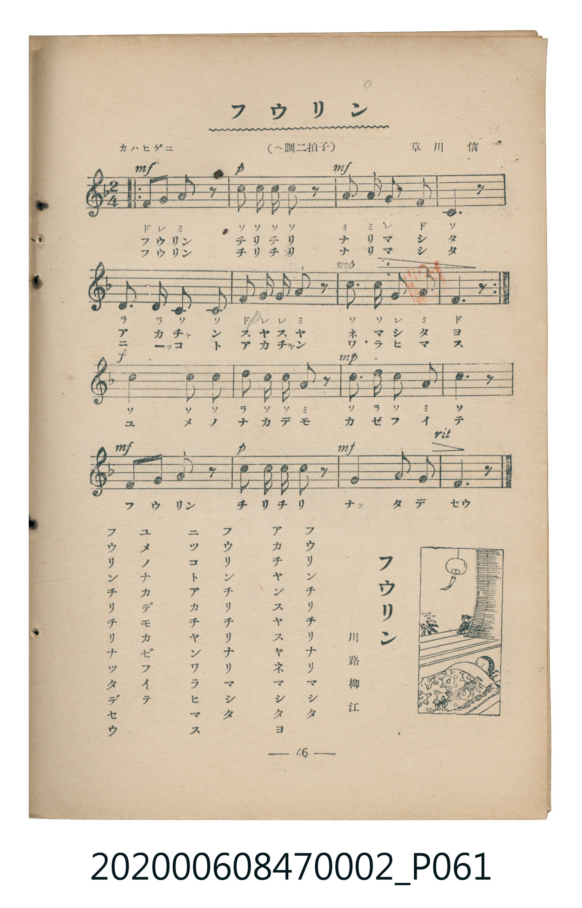

# フウリン

<audio controls src="furin.mp3"></audio>

- 詞：川路柳江
- 曲：草川信
- 臺灣教育會公認《新定兒童唱歌》尋常科第二學年用（2020.006.0847.0002）

## 說明

原書資訊與歌詞全文（對應 P061.jpg，書頁 p. 46，參考教材第 8 首）：
調性與拍號：ヘ調二拍子（F 大調 2/4 拍），「カハヒゲニ」

## 歌詞

```text
フウリンチリチリナリマシタ
アカチヤンスヤスヤネマシタヨ
フウリンチリチリナリマシタ
ニツコトアカチヤンワラヒマス
ユメノナカデモカゼフイテ
フウリンチリチリナツタデセウ
```

## ABC

```abc
X:1
T:フウリン
C:曲：草川信
M:2/4
L:1/16
Q:1/4=96
K:F
V:V1 name="Piano" snm="Pia"
[V:V1]
F2 G2 A2 z2 | c2 c c c2 z2 | A2 A2 G2 F2 | C6 z2 |
D3 D C2 C2 | F2 G2 G2 A2 | c3 c G2 A2 | F6 z2 |
F2 G2 A2 z2 | c2 c c c2 z2 | A2 A2 G2 F2 | C6 z2 |
D3 D C2 C2 | F2 G2 G2 A2 | c3 c G2 A2 | F6 z2 |
c4 c2 c2 | d2 c2 c2 A2 | c2 d2 c2 A2 | c6 z2 |
F2 G2 A2 z2 | c2 c c c2 z2 | A4 G2 G2 | F6 z2 |
```

## TMD 檔案連結

- [主旋律 TMD 檔案](furin.tmd) [[在 TMD Studio 編輯](https://tmdlang.github.io/Tmd-TS/#tmd=s7IKdvYPcrWy4tLSUnjcPPVx07LHzaseN29W0NLiUrRVsDTjsrdVcOOyMdI3seOqU1B6sXLe-z2znm6f-2L7-mfzNz_bOF8JJPxs9iag8IveTqDMk_0LwWIv2nc9b1z8bOrMF02bns1pftq65sWq3scNXc-mbXi6btbT1knPVy99OmXjs7U9jxu6n27ofrpjx_PlE5-vWfNkV8_TtTue7tzyfMqK93s6jAyMDPQMDMz0DCxMzIEMA6P3ezqVuLj0tRRsqQW4FBQUnvbNfzZ7x4vN7S9WdL3oaAe6C-jZp60rnk1rB7ri6YbeZ-2dCgEGZoZ6WQXp7_f0ABW_XNCoUKCnYGIG5D7tb37R0Az07rO5E4CeULBQeLlsGtClwHABmf5i1f5nDctB5nb3vpg5Hyj6uHkGUBDoWaDI07UTgHa4KTxdshwopgAMbQWgKFg3MHR6Hjetftzc_7h50uOmTY-bux839HKBzESOsMfNjWAGhOwCk_MeN21_3LQfrLRpEdgQoPQSkOqmnSAGhGzuhSt93LyCVIOBzmluedwEVNeBbknz-sfNK0GuBmnYCVENNHXh4-Y-kEkgpe2Pm8F6mvaA7QRqayPoAKBtQIe2P27aDVQDUk15_EOBgpY-F5dbaVFmnlVAZmJevkONQY1CNcgKBRtDMy07MKtGwVBBV8EIiI2B2ACIaxRMgaQpGMJEQHIgDFIHUg9UEw-kYBCsCGqcGUQCSIGVgAmEJTCLIJaArEGIgNRgM3HQOxCiEqQWgoF2IPEQpsFEkc0n37sgCHMxNrfVcnHp2imA418ByFDm4gIA)]
- [鋼琴伴奏 TMD 檔案](furin_piano.tmd) [[在 TMD Studio 編輯](https://tmdlang.github.io/Tmd-TS/#tmd=s7IKdvYPcrWy4tLSUnjcPPVx07LHzaseN29-v6fjZfee5xO2PNmz5enS_uedHe_3dCpoaXEp2ipYmnHZ2yq4cdkY6ZvYcdUpKL1YOe_9nllPt899sX39s_mbn22crwQSfjZ7E1D4RW8nUObJ_oVgsRftu543Ln42deaLpk3P5jQ_bV3zYlXv44auZ9M2PF0362nrpOerlz6dsvHZ2p7HDd1PN3Q_3bHj-fKJz9esebKr5-naHU93bnk-ZQXQcUYGRgZ6BgZmegYWJuZAhoER0H1KXFxupUWZeVYBmYl5-UEeDjUGNQrVXApAYGNopmUHZtUoGCroKhgBsTEQGwBxjYIpkDQFQ5gISA6EQepA6oFq4oEUDIIVQY0zg0gAKbASMIGwBGYRxBKQNQgRkBpsJg56B0JUgtRCMNAOJB7CNJgosvnkexcEYS7G5rZalOj3QYl-E0TsxytEG8ZCGAbIfNN4sABUmQmQB1cXbRoPZYEUwbTS3EATZB1YjMRiM4pxwADRtVMAh4kCkKHMxQUA)]

## 分析

```text
================================================================================
📊 TMD Song Profile: [ フウリン ]
================================================================================
⏱  Duration:       0:30 (30.0s), 24 measures total
🎼 Key & Tempo:    首調基準 F, != 96.0 BPM, <2/4>
   - 分析範圍：      由實際發聲的音符與和弦推測調性；播放脈絡另行呈現
🎤 人聲音域:    C4 (MIDI 60) – D5 (MIDI 74) [跨度: 14 個半音 / 1.2 個八度, 難度: moderate]
   - 最低音:  C4 in [Furin #1 @ m.4, 0:03]
   - 最高音: D5 in [Furin #1 @ m.18, 0:21]
   - 適合: soprano, mezzo-soprano, contralto, tenor, baritone, bass
🏛  結構:      Furin (30.0s)
⚡ 編曲密度:        Peak 1 軌道同時演奏
🗝  調性診斷：       C 大調（純淨自然大調，未偵測到可信轉調）
   - 風格氣質:    純淨自然大調（陽光明朗、易唱易記，無明顯調外色彩）
   - 轉調歷程:    全曲維持單一推測調性（未偵測到可信轉調）
   - 核心骨幹音:  C, F, A, G, D
   - 調性數值:    C 大調 [相關度: 0.85, 穩定度: Moderate, 自然音純度: 100.0%]
   - 候選調性 (K-S): C 大調 (0.85), F 大調 (0.76), A 小調 (0.67)
   - 五度圈歷程:   +0
   - 各段落調性細節:
     • [Furin #1]: C 大調 (r: 0.85, 自然音純度: 100.0%)

  [ 五度圈游移軌跡 ]
              [C ]*
         F            G  
      Bb               D  
      Eb               A  
         Ab           E  
            Db       B  
               F# 
     (* = active key center)

  [ 十二半音累積音高分佈 ]
     C  : ████████████████████████  40.5%
     C# :                            0.0%
     D  : ████                       7.1%
     D# :                            0.0%
     E  :                            0.0%
     F  : ███████████               19.0%
     F# :                            0.0%
     G  : █████████                 15.5%
     G# :                            0.0%
     A  : ███████████               17.9%
     A# :                            0.0%
     B  :                            0.0%
--------------------------------------------------------------------------------
Assignment 軌道音域：
  - Piano         : C4 – D5 (14 個半音 / 1.2 個八度, 73 個音符)
================================================================================
```


## 原書掃描頁




