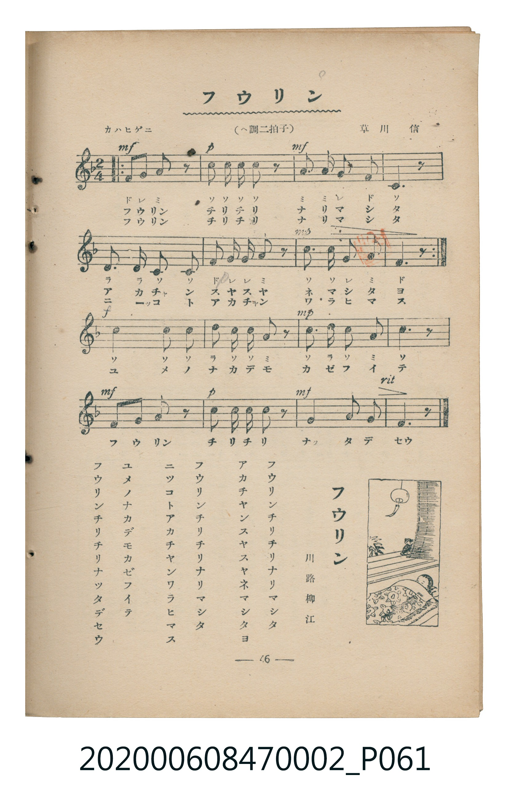

# フウリン（風鈴）

> Re:Shōka 使用 AI 協助辨識與重建樂譜，可能會有錯誤。歡迎[回報](https://github.com/TMDLang/reshoka/issues)。

- **鋼琴伴奏版**：<br><audio controls src="furin.mp3"></audio>
- **NEUTRINO 歌聲合成版**：<br><audio controls src="furin_neutrino.mp3"></audio>

- 詞：川路柳江
- 曲：草川信
- 臺灣教育會公認《新定兒童唱歌》尋常科第二學年用（2020.006.0847.0002）

## 說明

曲目說明
中文解釋：描寫風鈴在微風中發出清脆聲音。

原書資訊與歌詞全文（對應 P061.jpg，書頁 p. 46，參考教材第 8 首）：
調性與拍號：ヘ調二拍子（F 大調 2/4 拍），「カハヒゲニ」


## 歌詞

```text
フウリンチリチリナリマシタ
アカチヤンスヤスヤネマシタヨ
フウリンチリチリナリマシタ
ニツコトアカチヤンワラヒマス
ユメノナカデモカゼフイテ
フウリンチリチリナツタデセウ
```

## ABC

<div class="abc-score" data-abc-src="furin.abc" aria-label="五線譜載入中"></div>

[下載 ABC 原始檔](furin.abc)

## TMD 檔案連結

- [主旋律 TMD 檔案](furin.tmd) [[在 TMD Studio 編輯](https://tmdlang.github.io/Tmd-TS/#tmd=s7IKdvYPcrWy4qpTUCpJTLdSSM7PyUlNLsnMz7MqzsjMK0nNjM_KTMmPL87Iz05Ugisry88pzU21Si9KTEmNN4o3MjAyiDcwMIs3sDAxBzIMjBBKi_NLi5JTrYqTM_Lzc-JLUitKkvLzsxHyBUX5Zal5iXlANQVFIBtTwIoQClLLMlNSQdKpKZkl-UWZiTlI7kgtKga7FWxJfElRYl5xclFmAcgDCFUlGalAx-aWFmcmIwSBJqVn5lmVJGYC_QbyX3lifG5iZl5OYl4KsqqSjHygNwsyKq0yMotB9icn5sRnJ-YhhQbU9oLE9FSrAAMzQyUuLS2Fx81THzcte9y86nHz5vd7Ol4uWvGyY8v7PZ0KWlpcirYKlmZc9rYKblw2RvomdiCTXqyc937PrKfb577Yvv7Z_M3PNs4HW_Bs9iag8IveTqDMk_0LwWIv2nc9b1z8bOrMF02bns1pftq65sWq3scNXc-mbXi6btbT1knPVy99OmXjs7U9jxu6n27ofrpjx_PlE5-vWfNkV8_TtTue7tzyfMoKoJtA0aYHjDY9ULQBGQZGQPcpcelrKQBtfT573YtVq57N6ONSUFB4smPts2ntL5YvftneDXTOs_7-p-tXQ7z0dM6Kp_vWAdlANc9n7nnavuvZjtYXLW0vGje9nL_5cUMTl5Y-F8hMW2oBkIOe9s1_NnvHi83tL1Z0vehoB3oVGH5PW1cAXQn02NMNvc_aOxVAcaGXVZD-fk8PUPHLBY0KBXoKJmZA7tP-5hcNzcAQfDZ3AjBcFCwUXi6bBvQ80G8g01-s2v-sYTnI3O7eFzPnA0UfN88ACgLDDyjydO0EoB1uCk-XLAeKKQAjUAEoCtYNDPCex02rHzf3P26e9Lhp0-Pm7scNvVwgM5HTw-PmRjADQnaByXmPm7Y_btoPVtq0CGwIUHoJSHXTThADQjb3wpU-bl5BqsFA5zS3PG4CqutAt6R5_ePmlSBXgzTshKgGmrrwcXMfyCSQ0vbHzWA9TXvAdgK1tRF0ANA2oEPbHzftBqoBqaY8_qFAAZSu3EqBZYZVQGZiXr5DjUFNNcgGBRtDMy07MKtGwVBBV8EIiI2B2ACIaxRMgaQpGMJEQHIgDFIHUg9UEw-kYBCsCGycTw3Is0Au0C8gEuxlIAOkGiTVCBEEs0A0QqYLKgMi54EN2A6RadqPZBNYNdThZhAnACmwY8AEwjswL0G8A_IQQgSkBrvbmxaBBYFxCHIiMOLB7gH5ACS5E8wDiyGxQa7vhWgDuhziboirQTIrcLh-NNiR3d4NDb8WoMUghwOzH9QZoAgBRQdIDD1CmtdDta0E4klwP8CiCpvrIa4CuQuCgf5B4iFcDhNF9gtWl4PCG-KIhWCyD-o0cMBC3d0OJkE-ATkNLNa0BywGiTNYKmrD4Whi0gpIHgRh6QVvcJOXVEDRA_UsOHVAPAbyEqjownB7LReXrp0CuPxRADKUuQA)]
- [鋼琴伴奏 TMD 檔案](furin_piano.tmd) [[在 TMD Studio 編輯](https://tmdlang.github.io/Tmd-TS/#tmd=s7IKdvYPcrWy4qpTUCpJTLdSyC8qychPL0osyKi0ysgsLskvykxOzInPTsxLVIIrKs4vLUpOjS9ITE-1CjAwM1Ti0tJSeNw89XHTssfNqx43b36_p-Nl957nE7Y82bPl6dL-550d7_d0KmhpcSnaKliacdnbKrhx2Rjpm9iBjHyxct77PbOebp_7Yvv6Z_M3P9s4H2zTs9mbgMIvejuBMk_2LwSLvWjf9bxx8bOpM180bXo2p_lp65oXq3ofN3Q9m7bh6bpZT1snPV-99OmUjc_W9jxu6H66ofvpjh3Pl098vmbNk109T9fueLpzy_MpK4COMzIwMtAzMDDTM7AwMQcyDIyA7lPi4nIrLcrMswrITMzLD_JwqDGoqeZSAAIbQzMtOzCrRsFQQVfBCIiNgdgAiGsUTIGkKRjCREByIAxSB1IPVBMPpGAQrAhsnE8NKNiAXGDIgUhw4AEZINUgqUaIIJgFohEyXVAZEDkPbMB2iEzTfiSbwKqhDjeDOAFIgR0DJhDegXkJ4h2QhxAiIDXY3d60CCz4uGk1yImPm5eA3QPyAUhyJ5gHFkNig1zfC9EGdDnE3RBXg2RW4HD9aLAju70bGn4tQItBDn_c3AF1BihCQNEBEkOPkOb1UG0rgXgS3A-wqMLmeoirQO6CYKB_kHgIl8NEkf2C1eWg8IY4YiGY7IM6DRywUHe3g0mQT0BOA4s17QGLQeIMloracDiamLQCkgdBWHrBG9zkJRVQ9EA9C04dEI-BvLQbYhiq22tRih8f5OLHBFH6xCtEG8ZCGAbIfNN4sABUmQmQB1cXbRoPZYEUwbTS3EATZB1YjMRiM4pxwPDQtVMAB4kCkKHMBQA)]

## 分析

```text
================================================================================
📊 TMD Song Profile: [ フウリン（風鈴） ]
================================================================================
⏱  Duration:       0:30 (30.0s), 24 measures total
🎼 Key & Tempo:    首調基準 F, != 96.0 BPM, <2/4>
   - 分析範圍：      由實際發聲的音符與和弦推測調性；播放脈絡另行呈現
🎤 人聲音域:    C4 (MIDI 60) – D5 (MIDI 74) [跨度: 14 個半音 / 1.2 個八度, 難度: moderate]
   - 最低音:  C4 in [Furin #1 @ m.4, 0:03]
   - 最高音: D5 in [Furin #1 @ m.18, 0:21]
   - 適合: soprano, mezzo-soprano, contralto, tenor, baritone, bass
🏛  結構:      Furin (30.0s)
⚡ 編曲密度:        Peak 1 軌道同時演奏
🗝  調性診斷：       C 大調（純淨自然大調，未偵測到可信轉調）
   - 風格氣質:    純淨自然大調（陽光明朗、易唱易記，無明顯調外色彩）
   - 轉調歷程:    全曲維持單一推測調性（未偵測到可信轉調）
   - 核心骨幹音:  C, F, G, A, D
   - 調性數值:    C 大調 [相關度: 0.86, 穩定度: Moderate, 自然音純度: 100.0%]
   - 候選調性 (K-S): C 大調 (0.86), F 大調 (0.76), A 小調 (0.65)
   - 五度圈歷程:   +0
   - 各段落調性細節:
     • [Furin #1]: C 大調 (r: 0.86, 自然音純度: 100.0%)

  [ 五度圈游移軌跡 ]
              [C ]*
         F            G  
      Bb               D  
      Eb               A  
         Ab           E  
            Db       B  
               F# 
     (* = active key center)

  [ 十二半音累積音高分佈 ]
     C  : ████████████████████████  40.5%
     C# :                            0.0%
     D  : ████                       7.1%
     D# :                            0.0%
     E  :                            0.0%
     F  : ███████████               19.0%
     F# :                            0.0%
     G  : ██████████                16.7%
     G# :                            0.0%
     A  : ██████████                16.7%
     A# :                            0.0%
     B  :                            0.0%
--------------------------------------------------------------------------------
Assignment 軌道音域：
  - Piano         : C4 – D5 (14 個半音 / 1.2 個八度, 73 個音符)
================================================================================
```


## 原書掃描頁




