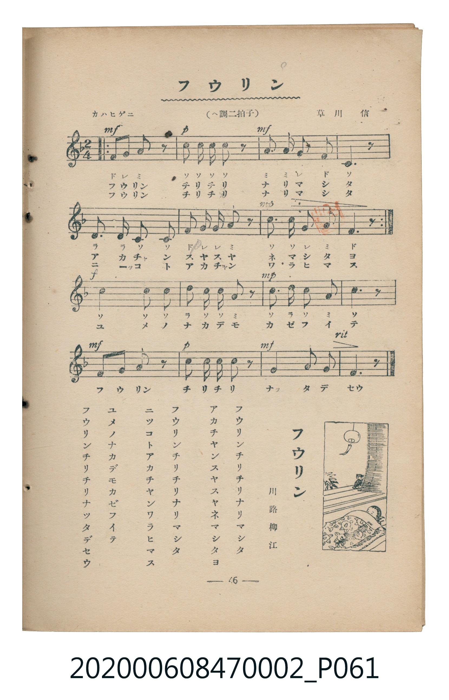

# フウリン（風鈴）

> Re:Shōka 使用 AI 協助辨識與重建樂譜，可能會有錯誤。歡迎回報。

- **鋼琴伴奏版**：<br><audio controls src="furin.mp3"></audio>
- **NEUTRINO 歌聲合成版**：<br><audio controls src="furin_neutrino.mp3"></audio>

- 詞：川路柳江
- 曲：草川信
- 臺灣教育會公認《新定兒童唱歌》尋常科第二學年用（2020.006.0847.0002）

## 說明

曲目說明
中文解釋：描寫風鈴在微風中發出清脆聲音。

原書資訊與歌詞全文（對應 P061.jpg，書頁 p. 46，參考教材第 8 首）：
調性與拍號：ヘ調二拍子（F 大調 2/4 拍），「カハヒゲニ」


## 歌詞

```text
フウリンチリチリナリマシタ
アカチヤンスヤスヤネマシタヨ
フウリンチリチリナリマシタ
ニツコトアカチヤンワラヒマス
ユメノナカデモカゼフイテ
フウリンチリチリナツタデセウ
```

## ABC

```abc
X:1
T:フウリン（風鈴）
C:曲：草川信
M:2/4
L:1/16
Q:1/4=96
K:F
V:V1 name="Piano" snm="Pia"
[V:V1]
F2 G2 A2 z2 | c2 c c c2 z2 | A2 A2 G2 F2 | C6 z2 |
w: フ ウ リン | チ リ チ リ | ナ リ マ シ | タ
D3 D C2 C2 | F2 G2 G2 A2 | c3 c G2 A2 | F6 z2 |
w: ア カ チヤ ン | ス ヤ ス ヤ | ネ マ シ タ | ヨ
F2 G2 A2 z2 | c2 c c c2 z2 | A2 A2 G2 F2 | C6 z2 |
w: フ ウ リン | チ リ チ リ | ナ リ マ シ | タ
D3 D C2 C2 | F2 G2 G2 A2 | c3 c G2 A2 | F6 z2 |
w: ニ ツ コ ト | ア カ チヤ ン | ワ ラ ヒ マ | ス
c4 c2 c2 | d2 c2 c2 A2 | c2 d2 c2 A2 | c6 z2 |
w: ユ メ ノ | ナ カ デ モ | カ ゼ フ イ | テ
F2 G2 A2 z2 | c2 c c c2 z2 | G4 A2 G2 | F6 z2 |
w: フ ウ リン | チ リ チ リ | ナツ タ デ | セウ
```

## TMD 檔案連結

- [主旋律 TMD 檔案](furin.tmd) [[在 TMD Studio 編輯](https://tmdlang.github.io/Tmd-TS/#tmd=s7IKdvYPcrWy4qpTUCpJTLdSSM7PyUlNLsnMz7MqzsjMK0nNjM_KTMmPL87Iz05Ugisry88pzU21Si9KTEmNN4o3MjAyiDcwMIs3sDAxBzIMjBBKi_NLi5JTrYqTM_Lzc-JLUitKkvLzsxHyBUX5Zal5iXlANQVFIBtTwIoQClLLMlNSQdKpKZkl-UWZiTlI7kgtKga7FWxJfElRYl5xclFmAcgDCFUlGalAx-aWFmcmIwSBJqVn5lmVJGYC_QbyX3lifG5iZl5OYl6KEpeWlsLj5qmPm5Y9bl71uHnz-z0dLxeteNmx5f2eTgUtLS5FWwVLMy57WwU3LhsjfRM7kKkvVs57v2fW0-1zX2xf_2z-5mcb54MtezZ7E1D4RW8nUObJ_oVgsRftu543Ln42deaLpk3P5jQ_bV3zYlXv44auZ9M2PF0362nrpOerlz6dsvHZ2p7HDd1PN3Q_3bHj-fKJz9esebKr5-naHU93bnk-ZQXQTaBw1wOGux4o3IEMAyOg-5S49LUUgLY-n73uxapVz2b0cSkoKDzZsfbZtPYXyxe_bO8GOudZf__T9ashXno6Z8XTfeuAbKCa5zP3PG3f9WxH64uWtheNm17O3_y4oYlLS58LZKYttQDIQU_75j-bvePF5vYXK7pedLQDvQoMv6etK4CuBHrs6YbeZ-2dCgEGZoZ6WQXp7_f0ABW_XNCoUKCnYGIG5D7tb37R0AwMwWdzJwDDRcFC4eWyaUDPA_0GMv3Fqv3PGpaDzO3ufTFzPlD0cfMMoCAw_IAiT9dOANrhpvB0yXKgmAIwAhWAomDdwADvedy0-nFz_-PmSY-bNj1u7n7c0MsFMhM5PTxubgQzIGQXmJz3uGn746b9YKVNi8CGAKWXgFQ37QQxIGRzL1zp4-YVpBoMdE5zy-MmoLoOdEua1z9uXglyNUjDTohqoKkLHzf3gUwCKW1_3AzW07QHbCdQWxtBBwBtAzq0_XHTbqAakGrK4x8KFEDpyq0UmOmtAjIT8_IdagxqqkE2KNgYmmnZgVk1CoYKugpGQGwMxAZAXKNgCiRNwRAmApIDYZA6kHqgmnggBYNgRWDjfGpAngVygX4BkWAvAxkg1SCpRoggmAWiETJdUBkQOQ9swHaITNN-JJvAqqEON4M4AUiBHQMmEN6BeQniHZCHECIgNdjd3rQILAiMQ5ATgREPdg_IByDJnWAeWAyJDXJ9L0Qb0OUQd0NcDZJZgcP1o8GO7PZuaPi1AC0GORyY_aDOAEUIKDpAYugR0rweqm0lEE-C-wEWVdhcD3EVyF0QDPQPEg_hcpgosl-wuhwU3hBHLASTfVCngQMW6u52MAnyCchpYLGmPWAxSJzBUlEbDkcTk1ZA8iAISy94g5u8pAKKHqhnwakD4jGQl0BFF4bba7m4dO0UwOWPApChzAUA)]
- [鋼琴伴奏 TMD 檔案](furin_piano.tmd) [[在 TMD Studio 編輯](https://tmdlang.github.io/Tmd-TS/#tmd=s7IKdvYPcrWy4tLSUnjcPPVx07LHzaseN29-v6fjZfee5xO2PNmz5enS_uedHe_3dCpoaXEp2ipYmnHZ2yq4cdkY6ZvYcdUpKL1YOe_9nllPt899sX39s_mbn22crwQSfjZ7E1D4RW8nUObJ_oVgsRftu543Ln42deaLpk3P5jQ_bV3zYlXv44auZ9M2PF0362nrpOerlz6dsvHZ2p7HDd1PN3Q_3bHj-fKJz9esebKr5-naHU93bnk-ZQXQcUYGRgZ6BgZmegYWJuZAhoER0H1KXFxupUWZeVYBmYl5-UEeDjUGNdVcCkBgY2imZQdm1SgYKugqGAGxMRAbAHGNgimQNAVDmAhIDoRB6kDqgWrigRQMghWBjfOpAQUbkAsMORAJDjwgA6QaJNUIEQSzQDRCpgsqAyLngQ3YDpFp2o9kE1g11OFmECcAKbBjwATCOzAvQbwD8hBCBKQGu9ubFoEFHzetBjnxcfMSsHtAPgBJ7gTzwGJIbJDreyHagC6HuBviapDMChyuHw12ZLd3Q8OvBWgxyOGPmzugzgBFCCg6QGLoEdK8HqptJRBPgvsBFlXYXA9xFchdEAz0DxIP4XKYKLJfsLocFN4QRywEk31Qp4EDFurudjAJ8gnIaWCxpj1gMUicwVJRGw5HE5NWQPIgCEsveIObvKQCih6oZ8GpA-IxkJd2QwxDdXstSvHjg1z8mCBKn3iFaMNYCMMAmW8aDxaAKjMB8uDqok3joSyQIphWmhtogqwDi5FYbEYxDhgeunYK4CBRADKUuQA)]

## 分析

```text
================================================================================
📊 TMD Song Profile: [ フウリン（風鈴） ]
================================================================================
⏱  Duration:       0:30 (30.0s), 24 measures total
🎼 Key & Tempo:    首調基準 F, != 96.0 BPM, <2/4>
   - 分析範圍：      由實際發聲的音符與和弦推測調性；播放脈絡另行呈現
🎤 人聲音域:    C4 (MIDI 60) – D5 (MIDI 74) [跨度: 14 個半音 / 1.2 個八度, 難度: moderate]
   - 最低音:  C4 in [Furin #1 @ m.4, 0:03]
   - 最高音: D5 in [Furin #1 @ m.18, 0:21]
   - 適合: soprano, mezzo-soprano, contralto, tenor, baritone, bass
🏛  結構:      Furin (30.0s)
⚡ 編曲密度:        Peak 1 軌道同時演奏
🗝  調性診斷：       C 大調（純淨自然大調，未偵測到可信轉調）
   - 風格氣質:    純淨自然大調（陽光明朗、易唱易記，無明顯調外色彩）
   - 轉調歷程:    全曲維持單一推測調性（未偵測到可信轉調）
   - 核心骨幹音:  C, F, G, A, D
   - 調性數值:    C 大調 [相關度: 0.86, 穩定度: Moderate, 自然音純度: 100.0%]
   - 候選調性 (K-S): C 大調 (0.86), F 大調 (0.76), A 小調 (0.65)
   - 五度圈歷程:   +0
   - 各段落調性細節:
     • [Furin #1]: C 大調 (r: 0.86, 自然音純度: 100.0%)

  [ 五度圈游移軌跡 ]
              [C ]*
         F            G  
      Bb               D  
      Eb               A  
         Ab           E  
            Db       B  
               F# 
     (* = active key center)

  [ 十二半音累積音高分佈 ]
     C  : ████████████████████████  40.5%
     C# :                            0.0%
     D  : ████                       7.1%
     D# :                            0.0%
     E  :                            0.0%
     F  : ███████████               19.0%
     F# :                            0.0%
     G  : ██████████                16.7%
     G# :                            0.0%
     A  : ██████████                16.7%
     A# :                            0.0%
     B  :                            0.0%
--------------------------------------------------------------------------------
Assignment 軌道音域：
  - Piano         : C4 – D5 (14 個半音 / 1.2 個八度, 73 個音符)
================================================================================
```


## 原書掃描頁




