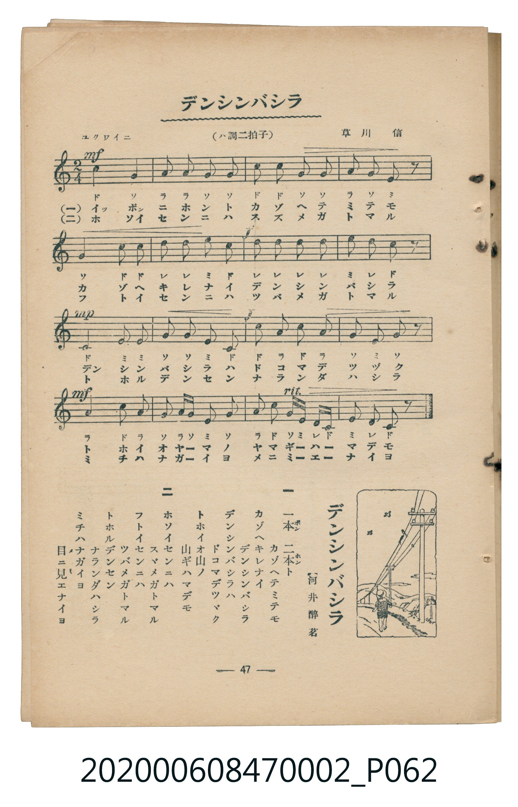

# デンシンバシラ

<audio controls src="denshin_bashira.mp3"></audio>

- 詞：河井醉茗
- 曲：草川信
- 臺灣教育會公認《新定兒童唱歌》尋常科第二學年用（2020.006.0847.0002）

## 說明

原書資訊與歌詞全文（對應 P062.jpg，書頁 p. 47，參考教材第 9 首）：
調性與拍號：ハ調二拍子（C 大調 2/4 拍），「ユクワイニ」

## 歌詞

```text
一
一本　二本ト　カゾヘテミテモ
カゾヘキレナイ　デンシンバシラ
デンシンバシラハ　ドコマデツヅク
トホイオ山ノ　山ギハマデモ

二
ホソイセンニハ　スヾメガトマル
フトイセンニハ　ツバメガトマル
トホルデンセン　ナランダハシラ
ミチハナガイヨ　目ニ見エナイヨ
```

## 原書掃描頁



## 分析

```text
================================================================================
📊 TMD Song Profile: [ デンシンバシラ ]
================================================================================
⏱  Duration:       0:18 (18.5s), 16 measures total
🎼 Key & Tempo:    首調基準 C, != 104.0 BPM, <2/4>
   - 分析範圍：      由實際發聲的音符與和弦推測調性；播放脈絡另行呈現
🎤 人聲音域:    C4 (MIDI 60) – E5 (MIDI 76) [跨度: 16 個半音 / 1.3 個八度, 難度: moderate]
   - 最低音:  C4 in [DenshinBashira #1 @ m.9, 0:09]
   - 最高音: E5 in [DenshinBashira #1 @ m.6, 0:06]
   - 適合: soprano, mezzo-soprano, contralto, tenor, baritone, bass
🏛  結構:      DenshinBashira (18.5s)
⚡ 編曲密度:        Peak 1 軌道同時演奏
🗝  調性診斷：       C 大調（純淨自然大調，未偵測到可信轉調）
   - 風格氣質:    純淨自然大調（陽光明朗、易唱易記，無明顯調外色彩）
   - 轉調歷程:    全曲維持單一推測調性（未偵測到可信轉調）
   - 核心骨幹音:  C, G, E, A, D
   - 調性數值:    C 大調 [相關度: 0.90, 穩定度: High, 自然音純度: 100.0%]
   - 候選調性 (K-S): C 大調 (0.90), G 大調 (0.73), A 小調 (0.64)
   - 五度圈歷程:   +0
   - 各段落調性細節:
     • [DenshinBashira #1]: C 大調 (r: 0.90, 自然音純度: 100.0%)

  [ 五度圈游移軌跡 ]
              [C ]*
         F            G  
      Bb               D  
      Eb               A  
         Ab           E  
            Db       B  
               F# 
     (* = active key center)

  [ 十二半音累積音高分佈 ]
     C  : ████████████████████████  29.2%
     C# :                            0.0%
     D  : ██████████                12.5%
     D# :                            0.0%
     E  : █████████████             15.8%
     F  :                            0.0%
     F# :                            0.0%
     G  : ██████████████████████    26.7%
     G# :                            0.0%
     A  : █████████████             15.8%
     A# :                            0.0%
     B  :                            0.0%
--------------------------------------------------------------------------------
Assignment 軌道音域：
  - Piano         : C4 – E5 (16 個半音 / 1.3 個八度, 57 個音符)
================================================================================
```

## ABC

```abc
X:1
T:デンシンバシラ
C:曲：草川信
M:2/4
L:1/16
Q:1/4=104
K:C

V:V1 name="Piano" snm="Pia"

[V:V1]
c4 g4 | a2 a2 g2 g2 | c2 c2 g2 g2 | a2 g2 e2 z2 |
g4 c2 c2 | d2 d2 e2 c2 | d2 d2 d2 e2 | d2 c4 z2 |
c4 e2 e2 | g2 g2 e2 c2 | c2 a2 c2 a2 | g2 e2 g2 z2 |
a4 c2 a2 | g2 g a e2 g2 | a2 c2 g e d c | e2 d2 c2 z2 |
```

- [主旋律 TMD 檔案](denshin_bashira.tmd)
- [鋼琴伴奏 TMD 檔案](denshin_bashira_piano.tmd)
