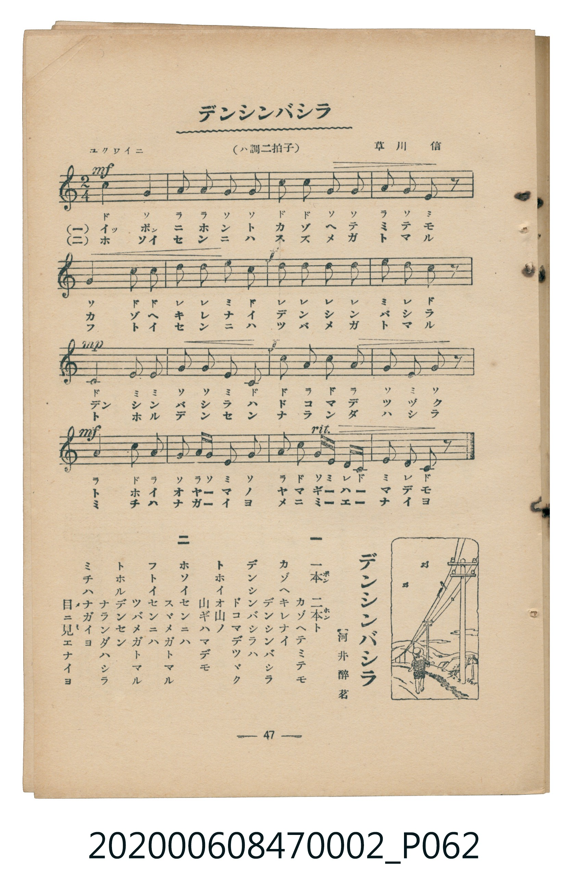

# デンシンバシラ（電線桿）

> Re:Shōka 使用 AI 協助辨識與重建樂譜，可能會有錯誤。歡迎[回報](https://github.com/TMDLang/reshoka/issues)。

- **鋼琴伴奏版**：<br><audio controls src="denshin_bashira.mp3"></audio>
- **NEUTRINO 歌聲合成版**：<br><audio controls src="denshin_bashira_neutrino.mp3"></audio>

- 詞：河井醉茗
- 曲：草川信
- 臺灣教育會公認《新定兒童唱歌》尋常科第二學年用（2020.006.0847.0002）

## 說明

曲目說明
中文解釋：描寫街道上的電線桿與電線，呈現現代城市景色。

原書資訊與歌詞全文（對應 P062.jpg，書頁 p. 47，參考教材第 9 首）：
調性與拍號：ハ調二拍子（C 大調 2/4 拍），「ユクワイニ」


## 歌詞

```text
一
一本　二本ト　カゾヘテミテモ
カゾヘキレナイ　デンシンバシラ
デンシンバシラハ　ドコマデツヅク
トホイオ山ノ　山ギハマデモ

二
ホソイセンニハ　スヾメガトマル
フトイセンニハ　ツバメガトマル
トホルデンセン　ナランダハシラ
ミチハナガイヨ　目ニ見エナイヨ
```

## ABC

<div class="abc-score" data-abc-src="denshin_bashira.abc" aria-label="五線譜載入中"></div>

[下載 ABC 原始檔](denshin_bashira.abc)

## TMD 檔案連結

- [主旋律 TMD 檔案](denshin_bashira.tmd) [[在 TMD Studio 編輯](https://tmdlang.github.io/Tmd-TS/#tmd=s7IKdvYPcrWy4qpTUCpJTLdSSM7PyUlNLsnMz7MqzsjMK0nNjM_KTMmPL87Iz05Ugisry88pzU21Si9KTEmNN4o3MjAyiDcwMIs3sDAxBzIMjBBKi_NLi5JTrYqTM_Lzc-JLUitKkvLzsxHyBUX5Zal5iXlANQVFIBtTwIoQClLLMlNSQdKpKZkl-UWZiTlI7kgtKga7FWxJfElRYl5xclFmAcgDCFUlGalAx5akJmfk5efkp1ciZIDGpWfmWZUkZgI9CPJkeWJ8bmJmXk5iXgqyqpKMfKBfCzIqrTIyi0GOSE7Mic9OzEMKEqgTChLTU60CDMyAIaClpfC4uf1x8-bHTdtBZPMEMGPl-z0dL2fvfr591rOF-9_v6VTQ0uJStFUwNDDhsrdVcOayMdI3sQMZ-2LlvPd7Zj3btPnJrqkv2zpf9EwH2_Zs9iag8Ivezqfb5z7ZvxAs9qJ91_PGxc-mznzRtOnZnOanrWterOp93ND1bNqGp-tmPW2d9Hz10qdTNj5b2_O4ofvphu6nO3Y8Xz7x-Zo1T3b1PF274-nOLc-nrAC6CxSResCI1ANFJJBhYAR0oBKXvpYC0Nbns9e9WLXq2Yw-LgUFhSc71j6b1v5i-eKX7d0gV_b3P12_-sXC6S8bJz_Z0fV8Vgvciy862iHs93t6nk7seN6_D4ie7F78dH7f0x1Nz2auf9G56XFDE5eWPhfIIltqAZArn_bNfzZ7x4vN7S9WdAHdAfQ_MFCftq4AOh3o26cbep-1dyqAYksvqyAd6D6g4pcLGhUK9BRMzEHO7W9-0dAMDNZncycAA0vBUuHlsmnAEAF6GGT6i1X7nzUsB5nb3fti5nyg6OPmfqAgMFCBIk_XTgDa4azwdMlyoJgCMFYVgKJg3cBY6HncvOxx0_rHzesfNy153Nz9uKGXCxKuDVDq2Zw1jxsaQGYBGc0dQPbjptWPm_Y9bp7xuLntcfN8MLkIpBoh0bT2cTNQdRfIUKAGbMkPrAGbBNDxYD2dj5uAgvPAaloeN7cCnQnR0_G4eTbI4KZVTzdufNzcB1QNYjStA-mEalgE8cWuHogWoPq9YC27wTZ1Q-1o2vm4GejehY-bwF4D6V0N0TAVxMfUAHLIBKwawI5qXg3zEVgbSEMX2EdAI4DsfmSfA8OtEexgYCCtAQf-CqAGYOIG2vZiWffjphXQ8GteAdJAeUKEAgVQAndJzQOVq06JQLIo0SogMzEv36HGoKYaZJWCjaGZlh2YVaNQnZtWq2AYp6ALhqZQukbBDEiCMEgEhGsgisAEQgymwhiIDUAiYFN9DGuAaQXosxaocY-b5wLDCG42MATAgrPBJEgcGL4QmabVIF7TPrDYDDDZBtUzH84DRj-QjEfYZwSSB5kGtgycFBCWNe1GsgZicT9UZidY-S6w2EIwew3UMpBzgNEPJkFOQlhWAw8kRIDUKBiBKDBhjFUUQdRAVIDZYGXo4QayDuIPRCiAxNeCeSAHAhMOWB7kSZBj2xEebNoOZ4NkJiCJrcQSZlNhdkE8DDMRd5CBoxRqLglBVp1bAExlUMtAiQWEISEJSz4gWWgiA6UqOAOiCqQCRKMFFjg3wsMLv98RfugEy0B8B3EvKAQRvmsFy6_HEl4gP0LCC5J2Qf5EjwFE2IFkwDEFtR9iYwNUBuQa7HEDzZUg38PTGSIoTIFsWHBAciA0UxorGAFDEZi-gDwjaIiihxeaB-ARvgosBuLBgqQP6kwksaZ1KMGICDrsGRKUYSF2NaLogyRecEIG2w8sAaEy4AQFTXDg7N4Ek0EkeIhqiF21XFy6dgqohZ0CUESZCwA)]
- [鋼琴伴奏 TMD 檔案](denshin_bashira_piano.tmd) [[在 TMD Studio 編輯](https://tmdlang.github.io/Tmd-TS/#tmd=s7IKdvYPcrWy4qpTUCpJTLdSyC8qychPL0osyKi0ysgsLskvykxOzInPTsxLVIIrKs4vLUpOjS9ITE-1CjAwM1Li0tJSeNzc_rh58-Om7SCyeQKYsfL9no6X3XueT9jyZM-Wp0v7n3d2vN_TqaClxaVoq2BoYMJlb6vgzGVjpG9iBzL8xcp57_fMerZp85NdU1-2db7omQ6289nsTUDhF72dT7fPfbJ_IVjsRfuu542Ln02d-aJp07M5zU9b17xY1fu4oevZtA1P18162jrp-eqlT6dsfLa253FD99MN3U937Hi-fOLzNWue7Op5unbH051bnk9ZAXSdkYGRgZ6BgZmegYWJOZBhYAR0oBIXl0tqXnFGZp5TIpAsSrQKyEzMyw_ycKgxqKnmUgACG0MzLTswq0ahOjetVsEwTkEXDE2hdI2CGZAEYZAICNdAFIEJhBhMhTEQG4BEwKb6GNYoPG5a8ri5BWrc4-a5wICFm_24uRssOBtMgsQfN3dAZJpWg3hN-8BiM8BkG1TPfDjvcfMiIBmPsM8IJA8yDWxZ016g5QjLmnYjWQOxuB8qsxOsfBdYbCGYvQZqGcg5j5vngUmQkxCW1cADCREgNQpGIApMGGMVRRA1EBVgNlgZeriBrIP4AxEKIPG1YB7IgY-bu8DyIE-CHNuO8GDTdjgbJDMBSWwlljCbCrML4mGYibiDDBylUHNJCLLq3AJgKoNaBkosIAwJSVjyAclCExkoVcEZEFUgFSAaLbDA2RYeXvj9jvBDJ1gG4juIe0EhCPcdJEE0rccSXiA_QsILknZB_kSPAUTYgWTAMQW1H2JjA1QG5BrscQPNlSDfw9MZIihMgWxYcEByIDRTGisYAUMRmL6APCNoiKKHF5oH4BG-CiwG4sGCpA_qTCSxpnUowYgIOuwZEpRhIXY1ouiDJF5wQgbb_7h5BVQGnKCgCQ6c3ZtgMogED1ENsasWe1nng1zWmcCLOsN4hWjDWCDDBMbAEEFXaYrMMIUygLIYClFMMoGKGMDVIYuiucE0Hmoi0DO6dgqo_on2AarBImoEFlXmAgA)]

## 分析

```text
================================================================================
📊 TMD Song Profile: [ デンシンバシラ（電線桿） ]
================================================================================
⏱  Duration:       0:18 (18.5s), 16 measures total
🎼 Key & Tempo:    首調基準 C, != 104.0 BPM, <2/4>
   - 分析範圍：      由實際發聲的音符與和弦推測調性；播放脈絡另行呈現
🎤 人聲音域:    C4 (MIDI 60) – E5 (MIDI 76) [跨度: 16 個半音 / 1.3 個八度, 難度: moderate]
   - 最低音:  C4 in [DenshinBashira #1 @ m.9, 0:09]
   - 最高音: E5 in [DenshinBashira #1 @ m.6, 0:06]
   - 適合: soprano, mezzo-soprano, contralto, tenor, baritone, bass
🏛  結構:      DenshinBashira (18.5s)
⚡ 編曲密度:        Peak 1 軌道同時演奏
🗝  調性診斷：       C 大調（純淨自然大調，未偵測到可信轉調）
   - 風格氣質:    純淨自然大調（陽光明朗、易唱易記，無明顯調外色彩）
   - 轉調歷程:    全曲維持單一推測調性（未偵測到可信轉調）
   - 核心骨幹音:  C, G, E, A, D
   - 調性數值:    C 大調 [相關度: 0.88, 穩定度: High, 自然音純度: 100.0%]
   - 候選調性 (K-S): C 大調 (0.88), G 大調 (0.75), A 小調 (0.63)
   - 五度圈歷程:   +0
   - 各段落調性細節:
     • [DenshinBashira #1]: C 大調 (r: 0.88, 自然音純度: 100.0%)

  [ 五度圈游移軌跡 ]
              [C ]*
         F            G  
      Bb               D  
      Eb               A  
         Ab           E  
            Db       B  
               F# 
     (* = active key center)

  [ 十二半音累積音高分佈 ]
     C  : ████████████████████████  27.5%
     C# :                            0.0%
     D  : ████████████              14.2%
     D# :                            0.0%
     E  : ██████████████            15.8%
     F  :                            0.0%
     F# :                            0.0%
     G  : ███████████████████████   26.7%
     G# :                            0.0%
     A  : ██████████████            15.8%
     A# :                            0.0%
     B  :                            0.0%
--------------------------------------------------------------------------------
Assignment 軌道音域：
  - Piano         : C4 – E5 (16 個半音 / 1.3 個八度, 58 個音符)
================================================================================
```


## 原書掃描頁




