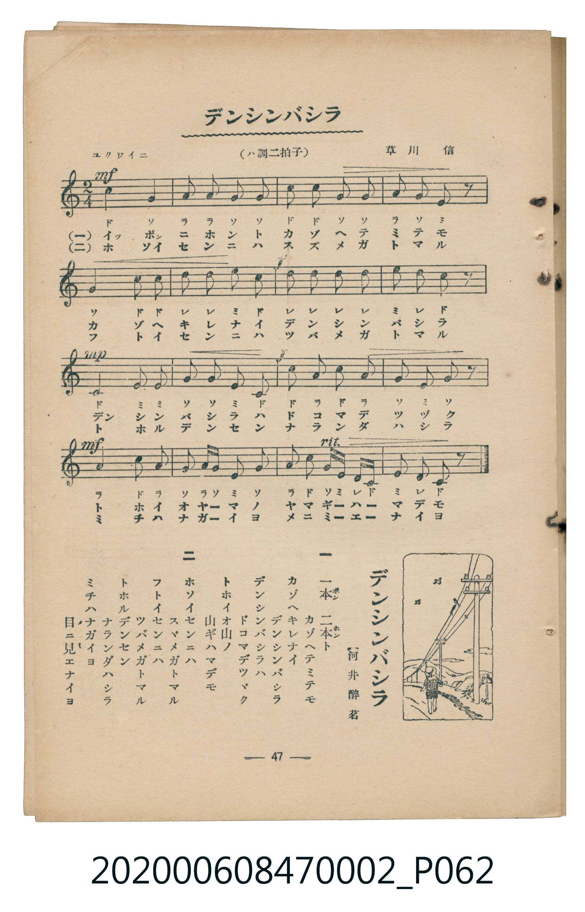

# デンシンバシラ（電線桿）

> Re:Shōka 使用 AI 協助辨識與重建樂譜，可能會有錯誤。歡迎回報。

- **鋼琴伴奏版**：<br><audio controls src="denshin_bashira.mp3"></audio>
- **NEUTRINO 歌聲合成版**：<br><audio controls src="denshin_bashira_neutrino.mp3"></audio>

- 詞：河井醉茗
- 曲：草川信
- 臺灣教育會公認《新定兒童唱歌》尋常科第二學年用（2020.006.0847.0002）

## 說明

曲目說明
中文解釋：描寫街道上的電線桿與電線，呈現現代城市景色。

原書資訊與歌詞全文（對應 P062.jpg，書頁 p. 47，參考教材第 9 首）：
調性與拍號：ハ調二拍子（C 大調 2/4 拍），「ユクワイニ」


## 歌詞

```text
一
一本　二本ト　カゾヘテミテモ
カゾヘキレナイ　デンシンバシラ
デンシンバシラハ　ドコマデツヅク
トホイオ山ノ　山ギハマデモ

二
ホソイセンニハ　スヾメガトマル
フトイセンニハ　ツバメガトマル
トホルデンセン　ナランダハシラ
ミチハナガイヨ　目ニ見エナイヨ
```

## ABC

<div class="abc-score" data-abc-src="denshin_bashira.abc" aria-label="五線譜載入中"></div>

[下載 ABC 原始檔](denshin_bashira.abc)

## TMD 檔案連結

- [主旋律 TMD 檔案](denshin_bashira.tmd) [[在 TMD Studio 編輯](https://tmdlang.github.io/Tmd-TS/#tmd=s7IKdvYPcrWy4qpTUCpJTLdSSM7PyUlNLsnMz7MqzsjMK0nNjM_KTMmPL87Iz05Ugisry88pzU21Si9KTEmNN4o3MjAyiDcwMIs3sDAxBzIMjBBKi_NLi5JTrYqTM_Lzc-JLUitKkvLzsxHyBUX5Zal5iXlANQVFIBtTwIoQClLLMlNSQdKpKZkl-UWZiTlI7kgtKga7FWxJfElRYl5xclFmAcgDCFUlGalAx5akJmfk5efkp1ciZIDGpWfmWZUkZgI9CPJkeWJ8bmJmXk5iXooSl5aWwuPm9sfNmx83bQeRzRPAjJXv93S8nL37-fZZzxbuf7-nU0FLi0vRVsHQwITL3lbBmcvGSN_EDmTFi5Xz3u-Z9WzT5ie7pr5s63zRMx1s87PZm4DCL3o7n26f-2T_QrDYi_ZdzxsXP5s680XTpmdzmp-2rnmxqvdxQ9ezaRuerpv1tHXS89VLn07Z-Gxtz-OG7qcbup_u2PF8-cTna9Y82dXzdO2Opzu3PJ-yAuguUEzoAWNCDxQTQIaBEdCBSlz6WgpAW5_PXvdi1apnM_q4FBQUnuxY-2xa-4vli1-2d4Nc2d__dP3qFwunv2yc_GRH1_NZLXAvvuhoh7Df7-l5OrHjef8-IHqye_HT-X1PdzQ9m7n-Reemxw1NXFr6XCCLbKkFQK582jf_2ewdLza3v1jRBXQH0P_AQH3augLodKBvn27ofdbeqRBgYGakl1WQDnQfUPHLBY0KBXoKJuYg5_Y3v2hoBgbrs7kTgIGlYKnwctk0YIgAPQwy_cWq_c8aloPM7e59MXM-UPRxcz9QEBioQJGnaycA7XBWeLpkOVBMARirCkBRsG5gLPQ8bl72uGn94-b1j5uWPG7uftzQywUJ1wYo9WzOmscNDSCzgIzmDiD7cdPqx037HjfPeNzc9rh5PphcBFKNkGha-7gZqLoLZChQA7bkB9aATQLoeLCezsdNQMF5YDUtj5tbgc6E6Ol43DwbZHDTqqcbNz5u7gOqBjGa1oF0QjUsgvhiVw9EC1D9XrCW3WCbuqF2NO183Ax078LHTWCvgfSuhmiYCuJjagA5ZAJWDWBHNa-G-QisDaShC-wjoBFAdj-yz4Hh1gh2MDCQ1oADfwVQAzBxA217saz7cdMKaPg1rwBpoDwhQoECKIG7pOaBCkanRCBZlGgVkJmYl-9QY1BTDbJKwcbQTMsOzKpRqM5Nq1UwjFPQBUNTKF2jYAYkQRgkAsI1EEVgAiEGU2EMxAYgEbCpPoY1wLQC9FkL1LjHzXOBYQQ3GxgCYMHZYBIkDgxfiEzTahCvaR9YbAaYbIPqmQ_nAaMfSMYj7DMCyYNMA1sGTgoIy5p2I1kDsbgfKrMTrHwXWGwhmL0GahnIOcDoB5MgJyEsq4EHEiJAahSMQBSYMMYqiiBqICrAbLAy9HADWQfxByIUQOJrwTyQA4EJBywP8iTIse0IDzZth7NBMhOQxFZiCbOpMLsgHoaZiDvIwFEKNZeEIKvOLQCmMqhloMQCwpCQhCUfkCw0kYFSFZwBUQVSAaLRAgucG-Hhhd_vCD90gmUgvoO4FxSCCN-1guXXYwkvkB8h4QVJuyB_oscAIuxAMuCYgtoPsbEBKgNyDfa4geZKkO_h6QwRFKZANiw4IDkQmimNFYyAoQhMX0CeETRE0cMLzQPwCF8FFgPxYEHSB3UmkljTOpRgRAQd9gwJyrAQuxpR9EESLzghg-0HloBQGXCCgiY4cHZvgskgEjxENcSuWi4uXTsF1MJOASiizAUA)]
- [鋼琴伴奏 TMD 檔案](denshin_bashira_piano.tmd) [[在 TMD Studio 編輯](https://tmdlang.github.io/Tmd-TS/#tmd=s7IKdvYPcrWy4tLSUnjc3P64efPjpu0gsnkCmLHy_Z6Ol917nk_Y8mTPlqdL-593drzf06mgpcWlaKtgaGDCZW-r4MxlY6RvYsdVp6D0YuW893tmPdu0-cmuqS_bOl_0TFcCCT-bvQko_KK38-n2uU_2LwSLvWjf9bxx8bOpM180bXo2p_lp65oXq3ofN3Q9m7bh6bpZT1snPV-99OmUjc_W9jxu6H66ofvpjh3Pl098vmbNk109T9fueLpzy_MpK4CuMzIwMtAzMDDTM7AwMQcyDIyADlTi4nJJzSvOyMxzSgSSRYlWAZmJeflBHg41BjXVXApAYGNopmUHZtUoVOem1SoYxinogqEplK5RMAOSIAwSAeEaiCIwgRCDqTAGYgOQCNhUH8MahcdNSx43t0CNe9w8FxiwcLMfN3eDBWeDSZD44-YOiEzTahCvaR9YbAaYbIPqmQ_nPW5eBCTjEfYZgeRBpoEta9oLtBxhWdNuJGsgFvdDZXaCle8Ciy0Es9dALQM553HzPDAJchLCshp4ICECpEbBCESBCWOsogiiBqICzAYrQw83kHUQfyBCASS-FswDOfBxcxdYHuRJkGPbER5s2g5ng2QmIImtxBJmU2F2QTwMMxF3kIGjFGouCUFWnVsATGVQy0CJBYQhIQlLPiBZaCIDpSo4A6IKpAJEowUWONvCwwu_3xF-6ATLQHwHcS8oBBG-awXLr8cSXiA_QsILknZB_kSPAUTYgWTAMQW1H2JjA1QG5BrscQPNlSDfw9MZIihMgWxYcEByIDRTGisYAUMRmL6APCNoiKKHF5oH4BG-CiwG4sGCpA_qTCSxpnUowYgIOuwZEpRhIXY1ouiDJF5wQgbb_7h5BVQGnKCgCQ6c3ZtgMogED1ENsasWe1nng1zWmcCLOsN4hWjDWCDDBMbAEEFXaYrMMIUygLIYClFMMoGKGMDVIYuiucE0Hmoi0DO6dgqo_on2AarBImoEFlXmAgA)]

## 分析

```text
================================================================================
📊 TMD Song Profile: [ デンシンバシラ（電線桿） ]
================================================================================
⏱  Duration:       0:18 (18.5s), 16 measures total
🎼 Key & Tempo:    首調基準 C, != 104.0 BPM, <2/4>
   - 分析範圍：      由實際發聲的音符與和弦推測調性；播放脈絡另行呈現
🎤 人聲音域:    C4 (MIDI 60) – E5 (MIDI 76) [跨度: 16 個半音 / 1.3 個八度, 難度: moderate]
   - 最低音:  C4 in [DenshinBashira #1 @ m.9, 0:09]
   - 最高音: E5 in [DenshinBashira #1 @ m.6, 0:06]
   - 適合: soprano, mezzo-soprano, contralto, tenor, baritone, bass
🏛  結構:      DenshinBashira (18.5s)
⚡ 編曲密度:        Peak 1 軌道同時演奏
🗝  調性診斷：       C 大調（純淨自然大調，未偵測到可信轉調）
   - 風格氣質:    純淨自然大調（陽光明朗、易唱易記，無明顯調外色彩）
   - 轉調歷程:    全曲維持單一推測調性（未偵測到可信轉調）
   - 核心骨幹音:  C, G, E, A, D
   - 調性數值:    C 大調 [相關度: 0.88, 穩定度: High, 自然音純度: 100.0%]
   - 候選調性 (K-S): C 大調 (0.88), G 大調 (0.75), A 小調 (0.63)
   - 五度圈歷程:   +0
   - 各段落調性細節:
     • [DenshinBashira #1]: C 大調 (r: 0.88, 自然音純度: 100.0%)

  [ 五度圈游移軌跡 ]
              [C ]*
         F            G  
      Bb               D  
      Eb               A  
         Ab           E  
            Db       B  
               F# 
     (* = active key center)

  [ 十二半音累積音高分佈 ]
     C  : ████████████████████████  27.5%
     C# :                            0.0%
     D  : ████████████              14.2%
     D# :                            0.0%
     E  : ██████████████            15.8%
     F  :                            0.0%
     F# :                            0.0%
     G  : ███████████████████████   26.7%
     G# :                            0.0%
     A  : ██████████████            15.8%
     A# :                            0.0%
     B  :                            0.0%
--------------------------------------------------------------------------------
Assignment 軌道音域：
  - Piano         : C4 – E5 (16 個半音 / 1.3 個八度, 58 個音符)
================================================================================
```


## 原書掃描頁




