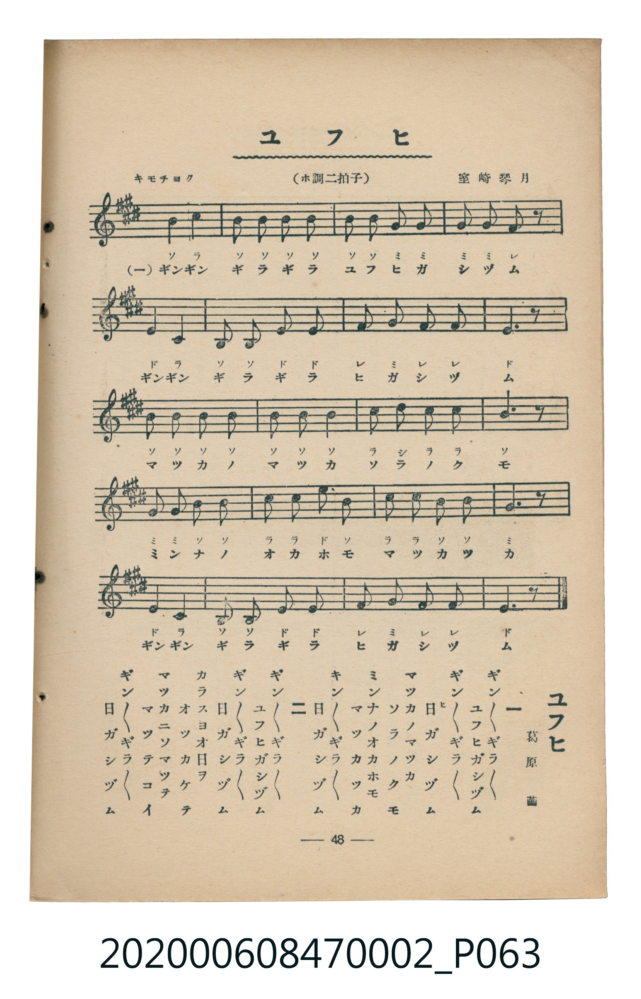

# ユフヒ（夕陽）

> Re:Shōka 使用 AI 協助辨識與重建樂譜，可能會有錯誤。歡迎回報。

- **鋼琴伴奏版**：<br><audio controls src="yuhi.mp3"></audio>
- **NEUTRINO 歌聲合成版**：<br><audio controls src="yuhi_neutrino.mp3"></audio>

- 詞：葛原𦱳
- 曲：室崎琴月
- 臺灣教育會公認《新定兒童唱歌》尋常科第二學年用（2020.006.0847.0002）

## 說明

曲目說明
中文解釋：描寫夕陽西下、天空染紅的傍晚景色。


## 歌詞

```text
一
ギン／＼ギラ／＼　ユフヒガシヅム
ギン／＼ギラ／＼　日ガシヅム
マツカノマツカ　ソラノクモ
ミンナノオカホモ　マツカツカ
ギン／＼ギラ／＼　日ガシヅム

二
ギン／＼ギラ／＼　ユフヒガシヅム
ギン／＼ギラ／＼　日ガシヅム
カラスヨオ日ヲ　オツカケテ
マツカニソマツテ　マツテコイ
ギン／＼ギラ／＼　日ガシヅム
```

## ABC

<div class="abc-score" data-abc-src="yuhi.abc" aria-label="五線譜載入中"></div>

[下載 ABC 原始檔](yuhi.abc)

## TMD 檔案連結

- [主旋律 TMD 檔案](yuhi.tmd) [[在 TMD Studio 編輯](https://tmdlang.github.io/Tmd-TS/#tmd=s7IKdvYPcrWy4qpTUCpJTLdSSM7PyUlNLsnMz7MqzsjMK0nNjM_KTMmPL87Iz05Ugisry88pzU21Si9KTEmNN4o3MjAyiDcwMIs3sDAxBzIMjBBKi_NLi5JTrYqTM_Lzc-JLUitKkvLzsxHyBUX5Zal5iXlANQVFIBtTwIoQClLLMlNSQdKpKZkl-UWZiTlI7kgtKga7FWxJfElRYl5xclFmAcgDCFUlGalAx-YllpQWpaKLlmTmpsbnp8WnJFYipIC2pGfmWZUkZgL9DfJ7eWJ8bmJmXk5iXgqyqpKMfGAQFGRUWmVkFoPclpyYE5-dmIcUUlCXFSSmp1oFGJgZK3FxaWkpPG5e9rh56uPmSe_3dDxdMvXlzL3v93QqaGlxKdoqWJpx2dsquHLZGOmb2IHMedG-63nj4mdTZ75o2vRsTvPT1jUvVvU-buh6Nm3D03WznrZOer566dMpG5-t7Xnc0P10Q_fTHTueL5_4fM2aJ7t6nq7d8XTnludTVgAtAsWSHjCW9ECxBGQYGAEtVeLS11J4NnvT89nrXqxa9WxGH5eCgsKTHWufTWt_sXzxy_bu93tmPevvf7p-NcSdL5buf7Kj-3FD49MlK5-v3PVs_uTnW1qfz2p52tT7bOasZzPXv-jc9LihiUtLH-z0lfOA-l9MnP20b_6HZRs3g8MFaBtQ8Om6JU-39D2fsOXZnA5goOhrcT3Z0cD1uGnd4-bN7_f0v9-zB8xeCWU3NMDD7HHTmsdN2x83tz5uXoBPw7PpS1GVNs973NzyuGn14-Y-BBtocNNeoDaQYNP6x82LgOrmA4183NwFFloF1jAbKAF2A9wIEEmK7VzA2KCt90CuWvm4aefj5hVAZ4Okm4FRAfTeKqibmzY-bm5DDoZusNfB3OY2hPeA7KbNj5uWkGI7ML65fIFZxCogMzEv36HGoKYalJIUbAzNtOzArBoFUwVdMDSD0hARZIwQMYbiGjjLCIgNQCJg03wMaxQgzoMahsIBy4EEm1dCpOBsoEzzMjBvKpicBJZfA9WzHSzWCiYXAMl4hH1G9LWvRsEQFlogQWhwgZhgAiQJwjXgYIEFDwgjNIIgdQIM4WhkJ4NkQI6GQeoEFql24UpEIDYswdWAk5w5EINoEEYkRiyh1DwPbG8L2A2rwew-qBtAMhA5iAzMP3sR_gGrBRYlUB2L8IQQxGxIKOwEs1dAzVsFtWcSEG9CsgckjuKypo1Qe9pwhA4s-yBCBxYGhnEYQghFIC24gmc-2BGg6AQWksjBA3Ee1FuzwSTI-9iDFMSGBQKOAMKiqxuqCxLgSPLgAEDTAxYDlmVQPUtwBNFoTiNoVy0Xl66dAqiAVwDSylwA)]
- [鋼琴伴奏 TMD 檔案](yuhi_piano.tmd) [[在 TMD Studio 編輯](https://tmdlang.github.io/Tmd-TS/#tmd=s7IKdvYPcrWy4qpTUCpJTLdSyC8qychPL0osyKi0ysgsLskvykxOzInPTsxLVIIrKs4vLUpOjS9ITE-1CjAwM1bi4tLSUnjcvOxx89THzZPe7-l4smfL06X9T3bPeL-nU0FLi0vRVsHSjMveVsGVy8ZI38QOZNSL9l3PGxc_mzrzRdOmZ3Oan7auebGq93FD17NpG56um_W0ddLz1UufTtn4bG3P44bupxu6n-7Y8Xz5xOdr1jzZ1fN07Y6nO7c8n7ICaJeRgZGBnoGBmZ6BhYk5kGFgBLQU7NgXK-e93zPrxcTZT_vmf1i2cTNY8NnsTUDBp-uWPN3S93zClmdzOoDO903MzLMKyEzMyw_ycKgxqKnmUgACG0MzLTswq0bBVEEXDM2gNEQEGSNEjKG4Bs4yAmIDkAjYNB_DGoXHTeseN2-GGobCAcuBBJtXQqTgbKBM8zIwbyqYnASWXwPVsx0s1gomFwDJeIR9RvS1r0bBEBZaIEFocIGYYAIkCcI14GCBBQ8IIzSCIHUCDOFoZCeDZECOhkHqBBapduFKRCA2LMHVgJOcORCDaBBGJEYsodQ8D2xvC9gNq8HsPqgbQDIQOYgMzD97Ef4Bq33ctB6qYxGeEIKYDQmFnWD2Cqh5q6D2TALiTUj2gMRRXNa0EWpPG47QgWUfROjAwsAwDkMIoQikBVfwzAc7AhSdj5u7kIMH4jyot2aDSZD3sQcpiA0LBBwBhEVXN1QXJMCR5MEBgKYHLPa4CeRSkJ4lOIJoNKcRtKsWuXz3QS7fLeDFu2G8QrRhrIIJkDKJRfChFCbfNB7IMo2PBTMMELEBkTcDyZoBZZEUYtcKZsD1gTCGYTjdAHUsupvxGwJVjZOPzxBKvQWMCF07BVBcRPsAheBsIzBbmQsA)]

## 分析

```text
================================================================================
📊 TMD Song Profile: [ ユフヒ（夕陽） ]
================================================================================
⏱  Duration:       0:25 (25.0s), 20 measures total
🎼 Key & Tempo:    首調基準 E, != 96.0 BPM, <2/4>
   - 分析範圍：      由實際發聲的音符與和弦推測調性；播放脈絡另行呈現
🎤 人聲音域:    B3 (MIDI 59) – E5 (MIDI 76) [跨度: 17 個半音 / 1.4 個八度, 難度: challenging]
   - 最低音:  B3 in [Main #1 @ m.6, 0:06]
   - 最高音: E5 in [Main #1 @ m.14, 0:16]
   - 適合: soprano, mezzo-soprano, contralto, tenor, baritone, bass
🏛  結構:      Main (25.0s)
⚡ 編曲密度:        Peak 1 軌道同時演奏
🗝  調性診斷：       B 調性不明確（純淨自然大調，未偵測到可信轉調）
   - 風格氣質:    純淨自然大調（陽光明朗、易唱易記，無明顯調外色彩）
   - 轉調歷程:    全曲維持單一推測調性（未偵測到可信轉調）
   - 核心骨幹音:  B, E, C#, G#, F#
   - 調性數值:    B 調性不明確 [相關度: 0.80, 穩定度: Ambiguous, 自然音純度: 100.0%]
   - 候選調性 (K-S): B 大調 (0.80), E 大調 (0.79), G# 小調 (0.64)
   - 五度圈歷程:   +5
   - 各段落調性細節:
     • [Main #1]: B 調性不明確 (r: 0.80, 自然音純度: 100.0%)

  [ 五度圈游移軌跡 ]
               C  
         F            G  
      Bb               D  
      Eb               A  
         Ab           E  
            Db      [B ]*
               F# 
     (* = active key center)

  [ 十二半音累積音高分佈 ]
     C  :                            0.0%
     C# : ███████████               17.3%
     D  :                            0.0%
     D# : █                          1.3%
     E  : █████████████             20.0%
     F  :                            0.0%
     F# : ██████                     9.3%
     G  :                            0.0%
     G# : █████████                 14.7%
     A  :                            0.0%
     A# :                            0.0%
     B  : ████████████████████████  37.3%
--------------------------------------------------------------------------------
Assignment 軌道音域：
  - Piano         : B3 – E5 (17 個半音 / 1.4 個八度, 60 個音符)
================================================================================
```


## 原書掃描頁




