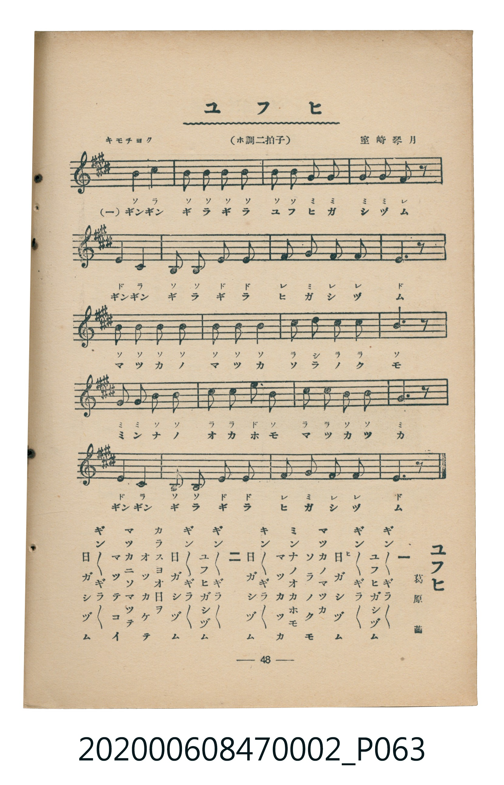

# ユフヒ

<audio controls src="yuhi.mp3"></audio>

- 詞：葛原齒
- 曲：室崎琴月
- 臺灣教育會公認《新定兒童唱歌》尋常科第二學年用（2020.006.0847.0002）

## 說明

・出處：臺灣教育會公認《新定兒童唱歌》尋常科第二學年用（2020.006.0847.0002）
・調性與拍號：調號 ?= E，拍號 <2/4>，速度 != 96

## 歌詞

```text
一
ギン／＼ギラ／＼　ユフヒガシヅム
ギン／＼ギラ／＼　日ガシヅム
マツカノマツカ　ソラノクモ
ミンナノオカホモ　マツカツカ
ギン／＼ギラ／＼　日ガシヅム

二
ギン／＼ギラ／＼　ユフヒガシヅム
ギン／＼ギラ／＼　日ガシヅム
カラスヨオ日ヲ　オツカケテ
マツカニソマツテ　マツテコイ
ギン／＼ギラ／＼　日ガシヅム
```

## ABC

```abc
X:1
T:ユフヒ
C:曲：室崎琴月
M:2/4
L:1/16
Q:1/4=96
K:E
V:V1 name="Piano" snm="Pia"
[V:V1]
B4 c4 | B2 B2 B2 B2 | B2 B2 G2 G2 | G2 G2 F2 z2 |
E4 C4 | B,2 B,2 E2 E2 | F2 G2 F2 F2 | E6 z2 |
B2 B2 B2 B2 | B3 B B4 | c2 d2 c2 c2 | B6 z2 |
G2 G2 B2 B2 | c2 c2 e2 B2 | c2 c2 B2 B2 | G6 z2 |
E4 C4 | B,2 B,2 E2 E2 | F2 G2 F2 F2 | E6 z2 |
```

## TMD 檔案連結

- [主旋律 TMD 檔案](yuhi.tmd)
- [鋼琴伴奏 TMD 檔案](yuhi_piano.tmd)

## 分析

```text
================================================================================
📊 TMD Song Profile: [ ユフヒ ]
================================================================================
⏱  Duration:       0:25 (25.0s), 20 measures total
🎼 Key & Tempo:    首調基準 E, != 96.0 BPM, <2/4>
   - 分析範圍：      由實際發聲的音符與和弦推測調性；播放脈絡另行呈現
🎤 人聲音域:    B3 (MIDI 59) – E5 (MIDI 76) [跨度: 17 個半音 / 1.4 個八度, 難度: challenging]
   - 最低音:  B3 in [Main #1 @ m.6, 0:06]
   - 最高音: E5 in [Main #1 @ m.14, 0:16]
   - 適合: soprano, mezzo-soprano, contralto, tenor, baritone, bass
🏛  結構:      Main (25.0s)
⚡ 編曲密度:        Peak 1 軌道同時演奏
🗝  調性診斷：       B 調性不明確（純淨自然大調，未偵測到可信轉調）
   - 風格氣質:    純淨自然大調（陽光明朗、易唱易記，無明顯調外色彩）
   - 轉調歷程:    全曲維持單一推測調性（未偵測到可信轉調）
   - 核心骨幹音:  B, E, C#, G#, F#
   - 調性數值:    B 調性不明確 [相關度: 0.80, 穩定度: Ambiguous, 自然音純度: 100.0%]
   - 候選調性 (K-S): B 大調 (0.80), E 大調 (0.79), G# 小調 (0.64)
   - 五度圈歷程:   +5
   - 各段落調性細節:
     • [Main #1]: B 調性不明確 (r: 0.80, 自然音純度: 100.0%)

  [ 五度圈游移軌跡 ]
               C  
         F            G  
      Bb               D  
      Eb               A  
         Ab           E  
            Db      [B ]*
               F# 
     (* = active key center)

  [ 十二半音累積音高分佈 ]
     C  :                            0.0%
     C# : ███████████               17.3%
     D  :                            0.0%
     D# : █                          1.3%
     E  : █████████████             20.0%
     F  :                            0.0%
     F# : ██████                     9.3%
     G  :                            0.0%
     G# : █████████                 14.7%
     A  :                            0.0%
     A# :                            0.0%
     B  : ████████████████████████  37.3%
--------------------------------------------------------------------------------
Assignment 軌道音域：
  - Piano         : B3 – E5 (17 個半音 / 1.4 個八度, 60 個音符)
================================================================================
```


## 原書掃描頁




