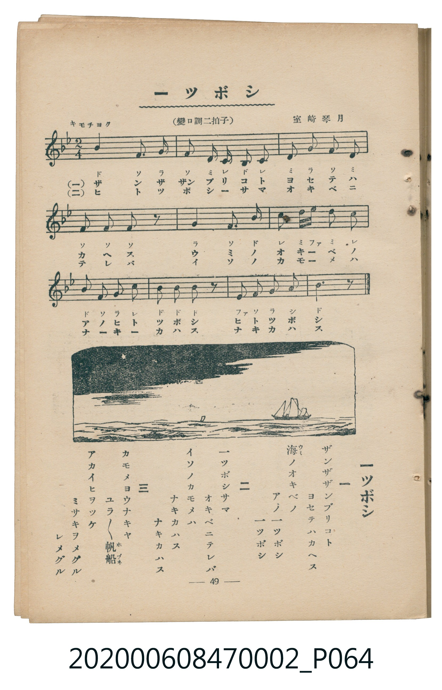

# 一ツボシ（一顆星）

> Re:Shōka 使用 AI 協助辨識與重建樂譜，可能會有錯誤。歡迎回報。

- **NEUTRINO 歌聲合成版**：<br><audio controls src="hitotsuboshi_neutrino.mp3"></audio>
- **鋼琴伴奏版**：<br><audio controls src="hitotsuboshi.mp3"></audio>


- 曲：室崎琴月
- 臺灣教育會公認《新定兒童唱歌》尋常科第二學年用（2020.006.0847.0002）

## 說明

曲目說明
中文解釋：描寫夜空中閃耀的一顆星，以及孩子仰望星空的心情。


## 歌詞

```text
一
ザンザザンブリコト　ヨセテハカヘス
海ノオキベノ　アノ一ツボシ　一ツボシ

二
一ツボシサマ　オキベニテレバ
イソノカモメハ　ナキカハス　ナキカハス

三
カモメヨウナキヤ　ユラ／＼帆船
アカイヒヨツケ　ミサキヲメグル　レメグル
```

## ABC

```abc
X:1
T:一ツボシ（一顆星）
C:曲：室崎琴月
M:2/4
L:1/16
Q:1/4=88
K:Bb
V:V1 name="Piano" snm="Pia"
[V:V1]
B4 F3 G | F2 D C B,2 C2 | D2 G2 F2 D2 | F2 F2 F2 z2 |
w: 1.~ザ ン ザ | ザン ブ リ コ ト | ヨ セ テ ハ | カ ヘ ス
w: 2.~ヒ ト ツ | ボ シ _ サ マ | オ キ ベ ニ | テ レ バ
w: 3.~カ モ メ | ヨ ウ _ ナ キヤ | ユ ラ ユ ラ | ホ ブ ネ
G4 F3 B | c2 d e d2 c2 | B F G2 c4 | B2 B2 B2 z2 |
w: 1.~ウ ミ ノ | オ キ _ ベ ノ | ア ノ ヒ ト | ツ ボ シ
w: 2.~イ ソ ノ | カ モ _ メ ハ | ナ _ キ _ | カ ハ ス
w: 3.~ア カ イ | ヒ ヲ _ ツ ケ | ミ サ キ ヲ | メ グ ル
E2 F2 G2 A2 | B6 z2 |
w: 1.~ヒ ト ツ ボ | シ
w: 2.~ナ キ カ ハ | ス
w: 3.~レ メ グ _ | ル
```

## TMD 檔案連結

- [主旋律 TMD 檔案](hitotsuboshi.tmd) [[在 TMD Studio 編輯](https://tmdlang.github.io/Tmd-TS/#tmd=s7IKdvYPcrWy4qpTUCpJTLdSSM7PyUlNLsnMz7MqzsjMK0nNjM_KTMmPL87Iz05Ugisry88pzU21Si9KTEmNN4o3MjAyiDcwMIs3sDAxBzIMjBBKi_NLi5JTrYqTM_Lzc-JLUitKkvLzsxHyBUX5Zal5iXlANQVFIBtTwIoQClLLMlNSQdKpKZkl-UWZiTlI7kgtKga7FWxJfElRYl5xclFmAcgDCFUlGalAx-YllpQWpSJEgUalZ-ZZlSRmAj0H8mB5YnxuYmZeTmJeihIXl5aWwpMdDY-bWx43z3nctP39ng4g9-XCtmcz5r_f06mgpcWlaKtgYcFlb6vgpMNlY6RvYgcy-kX7rueNi59NnfmiadOzOc1PW9e8WNX7uKHr2bQNT9fNeto66fnqpU-nbHy2tudxQ_fTDd1Pd-x4vnzi8zVrnuzqebp2x9OdW55PWQG0DBSkesAg1QMFKZBhYAS0VYlLX0vh2exNz2eve7Fq1bMZfVwKCkBXrn02rf3F8sUv27vf75n1rL__6frVT5fMeb5yF1Dq5bTmFw0Nz2e1ILm-58nupU_7u56uXfl07YQnuzc8mzMbKA5UD1T2dH_zs-bWxw1NXFr6IP8AbQMa-nTdkqdb-p5P2PJsTgcwbPS1uIDGcT1u2va4eTOIhDCapz1uXvW4CcjoeNwADLoVj5t2P25ue9zc_7hp9ePmGY-bdnI927r9cXPf4yagurWPm2eC2EClTYuADOTgBgoic7m4gMEDshOhoGnr4-Z5YL1wo7rBlq153DwB6LQlj5v2gm0C2gw0fSHIFSBHdYFUgwSBjtqJKQK0aUcnUDtcF9ATy6BqmpeA1QO5K9_v6X-_Z8_THW0vOnYCVS8CaQBa2TwJpAHoxqaNYKXzQc4E6dwEMqtpw-Pm1WBxoBuhXFAwc_kCk51VQGZiXr5DjUFNNShWFWwMzbTswKwaBcM4BV0wNAWTZkAhEMtYwUjBEEgbAXENkAeSgagBsWvAmn0MaxSA0QPVD4wlCA0UAYtDBIAxB8SrgAIQXgfYQKBXwEp3g8XawGQ_wmAjkIpJcINBekB0C1jnHLDO7WByK1h8HsTMplVgsbVgsZlgshthpjFIxWq4mYug9EIk1ywDi3RBTAFGCdSpEOGVYBLBhhgLCS0YNgDrAIUUIkSBAVyjYAQKZeM4BZM4EAkMVhCBHIoghwGTMdjqnUAyHuolkH0Qh86H0n04vNqHFnyQQF0DJicgmQjyFSSe9qKYCHEBKFhAgYIWIaDAa54NFp0GJnuRTIQEJchESPCC7IBFIDB5gskWsPhGpHADhospOKjAYQGC0MSIICDBaQINSpBac4QyGAQrQgrJRWAfwWyHJB1IPILdgJR8oO5HUomsBmQWSBUMglUjhS80mSCpQIQiKORQ4hFJNbIakA6QKix2gEN8PjiJw-IZFJIwv4BjqGkDWBxkHsweSHwjZGHqYQkfYUstF5eunUK1va6hUa0CkAUqKEC0MhcA)]
- [鋼琴伴奏 TMD 檔案](hitotsuboshi_piano.tmd) [[在 TMD Studio 編輯](https://tmdlang.github.io/Tmd-TS/#tmd=s7IKdvYPcrWy4uLS0lJ4sqPhcXPL4-Y5j5u2v9_T8WTPlqdL-5_snvF-T6eClhaXoq2ChQWXva2Ckw6XjZG-iR1XnYLSi_ZdzxsXP5s680XTpmdzmp-2rnmxqvdxQ9ezaRuerpv1tHXS89VLn07Z-Gxtz-OG7qcbup_u2PF8-cTna9Y82dXzdO2Opzu3PJ-yAmiZkYGRgZ6BgZmegYWJOZBhYAS0VQlkw7PZm97vmfV03ZKnW_qeT9jybE6HEheXb2JmnlVAZmJefpCHQ41BTTWXAhDYGJpp2YFZNQqGcQq6YGgKJs2AQiCWsYKRgiGQNgLiGiAPJANRA2LXgDX7GNYoPG7aBtX_uHkzhAaKgMUhAo-bpwHxKqAAhNcBNvBx8wqw0t1gsTYw2Y8w2AikYhLcYJAeEN0C1jkHrHM7mNwKFp8HMbNpFVhsLVhsJpjsRphpDFKxGm7mIii9EMk1y8AiXRBTHjcvgToVIrwSTCLYEGMhoQXDBmAdoJBChCgwgGsUjEChbBynYBIHIoHBCiKQQxHksMfNM8BW7wSS8VAvgeyDOHQ-lO7D4dU-tOCDBOoaMDkByUSQryDxtBfFRIgLQMECChS0CAEFXvNssOg0MNmLZCIkKEEmQoIXZAcsAh83bwKTLWDxjUjhBgwXU3BQgcMCBKGJEUFAgtMEGpQgteYIZTAIVoQUkovAPoLZDkk6kHgEuwEp-UDdj6QSWQ3ILJAqGASrRgpfaDJBUoEIRVDIocQjkmpkNSAdIFVY7ACH-HxwEofFMygkYX4Bx1DTBrA4yDyYPZD4RsjC1MMSPsKWWuTSwQdX6QBSG20YCySRmCjipvFgtmk8hgyyDlhmQVYMpaCxDJYwwbAJSdwUohfZPKLcASExrCFKAyiYdO0Uqu11DY1qFYAsUJhF-4AUwNhGSGxjMFuZCwA)]

## 分析

```text
================================================================================
📊 TMD Song Profile: [ 一ツボシ（一顆星） ]
================================================================================
⏱  Duration:       0:13 (13.6s), 10 measures total
🎼 Key & Tempo:    首調基準 B,, != 88.0 BPM, <2/4>
   - 分析範圍：      由實際發聲的音符與和弦推測調性；播放脈絡另行呈現
🎤 人聲音域:    A#3 (MIDI 58) – D#5 (MIDI 75) [跨度: 17 個半音 / 1.4 個八度, 難度: challenging]
   - 最低音:  A#3 in [Main #1 @ m.2, 0:02]
   - 最高音: D#5 in [Main #1 @ m.6, 0:07]
   - 適合: soprano, mezzo-soprano, contralto, tenor, baritone, bass
🏛  結構:      Main (13.6s)
⚡ 編曲密度:        Peak 1 軌道同時演奏
🗝  調性診斷：       A# 大調（純淨自然大調，未偵測到可信轉調）
   - 風格氣質:    純淨自然大調（陽光明朗、易唱易記，無明顯調外色彩）
   - 轉調歷程:    全曲維持單一推測調性（未偵測到可信轉調）
   - 核心骨幹音:  A#, F, C, G, D
   - 調性數值:    A# 大調 [相關度: 0.91, 穩定度: High, 自然音純度: 100.0%]
   - 候選調性 (K-S): A# 大調 (0.91), F 大調 (0.78), G 小調 (0.62)
   - 五度圈歷程:   -2
   - 各段落調性細節:
     • [Main #1]: A# 大調 (r: 0.91, 自然音純度: 100.0%)

  [ 五度圈游移軌跡 ]
               C  
         F            G  
     [Bb]*              D  
      Eb               A  
         Ab           E  
            Db       B  
               F# 
     (* = active key center)

  [ 十二半音累積音高分佈 ]
     C  : █████████████             14.9%
     C# :                            0.0%
     D  : ██████████                10.8%
     D# : ████                       4.1%
     E  :                            0.0%
     F  : ███████████████████████   25.7%
     F# :                            0.0%
     G  : █████████████             14.9%
     G# :                            0.0%
     A  : ██                         2.7%
     A# : ████████████████████████  27.0%
     B  :                            0.0%
--------------------------------------------------------------------------------
Assignment 軌道音域：
  - Piano         : A#3 – D#5 (17 個半音 / 1.4 個八度, 35 個音符)
================================================================================
```


## 原書掃描頁




