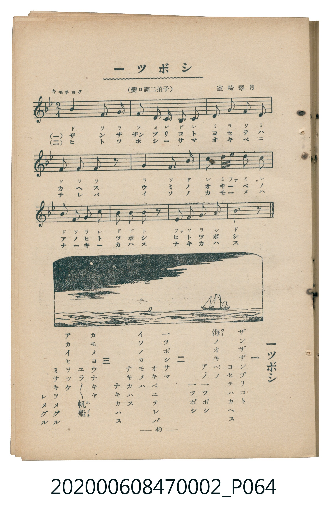

# 一ツボシ（一顆星）

> Re:Shōka 使用 AI 協助辨識與重建樂譜，可能會有錯誤。歡迎回報。

- **鋼琴伴奏版**：<br><audio controls src="hitotsuboshi.mp3"></audio>
- **NEUTRINO 歌聲合成版**：<br><audio controls src="hitotsuboshi_neutrino.mp3"></audio>

- 曲：室崎琴月
- 臺灣教育會公認《新定兒童唱歌》尋常科第二學年用（2020.006.0847.0002）

## 說明

曲目說明
中文解釋：描寫夜空中閃耀的一顆星，以及孩子仰望星空的心情。


## 歌詞

```text
一
ザンザザンブリコト　ヨセテハカヘス
海ノオキベノ　アノ一ツボシ　一ツボシ

二
一ツボシサマ　オキベニテレバ
イソノカモメハ　ナキカハス　ナキカハス

三
カモメヨウナキヤ　ユラ／＼帆船
アカイヒヨツケ　ミサキヲメグル　レメグル
```

## ABC

<div class="abc-score" data-abc-src="hitotsuboshi.abc" aria-label="五線譜載入中"></div>

[下載 ABC 原始檔](hitotsuboshi.abc)

## TMD 檔案連結

- [主旋律 TMD 檔案](hitotsuboshi.tmd) [[在 TMD Studio 編輯](https://tmdlang.github.io/Tmd-TS/#tmd=s7IKdvYPcrWy4qpTUCpJTLdSSM7PyUlNLsnMz7MqzsjMK0nNjM_KTMmPL87Iz05Ugisry88pzU21Si9KTEmNN4o3MjAyiDcwMIs3sDAxBzIMjBBKi_NLi5JTrYqTM_Lzc-JLUitKkvLzsxHyBUX5Zal5iXlANQVFIBtTwIoQClLLMlNSQdKpKZkl-UWZiTlI7kgtKga7FWxJfElRYl5xclFmAcgDCFUlGalAx-YllpQWpSJEgUalZ-ZZlSRmAj0H8mB5YnxuYmZeTmJeCrKqkox8oD8LMiqtMjKLQQ5ITsyJz07MQwoOqPUFiempVgEGZiZKXFxaWgpPdjQ8bm553DzncdP293s6gNyXC9uezZj_fk-ngpYWl6KtgoUFl72tgpMOl42RvokdyLgX7bueNy5-NnXmi6ZNz-Y0P21d82JV7-OGrmfTNjxdN-tp66Tnq5c-nbLx2dqexw3dTzd0P92x4_nyic_XrHmyq-fp2h1Pd255PmUF0DJQjOgBY0QPFCNAhoER0FYlLn0thWezNz2fve7FqlXPZvRxKSgAXbn22bT2F8sXv2zvfr9n1rP-_qfrVz9dMuf5yl1AqZfTml80NDyf1YLk-p4nu5c-7e96unbl07UTnuze8GzObKA4UD1Q2dP9zc-aWx83NHFp6YP8A7QNaOjTdUuebul7PmHLszkdwLDR1-ICGsf1uGnb4-bNIBLCaJ72uHnV4yYgo-NxAzDoVjxu2v24ue1xc__jptWPm2c8btrJ9Wzr9sfNfY-bgOrWPm6eCWIDlTYtAjKQgxsoiMzl4gIGD8hOhIKmrY-b54H1wo3qBlu25nHzBKDTljxu2gu2CWgz0PSFIFeAHNUFUg0SBDpqJ6YI0KYdnUDtcF1ATyyDqmleAlYP5K58v6f__Z49T3e0vejYCVS9CKQBaGXzJJAGoBubNoKVzgc5E6RzE8ispg2Pm1eDxYFuhHJBwczlC0y1VgGZiXn5DjUGNdWgWFWwMTTTsgOzahQM4xR0wdAUTJoBhUAsYwUjBUMgbQTENUAeSAaiBsSuAWv2MaxRAEYPVD8wliA0UAQsDhEAxhwQrwIKQHgdYAOBXgEr3Q0WawOT_QiDjUAqJsENBukB0S1gnXPAOreDya1g8XkQM5tWgcXWgsVmgsluhJnGIBWr4WYugtILkVyzDCzSBTEFGCVQp0KEV4JJBBtiLCS0YNgArAMUUogQBQZwjYIRKJSN4xRM4kAkMFhBBHIoghwGTMZgq3cCyXiol0D2QRw6H0r34fBqH1rwQQJ1DZicgGQiyFeQeNqLYiLEBaBgAQUKWoSAAq95Nlh0GpjsRTIREpQgEyHBC7IDFoHA5AkmW8DiG5HCDRgupuCgAocFCEITI4KABKcJNChBas0RymAQrAgpJBeBfQSzHZJ0IPEIdgNS8oG6H0klshqQWSBVMAhWjRS-0GSCpAIRiqCQQ4lHJNXIakA6QKqw2AEO8fngJA6LZ1BIwvwCjqGmDWBxkHkweyDxjZCFqYclfIQttVxcunYK1fa6hka1CkAWqKAA0cpcAA)]
- [鋼琴伴奏 TMD 檔案](hitotsuboshi_piano.tmd) [[在 TMD Studio 編輯](https://tmdlang.github.io/Tmd-TS/#tmd=s7IKdvYPcrWy4qpTUCpJTLdSyC8qychPL0osyKi0ysgsLskvykxOzInPTsxLVIIrKs4vLUpOjS9ITE-1CjAwM1Hi4tLSUniyo-Fxc8vj5jmPm7a_39PxZM-Wp0v7n-ye8X5Pp4KWFpeirYKFBZe9rYKTDpeNkb6JHci4F-27njcufjZ15oumTc_mND9tXfNiVe_jhq5n0zY8XTfraeuk56uXPp2y8dnanscN3U83dD_dseP58onP16x5sqvn6dodT3dueT5lBdAyIwMjAz0DAzM9AwsTcyDDwAhoK9jBz2Zver9n1tN1S55u6Xs-YcuzOR1A1_omZuZZBWQm5uUHeTjUGNRUcykAgY2hmZYdmFWjYBinoAuGpmDSDCgEYhkrGCkYAmkjIK4B8kAyEDUgdg1Ys49hjcLjpm1Q_Y-bN0NooAhYHCLwuHkaEK8CCkB4HWADHzevACvdDRZrA5P9CIONQComwQ0G6QHRLWCdc8A6t4PJrWDxeRAzm1aBxdaCxWaCyW6EmcYgFavhZi6C0guRXLMMLNIFMeVx8xKoUyHCK8Ekgg0xFhJaMGwA1gEKKUSIAgO4RsEIFMrGcQomcSASGKwgAjkUQQ573DwDbPVOIBkP9RLIPohD50PpPhxe7UMLPkigrgGTE5BMBPkKEk97UUyEuAAULKBAQYsQUOA1zwaLTgOTvUgmQoISZCIkeEF2wCLwcfMmMNkCFt-IFG7AcDEFBxU4LEAQmhgRBCQ4TaBBCVJrjlAGg2BFSCG5COwjmO2QpAOJR7AbkJIP1P1IKpHVgMwCqYJBsGqk8IUmEyQViFAEhRxKPCKpRlYD0gFShcUOcIjPBydxWDyDQhLmF3AMNW0Ai4PMg9kDiW-ELEw9LOEjbKlFLh18kEsHC0ThEK8QbRgLo-B803ggbRqPJAJTAcsTMAVgwgAUiUABEySToHxTkDqEPpzmgzCSMTgVgHyla6dQba9raFSrAGSBvBjtA5SEs42Q2MZgtjIXAA)]

## 分析

```text
================================================================================
📊 TMD Song Profile: [ 一ツボシ（一顆星） ]
================================================================================
⏱  Duration:       0:13 (13.6s), 10 measures total
🎼 Key & Tempo:    首調基準 B,, != 88.0 BPM, <2/4>
   - 分析範圍：      由實際發聲的音符與和弦推測調性；播放脈絡另行呈現
🎤 人聲音域:    A#3 (MIDI 58) – D#5 (MIDI 75) [跨度: 17 個半音 / 1.4 個八度, 難度: challenging]
   - 最低音:  A#3 in [Main #1 @ m.2, 0:02]
   - 最高音: D#5 in [Main #1 @ m.6, 0:07]
   - 適合: soprano, mezzo-soprano, contralto, tenor, baritone, bass
🏛  結構:      Main (13.6s)
⚡ 編曲密度:        Peak 1 軌道同時演奏
🗝  調性診斷：       A# 大調（純淨自然大調，未偵測到可信轉調）
   - 風格氣質:    純淨自然大調（陽光明朗、易唱易記，無明顯調外色彩）
   - 轉調歷程:    全曲維持單一推測調性（未偵測到可信轉調）
   - 核心骨幹音:  A#, F, C, G, D
   - 調性數值:    A# 大調 [相關度: 0.91, 穩定度: High, 自然音純度: 100.0%]
   - 候選調性 (K-S): A# 大調 (0.91), F 大調 (0.78), G 小調 (0.62)
   - 五度圈歷程:   -2
   - 各段落調性細節:
     • [Main #1]: A# 大調 (r: 0.91, 自然音純度: 100.0%)

  [ 五度圈游移軌跡 ]
               C  
         F            G  
     [Bb]*              D  
      Eb               A  
         Ab           E  
            Db       B  
               F# 
     (* = active key center)

  [ 十二半音累積音高分佈 ]
     C  : █████████████             14.9%
     C# :                            0.0%
     D  : ██████████                10.8%
     D# : ████                       4.1%
     E  :                            0.0%
     F  : ███████████████████████   25.7%
     F# :                            0.0%
     G  : █████████████             14.9%
     G# :                            0.0%
     A  : ██                         2.7%
     A# : ████████████████████████  27.0%
     B  :                            0.0%
--------------------------------------------------------------------------------
Assignment 軌道音域：
  - Piano         : A#3 – D#5 (17 個半音 / 1.4 個八度, 35 個音符)
================================================================================
```


## 原書掃描頁




