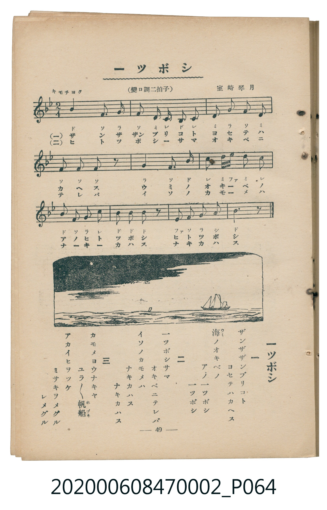

# 一ツボシ

<audio controls src="hitotsuboshi.mp3"></audio>

- 曲：室崎琴月
- 臺灣教育會公認《新定兒童唱歌》尋常科第二學年用（2020.006.0847.0002）

## 說明

・出處：臺灣教育會公認《新定兒童唱歌》尋常科第二學年用（2020.006.0847.0002）
・調性與拍號：調號 ?= B,，拍號 <2/4>，速度 != 88

## 歌詞

```text
一
ザンザザンブリコト　ヨセテハカヘス
海ノオキベノ　アノ一ツボシ　一ツボシ

二
一ツボシサマ　オキベニテレバ
イソノカモメハ　ナキカハス　ナキカハス

三
カモメヨウナキヤ　ユラ／＼帆船
アカイヒヨツケ　ミサキヲメグル　レメグル
```

## 原書掃描頁



## 分析

```text
================================================================================
📊 TMD Song Profile: [ 一ツボシ ]
================================================================================
⏱  Duration:       0:13 (13.6s), 10 measures total
🎼 Key & Tempo:    首調基準 B,, != 88.0 BPM, <2/4>
   - 分析範圍：      由實際發聲的音符與和弦推測調性；播放脈絡另行呈現
🎤 人聲音域:    A#4 (MIDI 70) – D#6 (MIDI 87) [跨度: 17 個半音 / 1.4 個八度, 難度: challenging]
   - 最低音:  A#4 in [Main #1 @ m.2, 0:02]
   - 最高音: D#6 in [Main #1 @ m.6, 0:07]
🏛  結構:      Main (13.6s)
⚡ 編曲密度:        Peak 1 軌道同時演奏
🗝  調性診斷：       A# 大調（純淨自然大調，未偵測到可信轉調）
   - 風格氣質:    純淨自然大調（陽光明朗、易唱易記，無明顯調外色彩）
   - 轉調歷程:    全曲維持單一推測調性（未偵測到可信轉調）
   - 核心骨幹音:  A#, F, G, C, D
   - 調性數值:    A# 大調 [相關度: 0.93, 穩定度: High, 自然音純度: 100.0%]
   - 候選調性 (K-S): A# 大調 (0.93), F 大調 (0.73), G 小調 (0.70)
   - 五度圈歷程:   -2
   - 各段落調性細節:
     • [Main #1]: A# 大調 (r: 0.93, 自然音純度: 100.0%)

  [ 五度圈游移軌跡 ]
               C  
         F            G  
     [Bb]*              D  
      Eb               A  
         Ab           E  
            Db       B  
               F# 
     (* = active key center)

  [ 十二半音累積音高分佈 ]
     C  : ████████████              13.5%
     C# :                            0.0%
     D  : ███████████               12.2%
     D# : █████                      5.4%
     E  :                            0.0%
     F  : ████████████████████      23.0%
     F# :                            0.0%
     G  : ██████████████            16.2%
     G# :                            0.0%
     A  : ██                         2.7%
     A# : ████████████████████████  27.0%
     B  :                            0.0%
--------------------------------------------------------------------------------
Assignment 軌道音域：
  - Piano         : A#4 – D#6 (17 個半音 / 1.4 個八度, 35 個音符)
================================================================================
```

## ABC

```abc
X:1
T:一ツボシ
C:曲：室崎琴月
M:2/4
L:1/16
Q:1/4=88
K:Bb

V:V1 name="Piano" snm="Pia"

[V:V1]
b4 f2 g2 | f2 d2 c b c2 | d2 g2 f2 d2 | f2 f2 f2 z2 |
g4 f2 b2 | c' d' e'2 d'2 c'2 | b f g2 c'4 | b2 b2 b2 z2 |
e2 f2 g2 a2 | b6 z2 |
```

- [主旋律 TMD 檔案](hitotsuboshi.tmd)
- [鋼琴伴奏 TMD 檔案](hitotsuboshi_piano.tmd)
