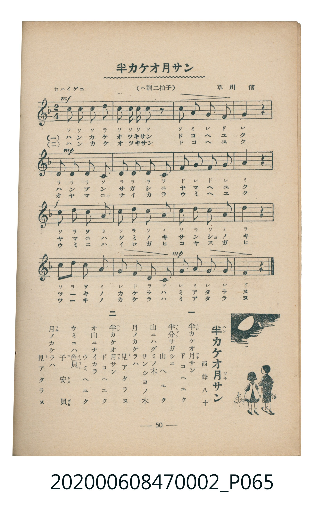

# 半カケオ月サン

> Re:Shōka 使用 AI 協助辨識與重建樂譜，可能會有錯誤。歡迎回報。

- **鋼琴伴奏版**：<br><audio controls src="hankake_otsukisan.mp3"></audio>
- **NEUTRINO 歌聲合成版**：<br><audio controls src="hankake_otsukisan_neutrino.mp3"></audio>

- 詞：西條八十
- 曲：草川信
- 臺灣教育會公認《新定兒童唱歌》尋常科第二學年用（2020.006.0847.0002）

## 說明


- 出處：臺灣教育會公認《新定兒童唱歌》尋常科第二學年用（2020.006.0847.0002）
- 調性與拍號：調號 ?= F，拍號 <2/4>，速度 != 96


## 歌詞

```text
一
半カケオ月サン　ドコヘユク
半分サガシニ　山ヘユク
山ニハグミノ木　サンシヨノ木
月ノカケラハ　見アタラヌ

二
半カケオ月サン　ドコヘユク
オ山ニナイカラ　ウミヘユク
ウミニハ色貝　子安貝
月ノカケラハ　見アタラヌ
```

## ABC

<div class="abc-score" data-abc-src="hankake_otsukisan.abc" aria-label="五線譜載入中"></div>

[下載 ABC 原始檔](hankake_otsukisan.abc)

## TMD 檔案連結

- [主旋律 TMD 檔案](hankake_otsukisan.tmd) [[在 TMD Studio 編輯](https://tmdlang.github.io/Tmd-TS/#tmd=s7IKdvYPcrWy4qpTUCpJTLdSSM7PyUlNLsnMz7MqzsjMK0nNjM_KTMmPL87Iz05Ugisry88pzU21Si9KTEmNN4o3MjAyiDcwMIs3sDAxBzIMjBBKi_NLi5JTrYqTM_Lzc-JLUitKkvLzsxHyBUX5Zal5iXlANQVFIBtTwIoQClLLMlNSQdKpKZkl-UWZiTlI7kgtKga7FWxJfElRYl5xclFmAcgDCFUlGalAx-YllpQWpSJEgUalZ-ZZlSRmAj0H8mB5YnxuYmZeTmJeCrKqkox8oD8LMiqtMjKLQQ5ITsyJz07MQwoOqPUFiempVgEGZqZKXFxaWgpPe7seN61-3LTxcdOqZ3M6Hjdtfdy8WUFLi0vRVsHSjMveVsGNy8ZI38QOZM6L9l3PGxc_mzrzRdOmZ3Oan7auebGq93FD17NpG56um_W0ddLz1UufTtn4bG3P44bupxu6n-7Y8Xz5xOdr1jzZ1fN07Y6nO7c8n7Li_Z4OUFToAaNCDxQVQIaB0fs9nWCXvlg57_2eWS-W7n-2aO7T1tVPexvBws9mbwIJ93Y-3T73yf6FQKfra3E92dHAhdX5jxsaHjd3Pm7a_Lh5xuPmZY-b1oPUPe1oA0k3rXnctP1xczdQ0dONG5FUgDjdj5v7HzdteNw8_3Fz37M5K0AmQYwE6VkBEeQCWdTcB7W3eSVIT0PDi2Xdj5sWPW7aDxbp4eIC-plo5wGlYfYDNSwB6QGaArJ8GdgtCHUQPsidLzo3vdg0F-SNtROerusEsolzmJY-F5cvMAlZBWQm5uU71BjUVHMpAIGNoZmWHZhVo1Cdm1arYKqgC8dmQFwD5YGgroIBXMQYiI2A2BAsAmKBIEgeBGvARvoY1igAnQPkg5IXkGxaDSY3gvUAvQ-WaQGy1gIxOA3qKsRDJJs7wUrB2ppngMllUG3roZaAVCJZZkRHy0CBVVCrYAYSRRCmEOOwi4ICChZgILoGHIREBFrzNDgb5KCtYKeuAZPbwTLdUE8sAfPmkRZi0HBB1gszrwtsB1gGEpbNK6HmgcwFJklSgguatEBJCpZ8IAmJkAiIhyuU0F0NCTeQOzYgubAP7IO1yOEHTSGg7A1XApIEKcIVUMieRrUM4gyQXmjENE-CykAiEBKEO-HyIKeDVGALKMwAgCUa5MQETn0gCVg2hKQokDJcYdUCFYN4EuFlRC6BxC_cWxCvNi0Ck_vh8iCZHtzBRGN7arm4dO0UQCWZApBW5gIA)]
- [鋼琴伴奏 TMD 檔案](hankake_otsukisan_piano.tmd) [[在 TMD Studio 編輯](https://tmdlang.github.io/Tmd-TS/#tmd=s7IKdvYPcrWy4qpTUCpJTLdSyC8qychPL0osyKi0ysgsLskvykxOzInPTsxLVIIrKs4vLUpOjS9ITE-1CjAwM1Xi4tLSUnja2_W4afXjpo2Pm1Y9m9PxuGnr4-bN7_d0PNmz5enS_ie7Z7zf06mgpcWlaKtgacZlb6vgxmVjpG9iBzL2Rfuu542Ln02d-aJp07M5zU9b17xY1fu4oevZtA1P18162jrp-eqlT6dsfLa253FD99MN3U937Hi-fOLzNWue7Op5unbH051bnk9ZAbTLyMDIQM_AwEzPwMLEHMgwMAJaCnb4i5Xz3u-Z9WLp_meL5j5tXf20txEs_Gz2JpBwb-fT7XOf7F8I9IlvYmaeVUBmYl5-kIdDjUFNNZcCENgYmmnZgVk1CtW5abUKpgq6cGwGxDVQHgjqKhjARYyB2AiIDcEiIBYIguRBsAZspI9hjcLj5n4gHxhiILJpNZjcCNYDDE6wTAuQtRaIQcEKFIiHSDZ3gpWCtTXPAJPLoNrWQy0BqUSyzIiOloECq6BWwQwkiiBMIcZhFwUFFCzAQHQNOAiJCLTmaXA2yEFbwU5dAya3g2W6oZ5YAubNIy3EoOGCrBdmXhfYDrAMJCybV0LNA5n7uHk-KcEFTVqgJAVLPpCEREgExMMVSuiuhoQbyB0bkFzYB_bBWuTwg6aQ7Y-bV8CVgCRBinAFFLKnUS2DOAOkFxoxzZOgMpAIhAThTrg8yOkgFdgCCjMAYIkGOTGBUx9IApYNISkKpAxXWLVAxSCeRHgZkUsg8Qv3FsSrTYvA5H64PEimB3cw0dieWuSCzAe5ILOAl2OG8QrRhrEwCs4HYQMs0qbxQJZpPEgSEQ0mIEEToCBcGaYIlAHXDxdBNgiHY3DyTUC24DcC0yVwJ-ByCzDYdO0UQCEX7QMUhLONwGxlLgA)]

## 分析

```text
================================================================================
📊 TMD Song Profile: [ 半カケオ月サン ]
================================================================================
⏱  Duration:       0:20 (20.0s), 16 measures total
🎼 Key & Tempo:    首調基準 F, != 96.0 BPM, <2/4>
   - 分析範圍：      由實際發聲的音符與和弦推測調性；播放脈絡另行呈現
🎤 人聲音域:    C4 (MIDI 60) – D5 (MIDI 74) [跨度: 14 個半音 / 1.2 個八度, 難度: moderate]
   - 最低音:  C4 in [Main #1 @ m.5, 0:05]
   - 最高音: D5 in [Main #1 @ m.1, 0:00]
   - 適合: soprano, mezzo-soprano, contralto, tenor, baritone, bass
🏛  結構:      Main (20.0s)
⚡ 編曲密度:        Peak 1 軌道同時演奏
🗝  調性診斷：       C 大調（純淨自然大調，未偵測到可信轉調）
   - 風格氣質:    純淨自然大調（陽光明朗、易唱易記，無明顯調外色彩）
   - 轉調歷程:    全曲維持單一推測調性（未偵測到可信轉調）
   - 核心骨幹音:  C, D, G, A, F
   - 調性數值:    C 大調 [相關度: 0.78, 穩定度: High, 自然音純度: 100.0%]
   - 候選調性 (K-S): C 大調 (0.78), F 大調 (0.62), G 大調 (0.58)
   - 五度圈歷程:   +0
   - 各段落調性細節:
     • [Main #1]: C 大調 (r: 0.78, 自然音純度: 100.0%)

  [ 五度圈游移軌跡 ]
              [C ]*
         F            G  
      Bb               D  
      Eb               A  
         Ab           E  
            Db       B  
               F# 
     (* = active key center)

  [ 十二半音累積音高分佈 ]
     C  : ████████████████████████  32.7%
     C# :                            0.0%
     D  : ███████████████████       25.5%
     D# :                            0.0%
     E  :                            0.0%
     F  : ████████                  10.9%
     F# :                            0.0%
     G  : ████████████              16.4%
     G# :                            0.0%
     A  : ███████████               14.5%
     A# :                            0.0%
     B  :                            0.0%
--------------------------------------------------------------------------------
Assignment 軌道音域：
  - Piano         : C4 – D5 (14 個半音 / 1.2 個八度, 52 個音符)
================================================================================
```


## 原書掃描頁




