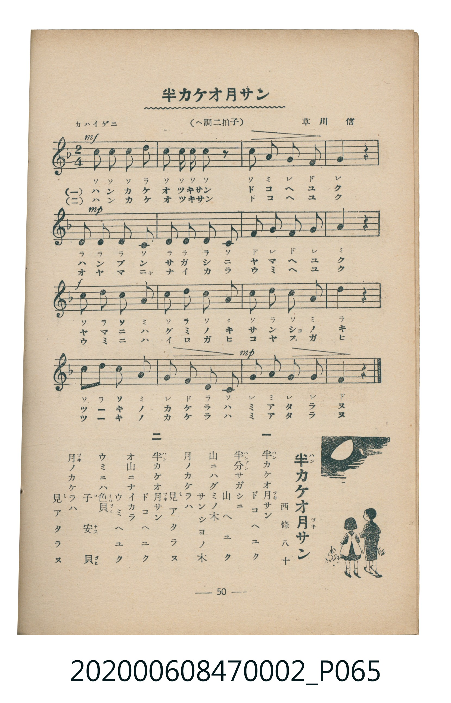

# 半カケオ月サン

> Re:Shōka 使用 AI 協助辨識與重建樂譜，可能會有錯誤。歡迎回報。

- **鋼琴伴奏版**：<br><audio controls src="hankake_otsukisan.mp3"></audio>
- **NEUTRINO 歌聲合成版**：<br><audio controls src="hankake_otsukisan_neutrino.mp3"></audio>

- 詞：西條八十
- 曲：草川信
- 臺灣教育會公認《新定兒童唱歌》尋常科第二學年用（2020.006.0847.0002）

## 說明


- 出處：臺灣教育會公認《新定兒童唱歌》尋常科第二學年用（2020.006.0847.0002）
- 調性與拍號：調號 ?= F，拍號 <2/4>，速度 != 96


## 歌詞

```text
一
半カケオ月サン　ドコヘユク
半分サガシニ　山ヘユク
山ニハグミノ木　サンシヨノ木
月ノカケラハ　見アタラヌ

二
半カケオ月サン　ドコヘユク
オ山ニナイカラ　ウミヘユク
ウミニハ色貝　子安貝
月ノカケラハ　見アタラヌ
```

## ABC

<div class="abc-score" data-abc-src="hankake_otsukisan.abc" aria-label="五線譜載入中"></div>

[下載 ABC 原始檔](hankake_otsukisan.abc)

## TMD 檔案連結

- [主旋律 TMD 檔案](hankake_otsukisan.tmd) [[在 TMD Studio 編輯](https://tmdlang.github.io/Tmd-TS/#tmd=s7IKdvYPcrWy4qpTUCpJTLdSSM7PyUlNLsnMz7MqzsjMK0nNjM_KTMmPL87Iz05Ugisry88pzU21Si9KTEmNN4o3MjAyiDcwMIs3sDAxBzIMjBBKi_NLi5JTrYqTM_Lzc-JLUitKkvLzsxHyBUX5Zal5iXlANQVFIBtTwIoQClLLMlNSQdKpKZkl-UWZiTlI7kgtKga7FWxJfElRYl5xclFmAcgDCFUlGalAx-YllpQWpSJEgUalZ-ZZlSRmAj0H8mB5YnxuYmZeTmJeihIXl5aWwtPersdNqx83bXzctOrZnI7HTVsfN29W0NLiUrRVsDTjsrdVcOOyMdI3sQOZ-aJ91_PGxc-mznzRtOnZnOanrWterOp93ND1bNqGp-tmPW2d9Hz10qdTNj5b2_O4ofvphu6nO3Y8Xz7x-Zo1T3b1PF274-nOLc-nrHi_pwMUlnrAsNQDhSWQYWD0fk8n2NUvVs57v2fWi6X7ny2a-7R19dPeRrDws9mbQMK9nU-3z32yfyHQ6fpaXE92NHBhdf7jhobHzZ2PmzY_bp7xuHnZ46b1IHVPO9pA0k1rHjdtf9zcDVT0dONGJBUgTvfj5v7HTRseN89_3Nz3bM4KkEkQI0F6VkAEuUAWNfdB7W1eCdLT0PBiWffjpkWPm_aDRXq4uIB-Jtp5QGmY_UANS0B6gKaALF8GdgtCHYQPcueLzk0vNs0FeWPthKfrOoFs4hympc_F5QtMA1YBmYl5-Q41BjXVXApAYGNopmUHZtUoVOem1SqYKujCsRkQ10B5IKirYAAXMQZiIyA2BIuAWCAIkgfBGrCRPoY1CkDnAPmg5AUkm1aDyY1gPUDvg2VagKy1QAxOg7oK8RDJ5k6wUrC25hlgchlU23qoJSCVSJYZ0dEyUGAV1CqYgUQRhCnEOOyioICCBRiIrgEHIRGB1jwNzgY5aCvYqWvA5HawTDfUE0vAvHmkhRg0XJD1wszrAtsBloGEZfNKqHkgc4FJkpTggiYtUJKCJR9IQiIkAuLhCiV0V0PCDeSODUgu7AP7YC1y-EFTCCh7w5WAJEGKcAUUsqdRLYM4A6QXGjHNk6AykAiEBOFOuDzI6SAV2AIKMwBgiQY5MYFTH0gClg0hKQqkDFdYtUDFIJ5EeBmRSyDxC_cWxKtNi8Dkfrg8SKYHdzDR2J5aLi5dOwVQSaYApJW5AA)]
- [鋼琴伴奏 TMD 檔案](hankake_otsukisan_piano.tmd) [[在 TMD Studio 編輯](https://tmdlang.github.io/Tmd-TS/#tmd=s7IKdvYPcrWy4uLS0lJ42tv1uGn146aNj5tWPZvT8bhp6-Pmze_3dDzZs-Xp0v4nu2e839OpoKXFpWirYGnGZW-r4MZlY6RvYsdVp6D0on3X88bFz6bOfNG06dmc5qeta16s6n3c0PVs2oan62Y9bZ30fPXSp1M2Plvb87ih--mG7qc7djxfPvH5mjVPdvU8Xbvj6c4tz6esANplZGBkoGdgYKZnYGFiDmQYGAEtVQLbsHLe-z2zXizd_2zR3Ketq5_2NoKFn83eBBLu7Xy6fe6T_QuVuLh8EzPzrAIyE_PygzwcagxqqrkUgMDG0EzLDsyqUajOTatVMFXQhWMzIK6B8kBQV8EALmIMxEZAbAgWAbFAECQPgjVgI30MaxQeN_cD-cAQA5FNq8HkRrAeYHCCZVqArLVADApWoEA8RLK5E6wUrK15BphcBtW2HmoJSCWSZUZ0tAwUWAW1CmYgUQRhCjEOuygooGABBqJrwEFIRKA1T4OzQQ7aCnbqGjC5HSzTDfXEEjBvHmkhBg0XZL0w87rAdoBlIGHZvBJqHsjcx83zSQkuaNICJSlY8oEkJEIiIB6uUEJ3NSTcQO7YgOTCPrAP1iKHHzSFbH_cvAKuBCQJUoQroJA9jWoZxBkgvdCIaZ4ElYFEICQId8LlQU4HqcAWUJgBAEs0yIkJnPpAErBsCElRIGW4wqoFKgbxJMLLiFwCiV-4tyBebVoEJvfD5UEyPbiDicb21CIXZD44CjJDkPpow1hQwCGYKOIQElKc4VJuGg_mmcbDlCLHkwlE0gQsiaINtwwSB8VsFBl0i4jwDFHiJhBXkWIFbp-gOJ8YvwDjTddOARR10T4gKRjbCMxW5gIA)]

## 分析

```text
================================================================================
📊 TMD Song Profile: [ 半カケオ月サン ]
================================================================================
⏱  Duration:       0:20 (20.0s), 16 measures total
🎼 Key & Tempo:    首調基準 F, != 96.0 BPM, <2/4>
   - 分析範圍：      由實際發聲的音符與和弦推測調性；播放脈絡另行呈現
🎤 人聲音域:    C4 (MIDI 60) – D5 (MIDI 74) [跨度: 14 個半音 / 1.2 個八度, 難度: moderate]
   - 最低音:  C4 in [Main #1 @ m.5, 0:05]
   - 最高音: D5 in [Main #1 @ m.1, 0:00]
   - 適合: soprano, mezzo-soprano, contralto, tenor, baritone, bass
🏛  結構:      Main (20.0s)
⚡ 編曲密度:        Peak 1 軌道同時演奏
🗝  調性診斷：       C 大調（純淨自然大調，未偵測到可信轉調）
   - 風格氣質:    純淨自然大調（陽光明朗、易唱易記，無明顯調外色彩）
   - 轉調歷程:    全曲維持單一推測調性（未偵測到可信轉調）
   - 核心骨幹音:  C, D, G, A, F
   - 調性數值:    C 大調 [相關度: 0.78, 穩定度: High, 自然音純度: 100.0%]
   - 候選調性 (K-S): C 大調 (0.78), F 大調 (0.62), G 大調 (0.58)
   - 五度圈歷程:   +0
   - 各段落調性細節:
     • [Main #1]: C 大調 (r: 0.78, 自然音純度: 100.0%)

  [ 五度圈游移軌跡 ]
              [C ]*
         F            G  
      Bb               D  
      Eb               A  
         Ab           E  
            Db       B  
               F# 
     (* = active key center)

  [ 十二半音累積音高分佈 ]
     C  : ████████████████████████  32.7%
     C# :                            0.0%
     D  : ███████████████████       25.5%
     D# :                            0.0%
     E  :                            0.0%
     F  : ████████                  10.9%
     F# :                            0.0%
     G  : ████████████              16.4%
     G# :                            0.0%
     A  : ███████████               14.5%
     A# :                            0.0%
     B  :                            0.0%
--------------------------------------------------------------------------------
Assignment 軌道音域：
  - Piano         : C4 – D5 (14 個半音 / 1.2 個八度, 52 個音符)
================================================================================
```


## 原書掃描頁




